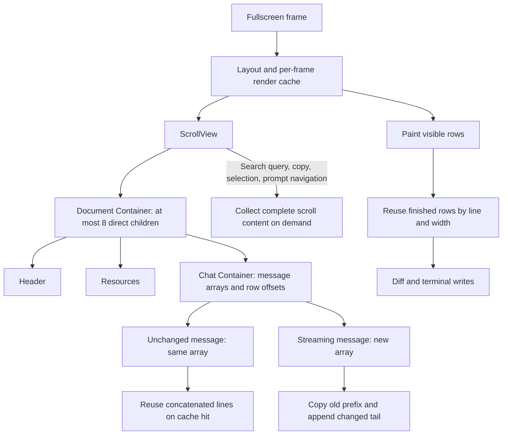
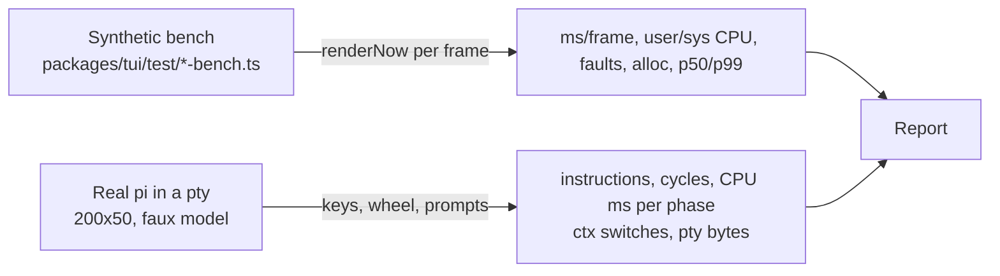

# TUI performance fork

This fork reduces CPU work when pi renders long fullscreen transcripts. It keeps
unchanged render arrays and finished screen rows, avoids redundant child renders,
and reduces allocation during layout, text slicing, and mouse dispatch.

The main change is a render contract. Components return the same array while
output stays unchanged. Callers treat returned arrays as read-only. A changed
component returns a new array. Extension authors must follow this contract to
retain correctness and obtain the cache benefit.

The upstream packet measured 61-70% fewer retired instructions for real wheel
scroll, paging, typing, and erase. Waiting spinners used about 53% less CPU.
These are historical measurements on one Linux desktop. First-pass latency and
components that allocate new arrays every frame expose costs. Idle CPU and resize
did not improve.

This document contains the idea, implementation, decision history, measurements,
reproduction protocol, upstream proposal, and extractable packet evidence.
It replaces local-only packet references with content carried in this checkout.

## Scope and revisions

Documentation snapshot is 2026-10-26, before its own documentation commit.

| Role | Revision |
| --- | --- |
| Current fork code | `a5c8c14e43bae34923b968d17cd54b23993e2d8b` |
| Parent of current 20-commit TUI series | `e86f89e0d` |
| Current `origin/main` | `ea448f454af474f3e2fe9733b331e17b0662f5d6` |
| Measured upstream baseline | `1402973a9dbe8c627341e04c9744c54953e285ca` |
| Measured 20-commit fork | `976db51f44da2a51a67e00a833863588d6b55bf0` |
| Packet's later rebased base and tip | `d5b3de22d`, `dcd835d18` |

The current 20-commit series changes 31 files in `packages/tui` and
`packages/coding-agent`. `origin/main..fork` also includes upstream development
that the fork imported. Its 290 commits are not 290 original fork patches.
The packet's commit names changed through rebases. The commit table below maps
packet names to current names.

Performance tables retain measured revisions. The current tree also includes
later upstream changes, including Markdown, images, streamed tool arguments, and
dependencies. Historical numbers do not establish performance of current HEAD.
`git range-diff` matches all 20 changes, with context and trailer differences.

Inspect the current change without relying on moving remote refs:

```sh
git log --reverse --format='%h %s%n%b' e86f89e0d..a5c8c14e4
git diff --stat e86f89e0d a5c8c14e4
git diff e86f89e0d a5c8c14e4 -- packages/tui packages/coding-agent
```

## Problem and concrete trace

A fullscreen transcript contains thousands of messages, but most remain unchanged
between frames. A cursor update or spinner tick still reaches the transcript's
containers. Before caching, each container allocates a fresh flat line array and
copies every child's lines. Nested containers repeat that copy.

The synthetic transcript contains 2,500 Markdown components and 47,503 rendered
lines. Its screen shows 50 rows. Upstream `Container.render` accounts for about
76% of sampled steady and scroll self time, despite unchanged text.

Consider a document with header, resources, and chat. Chat contains all messages.
On a steady frame, child components render, return their existing arrays, and
chat returns its prior concatenation. On a streaming frame, the final message
returns new lines. Chat creates a new concatenation while retaining the old one
for readers. Layout places the document's three sections separately, so the
document avoids a second full-history copy.



The fork still calls each direct child's `render()` during cache checks. It
removes repeated line copying, not all child calls. The #7730 probe still records
100, 1,000, and 10,000 render calls for those child counts on both revisions.
This is not viewport virtualization.

## Render contract and extension migration

[`Component.render`](packages/tui/src/tui.ts) still returns `string[]` in the
TypeScript API. Read-only ownership is a behavioral contract, not a changed
return type. Parents compare array identity and saved length.

Follow these rules:

- Return the same array for identical output when practical.
- Return a new array when text changes, even if line count stays constant.
- Copy a child's or `super.render()` result before adding markers or decorations.
- Preserve every old returned array for readers that retained it.
- Invalidate caches when width, children, visibility, allocated size, or styling
  changes. Cache checks still render children, so a child update can propagate
  without manually invalidating its parent.

Copy before decoration:

```ts
override render(width: number): string[] {
	const lines = super.render(width).slice();
	if (lines.length > 0) lines[0] = prefix + lines[0];
	return lines;
}
```

That example preserves ownership but returns a new array each time. Cache the
decorated array by source identity and length when decoration remains unchanged.
[`Osc133Zone`](packages/coding-agent/src/modes/interactive/components/osc133-zone.ts)
does this for message navigation markers.

Length checks detect appended or removed lines on reused arrays. They cannot
detect replacement of an existing element when identity and length both stay
unchanged. In-place edits remain unsupported.

## Implementation and constraints

| Owner | Change | Reason and limit |
| --- | --- | --- |
| [`Container`](packages/tui/src/tui.ts) | One entry per child stores component, top row, height, and returned lines. | One list supplies cache checks and binary-search mouse routing. Cache hits allocate no new Container output. Child renders still run. |
| `Container.render` | Keep unchanged prefix entries, render changed child once, preallocate new output, copy prefix and append tail. | Streaming avoids repeated child copies and array growth. A miss still copies the flat transcript. |
| [`Stack`](packages/tui/src/components/stack.ts), [`VStack`](packages/tui/src/components/v-stack.ts), [`HStack`](packages/tui/src/components/h-stack.ts) | Share cached output keyed by width and visible child rows, returned arrays, lengths, and allocated sizes. | Stable arrays let ancestor caches hit. Visibility and child rendering still run on each call. |
| [`Box`](packages/tui/src/components/box.ts) | Inner Container owns child concatenation and mouse rows. Box owns padding and background. | Remove duplicate parallel caches. Unchanged padded lines can be reused after identity or line equality checks. |
| [`Spacer`](packages/tui/src/components/spacer.ts) | Return stable blank-line arrays. | Spacers no longer defeat ancestor cache checks. |
| [`ScrollView`](packages/tui/src/components/scroll-view.ts) | Reuse scrollbar-column padding by child identity and length. | Always-visible scrollbar does not allocate padding on unchanged output. |
| [`layout.ts`](packages/tui/src/layout.ts) | Measure built-in stack and scroll nodes through shared child render cache. | Editor, widgets, and footer render once per component and width within a frame. Exact built-in render-method checks preserve subclass render calls during measurement. |
| `layout.ts` | Stack direct scroll content only when it is a plain Container with default render and mouse handlers and at most eight direct children. | Header, resources, and chat avoid document copying. A box per message would cost more than it saves. Only one Container level receives this treatment. |
| `getScrollContentLines` | Collect full stacked content only when queried. Child `sourceLines` functions defer nested-stack collection. | Search with empty query skips transcript collection. Query, copy, selection, and prompt navigation can still require full history. |
| `scrollContentLineAt` | Look up one row through ordered children. | Kitty image lookup avoids flattening the transcript. Upstream's later image fixes bound scans by maximum registered image height. |
| `LayoutBox` | Keep plain data properties, with explicit lazy-content helper. | Accessor object literals caused V8 dictionary-mode property access in the measured environment. |
| Hit tests | Binary-search vertically ordered children, preserve clips, layers, and depth ordering. | Offscreen nested siblings no longer multiply lookup cost. Horizontal and overlapping children retain full traversal. |
| Hit paths | Shared module-level collection, parallel box and depth arrays, stable insertion sort, scroll-only collection mode. | Avoid closures, intermediate hits, sort copies, filtering passes, and mapped arrays. Paths are short. |
| [`TuiAltScreen`](packages/tui/src/tui-alt-screen.ts) | Reuse finished rows by composed line and width from the previous frame. | Repeated rows skip normalization, style and hyperlink resets, width checks, and clipping. Cache stays bounded to screen rows. |
| `TuiAltScreen` mouse dispatch | Optional fields assigned directly. Short array tracks visited components. | Reduce per-event allocation. Layout routers skip duplicate child dispatch. |
| [`utils.ts`](packages/tui/src/utils.ts) | Printable ASCII runs in `sliceWithWidth` use one substring. `getGraphemeCellRange` computes cells directly. | U+0020 through U+007E each occupy one grapheme cell. Other runs still use `Intl.Segmenter` and existing width logic. |
| `visibleWidth` | Move grapheme slow path into `graphemeVisibleWidth`. | Small fast wrapper remains suitable for V8 inlining across workload orders. |
| [`DynamicBorder`](packages/coding-agent/src/modes/interactive/components/dynamic-border.ts) | Stable array keyed by actual styled border text. | Theme changes remain visible without relying only on width. |
| User and assistant messages | `Osc133Zone` decorates a cached copy. Assistant tool-call path retains prior marker policy. | Parent arrays keep original content. Cache also tracks length after the growth fix. |
| [`ToolExecutionComponent`](packages/coding-agent/src/modes/interactive/components/tool-execution.ts) | Cache self-render output by width, content array and length, image parts and lengths. Collect parts only for images. | Repeated tool render can stay stable. Misses still write pointers into a long-lived cache and allocate output. |
| Radius login and editor examples | Copy before changing inherited render output. | Preserve array ownership. |
| `TuiBase.invalidate` | Clear inherited render cache and invalidate mounted roots and overlays. | Alternate and inline screen modes do not retain stale parent output. |

Printable-ASCII slicing reduces ICU-backed segmentation objects and their weak
handles. Earlier render caches reduced ordinary allocation enough to postpone
minor garbage collection. Longer intervals accumulated more dead ICU handles,
making each collection slower. The ASCII change addresses that remaining source
of garbage without changing Unicode segmentation.

The broad Unicode fast path suggested in an older handoff is not implemented.
Combining marks, emoji sequences, CJK, box drawing, and non-ASCII search UI still
take existing Unicode paths. The explicit cache-miss opt-out, spinner-only
redraw, and terminal scroll-region optimizations below are proposals.

## Measurement methodology

The next section carries the packet's full report. Use retired instructions to
compare work, CPU milliseconds to assess processor use, and frame samples to
assess render-cycle latency. They answer different questions.

All paired percentage changes are calculated within an iteration before taking
their median. They need not equal the percentage obtained from two column
medians. Keep absolute values, run counts, ranges, and A/A controls together.

Two implementation details qualify the packet's prose:

- Synthetic timers in the archived probes cover the scenario callback plus
  `renderNow()`, with sample bookkeeping around the loop. Startup, warmup,
  terminal emulator painting, and input scheduling are outside those timers.
- The archived quiet-core guard inspects Linux CPU ticks and last observed CPU.
  It detects contention but does not reserve a core. `warm.mjs` allows a retry
  batch to finish after four attempts or fewer than four foreign ticks. The
  raw records preserve `foreignPct`, `tries`, and `waits` for inspection.

Primary real-pi runs include timers and spinners during each phase. Profile
percentages come from separate diagnostic runs and cannot substitute for the
primary instruction and CPU counters.

## Full upstream-packet measurement report

The report below is historical evidence from `upstream-packet/evidence/REPORT.md`.
Its baseline is `1402973a9`, and its measured fork is `976db51f4`. The packet's
later tip `dcd835d18` and current tip `a5c8c14e4` identify rebased versions.
Reproduction below supplies embedded files instead of the report's local `share/`
directory. This report supersedes the earlier experimental layout packet for
claims about the complete 20-commit fork.

### Summary

- In real pi, interactive work retires 61-70% fewer CPU instructions on the fork. The measured interactions are wheel scroll, Page Up and Page Down, typing, and erase. CPU time on a quiet core drops 33-54%.
- The waiting spinners retire 59-72% fewer instructions and use 53% less CPU time. One spinner runs while a bash command executes, the other while pi waits for the model's first token.
- Streaming a model reply retires 19% fewer instructions and uses 22% less CPU time.
- An idle pi with no animation uses 0 ms CPU and 0 wakeups on both revisions. Upstream already idles correctly, so the fork brings no idle gain.
- In the synthetic render benchmark, mean frame time drops 83% for steady frames, 78% for scroll, and 41% for static churn. Allocation per frame drops 59-65%. On a second pass over the same work, streaming drops 55% and editor typing drops 58%.
- Resize shows no change.
- The fork pays a one-time cost the first time the streaming and editor code paths run. It shows as worse p99 frame time and more page faults in the first pass, from JIT tier-up and from first-touch of the new caches. On a second pass the fork's p99 is better: streaming -39%, editor -88%.
- Every comparison does identical work. Before measuring, the harnesses check terminal output and viewports across revisions.

### Why the report leads with instructions

CPU time on an idle desktop depends on the clock speed the frequency governor picks, and the governor picks a lower clock for lighter work.

Example, measured on the same core with the same input (wheelUp, 300 events):

| Revision | Quiet core | Busy core | Instructions, quiet / busy |
| --- | --- | --- | --- |
| upstream | 1,074 ms at 4.8 GHz | 943 ms at 5.4 GHz | 16,417 M / 16,407 M |
| fork | 772 ms at 2.9 GHz | 426 ms at 5.4 GHz | 6,702 M / 6,612 M |
| fork vs upstream | -28% | -55% | -59% / -60% |

- "Busy core" means a `SCHED_IDLE` spinner shares the core. It runs only when pi is not runnable, so it keeps the core awake at full clock without taking time from pi.
- Instructions retired stay the same within 1-2% in both conditions, so they measure the work itself. CPU milliseconds measure the work multiplied by the clock speed the governor chose.
- Upstream's heavier work pushes the core to near full clock. The fork's lighter work leaves it at 1-3 GHz, so its CPU-ms saving looks smaller than the work saving.
- The report gives instructions as the main metric, quiet-core CPU-ms as the conservative figure, and busy-core CPU-ms as the upper figure.

### Method

| Item | Value |
| --- | --- |
| Revisions | upstream `1402973a9`, fork = the 20 commits on `1402973a9` (since rebased to `dcd835d18`), each in its own detached worktree |
| Machine | Intel Core Ultra 9 285K, 24 cores, governor `powersave`, turbo on, Linux |
| Runtime | Node v26.3.0 |
| Pinning | `taskset -c 5` (P-core) for every measured process |
| Ordering | upstream and fork alternate; the order reverses each iteration |
| Statistics | median across iterations; the paired change is computed per iteration, then the median and [min, max] are reported |
| Contention guard | each run waits until no other process uses CPU 5, then records foreign CPU on that core |

Two harnesses measure different layers.



#### Synthetic render benchmark

- The benchmark scripts are `alt-screen-large-transcript-bench.ts` and `render-churn-bench.ts`, byte-identical in both revisions.
- Large transcript: 2,500 Markdown components (47,503 lines) on an 80x50 alt screen. Scenarios are 200 steady frames, 200 scroll frames, 100 streaming frames, 10 resize frames, and a second pass of 100 streaming frames.
- Churn: 150 Text components on 100x30. Scenarios are 300 static frames, 300 editor frames, and 300 more editor frames that keep typing into the same editor. The sampling heap profiler is on.
- The timer covers `renderNow()` only, so these numbers are render-cycle cost, not keystroke-to-pixel latency.
- Validation runs first. A headless xterm replays each revision's output. Viewports must match the expected text and each other. Frame counts, scroll offsets, write calls, and output code units must also match.
- 11 iterations with three arms each: upstream, a second upstream (A/A control), and fork. The A/A arm measures noise; any A/A change is noise by construction.
- Median foreign CPU on the pinned core was 0.92%. A run with more than 3% foreign CPU was retried (5 retries in total).

#### Real pi end to end

- pi runs in a pty (200x50, `TERM=xterm-256color`, fullscreen mode) and resumes a real 1.25 MB session with 75 assistant turns.
- Flags are `--offline --no-extensions --no-skills`. A faux provider extension waits 10 s before the first token, then streams about 6 KB of fixed Markdown at 150 tokens/s. The extension API is identical in both revisions.
- `fullscreenWheelScrollLines` is pinned to 3. The default `auto` mode sets lines per event from event-arrival timing, and in a pilot it left the two revisions at different scroll offsets.
- `perf stat -p <pid> -I 100` counts P-core instructions and cycles in 100 ms intervals, summed per phase. CPU ms is the sum of per-thread `/proc/<pid>/task/*/schedstat` run time.
- After each phase, the harness waits until there is no output for 1 s and CPU stays under 5 ms per 0.5 s.
- Validation: xterm-headless replays each run's pty output up to each phase boundary. All 55 phase viewports (11 phases x 5 pairs) match across revisions.
- 5 iterations per revision. Foreign CPU on the pinned core was 0.0-1.8% per run, and load average was 0.2-0.7.

Phases, in order:

| Phase | Input |
| --- | --- |
| idle | nothing for 60 s after startup settles |
| wheelUp / wheelDown | 300 SGR wheel events at 60 Hz |
| idleScrolled | nothing for 30 s while scrolled up |
| pageUp / pageDown | 40 keys at 10 Hz |
| typing | 200 characters at about 30/s |
| erase | 200 backspaces at 30/s |
| idleAfter | nothing for 30 s |
| bashWait | `!sleep 10`, the spinner runs for 10 s |
| modelWait | prompt sent, the spinner runs for 9.5 s before the first token |
| stream | first token until output settles, about 6 KB of Markdown |

### Results: real pi

Median of 5 runs. The paired change is the median of per-iteration changes, with [min, max].

| Phase | Instructions, upstream / fork (M) | Instructions change | CPU ms on a quiet core, upstream / fork | CPU change |
| --- | --- | --- | --- | --- |
| wheelUp (300) | 17,469 / 6,072 | **-65.1%** [-65.4, -64.8] | 1,182 / 751 | -36.0% [-40.7, -32.2] |
| wheelDown (300) | 16,491 / 5,455 | **-66.8%** [-67.6, -66.2] | 1,081 / 691 | -32.7% [-37.9, -31.8] |
| pageUp (40) | 2,463 / 963 | **-61.0%** [-62.5, -60.4] | 342 / 171 | -39.8% [-50.1, -34.9] |
| pageDown (40) | 2,372 / 856 | **-63.7%** [-64.6, -62.7] | 352 / 167 | -52.6% [-55.4, -43.1] |
| typing (200) | 1,506 / 512 | **-66.4%** [-70.0, -64.9] | 607 / 283 | -53.6% [-57.7, +12.4] |
| erase (200) | 1,377 / 420 | **-69.5%** [-71.0, -68.6] | 599 / 268 | -54.3% [-56.7, -3.1] |
| bashWait (10 s spinner) | 1,464 / 613 | **-59.0%** [-64.9, -49.3] | 482 / 224 | -52.7% [-55.8, -50.7] |
| modelWait (9.8 s spinner) | 1,098 / 306 | **-71.9%** [-73.5, -71.2] | 404 / 189 | -52.9% [-59.5, -50.6] |
| stream (about 8 s) | 3,788 / 3,065 | **-19.1%** [-22.8, -15.1] | 868 / 686 | -21.6% [-38.7, -19.7] |

Busy-core CPU ms from two extra pairs (spinner on the core, 4 s idle phases) falls between these and the instruction change. Examples: wheelUp -55%, typing -61%, modelWait -57%.

Other observations:

- **Pty output bytes.** They are identical for every phase, including wheel (3,451 KiB). The viewports match at every phase boundary.
- **Cycles.** Cycle reductions are smaller than instruction reductions in sparse phases (typing -34%, modelWait -47%). Each keystroke wakes a core whose caches have gone cold, and memory-stall cycles grow with clock speed, so cycle counts vary with the clock the governor picked (inferred). In the busy-core runs, typing cycles drop 61%.
- **Context switches.** The fork has more voluntary switches during paging, typing, and streaming (for example 1,291 vs 1,131 while streaming), even though it does less work. Unexplained.
- **Startup.** CPU is 840 ms on both, measured in 10 ms ticks. Time to settle is 3.0 s on both. Startup RSS is 223 MiB on both.
- **RSS after streaming.** 238 MiB upstream vs 181 MiB on the fork, median of 5. This is a single snapshot after V8's memory reducer has run, so treat it as indicative.

#### Idle

- A truly idle pi uses 0.0 ms CPU, 0 context switches, and 0 output bytes over 30 s on both revisions (idleScrolled, idleAfter).
- The first idle window costs 65 ms on both. A per-0.5 s timeline puts this at about 28-36 s after startup, and RSS falls from 222 to 158 MiB at the same moment. This matches V8's memory reducer, a one-time full GC after startup allocations (inferred from timing and the RSS drop).
- The spinner phases are where the fork saves CPU while pi waits: 48 vs 22 ms/s during a bash command and 41 vs 19 ms/s while waiting for the model, on a quiet core.

### Results: synthetic render benchmark

Median of 11 runs, in ms per frame unless noted. The A/A column compares two upstream arms and shows the noise floor.

| Scenario | Metric | Upstream | Fork | Fork vs upstream | A/A |
| --- | --- | --- | --- | --- | --- |
| steady | mean | 0.374 | 0.067 | **-82.8%** [-84.5, -76.5] | -1.0% |
| steady | p50 | 0.301 | 0.029 | -90.4% [-91.9, -90.0] | +0.5% |
| steady | p99 | 1.111 | 0.690 | -36.4% [-59.7, +95.7] | +5.3% |
| scroll | mean | 0.409 | 0.101 | **-78.4%** [-86.8, -69.5] | -1.7% |
| scroll | p50 | 0.308 | 0.033 | -89.3% [-91.1, -88.9] | -2.4% |
| scroll | p99 | 3.518 | 1.802 | -54.9% [-96.8, +1.8] | -6.2% |
| streaming, first pass | mean | 0.478 | 0.430 | -10.9% [-30.0, +1.5] | 0.0% |
| streaming, first pass | p50 | 0.381 | 0.311 | -17.4% [-30.2, -15.1] | -1.2% |
| streaming, first pass | p99 | 1.369 | 2.107 | +60.4% [-49.4, +110.1] | +12.1% |
| streaming, first pass | user CPU ms | 45.4 | 27.4 | -38.8% [-52.6, -27.8] | +2.3% |
| streaming, second pass | mean | 0.528 | 0.241 | **-54.9%** [-59.5, -53.5] | +1.3% |
| streaming, second pass | p50 | 0.375 | 0.150 | -60.4% [-64.8, -58.0] | +0.3% |
| streaming, second pass | p99 | 3.413 | 2.137 | **-38.7%** [-56.2, -14.7] | -0.4% |
| resize | mean | 56.3 | 56.3 | -0.5% [-6.3, +4.3], no change | -0.1% |
| churn static | mean | 0.069 | 0.041 | **-41.0%** [-43.1, -38.7] | -0.4% |
| churn static | p99 | 0.746 | 0.576 | -22.2% [-26.4, -4.4] | -1.3% |
| churn static | alloc KiB/frame | 46.1 | 16.1 | **-65.1%** [-65.8, -63.7] | -0.6% |
| editor, first pass | mean | 0.053 | 0.047 | -8.1% [-15.3, -1.0] | -1.1% |
| editor, first pass | p50 | 0.040 | 0.022 | -45.7% [-48.0, -43.6] | -1.2% |
| editor, first pass | p99 | 0.285 | 0.364 | +25.5% [-26.3, +289.0] | -8.1% |
| editor, first pass | alloc KiB/frame | 41.7 | 17.0 | **-59.0%** [-61.2, -57.6] | +1.0% |
| editor, second pass | mean | 0.083 | 0.034 | **-58.2%** [-62.7, -51.9] | -2.0% |
| editor, second pass | p99 | 1.468 | 0.180 | **-87.7%** [-89.1, -38.4] | -1.1% |
| editor, second pass | alloc KiB/frame | 46.6 | 17.9 | -61.4% [-64.1, -60.1] | +0.1% |

- A/A medians for mean and p50 stay within 2.4%, so changes above that are real for those metrics.
- A/A p99 ranges reach +90% to +219% in single iterations. A p99 change needs a consistent sign across iterations before it counts.
- Output code units and write calls are identical between revisions in every scenario.
- The synthetic loop renders frames back to back, so the core stays at full clock and CPU time tracks work here.

### Where the time goes

Self time from CPU profiles taken inside the measured window.

| Scenario | Upstream top limiter | Fork top limiters |
| --- | --- | --- |
| steady | `Container.render` copies child arrays, 76.6% | `Container.render` 23.1%, `Markdown.render` 18.6%, `isImageLine` 6.8% |
| scroll | `Container.render` 75.9% | `Container.render` 22.5%, `Markdown.render` 15.6%, `isImageLine` 7.9% |
| streaming | `Container.render` 60.0% | `Container.render` 34.8%, `asciiVisibleWidth` 5.9% |
| resize | `asciiVisibleWidth` 26.4%, wrapping | `asciiVisibleWidth` 29.5%, wrapping |
| real pi wheel | `writeUtf8String` 36.6%, `(program)` 15%, GC 13.3%, `sliceWithWidth` 9.1% | `writeUtf8String` 64.1%, GC 12.3%; no JS function above 1.3% |
| real pi stream | GC 32.4%, `Container.render` 4.3% | GC 22.7%, `writeUtf8String` 6.6%, highlighter regexes |

The real-pi profiles ran on one E-core at the same time, so their percentages are indicative.

Remaining opportunities, ranked by measured share:

1. **Full-viewport repaint per scroll step in real pi.** On the fork, the synchronous pty write (`writeUtf8String`) takes 64% of sampled wheel time, about 11.6 KB per event for a 200x50 screen. Scroll regions (`DECSTBM` plus `SU`/`SD`) could cut those bytes. Profile samples include time blocked in `write()`.
2. **Streaming still rebuilds the flat transcript array.** One changed child forces `Container.render` to rebuild the flat array, which is 35% of fork streaming self time.
3. **Resize is bound by width measurement and wrapping.** A width change invalidates every per-width cache, so neither revision improves here.

### Regressions and caveats

#### First-pass p99 and page faults

The fork's first streaming and editor passes have a worse p99, and its first streaming pass takes many more page faults. These are one-time costs.

| Scenario | Metric | Upstream | Fork | Change |
| --- | --- | --- | --- | --- |
| streaming, first pass | p99 ms | 1.37 | 2.11 | +60% |
| streaming, first pass | minor faults | 1,019 | 11,601 | +1,054% |
| streaming, first pass | sys CPU ms | 1.0 | 14.0 | +13 ms |
| streaming, second pass | p99 ms | 3.41 | 2.14 | -39% |
| streaming, second pass | minor faults | 1,198 | 935 | -23% |
| editor, first pass | p99 ms | 0.285 | 0.364 | +26% |
| editor, second pass | p99 ms | 1.468 | 0.180 | -88% |

- **JIT tier-up.** The benchmark warmup renders only static frames, so the editor and streaming code paths first reach V8's optimization thresholds inside the measured window. The fork's slow frames sit at fixed indices in every run (editor frames 130 and 296, streaming frame 86). With `--no-maglev --no-turbofan`, editor p99 is 0.32 ms upstream vs 0.12 ms on the fork, and streaming p99 is 3.40 vs 1.18 ms.
- **GC is not the cause.** A `PerformanceObserver` placed GC events against frame windows over 7 runs. None of the fork's 21 top-3 editor frames overlap a GC.
- **First-touch faults.** The fork's caches fill fresh heap pages the first time streaming runs. The second pass reuses them and takes fewer faults than upstream.
- **Net first-pass CPU still favors the fork.** User plus sys CPU for the first streaming pass is about 41 vs 46 ms.
- **Resize.** Faults rise 60% and sys CPU 36% on the fork. Wall time and user CPU show no change.
- In a long-running session, each of these one-time costs is paid once (inferred).

#### Measurement integrity

- An earlier real-pi batch ran while two orphaned pi processes from early probes kept CPU 5 about 47% busy. Their `fd` child processes had spun since the probes. The old harness killed only the pi pid, not its process group.
- That busy core held the clock at full speed. The contaminated batch therefore measured busy-core CPU ms (wheel -63%, typing -59%), close to the busy-core figures above.
- The harness now kills the whole process group, waits for a quiet core before each run, and records foreign CPU per run. The numbers in this report come from runs with that guard.
- The synthetic benchmark used the same guard plus the A/A arm.

#### Scope limits

- **Not measured.** Terminal emulator draw cost, user extensions and packages, and non-Linux platforms.
- **Synthetic latency.** It measures the render cycle, not input-to-pixel latency.
- **Real pi timing.** Input pacing is real time, so per-phase CPU includes timers and spinners that run during the window.
- **One machine.** Results come from one hybrid Intel desktop with the `powersave` governor. Quiet-core CPU ms will differ on other governors and CPUs. Instruction counts should transfer.

## Stable arrays determine benefit and failure cost

The packet extended #7730 with stable-array and newly allocated-array variants.
It also varied lines per child while keeping 2,500 children. Each run warms
50 frames and measures 200 layout frames at 100x24. The table gives median
per-run p50 and p99 across six runs per tree. The extractable raw rows retain
all individual results, including one-line children.

| Lines per child | Returned array | Upstream p50 ms | Fork p50 ms | Upstream p99 ms | Fork p99 ms |
| --- | --- | ---: | ---: | ---: | ---: |
| 1 | same | 0.0188 | 0.0128 | 0.2555 | 0.0610 |
| 1 | new | 0.3103 | 0.3145 | 0.6908 | 0.6200 |
| 5 | same | 0.0344 | 0.0132 | 0.2019 | 0.0398 |
| 5 | new | 0.6090 | 0.6145 | 1.1541 | 1.5467 |
| 19 | same | 0.1135 | 0.0124 | 1.5364 | 0.0590 |
| 19 | new | 1.7129 | 1.6867 | 3.6916 | 4.5471 |
| 50 | same | 0.3352 | 0.0149 | 1.4344 | 0.0571 |
| 50 | new | 4.0907 | 4.3114 | 6.7991 | 26.2331 |

With stable arrays, the gain grows as line count grows because upstream copies
more lines. With a fresh array on every render, the fork retains prior arrays
long enough to increase young-generation collection work. Median cost is near
equal at 5 and 19 lines, but the 50-line p99 grows to about four times upstream.
The original one-line, 10,000-child #7730 shape measured 0.120 ms on upstream
and 0.234 ms on the fork. Fewer render calls is a separate problem.

Reusing cache entries in place was tried and worsened garbage collection.
The packet records pretenuring in 13 of 20 runs. Pretenuring allocates selected
objects directly in the old generation. An adaptive policy that stops caching
children after persistent misses was neither implemented nor measured.

## Change sequence and individual measurements

The first 14 commits implement and repair the main performance changes. The
last six consolidate ownership, stabilize more built-ins, fix marker growth,
remove tests that pin internals, and recover scroll-query cost after deduplication.
Several intermediate commits intentionally make workloads slower. Assess the
complete series and its contracts before cherry-picking.

Commit-message numbers compare each change with its fork parent. They are not
independent speedups against upstream, and multiplying them does not predict the
complete fork result. The full measured bodies follow the table.

| Order | Current commit | Packet commit | Change |
| --- | --- | --- | --- |
| 1 | `e9d10f70d` | `0475ed548` | fix(tui): render children of measured nested stacks once per frame |
| 2 | `20a8eff97` | `82d447706` | fix(coding-agent): stop mutating render results and return stable lines |
| 3 | `16effbafc` | `a5de8cc71` | fix(tui): stop copying the whole transcript on every fullscreen frame |
| 4 | `3d3460c05` | `0fd3722bb` | fix(tui): reuse finished rows between fullscreen frames |
| 5 | `3294085bf` | `90f3f2a23` | fix(tui): render nested stacks of a stacked transcript only when read |
| 6 | `7db155ca9` | `a51cc605b` | fix(tui): stack only scroll content with few direct children |
| 7 | `d77871098` | `541ed42fb` | fix(tui): limit hit tests to matching rows |
| 8 | `d824cbdb2` | `759e9a882` | fix(tui): return stable arrays from unchanged VStacks |
| 9 | `5c8cc1e7f` | `c259a3a11` | fix(tui): keep scroll layout boxes out of V8 dictionary mode |
| 10 | `19f3efbf8` | `cea08a4b6` | fix(tui): slice printable ASCII without grapheme segmentation |
| 11 | `de2c7723d` | `f146b16c2` | fix(tui): keep Container render cache and mouse layout in one list |
| 12 | `81a7232ac` | `37de4ea37` | fix(coding-agent): build self-rendered tool parts only for images |
| 13 | `c5426267c` | `77d925e73` | fix(tui): keep visibleWidth small enough to inline |
| 14 | `78f080787` | `e47bdd141` | fix(tui): allocate less per mouse event |
| 15 | `f8cfdd9aa` | `b59a9afec` | fix(tui): build Box on Container's child cache |
| 16 | `9930ed8a0` | `747a45340` | fix(tui): keep HStack and ScrollView output stable |
| 17 | `9bd99ef94` | `b137065f2` | fix(tui): share one hit-test walk for boxes and scroll views |
| 18 | `195f03f48` | `431cdca60` | fix(coding-agent): rewrap OSC 133 zones for grown arrays |
| 19 | `62d7557bd` | `333833272` | fix: test render behavior instead of internals |
| 20 | `a5c8c14e4` | `dcd835d18` | fix(tui): collect only scroll boxes for scroll view hits |

Two support changes outside this 20-commit series are present in the branch:
`e86f89e0d` passes proxy settings through `test.sh`; `a6c7b30cf` handles npm 12
`pack --json` output in preview packaging. The packet recommends keeping proxy
passthrough local unless maintainers need it. Neither support change accounts
for the rendering measurements.

<details>
<summary>1. e9d10f70d fix(tui): render children of measured nested stacks once per frame</summary>

```text
fix(tui): render children of measured nested stacks once per frame

Layout measured a nested VStack, HStack, or ScrollView by calling its
render(), which rendered every child outside the per-frame render cache.
Layout then rendered the same children again through the cache, so the
fullscreen input dock (editor, widgets, footer) rendered twice per
frame.

renderCached now renders stack and scroll nodes from their layout node
and sends their children through the cache. The component render()
methods share the same renderVStack, renderHStack, and
renderScrollViewContent functions. The shortcut runs only for the
built-in VStack, HStack, and ScrollView render methods; a subclass that
overrides render runs its own method, so its measured height matches
its output.

Benchmark against the parent commit (median of 7 paired runs):
- Input dock child renders per frame: 2 -> 1.
- Input dock with editor over 50 Markdown children: 0.029 -> 0.026 ms
  per steady frame (-8%), 0.033 -> 0.030 ms per typing frame (-9%).
- Other workloads: unchanged within noise.
```

</details>

<details>
<summary>2. 20a8eff97 fix(coding-agent): stop mutating render results and return stable lines</summary>

```text
fix(coding-agent): stop mutating render results and return stable lines

User and assistant messages added OSC 133 markers by modifying the array
returned by Container.render(), and the radius login selector modified
its parent's lines. A parent that caches its children's arrays would
then hold modified lines.

They now copy first; the message markers go through Osc133Zone, which
reuses the marked copy while the source array is unchanged.
DynamicBorder and the self-rendered tool execution path return the same
array while their output is unchanged, so parents can detect unchanged
children by array identity. The modal and border-status editor examples
copy before modifying super.render() output.

This prepares the next commit. Until Container returns stable arrays,
the copies and identity checks only add work; the next commit recovers
it.

Benchmark against the parent commit (median of 7 paired runs):
- pi transcript, 2,500 message components (41k lines): 2.32 -> 2.98 ms
  per steady frame (+28%), 2.81 -> 3.39 ms per streaming frame (+20%).
- Self-rendered tool, repeated render: 0.047 -> 0.061 us (+30%) with
  text, 0.099 -> 0.127 us (+28%) with an image.
- Other workloads: unchanged within noise.
```

</details>

<details>
<summary>3. 16effbafc fix(tui): stop copying the whole transcript on every fullscreen frame</summary>

```text
fix(tui): stop copying the whole transcript on every fullscreen frame

The fullscreen transcript is a document Container holding a chat
Container of all messages. Each frame, every Container level built a new
array of every line below it, so render cost grew with session length
even when nothing in the transcript changed.

Container.render() now returns its previous array when the width,
children, and each child's returned array (identity and length) are
unchanged. When only trailing children changed, as while streaming, it
copies the unchanged prefix from the cached array and appends the new
tail. Box and Spacer also return stable arrays, and Box checks child
array identity before comparing lines.

Layout places the children of a plain Container that is direct scroll
content as separate boxes, so the document level no longer copies the
chat lines. Only one level is stacked: a box per message costs more than
copying its lines. The full scroll content for search, selection, and
copy is built on first access, and Kitty image cropping above the
viewport looks up single rows.

The search bar checks its query before reading scroll content, so an
open search bar with an empty query does not collect the transcript.
TuiBase.invalidate() clears the inherited render cache; it walks
mounted roots instead of children and would otherwise keep it. The
self-rendered tool execution path keys its line cache on width as well
as on each rendered part. Tests cover the Container and tool caches,
invalidation in both screen modes, empty and non-empty search queries,
and mouse dispatch through a stacked transcript.

Breaking: arrays returned by Component.render() are read-only. Copy a
child's or super.render() result before modifying it, and return a new
array when content changes.

Benchmark against the parent commit (median of 7 paired runs):
- Markdown transcript, 2,500 messages (37.5k lines): 0.305 -> 0.062 ms
  per steady frame (-80%), 0.306 -> 0.061 ms per scrolled frame (-80%),
  0.427 -> 0.396 ms per streaming frame (-8%).
- pi transcript, 2,500 message components (41k lines): 2.98 -> 1.77 ms
  per steady frame (-41%), 2.98 -> 1.83 ms per scrolled frame (-39%),
  3.39 -> 2.40 ms per streaming frame (-29%).
- Self-rendered tool, repeated render: 0.061 -> 0.013 us (-79%) with
  text, 0.126 -> 0.034 us (-73%) with an image.

Scroll content with many direct children now gets one layout box per
child. pi's transcript avoids this by keeping messages in the chat
Container, but other layouts pay per child until "stack only scroll
content with few direct children":
- 50 Markdown children with an input dock: 0.027 -> 0.063 ms per frame
  (+136%).
- Mouse move over 2,500 Text children: 0.32 -> 26.9 us per event; hit
  testing visits every box.
- 400 VStack children: 0.26 -> 0.80 ms per frame (+204%); each stack is
  rendered every frame for lookups. Later reduced by "render nested
  stacks of a stacked transcript only when read" and fixed by "return
  stable arrays from unchanged VStacks".

Other changes:
- Open search bar with an empty query: not remeasured with the query
  check folded in. Without it, 0.41 -> 0.49 ms per frame (+21%); on a
  later tree the check alone took 0.445 -> 0.099 ms per frame (-77%).
- Other workloads: unchanged within noise.
```

</details>

<details>
<summary>4. 3d3460c05 fix(tui): reuse finished rows between fullscreen frames</summary>

```text
fix(tui): reuse finished rows between fullscreen frames

Each fullscreen frame normalized every screen row, appended the style
and hyperlink reset, and measured its visible width to clamp over-wide
rows. With styled transcript lines this cost about 0.24 ms per frame in
a live session, although most rows are identical to the previous frame.

TuiAltScreen now keeps last frame's finished rows keyed by the composed
line and width, so repeated rows, including rows moved by scrolling,
reuse their output. The per-line reset is shared with applyLineResets as
resetTerminalLine.

Benchmark against the parent commit (median of 7 paired runs):
- Markdown transcript, 2,500 messages (37.5k lines): 0.062 -> 0.039 ms
  per steady frame (-38%), 0.060 -> 0.038 ms per scrolled frame (-37%),
  0.391 -> 0.354 ms per streaming frame (-11%).
- Input dock with editor over 50 Markdown children: 0.062 -> 0.051 ms
  per frame (-18%).
- Open search bar with an empty query, measured before the query check
  that now precedes this commit: 0.49 -> 0.43 ms per frame (-12%).
- pi transcript, 2,500 message components (41k lines): 1.75 -> 1.69 ms
  per steady frame (-4%).
- Other workloads: unchanged within noise.
```

</details>

<details>
<summary>5. 3294085bf fix(tui): render nested stacks of a stacked transcript only when read</summary>

```text
fix(tui): render nested stacks of a stacked transcript only when read

Layout rendered every VStack, HStack, or ScrollView child of a stacked
Container each frame to keep its lines for search, copy, selection, and
image lookups, even when nothing read them. A transcript of nested
stacks paid a full render of every stack per frame.

LayoutBox.sourceLines is now a function that renders through the
per-frame render cache when a lookup first needs the lines. Tests cover
lazy collection, unchanged content, and image cropping.

Benchmark against the parent commit (median of 7 paired runs):
- 400 VStack children of a scrolled Container: 0.765 -> 0.375 ms per
  frame (-51%); with search open 1.365 -> 1.391 ms per frame (+2%).
- Other workloads: unchanged within noise.
```

</details>

<details>
<summary>6. 7db155ca9 fix(tui): stack only scroll content with few direct children</summary>

```text
fix(tui): stack only scroll content with few direct children

Layout placed every direct child of plain Container scroll content in
its own box, rebuilt each frame including offscreen children. With many
direct children this cost more than it saved: each box allocated layout
objects every frame, search collected the lines of every box again, and
mouse hit testing visited every box.

Only Containers with at most eight direct children are stacked now. That
still covers document sections such as pi's header, resources, and chat,
so pi's growing history keeps the copy savings. Larger Containers render
as one cached leaf. Tests cover flat and nested children, stable lines,
scrolling, and crossing the limit as children are added and removed.

Benchmark against the parent commit (median of 7 paired runs):
- 400 VStack children: 0.349 -> 0.321 ms per frame (-9%); with search
  open and a query 1.357 -> 0.497 ms per frame (-64%).
- Mouse move over 2,500 Text children: 26.5 -> 0.41 us per event (-98%).
- Input dock with editor over 50 Markdown children: 0.052 -> 0.025 ms
  per steady frame (-53%), 0.055 -> 0.028 ms per typing frame (-50%).
- Other workloads: unchanged within noise.
```

</details>

<details>
<summary>7. d77871098 fix(tui): limit hit tests to matching rows</summary>

```text
fix(tui): limit hit tests to matching rows

getLayoutBoxesAt and getScrollViewsAt visited every child box of a
vertical stack, even when most children were outside the viewport.
Nested offscreen boxes multiplied the cost of mouse dispatch and
scroll-view lookup.

Stacked Containers and VStacks now mark their children as ordered by
row, and both lookups binary-search them with the row search
scrollContentLineAt already used, so only the matching child is visited.
Clip checks and result ordering are unchanged. Tests cover offscreen
clips, nested scroll views, empty children, gaps, horizontal siblings,
and viewport edges.

Benchmark against the parent commit (median of 7 paired runs):
- Layout hit test over 2,500 nested scroll views: 15.5 -> 0.22 us per
  query (-99%); scroll-view lookup 15.4 -> 0.19 us per query (-99%).
- Mouse move over 2,500 Text children in one cached leaf: 0.411 -> 0.427
  us per event (+4%, 16 ns).
- Other workloads: unchanged within noise.
```

</details>

<details>
<summary>8. d824cbdb2 fix(tui): return stable arrays from unchanged VStacks</summary>

```text
fix(tui): return stable arrays from unchanged VStacks

VStack.render built a new array on every call. Once a Container of
VStacks renders as one cached leaf, a new child array defeats the
Container render cache, so the Container copied every VStack's lines on
every frame.

VStack now returns its previous array while the width, the visible
children, each child's returned array (identity and length), and the
allocated sizes are unchanged. Children still render and visibility is
still evaluated on every call, so child updates need no invalidation.
invalidate() clears the cache, and changed output never modifies a
previously returned array. Tests cover nested scroll content and every
input that must invalidate the cache.

Benchmark against the parent commit (median of 7 paired runs):
- 400 VStack children: 0.329 -> 0.037 ms per frame (-89%); with search
  open and a query 0.503 -> 0.177 ms per frame (-65%).
- Input dock with editor, typing: 0.029 -> 0.029 ms per frame (+3%); a
  repeat run was inconclusive (-1% to +11%).
- Other workloads: unchanged within noise.
```

</details>

<details>
<summary>9. 5c8cc1e7f fix(tui): keep scroll layout boxes out of V8 dictionary mode</summary>

```text
fix(tui): keep scroll layout boxes out of V8 dictionary mode

The scroll box built its full content lazily through a getter in its
object literal. V8 creates object literals with accessors in dictionary
mode, so every property read on the box became a hash lookup. Code that
reads the box on every frame and every mouse event slowed down: hit
testing, scroll-view lookup, scrollbar geometry, and painting.

The box is now a plain data object. getScrollContentLines builds the
content of stacked scroll content on first use and stores it on the box;
search, prompt navigation, selection, and copy read the content through
it. A test checks that no layout box has an accessor.

Benchmark against the parent commit (median of 7 paired runs):
- Mouse move over 2,500 Text children: 0.425 -> 0.319 us per event
  (-25%), back to origin/main's 0.32 us.
- Markdown transcript, 2,500 messages: 0.039 -> 0.033 ms per steady
  frame (-17%), 0.039 -> 0.034 ms per scrolled frame (-13%), 0.353 ->
  0.176 ms per streaming frame (-50%).
- Input dock with editor over 50 Markdown children: 0.025 -> 0.016 ms
  per steady frame (-35%), 0.029 -> 0.020 ms per typing frame (-33%).
- 400 VStack children: 0.037 -> 0.034 ms per frame (-9%).
- Open search bar with an empty query: 0.101 -> 0.097 ms per frame
  (-5%).
- Other workloads: unchanged within noise.
```

</details>

<details>
<summary>10. 19f3efbf8 fix(tui): slice printable ASCII without grapheme segmentation</summary>

```text
fix(tui): slice printable ASCII without grapheme segmentation

The fullscreen scrollbar replaces the last cell of every visible row
through getGraphemeCellRange and sliceByColumn, and both ran every text
run through Intl.Segmenter. Each segmentation allocates ICU-backed
objects behind weak global handles, which every scavenge must process
when they die. Once the render caches removed most other per-frame
garbage, scavenges ran about four times less often, but each one found
about four times as many dead handles. In a 2,500-message pi transcript,
minor GC pauses grew from about 2 ms to about 7.5 ms, and the p99 of
scrolled, streaming, and wheel frames doubled against upstream.

A run of printable ASCII splits into one grapheme of width 1 per
character. sliceWithWidth now copies such a run's overlap with the
requested columns in one slice, and getGraphemeCellRange computes the
cell directly. Other runs are still segmented. A test checks that styled
ASCII lines are not segmented and compares both functions with the
segmenting algorithm on random ASCII and mixed lines.

Benchmark against the parent commit (median of 7 paired runs):
- pi transcript, 2,500 user, assistant, and tool messages: 1.58 ->
  0.49 ms per scrolled frame (-70%), p99 13.3 -> 2.9 ms (-80%); 2.21 ->
  1.05 ms per streaming frame (-53%), p99 12.3 -> 6.2 ms (-50%); 1.58 ->
  0.46 ms per wheel event and frame (-71%), p99 13.0 -> 1.7 ms (-87%).
  A scrolled frame allocates 368 KB instead of 1.43 MB.
- 400 VStack children with a search query: 0.305 -> 0.112 ms per frame
  (-64%), p99 2.35 -> 0.74 ms (-68%).
- Search bar on the Markdown transcript: 0.094 -> 0.089 ms per frame
  with an empty query (-6%), 0.385 -> 0.365 ms with a query (-6%), p99
  1.64 -> 1.30 ms (-24%).
- Other workloads: unchanged within noise.
```

</details>

<details>
<summary>11. de2c7723d fix(tui): keep Container render cache and mouse layout in one list</summary>

```text
fix(tui): keep Container render cache and mouse layout in one list

Container.render kept its cache in parallel arrays: a copy of the
children, each child's lines, their lengths, and separate mouse
entries. It built the array of child lines on every render, even when
the cache hit, and copied the children and lengths on every miss.
Mouse dispatch then scanned the entries from the top. In a
2,500-message transcript, every steady frame allocated about 20 KB per
large Container, and a mouse move near the bottom walked 2,500
entries.

One entry per child now holds the component, its top row, its height,
and its lines. Render compares the cached entries in place and
allocates nothing when they all match. On a change it keeps the
unchanged prefix of entries and lines and still renders each child
once. Mouse dispatch reads the same entries and binary-searches the
top rows. Tests cover a changed middle child and routing around
zero-height children.

Benchmark against the parent commit (median of 7 paired runs):
- pi transcript, 2,500 user, assistant, and tool messages: 0.289 ->
  0.205 ms per steady frame (-30%), p99 1.11 -> 0.38 ms (-66%); 0.304
  -> 0.212 ms per typing frame (-30%), p99 1.14 -> 0.34 ms (-70%);
  0.479 -> 0.402 ms per scrolled frame (-17%); 0.450 -> 0.373 ms per
  wheel event and frame (-16%); 1.04 -> 0.93 ms per streaming frame
  (-10%). A steady frame allocates 26 KB instead of 244 KB.
- Mouse move over the pi transcript: 2.85 -> 0.70 us per event
  (-75%), p99 3.55 -> 1.04 us (-71%).
- Markdown transcript, 2,500 messages: 0.032 -> 0.028 ms per steady
  frame (-12%), 0.034 -> 0.030 ms per scrolled frame (-11%), 0.176 ->
  0.168 ms per streaming frame (-6%). The streaming p99 rose 1.33 ->
  1.56 ms (+16%) because scavenges land at a different point of the
  frame; with random-size garbage added to every frame to spread them,
  the p99 is 8% lower.
- Self-rendered tool: 18 -> 14 ns per render (-19%), 522 -> 490 ns
  per render at alternating widths (-6%). With an image, the p99 rose
  53 -> 83 ns (+59%) after the text-tool run in the same process, and
  fell 92 -> 82 ns (-10%) when measured alone.
- Mouse move over 2,500 Text children: 363 -> 371 ns per event (+3%).
  The pointer is on the second row, where the linear scan stopped
  after one entry.
- Other workloads: unchanged within noise.
```

</details>

<details>
<summary>12. 81a7232ac fix(coding-agent): build self-rendered tool parts only for images</summary>

```text
fix(coding-agent): build self-rendered tool parts only for images

The self-rendered tool render cache collected every rendered part into
a new array on every render, including the common case without images,
and on a miss also built a lengths array, a slice of the parts, and a
new cache object. A width change, which misses the cache, paid for all
of them on top of copying the lines.

Without images the cache now compares the content array directly; the
image parts array is built only when there are images. The cache
object is allocated once and updated in place.

Benchmark against the parent commit (median of 7 paired runs):
- Self-rendered tool: 4 -> 2 B allocated per render, 226 -> 186 B with
  an image (-18%), and 2.5 -> 2.3 KB per render at alternating widths
  (-8%). The fastest render is 2 to 6% faster in every pair; mean
  times move within noise.
- Other workloads: unchanged within noise.
```

</details>

<details>
<summary>13. c5426267c fix(tui): keep visibleWidth small enough to inline</summary>

```text
fix(tui): keep visibleWidth small enough to inline

visibleWidth held its ASCII fast path and the whole slow path: the
width cache, ANSI stripping, and grapheme segmentation. Whether V8
inlined it into hot callers such as Markdown.render depended on what
ran before. After many cached steady frames, which no longer call it,
a full re-render after invalidate inlined it differently and ran 3 to
4% slower than upstream, with the same calls and no cache misses.

visibleWidth now only checks for an empty string and the ASCII fast
path; graphemeVisibleWidth holds the rest.

Benchmark against the parent commit (median of 7 paired runs):
- Input dock with editor over 50 Markdown children, invalidate and
  render: 0.827 -> 0.766 ms per frame (-7%), p99 1.40 -> 1.25 ms
  (-8%).
- Other workloads: unchanged within noise.
```

</details>

<details>
<summary>14. 78f080787 fix(tui): allocate less per mouse event</summary>

```text
fix(tui): allocate less per mouse event

Every mouse event allocated about 3.2 KB: the hit-path functions built
a closure, one object per hit, a temporary copy inside Array.sort, and
a mapped result; createMouseEvent spread temporary objects for its
optional fields; and dispatch kept a Set for a few boxes. A busy mouse
filled the young generation quickly. In the fork, which allocates less
elsewhere, V8 kept that generation at 8 MB instead of 16 MB, so over 1%
of mouse-move batches contained a scavenge and the p99 rose 13% over
upstream.

The hit-path functions now collect boxes and depths into two arrays
through module-level visitors and order them with an in-place stable
insertion sort. createMouseEvent sets optional fields only when they
are present, and dispatch tracks visited components in an array.

Benchmark against the parent commit (median of 7 paired runs):
- Mouse move over 2,500 Text children: 371 -> 268 ns per event (-28%),
  p99 1.35 -> 0.70 us (-47%); 3.2 -> 2.0 KB allocated per event.
- Mouse move over the pi transcript: 712 -> 555 ns per event (-22%),
  p99 1.09 -> 0.74 us (-34%); 4.0 -> 2.6 KB allocated per event.
- Other workloads: unchanged within noise.
```

</details>

<details>
<summary>15. f8cfdd9aa fix(tui): build Box on Container's child cache</summary>

```text
fix(tui): build Box on Container's child cache

Box kept its own parallel arrays of children, returned arrays, and
lengths to detect unchanged children, plus a separate mouse layout
scanned linearly. Container already does the same identity-and-length
check per child and finds the row under the pointer by binary search.

Box now concatenates its children through an inner Container and only
owns padding: it reuses its padded lines when the Container returns the
same array or equal lines, and forwards mouse events with the padding
removed. A test pins row routing through padding.
```

</details>

<details>
<summary>16. 9930ed8a0 fix(tui): keep HStack and ScrollView output stable</summary>

```text
fix(tui): keep HStack and ScrollView output stable

HStack and ScrollView with an always-visible scrollbar built a new
array on every render, so any Container holding them rebuilt its
concatenated lines every frame even when nothing changed. An HStack of
three 20-line children took 0.38 ms per unchanged render.

- Stack owns one render cache for both stacks, keyed on width and one
  row per visible child (component, returned array, its length, and the
  allocated size). VStack's own cache and its duplicated measure step go
  away: renderVStack and VStack.render share measureVStack, and HStack
  splits the same way.
- ScrollView reuses its scrollbar-padded lines while the child returns
  the same array with the same length.
- RenderChild moves to layout-node.ts next to the other layout types.

Measured with an ad-hoc microbench (median of 7 x 50k calls): unchanged
HStack render 382 us -> 0.8 us, ScrollView with scrollbar 2 us -> 2 ns,
VStack and Box unchanged within noise.
```

</details>

<details>
<summary>17. 9bd99ef94 fix(tui): share one hit-test walk for boxes and scroll views</summary>

```text
fix(tui): share one hit-test walk for boxes and scroll views

getLayoutBoxesAt and getScrollViewsAt each carried their own pre-order
walk and their own insertion sort, differing only in which boxes they
keep and whether layer outranks depth. getScrollViewsAt now collects
the same hit path, keeps the scroll boxes whose rect holds the point,
and both sort through sortHitPath.

The cost is one extra pass over a hit path a few boxes long:
getScrollViewsAt goes from 60 to 95 ns per call in an ad-hoc microbench,
small next to a frame. The stacked-children limit gets a name,
MAX_STACKED_CHILDREN, instead of a bare 8.
```

</details>

<details>
<summary>18. 195f03f48 fix(coding-agent): rewrap OSC 133 zones for grown arrays</summary>

```text
fix(coding-agent): rewrap OSC 133 zones for grown arrays

Osc133Zone reused its wrapped copy whenever the source array had the
same identity. A component that pushes lines onto the array it returned
before kept the stale copy, with the end marker on the old last line
and the new lines missing. The cache now also keys on the length, the
same identity-and-length check every other render cache uses.
```

</details>

<details>
<summary>19. 62d7557bd fix: test render behavior instead of internals</summary>

```text
fix: test render behavior instead of internals

Three tests pinned implementation details and would fail on a correct
refactor or pass on a broken one:

- The layout box accessor test asserted V8 object shape. The reason
  for plain data boxes stays in the getScrollContentLines comment.
- The ASCII fast-path test counted segmenter calls through a spy. It
  now compares the styled hyperlink line against the segmenter
  reference, like the randomized test beside it.
- Two tool execution tests set or spied on private fields. The hidden
  flag they forced is unreachable: every renderer branch adds content.
  The empty-output test now drives the reachable path, a self-rendered
  tool whose renderer draws nothing. The width-key test only held with
  a mocked inner Container, since a real one returns a new array per
  width, so it is removed.
```

</details>

<details>
<summary>20. a5c8c14e4 fix(tui): collect only scroll boxes for scroll view hits</summary>

```text
fix(tui): collect only scroll boxes for scroll view hits

Sharing the hit-test walk made getScrollViewsAt collect every box on
the hit path, filter it in a second pass, truncate both arrays, and
map the survivors, raising its cost from 60 to 95 ns per call. The
walk now takes a scrollViewsOnly flag and pushes only scroll boxes
whose rect holds the point, so the filter pass and truncation go away
while the walk and sort stay shared.

Ad-hoc microbench, median of 7 x 200k calls: 96 ns -> 61 ns, matching
the pre-dedupe 58 ns; getLayoutBoxesAt unchanged.
```

</details>

## Correctness, tests, and remaining uncertainty

The current tests cover cache hits and misses, old-array preservation, width,
child addition and removal, middle-child updates, empty children, invalidation,
stack visibility and sizes, threshold transitions, clipping, row ordering,
scrollbars, search, selection, mouse routing, and OSC 133 marker ownership.

Relevant files are:

- [`container-render-cache.test.ts`](packages/tui/test/container-render-cache.test.ts).
- [`layout.test.ts`](packages/tui/test/layout.test.ts).
- [`slice-ascii-fast-path.test.ts`](packages/tui/test/slice-ascii-fast-path.test.ts).
- [`tui-alt-screen.test.ts`](packages/tui/test/tui-alt-screen.test.ts).
- [`tool-execution-component.test.ts`](packages/coding-agent/test/tool-execution-component.test.ts).
- [`osc133-zone.test.ts`](packages/coding-agent/test/osc133-zone.test.ts).
- [`assistant-message.test.ts`](packages/coding-agent/test/assistant-message.test.ts) and
  [`user-message.test.ts`](packages/coding-agent/test/user-message.test.ts).

The October 22 incremental audit checked all 20 then-current fork commits in
order in an isolated worktree. Every revision passed `npm run check` and all
TUI tests. Coding-agent tests retained one exact baseline failure in
`test/model-catalog-protocol.test.ts`: catalog refresh called OpenRouter using
fake `test-key` and timed out outside its fixture server. Final counts were
1,115 TUI tests passing and 2,719 coding-agent tests passing plus that failure.
Two native clipboard tests were skipped. Credentials were removed, so live
provider tests were skipped. Full baseline and final `./test.sh` runs retained
the same single failure. That audit does not establish an entirely passing suite.

Audit used Node 26.3.0, private npm 11.15.0, fd 10.3.0, live generated model data,
and refreshed dependency and daemon outputs. These prerequisites differ from an
unprepared clone. The packet's separate standalone-candidate testing on
`d5b3de22d` instead recorded an existing `native-platform.test.ts` failure,
"Linux loads X11 lazily". Keep those test batches distinct.

A separate earlier review reproduced overridden stack `render()` output being
skipped during layout. The committed method-identity guard protects measurement
in `renderCached`; that guard alone does not prove every layout and paint path
honors arbitrary subclass output. A seven-file experimental fix added
`customRender`, leaf-only eligibility, viewport and allocation checks, and
scroll-content-height handling. That patch is not in this fork. It is not part
of the full-fork packet result, and its 106-test experimental pass is not evidence
for current HEAD. Review extension overrides before proposing upstream adoption.

Older notes also disagree about changelog frame numbers: 0.33 to 0.05 ms versus
the parent-commit record's 0.305 to 0.062 ms. This document preserves the explicit
commit and full-report contexts rather than reconciling unrelated runs by guess.

## Upstream adoption plan

Tracker facts below are the packet's recorded state, not a fresh tracker query.
No issue, comment, or PR was posted while preparing this document.

- [#9549](https://github.com/earendil-works/pi/issues/9549) concerns large
  fullscreen transcripts. Maintainer davidbrai reopened it and requested a
  reproducing session through `/bug`. He closed #10191 and linked it to #9549.
- [#7730](https://github.com/earendil-works/pi/issues/7730) concerns high CPU in
  long sessions. badlogic requested, "i need a session file that reproduces the
  issue."
- #9659 overlaps measured HStack rendering. #9730 and #9870 overlap ASCII width
  and slicing. #10102, #6478, and #3881 concern transcript-length render cost.
  The packet records those proposals as auto-closed without reopening.
- Maintainer fixes `b485fa312`, `54c19a252`, and `18dee5f0a` illustrate that
  maintainers may take the idea and implement their own version.

[`CONTRIBUTING.md`](CONTRIBUTING.md) requires issues from new contributors to
use a template and fit on one screen. The author must understand and explain
the change. `lgtmi` grants issue rights; `lgtm` grants issue and PR rights.
Maintainers write upstream changelogs. Friday-through-Sunday submissions receive
lower priority. Public issue and PR text belongs in the author's own voice.
Any separate AI comment must carry its disclaimer.

The packet proposes this sequence:

1. Submit the reproducing session through `/bug` and put the bug ID on #9549 in
   the author's words. Both relevant maintainers requested a session.
2. Offer two standalone changes after contributor approval: measured nested
   stacks once per frame (`e9d10f70d`) and reuse finished rows (`3d3460c05`).
   Both historical candidates applied alone on `d5b3de22d`, with two and one new
   TUI tests respectively. Remeasure each against current upstream in real pi.
   Drop a candidate that has no measurable real-pi gain. Include a slow laptop
   when available. Mention #9659's related HStack proposal.
3. Hold ASCII changes `19f3efbf8` and `c5426267c` unless requested. They applied
   alone historically, but independent real-pi benefit was not measured and
   similar proposals had not been adopted.
4. Prototype spinner-only redraw as a smaller alternative. This is new work.
5. Measure Container caching without per-child transcript stacking. Start with
   `16effbafc` minus stacking, `de2c7723d`, `f8cfdd9aa`, `9930ed8a0`,
   `d824cbdb2`, and coding-agent changes `20a8eff97`, `81a7232ac`, `195f03f48`.
   If the benefit survives, stacking and its repairs may be unnecessary upstream.
6. Propose the stable-array contract before a PR. Include fresh-array median and
   p99 costs, the unchanged child-call count, and potential need for an RFC.
   Squash add-then-repair history into a few changes that each explain one idea.
7. Offer remaining mouse or layout improvements only when they improve current
   upstream after the accepted cache changes. The hit-test and dictionary-mode
   commits did not apply independently in the packet's scratch worktrees.

For each upstream PR, use current upstream as the base, omit changelog hunks,
pass `npm run check` and `./test.sh`, report absolute values against upstream,
and follow contributor approval. Keep unrelated proxy handling separate.
The packet's two issue drafts and optional AI comment are embedded below with
their historical hashes and status. Their placeholder link must be replaced
before publication. This document is not contributor approval.

## Fresh-checkout inspection and reproduction

Clone the fork with full history, install exact lockfile dependencies without
lifecycle scripts, and inspect the pinned series:

```sh
git clone --branch fork https://github.com/klimkin/pi.git pi-fork
cd pi-fork
npm ci --ignore-scripts
git log --reverse --oneline e86f89e0d..a5c8c14e4
npm run check
```

Run focused tests from their packages. These commands use the checkout's sources
and do not call paid providers:

```sh
cd packages/tui
node --test test/container-render-cache.test.ts test/layout.test.ts test/slice-ascii-fast-path.test.ts test/tui-alt-screen.test.ts
cd ../coding-agent
node "$(git rev-parse --show-toplevel)/node_modules/vitest/dist/cli.js" --run test/assistant-message.test.ts test/user-message.test.ts test/osc133-zone.test.ts test/tool-execution-component.test.ts
cd ../..
```

Use `./test.sh` for the full suite with its credential handling. Root checks
format code and check types; they do not run tests. Native packages, generated
model data, and platform tools may need preparation for a full suite. Do not
interpret prerequisite failures as rendering regressions without a baseline run.

Basic benchmark scripts are already tracked:

```sh
taskset -c 5 node packages/tui/test/alt-screen-large-transcript-bench.ts
taskset -c 5 node packages/tui/test/render-churn-bench.ts
```

Choose an available core of the same type on other machines. These stock scripts
do not produce every metric or control in the packet. Use the embedded harness
for paired results, A/A controls, percentiles, faults, and output checks.

### Extract the packet from this file

Each embedded artifact has a `fork-packet` marker with a relative path and a
SHA-256 digest. The following extractor writes only into a new destination,
checks every digest, and rejects paths outside that destination. Save it as
`/tmp/extract-fork-packet.py`, then run it from the repository root:

```sh
python3 /tmp/extract-fork-packet.py FORK.md /tmp/pi-fork-packet
```

```python
import hashlib
import re
import sys
from pathlib import Path

source = Path(sys.argv[1]).read_text()
destination = Path(sys.argv[2]).resolve()
destination.mkdir(parents=True, exist_ok=False)
pattern = re.compile(
    r'<!-- fork-packet path="([^"]+)" sha256="([0-9a-f]{64})" -->\n'
    r'````[^\n]*\n(.*?)\n````',
    re.DOTALL,
)
count = 0
for name, digest, content in pattern.findall(source):
    target = (destination / name).resolve()
    if not target.is_relative_to(destination):
        raise ValueError(f'Artifact path leaves destination: {name}')
    data = (content + '\n').encode()
    if hashlib.sha256(data).hexdigest() != digest:
        raise ValueError(f'Artifact digest mismatch: {name}')
    target.parent.mkdir(parents=True, exist_ok=True)
    with target.open('xb') as output:
        output.write(data)
    count += 1
if count == 0:
    raise ValueError('No packet artifacts found')
print(f'Extracted {count} verified artifacts into {destination}')
```

The archive preserves report text, planning facts, issue drafts, the two
independent probes and raw line-count results, the complete measurement drivers,
two-pass instrumented scripts, raw warm and real-pi records, perf counters,
busy-core controls, and viewport-validation results. It also preserves the
profile attributions reported above. Original binary-sized CPU profiles and the
private session transcript are excluded. Public reasoning does not require
those files. Replaying the original real-pi benchmark requires the same session;
using another session produces new evidence, not an exact recreation of its
numbers.

### Recalculate historical tables

Embedded scripts retain their historical absolute `/tmp/pi-perf` paths and
placeholder checkout paths. Keep archived copies unchanged. Copy summary scripts
to a separate run directory, change only the input/output root constants, and
point them at extracted `evidence/warm.jsonl` and `evidence/real.jsonl`.
`summarize-warm.mjs` prints all metrics, A/A comparisons, and slow-frame indices.
`summarize-real.mjs` prints paired CPU, instruction, cycle, output, context-switch,
and startup results. The original raw rows remain available for independent
calculations without running either script.

The archive's real-pi validation has 55 paired viewport checks. Those compare
startup, idle, scrolling, paging, typing, erase, and completed streaming. They
do not compare spinner frames at identical animation phases. The sample viewport
from the private session is omitted; check results are preserved.

### Run a new paired experiment

Use two new detached worktrees, not the shared working tree. Pinned current refs
are reachable in this branch's history:

```sh
git worktree add --detach /tmp/pi-fork-perf-base e86f89e0d
git worktree add --detach /tmp/pi-fork-perf-tip a5c8c14e4
```

Install dependencies with `npm ci --ignore-scripts` in each worktree. Keep Node,
dependency versions, generated model data, dataset, settings, and CPU type equal.
When testing the historic revisions, those old hashes may require an additional
fetch if the remote retains them. Current pinned refs reproduce the rebased
change, not the historical surrounding tree.

Use a new output directory. Relocate copied harness constants for checkout,
worktree, and output paths. In `runner.mjs`, replace pinned revision SHAs with
the exact selected worktree SHAs and point its top-level xterm import at
`@xterm/headless` 5.5.0. Install that tool in an isolated tools directory with
`npm install --ignore-scripts --prefix <tools-dir> @xterm/headless@5.5.0` when
the checkout does not provide it. Do not change repository dependencies for
benchmark tools.

For synthetic runs:

1. Run `runner.mjs prepare` and `runner.mjs validate` with `PI_PERF_CPU` exported
   for every invocation. Preparation checks dataset hashes; validation replays
   terminal output. It covers the original single-pass scripts.
2. Relocate embedded `warm.upstream-large.ts`, `warm.upstream-churn.ts`, and
   fork equivalents to the selected worktrees. Their two-pass code adds
   `streaming-warm` and `editor-warm`. Preserve dataset and frame counts.
3. Run `warm.mjs` for 11 alternating triples, including upstream A/A. Use its
   quiet-core checks. Save all accepted runs and contention retries.
4. Run `summarize-warm.mjs`. Verify identical frame counts and output counts in
   raw rows. Validate the second-pass output before relying on its timing.
5. Run `runner.mjs profile` separately to find the remaining limiter. Diagnostic
   profile timings do not enter the primary tables.

For real pi, prepare a representative saved session with 75 assistant turns,
roughly 1.25 MB, and the same file for both trees. Put it at the relocated
`session-src.jsonl`. Create `sessions/`, `agent/bin/`, and an empty benchmark
working directory `cwd/`. Supply fd 10.3.0 under `agent/bin/fd`, and use:

```json
{"quietStartup":true,"tuiMode":"fullscreen","fullscreenWheelScrollLines":3}
```

Set fullscreen mode for both runs using the repository's supported setting.
Copy the embedded faux extension, relocate `real.py` and xterm validator paths,
prepare generated model data in both trees through the repository's model-data
workflow, and keep credentials absent. The driver selects the faux provider
explicitly. It never needs a real model key.

Run the copied harness from its prepared directory:

```sh
export PI_PERF_CPU=5
PI_PERF_PERF=1 python3 real.py 5 > real.log
node validate-real.mjs
node summarize-real.mjs
```

On hybrid Intel, recorded perf events are `cpu_core/cycles/` and
`cpu_core/instructions/`. Select equivalent available events on another CPU.
The archived validator records mismatches but does not itself throw for every
cross-revision mismatch. Require `report.mismatches.length === 0` before accepting
a run. Use the busy-core control only as a separate experiment:

```sh
PI_PERF_PERF=1 PI_PERF_SPIN=1 PI_PERF_IDLE_S=4 PI_PERF_JSONL=diag.jsonl python3 real.py 2
```

Stop the whole owned pi process group after each run, including tool children.
Never mix contaminated measurements with quiet-core results. Guard cleanup by
the worktrees and process groups created for this experiment.

## Branch workflow

`origin` is `klimkin/pi`; `upstream` is `earendil-works/pi`. `main` is the mirror
branch. `fork` is the runnable fork tip. `up/<name>` can hold an isolated upstream
candidate, and `fork/<name>` can hold a local stack when useful.

Fetch before synchronization, inspect divergence, and verify the preserved
series with `git range-diff` after a rebase. Stage explicit paths and commit only
owned changes. Never silently discard conflicts or overwrite another session's
files. A normal push is:

```sh
git push origin fork
```

Rebasing changes commit IDs. If a remote branch already contains an earlier
version, a normal push can reject the rewritten history. Repository rules prohibit
force-pushing. Resolve publication policy explicitly before rewriting remote
history. Automatic force-push commands from the old local workflow are omitted.

## Embedded packet and provenance

The following artifacts preserve all source documents in `upstream-packet` and
the portable evidence they reference. Original planning text remains historical.
It does not authorize posting, cherry-picking, removing functionality, building,
or changing publication policy. The current rationale and instructions above
describe how to use it.

The artifact index lists extracted paths and checksums. JSONL records retain
all accepted per-run metrics and slow-frame samples. Phase instruction and
cycle totals are in `real.jsonl` and `diag.jsonl`; original 100 ms CSV traces
are not embedded. Profile summaries retain the top 20 self-time symbols with the
original profile digest and explicitly use whole-profile denominators.

```json
[
  {
    "path": "source/PLAN.md",
    "sha256": "570af184ca63eac854f8451b7e7be5560393a843770c789288a780a871352cf4",
    "bytes": 7174
  },
  {
    "path": "source/README.md",
    "sha256": "dd172ea713daeee8c6a1329e6a90016dd62421fc17c3401db5773dfd2fad195e",
    "bytes": 1196
  },
  {
    "path": "source/evidence/REPORT.md",
    "sha256": "c00ded663fc5361294af13f7928005341eaf87fa49fcd483c4fb85cb11209e70",
    "bytes": 18510
  },
  {
    "path": "source/evidence/lines-per-child.raw.txt",
    "sha256": "75ba959d8d58ff36cc8cc4cb2bea51edfb32fa6d49c255dba9e887eba11e3969",
    "bytes": 2119
  },
  {
    "path": "source/evidence/lines-per-child.ts",
    "sha256": "2e3d5952fe54a31d2fb6475250deea8dcaa3cffcfe7eaa927f22fa0f2d3c27eb",
    "bytes": 1151
  },
  {
    "path": "source/evidence/scrollview-child-calls.ts",
    "sha256": "94b9337be71eee5c3bb5c99a578fbf1db7561d8e4b8339c3e618db9cbb84700d",
    "bytes": 1369
  },
  {
    "path": "source/layer1-issue.md",
    "sha256": "e882a506501948e7f27529ee575eb95e65942d54b5156d255a10ba6c1c68cc9c",
    "bytes": 2951
  },
  {
    "path": "source/layer2-caching.md",
    "sha256": "6823c2ec41fe093af9761c39e036fa8f1c4edd9823e80fffc56d5f848657969e",
    "bytes": 5126
  },
  {
    "path": "harness/faux-ext.ts",
    "sha256": "26c3d1c63feb1aa97ce2a9e373ebb2e2df5084be37b2edeb2543ea04909de801",
    "bytes": 1726
  },
  {
    "path": "harness/real.py",
    "sha256": "f117861886b5697fc9a20e9692bc8803dd4347e5dcc8ddfe1c50bef58d5c4f0b",
    "bytes": 11483
  },
  {
    "path": "harness/runner.mjs",
    "sha256": "ad7f2f91430da94e2140e25d862d001e8a2900c4faad47958925d5c7b6bc9047",
    "bytes": 15585
  },
  {
    "path": "harness/summarize-real.mjs",
    "sha256": "2f83b64950c3d2c8803db9f8425f76bc0ad7d36a3de956ea70afe01c8bfccc3b",
    "bytes": 4623
  },
  {
    "path": "harness/summarize-warm.mjs",
    "sha256": "564dad96bbf3ecb651b1155c9c7338bc1446cc190b5c7e76550b7d99280a7c7a",
    "bytes": 2179
  },
  {
    "path": "harness/validate-real.mjs",
    "sha256": "238dfceeb72be2a76d244d22b91cf11ffec72046fd4fac0b48ba851efa6fa066",
    "bytes": 2700
  },
  {
    "path": "harness/warm.fork-churn.ts",
    "sha256": "c213aceb6e12c8c58c3bb7e523092a1fed8c29dcdca0ddbdadfc60b2bb19044a",
    "bytes": 8498
  },
  {
    "path": "harness/warm.fork-large.ts",
    "sha256": "51664eeec98b7d5a7a47febdc9c36da8d28a456106717a0e0a90f5c7e6c0b5e4",
    "bytes": 8846
  },
  {
    "path": "harness/warm.mjs",
    "sha256": "0b7d1ad2c5f0653cbe14c07760a18f086977daa3d9a393aa72d642e769c4be4a",
    "bytes": 3460
  },
  {
    "path": "harness/warm.upstream-churn.ts",
    "sha256": "8b8966618a074ccae8b403e18ebfea3474f82a3f98f207b2bfd63a286852d267",
    "bytes": 8491
  },
  {
    "path": "harness/warm.upstream-large.ts",
    "sha256": "df55e933d9aa476a9c23beffff2e9d945440bb3c7728d245f91cb670c3c3df69",
    "bytes": 8838
  },
  {
    "path": "evidence/warm.jsonl",
    "sha256": "5b370183771190c4fa4b649e1ad59edf69f0a19d637f6f6e8e1bf1039555b8d4",
    "bytes": 145639
  },
  {
    "path": "evidence/real.jsonl",
    "sha256": "a8ff081c386e94c9ff72dee38210fbf1e20d9b68418bc17f30f09bc064f04ac9",
    "bytes": 47570
  },
  {
    "path": "evidence/real.summary.json",
    "sha256": "890dc694193fff3f0f1f775f05eab41d7d7c8501ddbd3d6da4dc0e00785b160c",
    "bytes": 8641
  },
  {
    "path": "evidence/diag.jsonl",
    "sha256": "55b13dcd7d135816eaa6fe35ae8e527addb863199f04fdc1ee01cb6d63f3dbb6",
    "bytes": 38152
  },
  {
    "path": "evidence/real-validation.json",
    "sha256": "c6582a11376958d32be7e3959bb7bc46030a7e4a28b5c528ec052a1d14c2a18d",
    "bytes": 3972
  },
  {
    "path": "evidence/profiles-summary.json",
    "sha256": "428cb964d94fb8da59235ac611f0ae6ef06a2066f446e36f9e5a85c9c397bdc9",
    "bytes": 30182
  }
]
```

<details>
<summary>source/PLAN.md</summary>

<!-- fork-packet path="source/PLAN.md" sha256="570af184ca63eac854f8451b7e7be5560393a843770c789288a780a871352cf4" -->
````markdown
# Upstreaming plan: peel the onion

Goal: get maintainers to take parts of the fork, starting with the smallest, least controversial change and ending with the stable-array contract.

## What the tracker says

- **#9549** ([fullscreen] large transcripts re-render every frame) is the live issue. It was auto-closed, then reopened by maintainer davidbrai. His one request: a session file that reproduces the problem, uploaded through `/bug`. #10191 (spinner holds cores while idle) was closed and linked to #9549 by the same maintainer.
- **#7730** (high CPU, long session) is open and labeled `bug`. badlogic: "i need a session file that reproduces the issue."
- Similar proposals from new contributors were auto-closed and never reopened (`no-action`):
  - #9659: skip unused intrinsic-height rendering in HStacks. This overlaps `0475ed548`.
  - #9730, #9870: ASCII fast paths for width and slicing. These overlap `cea08a4b6` and `77d925e73`.
  - #10102, #6478, #3881: render cost grows with transcript length.
- Maintainers often fix TUI performance themselves, for example `b485fa312`, `54c19a252`, and `18dee5f0a`. A realistic outcome is that they take an idea and reimplement it. Plan for that.
- Only an `lgtm` reply grants PR rights, and it applies to all future PRs. The first issue therefore matters most. It should be small, clearly correct, and easy to verify.

## Rules from CONTRIBUTING.md

- Issues and PRs from new contributors are auto-closed. Maintainers review them daily and reopen the ones that meet the quality bar.
- An issue must use a template, fit on one screen, and be written in your own voice. AI-written text goes in a separate, clearly labeled comment.
- A PR without a maintainer `lgtm` on the issue is closed.
- Issues filed Friday through Sunday get lower priority. File Monday through Thursday.
- Do not edit `CHANGELOG.md`; maintainers write the entries.

## What applies on its own

Each candidate below was cherry-picked onto `upstream/main` `d5b3de22d` in a scratch worktree and run against the `packages/tui` tests plus the four affected `coding-agent` test files. On this machine, base already has one unrelated failure: `native-platform.test.ts`, "Linux loads X11 lazily".

| Commits | Applies alone | Tests |
| --- | --- | --- |
| `0475ed548` render measured nested stacks once per frame | yes | pass (+2) |
| `0fd3722bb` reuse finished rows between fullscreen frames | yes | pass (+1) |
| `cea08a4b6`, `77d925e73` ASCII slice and width | yes | pass (+2) |
| `541ed42fb`, `e47bdd141`, `b137065f2`, `dcd835d18` hit tests | no: conflicts in `layout.ts` without the stacking commits | n/a |
| `c259a3a11` dictionary mode | no: same dependency | n/a |

Most of the hit-test and object-shape commits repair costs that the fork's own transcript stacking (`a5de8cc71`) introduced:

- `a51cc605b`: mouse move 26.5 us -> 0.41 us.
- `c259a3a11`: 0.425 us -> 0.319 us, "back to origin/main's 0.32 us".

They are not standalone wins against upstream.

## Layers

### Layer 0: earn `lgtm` (no code)

1. Upload the 1.25 MB benchmark session with `/bug`. Post the bug ID on #9549 in your own words, with a short repro: resume the session, wheel-scroll, then watch CPU while the spinner waits for the model. This is what both maintainers asked for, and it costs them nothing to verify.
2. Do not post the AI comment yet. #7730 and #9549 already hold several AI-drafted analyses.

### Layer 1: standalone fixes, no API change

One issue, Contribution Proposal template, Monday through Thursday. Offer two small PRs. Facts for the issue: `layer1-issue.md`.

- **1a. `0475ed548`**: layout renders the fullscreen input dock twice per frame. This is a plain bug: the work is done twice. The gain is small (input dock 2 -> 1 child renders, -8% frame time). Mention that #9659 attempted a similar fix. 205+/56- lines, mostly tests.
- **1b. `0fd3722bb`**: the fullscreen painter re-normalizes and re-measures every row each frame. The fix reuses the finished row when the composed line and width repeat. Fork parent: -38% steady and scrolled frame. 70 lines.

Before filing, for each one:

- Cut a branch from `upstream/main` and cherry-pick the commit. Drop the `CHANGELOG.md` hunks, because CONTRIBUTING.md says maintainers write those.
- Run `npm run check` and `./test.sh`.
- Measure against `upstream/main`, not against the fork parent. The commit-message numbers are relative to fork parents. Use the harness in `~/.copilot/session-state/b40d9375-.../files/pi-perf-share/`; `share/` is not in the repo. Report steady, scroll, and spinner phases in real pi in absolute ms.
- If either one shows no measurable gain in real pi, drop it.

Hold back `cea08a4b6` and `77d925e73` (ASCII): two prior attempts were not picked up, and their gain was never measured on its own. Offer them only if a maintainer asks.

### Layer 2: the existing issue (#9549, #7730)

Target: CPU while the spinner runs and frame cost that grows with the transcript.

- **2a. Spinner-only redraw (new work, not in the fork).** Check whether a spinner tick can avoid re-laying-out the transcript. If it can, this is the smallest fix for the idle-looking CPU users report ("Thinking..." at 50-100% CPU). It likely beats layer 2b on diff size. Prototype and measure it before filing.
- **2b. Container render cache with stable arrays.** This holds most of the fork's gain and includes the breaking change for extension authors. Facts and the optional AI comment: `layer2-caching.md`. Before proposing it:
  1. **Subtract first.** Build the cache without per-child transcript stacking: `a5de8cc71` minus stacking, `759e9a882`, `f146b16c2`, `b59a9afec`, `747a45340`, and the coding-agent commits `82d447706`, `37de4ea37`, `431cdca60`. If the numbers hold, the stacking commits and their seven repair commits drop out: `90f3f2a23`, `a51cc605b`, `541ed42fb`, `c259a3a11`, `e47bdd141`, `b137065f2`, `dcd835d18`.
  2. Squash the result into a few commits that each explain one idea. Upstream should not see the fork's add-then-repair history.
  3. Propose the contract in the issue first. A component returns the same array while its output is unchanged, and arrays are read-only. Include the cost when an extension breaks the contract: flat median, p99 up to 4x at 50 lines per child, 2x slower in the #7730 fixture shape. Ask whether they want it before writing the PR. This may need an RFC (rfc.earendil.com).

### Layer 3: leftovers

Whatever survives layer 2's subtraction, such as mouse allocation (`e47bdd141`), goes in only if it is measurable against upstream after layer 2 lands.

Keep `381845ee2` (test.sh proxy passthrough) local unless a maintainer hits the same proxy problem.

## Per-PR checklist

- Branch from current `upstream/main`, with no fork-only commits underneath.
- Leave out `CHANGELOG.md` edits.
- `npm run check` and `./test.sh` both pass.
- Measure against `upstream/main` in absolute ms on the same machine. Add a slow-laptop number when you can.
- Write the issue and the PR description in your own voice, short enough to fit on one screen. Put any AI text in a separate, labeled comment.
- Commit messages: `fix(tui): ...`, with no Co-authored-by trailers.
````

</details>

<details>
<summary>source/README.md</summary>

<!-- fork-packet path="source/README.md" sha256="dd172ea713daeee8c6a1329e6a90016dd62421fc17c3401db5773dfd2fad195e" -->
````markdown
# Upstream packet: TUI render performance fork

Local working notes for upstreaming the `fork` branch's TUI render changes to `earendil-works/pi`. Not for commit: the folder is listed in `.git/info/exclude`.

| File | Use |
| --- | --- |
| `PLAN.md` | Strategy: layers, order, per-PR checklist, contribution rules. Start here. |
| `layer1-issue.md` | Facts for the first issue: two standalone fixes. |
| `layer2-caching.md` | Facts for the caching proposal, plus an optional AI-labeled comment. |
| `evidence/REPORT.md` | Full measurement report: fork vs upstream, real pi and synthetic. |
| `evidence/scrollview-child-calls.ts` | The #7730 repro, extended with a stable-array variant. |
| `evidence/lines-per-child.ts`, `.raw.txt` | Frame time vs lines per child, stable and new arrays, both trees. |

The harness, raw data, and CPU profiles (12 MB, no session file) are in `~/.copilot/session-state/b40d9375-8842-49f0-b12d-8fafcf7f7bba/files/pi-perf-share/`. A scan found no `/home/` paths or username in it.

Branch: `fork`, tip `dcd835d18`, on `upstream/main` `d5b3de22d`. If you rebase again, update the hashes in `PLAN.md`, `layer1-issue.md`, `layer2-caching.md`, and `evidence/REPORT.md`.
````

</details>

<details>
<summary>source/evidence/REPORT.md</summary>

<!-- fork-packet path="source/evidence/REPORT.md" sha256="c00ded663fc5361294af13f7928005341eaf87fa49fcd483c4fb85cb11209e70" -->
````markdown
# pi TUI render performance: fork vs upstream

Fork tip `dcd835d18` (20 TUI commits on upstream `d5b3de22d`) compared with upstream.

The measurements predate the rebase onto `d5b3de22d`. They compare the same 20 commits applied to upstream `1402973a9` against that base. The rebase changed only surrounding context, not the fork's code changes.

## Summary

- In real pi, interactive work retires 61-70% fewer CPU instructions on the fork. The measured interactions are wheel scroll, Page Up and Page Down, typing, and erase. CPU time on a quiet core drops 33-54%.
- The waiting spinners retire 59-72% fewer instructions and use 53% less CPU time. One spinner runs while a bash command executes, the other while pi waits for the model's first token.
- Streaming a model reply retires 19% fewer instructions and uses 22% less CPU time.
- An idle pi with no animation uses 0 ms CPU and 0 wakeups on both revisions. Upstream already idles correctly, so the fork brings no idle gain.
- In the synthetic render benchmark, mean frame time drops 83% for steady frames, 78% for scroll, and 41% for static churn. Allocation per frame drops 59-65%. On a second pass over the same work, streaming drops 55% and editor typing drops 58%.
- Resize shows no change.
- The fork pays a one-time cost the first time the streaming and editor code paths run. It shows as worse p99 frame time and more page faults in the first pass, from JIT tier-up and from first-touch of the new caches. On a second pass the fork's p99 is better: streaming -39%, editor -88%.
- Every comparison does identical work. Before measuring, the harnesses check terminal output and viewports across revisions.

## Why the report leads with instructions

CPU time on an idle desktop depends on the clock speed the frequency governor picks, and the governor picks a lower clock for lighter work.

Example, measured on the same core with the same input (wheelUp, 300 events):

| Revision | Quiet core | Busy core | Instructions, quiet / busy |
| --- | --- | --- | --- |
| upstream | 1,074 ms at 4.8 GHz | 943 ms at 5.4 GHz | 16,417 M / 16,407 M |
| fork | 772 ms at 2.9 GHz | 426 ms at 5.4 GHz | 6,702 M / 6,612 M |
| fork vs upstream | -28% | -55% | -59% / -60% |

- "Busy core" means a `SCHED_IDLE` spinner shares the core. It runs only when pi is not runnable, so it keeps the core awake at full clock without taking time from pi.
- Instructions retired stay the same within 1-2% in both conditions, so they measure the work itself. CPU milliseconds measure the work multiplied by the clock speed the governor chose.
- Upstream's heavier work pushes the core to near full clock. The fork's lighter work leaves it at 1-3 GHz, so its CPU-ms saving looks smaller than the work saving.
- The report gives instructions as the main metric, quiet-core CPU-ms as the conservative figure, and busy-core CPU-ms as the upper figure.

## Method

| Item | Value |
| --- | --- |
| Revisions | upstream `1402973a9`, fork = the 20 commits on `1402973a9` (since rebased to `dcd835d18`), each in its own detached worktree |
| Machine | Intel Core Ultra 9 285K, 24 cores, governor `powersave`, turbo on, Linux |
| Runtime | Node v26.3.0 |
| Pinning | `taskset -c 5` (P-core) for every measured process |
| Ordering | upstream and fork alternate; the order reverses each iteration |
| Statistics | median across iterations; the paired change is computed per iteration, then the median and [min, max] are reported |
| Contention guard | each run waits until no other process uses CPU 5, then records foreign CPU on that core |

Two harnesses measure different layers.


### Synthetic render benchmark

- The benchmark scripts are `alt-screen-large-transcript-bench.ts` and `render-churn-bench.ts`, byte-identical in both revisions.
- Large transcript: 2,500 Markdown components (47,503 lines) on an 80x50 alt screen. Scenarios are 200 steady frames, 200 scroll frames, 100 streaming frames, 10 resize frames, and a second pass of 100 streaming frames.
- Churn: 150 Text components on 100x30. Scenarios are 300 static frames, 300 editor frames, and 300 more editor frames that keep typing into the same editor. The sampling heap profiler is on.
- The timer covers `renderNow()` only, so these numbers are render-cycle cost, not keystroke-to-pixel latency.
- Validation runs first. A headless xterm replays each revision's output. Viewports must match the expected text and each other. Frame counts, scroll offsets, write calls, and output code units must also match.
- 11 iterations with three arms each: upstream, a second upstream (A/A control), and fork. The A/A arm measures noise; any A/A change is noise by construction.
- Median foreign CPU on the pinned core was 0.92%. A run with more than 3% foreign CPU was retried (5 retries in total).

### Real pi end to end

- pi runs in a pty (200x50, `TERM=xterm-256color`, fullscreen mode) and resumes a real 1.25 MB session with 75 assistant turns.
- Flags are `--offline --no-extensions --no-skills`. A faux provider extension waits 10 s before the first token, then streams about 6 KB of fixed Markdown at 150 tokens/s. The extension API is identical in both revisions.
- `fullscreenWheelScrollLines` is pinned to 3. The default `auto` mode sets lines per event from event-arrival timing, and in a pilot it left the two revisions at different scroll offsets.
- `perf stat -p <pid> -I 100` counts P-core instructions and cycles in 100 ms intervals, summed per phase. CPU ms is the sum of per-thread `/proc/<pid>/task/*/schedstat` run time.
- After each phase, the harness waits until there is no output for 1 s and CPU stays under 5 ms per 0.5 s.
- Validation: xterm-headless replays each run's pty output up to each phase boundary. All 55 phase viewports (11 phases x 5 pairs) match across revisions.
- 5 iterations per revision. Foreign CPU on the pinned core was 0.0-1.8% per run, and load average was 0.2-0.7.

Phases, in order:

| Phase | Input |
| --- | --- |
| idle | nothing for 60 s after startup settles |
| wheelUp / wheelDown | 300 SGR wheel events at 60 Hz |
| idleScrolled | nothing for 30 s while scrolled up |
| pageUp / pageDown | 40 keys at 10 Hz |
| typing | 200 characters at about 30/s |
| erase | 200 backspaces at 30/s |
| idleAfter | nothing for 30 s |
| bashWait | `!sleep 10`, the spinner runs for 10 s |
| modelWait | prompt sent, the spinner runs for 9.5 s before the first token |
| stream | first token until output settles, about 6 KB of Markdown |

## Results: real pi

Median of 5 runs. The paired change is the median of per-iteration changes, with [min, max].

| Phase | Instructions, upstream / fork (M) | Instructions change | CPU ms on a quiet core, upstream / fork | CPU change |
| --- | --- | --- | --- | --- |
| wheelUp (300) | 17,469 / 6,072 | **-65.1%** [-65.4, -64.8] | 1,182 / 751 | -36.0% [-40.7, -32.2] |
| wheelDown (300) | 16,491 / 5,455 | **-66.8%** [-67.6, -66.2] | 1,081 / 691 | -32.7% [-37.9, -31.8] |
| pageUp (40) | 2,463 / 963 | **-61.0%** [-62.5, -60.4] | 342 / 171 | -39.8% [-50.1, -34.9] |
| pageDown (40) | 2,372 / 856 | **-63.7%** [-64.6, -62.7] | 352 / 167 | -52.6% [-55.4, -43.1] |
| typing (200) | 1,506 / 512 | **-66.4%** [-70.0, -64.9] | 607 / 283 | -53.6% [-57.7, +12.4] |
| erase (200) | 1,377 / 420 | **-69.5%** [-71.0, -68.6] | 599 / 268 | -54.3% [-56.7, -3.1] |
| bashWait (10 s spinner) | 1,464 / 613 | **-59.0%** [-64.9, -49.3] | 482 / 224 | -52.7% [-55.8, -50.7] |
| modelWait (9.8 s spinner) | 1,098 / 306 | **-71.9%** [-73.5, -71.2] | 404 / 189 | -52.9% [-59.5, -50.6] |
| stream (about 8 s) | 3,788 / 3,065 | **-19.1%** [-22.8, -15.1] | 868 / 686 | -21.6% [-38.7, -19.7] |

Busy-core CPU ms from two extra pairs (spinner on the core, 4 s idle phases) falls between these and the instruction change. Examples: wheelUp -55%, typing -61%, modelWait -57%.

Other observations:

- **Pty output bytes.** They are identical for every phase, including wheel (3,451 KiB). The viewports match at every phase boundary.
- **Cycles.** Cycle reductions are smaller than instruction reductions in sparse phases (typing -34%, modelWait -47%). Each keystroke wakes a core whose caches have gone cold, and memory-stall cycles grow with clock speed, so cycle counts vary with the clock the governor picked (inferred). In the busy-core runs, typing cycles drop 61%.
- **Context switches.** The fork has more voluntary switches during paging, typing, and streaming (for example 1,291 vs 1,131 while streaming), even though it does less work. Unexplained.
- **Startup.** CPU is 840 ms on both, measured in 10 ms ticks. Time to settle is 3.0 s on both. Startup RSS is 223 MiB on both.
- **RSS after streaming.** 238 MiB upstream vs 181 MiB on the fork, median of 5. This is a single snapshot after V8's memory reducer has run, so treat it as indicative.

### Idle

- A truly idle pi uses 0.0 ms CPU, 0 context switches, and 0 output bytes over 30 s on both revisions (idleScrolled, idleAfter).
- The first idle window costs 65 ms on both. A per-0.5 s timeline puts this at about 28-36 s after startup, and RSS falls from 222 to 158 MiB at the same moment. This matches V8's memory reducer, a one-time full GC after startup allocations (inferred from timing and the RSS drop).
- The spinner phases are where the fork saves CPU while pi waits: 48 vs 22 ms/s during a bash command and 41 vs 19 ms/s while waiting for the model, on a quiet core.

## Results: synthetic render benchmark

Median of 11 runs, in ms per frame unless noted. The A/A column compares two upstream arms and shows the noise floor.

| Scenario | Metric | Upstream | Fork | Fork vs upstream | A/A |
| --- | --- | --- | --- | --- | --- |
| steady | mean | 0.374 | 0.067 | **-82.8%** [-84.5, -76.5] | -1.0% |
| steady | p50 | 0.301 | 0.029 | -90.4% [-91.9, -90.0] | +0.5% |
| steady | p99 | 1.111 | 0.690 | -36.4% [-59.7, +95.7] | +5.3% |
| scroll | mean | 0.409 | 0.101 | **-78.4%** [-86.8, -69.5] | -1.7% |
| scroll | p50 | 0.308 | 0.033 | -89.3% [-91.1, -88.9] | -2.4% |
| scroll | p99 | 3.518 | 1.802 | -54.9% [-96.8, +1.8] | -6.2% |
| streaming, first pass | mean | 0.478 | 0.430 | -10.9% [-30.0, +1.5] | 0.0% |
| streaming, first pass | p50 | 0.381 | 0.311 | -17.4% [-30.2, -15.1] | -1.2% |
| streaming, first pass | p99 | 1.369 | 2.107 | +60.4% [-49.4, +110.1] | +12.1% |
| streaming, first pass | user CPU ms | 45.4 | 27.4 | -38.8% [-52.6, -27.8] | +2.3% |
| streaming, second pass | mean | 0.528 | 0.241 | **-54.9%** [-59.5, -53.5] | +1.3% |
| streaming, second pass | p50 | 0.375 | 0.150 | -60.4% [-64.8, -58.0] | +0.3% |
| streaming, second pass | p99 | 3.413 | 2.137 | **-38.7%** [-56.2, -14.7] | -0.4% |
| resize | mean | 56.3 | 56.3 | -0.5% [-6.3, +4.3], no change | -0.1% |
| churn static | mean | 0.069 | 0.041 | **-41.0%** [-43.1, -38.7] | -0.4% |
| churn static | p99 | 0.746 | 0.576 | -22.2% [-26.4, -4.4] | -1.3% |
| churn static | alloc KiB/frame | 46.1 | 16.1 | **-65.1%** [-65.8, -63.7] | -0.6% |
| editor, first pass | mean | 0.053 | 0.047 | -8.1% [-15.3, -1.0] | -1.1% |
| editor, first pass | p50 | 0.040 | 0.022 | -45.7% [-48.0, -43.6] | -1.2% |
| editor, first pass | p99 | 0.285 | 0.364 | +25.5% [-26.3, +289.0] | -8.1% |
| editor, first pass | alloc KiB/frame | 41.7 | 17.0 | **-59.0%** [-61.2, -57.6] | +1.0% |
| editor, second pass | mean | 0.083 | 0.034 | **-58.2%** [-62.7, -51.9] | -2.0% |
| editor, second pass | p99 | 1.468 | 0.180 | **-87.7%** [-89.1, -38.4] | -1.1% |
| editor, second pass | alloc KiB/frame | 46.6 | 17.9 | -61.4% [-64.1, -60.1] | +0.1% |

- A/A medians for mean and p50 stay within 2.4%, so changes above that are real for those metrics.
- A/A p99 ranges reach +90% to +219% in single iterations. A p99 change needs a consistent sign across iterations before it counts.
- Output code units and write calls are identical between revisions in every scenario.
- The synthetic loop renders frames back to back, so the core stays at full clock and CPU time tracks work here.

## Where the time goes

Self time from CPU profiles taken inside the measured window.

| Scenario | Upstream top limiter | Fork top limiters |
| --- | --- | --- |
| steady | `Container.render` copies child arrays, 76.6% | `Container.render` 23.1%, `Markdown.render` 18.6%, `isImageLine` 6.8% |
| scroll | `Container.render` 75.9% | `Container.render` 22.5%, `Markdown.render` 15.6%, `isImageLine` 7.9% |
| streaming | `Container.render` 60.0% | `Container.render` 34.8%, `asciiVisibleWidth` 5.9% |
| resize | `asciiVisibleWidth` 26.4%, wrapping | `asciiVisibleWidth` 29.5%, wrapping |
| real pi wheel | `writeUtf8String` 36.6%, `(program)` 15%, GC 13.3%, `sliceWithWidth` 9.1% | `writeUtf8String` 64.1%, GC 12.3%; no JS function above 1.3% |
| real pi stream | GC 32.4%, `Container.render` 4.3% | GC 22.7%, `writeUtf8String` 6.6%, highlighter regexes |

The real-pi profiles ran on one E-core at the same time, so their percentages are indicative.

Remaining opportunities, ranked by measured share:

1. **Full-viewport repaint per scroll step in real pi.** On the fork, the synchronous pty write (`writeUtf8String`) takes 64% of sampled wheel time, about 11.6 KB per event for a 200x50 screen. Scroll regions (`DECSTBM` plus `SU`/`SD`) could cut those bytes. Profile samples include time blocked in `write()`.
2. **Streaming still rebuilds the flat transcript array.** One changed child forces `Container.render` to rebuild the flat array, which is 35% of fork streaming self time.
3. **Resize is bound by width measurement and wrapping.** A width change invalidates every per-width cache, so neither revision improves here.

## Regressions and caveats

### First-pass p99 and page faults

The fork's first streaming and editor passes have a worse p99, and its first streaming pass takes many more page faults. These are one-time costs.

| Scenario | Metric | Upstream | Fork | Change |
| --- | --- | --- | --- | --- |
| streaming, first pass | p99 ms | 1.37 | 2.11 | +60% |
| streaming, first pass | minor faults | 1,019 | 11,601 | +1,054% |
| streaming, first pass | sys CPU ms | 1.0 | 14.0 | +13 ms |
| streaming, second pass | p99 ms | 3.41 | 2.14 | -39% |
| streaming, second pass | minor faults | 1,198 | 935 | -23% |
| editor, first pass | p99 ms | 0.285 | 0.364 | +26% |
| editor, second pass | p99 ms | 1.468 | 0.180 | -88% |

- **JIT tier-up.** The benchmark warmup renders only static frames, so the editor and streaming code paths first reach V8's optimization thresholds inside the measured window. The fork's slow frames sit at fixed indices in every run (editor frames 130 and 296, streaming frame 86). With `--no-maglev --no-turbofan`, editor p99 is 0.32 ms upstream vs 0.12 ms on the fork, and streaming p99 is 3.40 vs 1.18 ms.
- **GC is not the cause.** A `PerformanceObserver` placed GC events against frame windows over 7 runs. None of the fork's 21 top-3 editor frames overlap a GC.
- **First-touch faults.** The fork's caches fill fresh heap pages the first time streaming runs. The second pass reuses them and takes fewer faults than upstream.
- **Net first-pass CPU still favors the fork.** User plus sys CPU for the first streaming pass is about 41 vs 46 ms.
- **Resize.** Faults rise 60% and sys CPU 36% on the fork. Wall time and user CPU show no change.
- In a long-running session, each of these one-time costs is paid once (inferred).

### Measurement integrity

- An earlier real-pi batch ran while two orphaned pi processes from early probes kept CPU 5 about 47% busy. Their `fd` child processes had spun since the probes. The old harness killed only the pi pid, not its process group.
- That busy core held the clock at full speed. The contaminated batch therefore measured busy-core CPU ms (wheel -63%, typing -59%), close to the busy-core figures above.
- The harness now kills the whole process group, waits for a quiet core before each run, and records foreign CPU per run. The numbers in this report come from runs with that guard.
- The synthetic benchmark used the same guard plus the A/A arm.

### Scope limits

- **Not measured.** Terminal emulator draw cost, user extensions and packages, and non-Linux platforms.
- **Synthetic latency.** It measures the render cycle, not input-to-pixel latency.
- **Real pi timing.** Input pacing is real time, so per-phase CPU includes timers and spinners that run during the window.
- **One machine.** Results come from one hybrid Intel desktop with the `powersave` governor. Quiet-core CPU ms will differ on other governors and CPUs. Instruction counts should transfer.

## Reproduce

The harness files are in `share/`. A real session file is required and is not included.

```sh
# worktrees with node_modules symlinked and packages/ai/src/providers/data copied
# current base and tip; the numbers above were measured on base 1402973a9 before the rebase
git worktree add --detach /tmp/pi-perf-up d5b3de22d
git worktree add --detach /tmp/pi-perf-tip dcd835d18

# synthetic: prepare and validate, then 11 iterations of upstream, upstream A/A, fork on CPU 5
PI_PERF_CPU=5 node runner.mjs prepare && node runner.mjs validate
node warm.mjs && node summarize-warm.mjs

# real pi: needs session-src.jsonl, agent/bin/fd (fd-find), agent/settings.json
#   {"quietStartup":true,"fullscreenWheelScrollLines":3}
PI_PERF_PERF=1 python3 real.py 5 > real.log
node validate-real.mjs     # cross-revision viewport parity per phase
node summarize-real.mjs    # per-phase CPU, instructions, cycles

# busy-core control: SCHED_IDLE spinner on the measured core
PI_PERF_PERF=1 PI_PERF_SPIN=1 PI_PERF_IDLE_S=4 PI_PERF_JSONL=diag.jsonl python3 real.py 2
```

| File | Content |
| --- | --- |
| `runner.mjs`, `warm.mjs`, `warm.*.ts`, `summarize-warm.mjs` | synthetic benchmark driver, two-pass variants, A/A summary |
| `real.py`, `faux-ext.ts` | pty driver and faux streaming provider |
| `validate-real.mjs`, `summarize-real.mjs` | real-pi parity check and summary |
| `warm.jsonl` | raw synthetic measurements |
| `real.jsonl`, `real.summary.json`, `real-validation.json`, `perf-*.csv` | raw real-pi measurements, counters, and parity results |
| `diag.jsonl` | quiet-core vs busy-core control runs |
| `*.cpuprofile` | synthetic and real-pi CPU profiles, viewable in Chrome DevTools |
````

</details>

<details>
<summary>source/evidence/lines-per-child.raw.txt</summary>

<!-- fork-packet path="source/evidence/lines-per-child.raw.txt" sha256="75ba959d8d58ff36cc8cc4cb2bea51edfb32fa6d49c255dba9e887eba11e3969" -->
````text
1 0 up 0.3106 0.9274
1 0 tip 0.3140 0.6174
1 0 tip 0.3155 0.6081
1 0 up 0.3093 0.6975
1 0 up 0.3099 0.6741
1 0 tip 0.3143 0.7883
1 0 tip 0.3135 0.6220
1 0 up 0.3377 0.6841
1 0 up 0.3148 0.6590
1 0 tip 0.3146 0.8096
1 0 tip 0.3169 0.6179
1 0 up 0.3096 0.7024
1 1 up 0.0200 0.2826
1 1 tip 0.0126 0.0609
1 1 tip 0.0126 0.2301
1 1 up 0.0186 0.2283
1 1 up 0.0187 0.3755
1 1 tip 0.0140 0.2309
1 1 tip 0.0140 0.0237
1 1 up 0.0187 0.1886
1 1 up 0.0191 0.3013
1 1 tip 0.0129 0.0363
1 1 tip 0.0126 0.0610
1 1 up 0.0189 0.2254
5 0 up 0.6095 1.2489
5 0 tip 0.6155 1.5191
5 0 tip 0.6067 1.5520
5 0 up 0.6082 1.1439
5 0 up 0.6122 1.1655
5 0 tip 0.6135 1.5395
5 0 tip 0.6184 1.5463
5 0 up 0.6068 1.1506
5 0 up 0.6093 1.1525
5 0 tip 0.6179 1.5699
5 0 tip 0.6091 1.5472
5 0 up 0.6088 1.1557
5 1 up 0.0336 0.1909
5 1 tip 0.0133 0.0385
5 1 tip 0.0131 0.0388
5 1 up 0.0342 1.2461
5 1 up 0.0343 0.2129
5 1 tip 0.0144 0.0408
5 1 tip 0.0130 0.0577
5 1 up 0.0348 0.2144
5 1 up 0.0345 0.1686
5 1 tip 0.0132 0.2454
5 1 tip 0.0142 0.0297
5 1 up 0.0347 0.1826
19 0 up 1.7094 3.9788
19 0 tip 2.1292 4.9389
19 0 tip 1.6855 4.2154
19 0 up 1.7195 6.6525
19 0 up 1.7364 3.4044
19 0 tip 1.6977 4.3765
19 0 tip 1.6662 4.7106
19 0 up 1.6430 3.1428
19 0 up 1.6475 2.8956
19 0 tip 1.6880 4.8104
19 0 tip 1.6837 4.3835
19 0 up 1.7165 6.2168
19 1 up 0.1111 1.6771
19 1 tip 0.0123 0.0600
19 1 tip 0.0125 0.0551
19 1 up 0.1151 2.7264
19 1 up 0.1120 0.5356
19 1 tip 0.0124 0.0580
19 1 tip 0.0124 0.0657
19 1 up 0.1184 3.6466
19 1 up 0.1114 0.5325
19 1 tip 0.0125 0.0556
19 1 tip 0.0123 0.2229
19 1 up 0.1199 1.3957
50 0 up 4.0198 6.4246
50 0 tip 4.3031 27.3023
50 0 tip 4.2883 25.9014
50 0 up 4.0954 6.6943
50 0 up 4.1713 6.9038
50 0 tip 4.3750 25.9702
50 0 tip 4.3197 25.8257
50 0 up 4.0861 6.6659
50 0 up 4.1471 15.3298
50 0 tip 4.4886 26.4961
50 0 tip 4.2861 26.7267
50 0 up 4.0705 6.9430
50 1 up 0.3218 1.4342
50 1 tip 0.0150 0.0553
50 1 tip 0.0136 0.0590
50 1 up 0.3689 1.4234
50 1 up 0.3360 1.4550
50 1 tip 0.0148 0.2265
50 1 tip 0.0151 0.0259
50 1 up 0.3318 1.4345
50 1 up 0.3495 1.4366
50 1 tip 0.0150 0.0250
50 1 tip 0.0137 0.2482
50 1 up 0.3343 1.4230
````

</details>

<details>
<summary>source/evidence/lines-per-child.ts</summary>

<!-- fork-packet path="source/evidence/lines-per-child.ts" sha256="2e3d5952fe54a31d2fb6475250deea8dcaa3cffcfe7eaa927f22fa0f2d3c27eb" -->
````typescript
// Frame time vs lines per child. Copy to <checkout>/.perfprobe/be.ts and run:
// N=2500 L=19 STABLE=1 taskset -c 5 node .perfprobe/be.ts   (prints p50 and p99 in ms)
import { ScrollView } from "../packages/tui/src/components/scroll-view.ts";
import { renderLayoutFrame } from "../packages/tui/src/layout.ts";
import { Container } from "../packages/tui/src/tui.ts";
const n = Number(process.env.N), perChild = Number(process.env.L), stable = process.env.STABLE === "1";
const container = new Container();
for (let i = 0; i < n; i++) {
	const kept = Array.from({ length: perChild }, (_, j) => `m${i}.${j}`);
	container.addChild({ render: () => (stable ? kept : Array.from({ length: perChild }, (_, j) => `m${i}.${j}`)), invalidate() {} });
}
const view = new ScrollView(container, { follow: "end" });
for (let i = 0; i < 50; i++) renderLayoutFrame(view, 100, 24, () => {});
const times: number[] = [];
for (let i = 0; i < 200; i++) {
	const start = performance.now();
	renderLayoutFrame(view, 100, 24, () => {});
	times.push(performance.now() - start);
}
times.sort((a, b) => a - b);
console.log(`${times[100]!.toFixed(4)} ${times[198]!.toFixed(4)}`);
````

</details>

<details>
<summary>source/evidence/scrollview-child-calls.ts</summary>

<!-- fork-packet path="source/evidence/scrollview-child-calls.ts" sha256="94b9337be71eee5c3bb5c99a578fbf1db7561d8e4b8339c3e618db9cbb84700d" -->
````typescript
// Repro from earendil-works/pi#7730: a ScrollView over a Container renders every child on every frame.
// STABLE=1 makes each child return the same array every call; STABLE=0 allocates a new one.
// Run from a checkout root: copy to .perfprobe/p.ts, then `STABLE=0 taskset -c 5 node .perfprobe/p.ts`.
import { ScrollView } from "../packages/tui/src/components/scroll-view.ts";
import { renderLayoutFrame } from "../packages/tui/src/layout.ts";
import { Container } from "../packages/tui/src/tui.ts";
const STABLE = process.env.STABLE === "1";

for (const n of [100, 1000, 10000]) {
	let calls = 0;
	const container = new Container();
	for (let i = 0; i < n; i++) { const lines = [`m${i}`]; container.addChild({ render: () => (calls++, STABLE ? lines : [`m${i}`]), invalidate() {} }); }
	const view = new ScrollView(container, { follow: "end" });
	for (let i = 0; i < 50; i++) renderLayoutFrame(view, 100, 24, () => {});
	calls = 0;
	renderLayoutFrame(view, 100, 24, () => {});
	const callsPerFrame = calls;
	const times: number[] = [];
	for (let i = 0; i < 200; i++) {
		const start = performance.now();
		renderLayoutFrame(view, 100, 24, () => {});
		times.push(performance.now() - start);
	}
	times.sort((a, b) => a - b);
	console.log(`children=${n} renderCallsPerUnchangedFrame=${callsPerFrame} medianMs=${times[100].toFixed(3)} p99Ms=${times[198].toFixed(3)}`);
}
````

</details>

<details>
<summary>source/layer1-issue.md</summary>

<!-- fork-packet path="source/layer1-issue.md" sha256="e882a506501948e7f27529ee575eb95e65942d54b5156d255a10ba6c1c68cc9c" -->
````markdown
# Layer 1 issue: standalone fullscreen render fixes

Facts for the first Contribution Proposal issue. Rewrite in your own voice; it must fit on one screen. File Monday through Thursday.

Suggested title: `fix(tui): fullscreen renders the input dock twice and repaints unchanged rows every frame`

## What do you want to change?

Two small fixes in `packages/tui`. Neither one changes the API, and each can be its own PR.

1. **Render the input dock once per frame** (`0475ed548`). To measure a nested `VStack`, `HStack`, or `ScrollView`, layout calls its `render()`, which renders every child outside the per-frame render cache. Layout then renders the same children again through the cache. The fullscreen input dock (editor, widgets, footer) is a nested stack, so it renders twice on every frame. The fix renders stack and scroll nodes from their layout node and sends their children through the cache. Subclasses that override `render()` keep their own method.
2. **Reuse finished rows between fullscreen frames** (`0fd3722bb`). Each frame `TuiAltScreen` normalizes every screen row, appends the style and hyperlink reset, and measures the row width to clamp it. Most rows are identical to the previous frame's, including rows that scrolling only moved. The fix keeps last frame's finished rows keyed by composed line and width.

## Why?

- Fix 1 is plain duplicated work on every frame, keystroke, and spinner tick.
- Fix 2 is per-row work on unchanged rows during scrolling and while a spinner animates.
- Related: #9549 (large transcripts re-render every frame) and #7730 (high CPU with long sessions).

Numbers relative to each commit's fork parent (median of 7 paired runs):

| Fix | Workload | Before | After |
| --- | --- | --- | --- |
| 1 | input dock child renders per frame | 2 | 1 |
| 1 | input dock over 50 Markdown children, typing frame | 0.033 ms | 0.030 ms |
| 2 | 2,500-message Markdown transcript, steady frame | 0.062 ms | 0.039 ms |
| 2 | same, scrolled frame | 0.060 ms | 0.038 ms |
| 2 | input dock over 50 Markdown children | 0.062 ms | 0.051 ms |

**TODO before filing.** Replace these numbers with a measurement against `upstream/main`, in real pi as well as the synthetic bench, in absolute ms:

- Resume the 1.25 MB session and measure steady, wheel scroll, and the spinner while waiting on the model.
- If you can, add a number from a slow laptop.
- If a fix shows no gain in real pi, drop it from the issue.

## How?

- Both commits apply cleanly to `upstream/main` `d5b3de22d` and pass the `packages/tui` tests: 2 new tests for fix 1, 1 for fix 2.
- Fix 1 is about 150 lines of source plus 67 lines of tests. Fix 2 is about 40 lines of source plus 40 lines of tests.
- Mention that #9659 proposed a related fix for stretch `HStack`s that was not picked up. Say how this one differs: it covers every measured stack and scroll view, through the existing render cache.
- Say that you will open the PRs if they want them.
````

</details>

<details>
<summary>source/layer2-caching.md</summary>

<!-- fork-packet path="source/layer2-caching.md" sha256="6823c2ec41fe093af9761c39e036fa8f1c4edd9823e80fffc56d5f848657969e" -->
````markdown
# Layer 2b: Container render cache and the stable-array contract

Facts for the caching proposal. Use this only after layer 1 has earned an `lgtm`, and after the subtraction experiment in `PLAN.md` (the cache without transcript stacking) has run. Some numbers below come from the full fork, stacking included, and may change.

## Issue facts (rewrite in your own voice, one screen)

Suggested title: `perf(tui): reuse Container render output while children are unchanged`

### What

- Cache each `Container`'s rendered lines. Reuse them while every child returns the same array as last frame.
- Make the built-in components return stable arrays: `Box`, `Spacer`, `VStack`, `HStack`, `ScrollView`, and `DynamicBorder`. Stop the `coding-agent` components from modifying their render results in place.

### Why

All numbers are from one Linux desktop, from `evidence/REPORT.md`. Real pi resumes a 1.25 MB session.

- Wheel scroll, paging, typing, and erase: 61-70% fewer instructions retired, 33-54% less CPU on a quiet core.
- Spinner while waiting on bash or the model: 48 -> 22 and 41 -> 19 ms CPU per second. This is the "idle" CPU users report in #7730 and #9549.
- Streaming: 19% fewer instructions.
- Synthetic: steady frames -83%, scroll -78%, allocation per frame -59 to -65%.
- Viewports and pty output bytes are identical to upstream at every phase boundary.

### How

- Frame cost changes from copying every line to one identity check per child. Main copies all lines of all children on every frame. The fork returns last frame's array when every child returned the same array.
- **Contract.** A component returns the same array while its output is unchanged, and returned arrays are read-only. This is a breaking change for extension authors. Put it first in the issue and ask whether they want it before writing the PR. It may need an RFC (rfc.earendil.com).
- Gain grows with lines per child (2,500 children, stable arrays): -61% at 5 lines, -89% at 19, -96% at 50. A real transcript averages about 19 lines per component.
- **Cost for components that break the contract.** The median stays about equal (-2 to +5%). p99 gets worse: +29% at 19 lines, about 4x at 50. The cache keeps last frame's arrays alive, so each scavenge copies them. Worst case is the #7730 fixture shape (one line per child, cheap render): 2x slower. Reusing cache entries in place was tried and made GC worse (13 of 20 runs pretenured).
- **#7730 overlap.** The fork still calls `render()` on every child each frame. It removes the per-line copy, not the calls. Say so, because the #7730 thread asks for fewer calls.
- An optional mitigation was neither built nor measured: stop caching children that miss on every frame.

## Optional AI comment for #7730 or #9549

Post this only after the issue exists, and keep the disclaimer line. Replace the link placeholder. Update the hashes if the branch was rebased again.

---

Data point on the transcript scope question, from a fork that changes what an unchanged child costs instead of skipping child renders.

The fork (20 commits, now on `d5b3de22d`, tip `dcd835d18`; measured on `1402973a9` before the rebase) still calls `render()` on every child each frame; the #7730 fixture gives the same 100/1,000/10,000 calls on both trees. What changes is the cost per frame. Main copies every line of every child into a new array. The fork compares each child's returned array with last frame's by identity. If all match, `Container` returns its cached array, so the parent's cache hits too. This relies on a contract: a component returns the same array when its output has not changed. The fork's built-in components follow it.

Frame time, 2,500 children in a `ScrollView`, pinned core, median of 6 runs:

| Lines per child | Child returns | main p50 | fork p50 | main p99 | fork p99 |
| --- | --- | --- | --- | --- | --- |
| 5 | same array | 0.034 ms | 0.013 ms | 0.20 ms | 0.04 ms |
| 19 | same array | 0.114 ms | 0.012 ms | 1.54 ms | 0.06 ms |
| 50 | same array | 0.335 ms | 0.015 ms | 1.43 ms | 0.06 ms |
| 5 | new array | 0.609 ms | 0.615 ms | 1.15 ms | 1.55 ms |
| 19 | new array | 1.713 ms | 1.687 ms | 3.69 ms | 4.55 ms |
| 50 | new array | 4.091 ms | 4.311 ms | 6.80 ms | 26.2 ms |

A component that breaks the contract costs about the same in the median but has a worse tail. The cache keeps the previous frame's arrays alive, so each scavenge copies them. The fixture as posted (10,000 children, one line each, a new array per call) is the fork's worst case: 0.120 ms on main against 0.234 ms on the fork.

End to end, real pi resuming a 1.25 MB session in a 200x50 pty, 5 alternating runs per revision:

| Phase | Instructions retired, main to fork |
| --- | --- |
| wheel scroll, 300 events | -65% |
| Page Up/Down, 40 keys | -61% / -64% |
| typing, 200 chars | -66% |
| spinner while waiting on the model | -72% |
| streaming a reply | -19% |

Idle pi is 0 ms CPU on both. Viewports match main at every phase boundary. The scrollbar growth check in `layout.test.ts` passes on the fork.

Report, harness, and commit list: <link to fork branch or gist>

This comment is AI-generated.
````

</details>

<details>
<summary>harness/faux-ext.ts</summary>

<!-- fork-packet path="harness/faux-ext.ts" sha256="26c3d1c63feb1aa97ce2a9e373ebb2e2df5084be37b2edeb2543ea04909de801" -->
````typescript
import { createFauxCore, fauxAssistantMessage } from "@earendil-works/pi-ai";
import type { ExtensionAPI } from "@earendil-works/pi-coding-agent";

const WAIT_MS = Number(process.env.PI_PERF_WAIT_MS ?? "10000");
const TOKENS_PER_SECOND = Number(process.env.PI_PERF_TPS ?? "150");

function reply(): string {
	const parts: string[] = ["# Render pipeline notes", ""];
	for (let section = 1; section <= 8; section++) {
		parts.push(`## Section ${section}`, "");
		parts.push(
			`The renderer walks **${section * 100} components** and reuses cached lines when a child's output is unchanged. ` +
				"Width changes invalidate every cache, so resize still pays for a full markdown reparse and wrap.",
			"",
		);
		parts.push(`- item ${section}.1 with \`inline code\``, `- item ${section}.2 with a [link](https://example.com)`, "");
		parts.push("```ts", `const frame${section} = tui.render(${section});`, "for (const line of frame) out.push(line);", "```", "");
	}
	return parts.join("\n");
}

export default function (pi: ExtensionAPI) {
	const core = createFauxCore({ provider: "faux", tokensPerSecond: TOKENS_PER_SECOND, tokenSize: { min: 4, max: 4 } });
	const text = reply();
	core.setResponses(
		Array.from({ length: 8 }, () => async () => {
			await new Promise((resolve) => setTimeout(resolve, WAIT_MS));
			return fauxAssistantMessage(text);
		}),
	);
	pi.registerProvider("faux", {
		baseUrl: "http://localhost:0",
		apiKey: "faux-key",
		api: core.api,
		streamSimple: core.streamSimple,
		models: [
			{
				id: "faux-1",
				name: "Faux",
				reasoning: false,
				input: ["text"],
				cost: { input: 0, output: 0, cacheRead: 0, cacheWrite: 0 },
				contextWindow: 1_000_000,
				maxTokens: 16384,
			},
		],
	});
}
````

</details>

<details>
<summary>harness/real.py</summary>

<!-- fork-packet path="harness/real.py" sha256="f117861886b5697fc9a20e9692bc8803dd4347e5dcc8ddfe1c50bef58d5c4f0b" -->
````python
#!/usr/bin/env python3
"""Drive real interactive pi in a pty and measure CPU, wakeups and terminal output per phase."""
import fcntl, json, os, pty, select, shutil, struct, sys, termios, threading, time

ROOT = "/tmp/pi-perf"
TREES = {"upstream": "/tmp/pi-perf-up", "fork": "/tmp/pi-perf-tip"}
COLS, ROWS = 200, 50
CPU = os.environ.get("PI_PERF_CPU", "5")
TICK = os.sysconf("SC_CLK_TCK")
IDLE_S = float(os.environ.get("PI_PERF_IDLE_S", "60"))


class Pi:
    def __init__(self, tree, tag):
        session = f"{ROOT}/sessions/{tag}.jsonl"
        shutil.copy(f"{ROOT}/session-src.jsonl", session)
        root = TREES[tree]
        argv = ["taskset", "-c", CPU, "node",
                "--import", f"{root}/packages/coding-agent/src/experimental/source-resolver.ts",
                f"{root}/packages/coding-agent/src/cli.ts",
                "--session", session, "--offline", "--no-extensions", "--no-skills",
                "-e", f"{ROOT}/faux-ext.ts", "--provider", "faux", "--model", "faux-1"]
        env = {**os.environ, "PI_CODING_AGENT_DIR": f"{ROOT}/agent", "TERM": "xterm-256color",
               "COLORTERM": "truecolor", "COLUMNS": str(COLS), "LINES": str(ROWS)}
        self.pid, self.fd = pty.fork()
        if self.pid == 0:
            os.chdir(f"{ROOT}/cwd")
            os.execvpe(argv[0], argv, env)
        fcntl.ioctl(self.fd, termios.TIOCSWINSZ, struct.pack("HHHH", ROWS, COLS, 0, 0))
        self.out = bytearray()
        self.last_out = time.monotonic()
        self.lock = threading.Lock()
        self.alive = True
        threading.Thread(target=self._drain, daemon=True).start()

    def _drain(self):
        while self.alive:
            r, _, _ = select.select([self.fd], [], [], 0.1)
            if not r:
                continue
            try:
                data = os.read(self.fd, 1 << 16)
            except OSError:
                return
            if not data:
                return
            with self.lock:
                self.out += data
                self.last_out = time.monotonic()

    def write(self, data):
        os.write(self.fd, data.encode() if isinstance(data, str) else data)

    def sample(self):
        """CPU ns (schedstat, all live threads), CPU ticks (stat, includes exited threads), ctx switches, output bytes."""
        sched = 0
        vol = invol = 0
        for tid in os.listdir(f"/proc/{self.pid}/task"):
            try:
                sched += int(open(f"/proc/{self.pid}/task/{tid}/schedstat").read().split()[0])
                for line in open(f"/proc/{self.pid}/task/{tid}/status"):
                    if line.startswith("voluntary_ctxt_switches"):
                        vol += int(line.split()[1])
                    elif line.startswith("nonvoluntary_ctxt_switches"):
                        invol += int(line.split()[1])
            except FileNotFoundError:
                pass
        stat = open(f"/proc/{self.pid}/stat").read().rsplit(")", 1)[1].split()
        ticks = int(stat[11]) + int(stat[12])
        threads = int(stat[17])
        rss_kib = int(stat[21]) * os.sysconf("SC_PAGE_SIZE") // 1024
        with self.lock:
            nout = len(self.out)
        return {"t": time.monotonic(), "schedNs": sched, "ticks": ticks, "vol": vol, "invol": invol,
                "outBytes": nout, "threads": threads, "rssKiB": rss_kib}

    def check_alive(self):
        pid, status = os.waitpid(self.pid, os.WNOHANG)
        if pid:
            raise RuntimeError(f"pi exited with status {status}: {bytes(self.out[-2000:]).decode(errors='replace')}")

    def settle(self, quiet_s=2.0, max_s=60.0):
        self.check_alive()
        start = time.monotonic()
        prev = self.sample()
        while time.monotonic() - start < max_s:
            time.sleep(0.5)
            cur = self.sample()
            quiet = time.monotonic() - self.last_out >= quiet_s
            self.check_alive()
            if quiet and cur["schedNs"] - prev["schedNs"] < 5_000_000:
                return time.monotonic() - start
            prev = cur
        raise RuntimeError("pi did not settle")

    def close(self):
        self.alive = False
        # pty.fork makes pi a session leader; killing the group also reaps tool children such as fd.
        try:
            os.killpg(self.pid, 9)
        except ProcessLookupError:
            pass
        try:
            os.waitpid(self.pid, 0)
        except ChildProcessError:
            pass


def assert_cpu_quiet():
    def ticks(pid):
        f = open(f"/proc/{pid}/stat").read().rsplit(") ", 1)[1].split()
        return int(f[36]), int(f[11]) + int(f[12])
    before = {}
    for pid in filter(str.isdigit, os.listdir("/proc")):
        try:
            before[pid] = ticks(pid)
        except (FileNotFoundError, ProcessLookupError):
            pass
    time.sleep(1)
    busy = []
    for pid, (_, t0) in before.items():
        try:
            cpu, t1 = ticks(pid)
            if cpu == int(CPU) and t1 - t0 > 2:
                busy.append(f"{pid} {open(f'/proc/{pid}/comm').read().strip()} {t1 - t0} ticks/s")
        except (FileNotFoundError, ProcessLookupError):
            pass
    return busy


def wait_cpu_quiet():
    for attempt in range(180):
        busy = assert_cpu_quiet()
        if not busy:
            return attempt
        if attempt % 10 == 0:
            print(f"waiting for CPU {CPU}: {', '.join(busy)}", flush=True)
    raise RuntimeError(f"CPU {CPU} stayed busy for 3 minutes")


def cpu_jiffies():
    for line in open("/proc/stat"):
        if line.startswith(f"cpu{CPU} "):
            f = list(map(int, line.split()[1:9]))
            return f[0] + f[1] + f[2] + f[5] + f[6] + f[7], sum(f)


def delta(a, b, events=None):
    d = {"t0": a["t"], "t1": b["t"], "wallS": b["t"] - a["t"], "cpuMs": (b["schedNs"] - a["schedNs"]) / 1e6,
         "cpuTickMs": (b["ticks"] - a["ticks"]) * 1000 / TICK,
         "volCtx": b["vol"] - a["vol"], "involCtx": b["invol"] - a["invol"],
         "outBytes": b["outBytes"] - a["outBytes"], "rssKiB": b["rssKiB"], "threads": b["threads"]}
    if events:
        d["events"] = events
        d["cpuMsPerEvent"] = d["cpuMs"] / events
        d["outBytesPerEvent"] = d["outBytes"] / events
    return d


def burst(pi, seq, count, rate_hz):
    period = 1.0 / rate_hz
    t0 = time.monotonic()
    for i in range(count):
        target = t0 + i * period
        now = time.monotonic()
        if target > now:
            time.sleep(target - now)
        pi.write(seq)


PERF = os.environ.get("PI_PERF_PERF") == "1"
SPIN = os.environ.get("PI_PERF_SPIN") == "1"


def perf_phases(path, perf_t0, phases):
    """Sum 100 ms perf intervals into phases using each phase's monotonic [t0, t1]."""
    rows = []
    for line in open(path):
        f = line.strip().split(",")
        if len(f) < 4 or not f[1].strip().replace(".", "").isdigit():
            continue
        rows.append((perf_t0 + float(f[0]), f[3], float(f[1])))
    for p in phases.values():
        if "t0" not in p:
            continue
        acc = {}
        for t, ev, v in rows:
            if p["t0"] < t <= p["t1"] + 0.1:
                acc[ev] = acc.get(ev, 0) + v
        cyc = acc.get("cpu_core/cycles/", 0)
        ins = acc.get("cpu_core/instructions/", 0)
        p["perf"] = {"cycles": cyc, "instructions": ins,
                     "ghz": cyc / (p["cpuMs"] * 1e6) if p.get("cpuMs") else None}


def run(tree, iteration):
    tag = f"{tree}{'-spin' if SPIN else ''}-{iteration}"
    waits = wait_cpu_quiet()
    spinner = None
    if SPIN:
        import subprocess
        spinner = subprocess.Popen(["chrt", "-i", "0", "taskset", "-c", CPU, "sh", "-c", "while :; do :; done"])
    j0 = cpu_jiffies()
    launched = time.monotonic()
    pi = Pi(tree, tag)
    perf = None
    if PERF:
        import subprocess
        perf_path = f"{ROOT}/perf-{tag}.csv"
        perf_t0 = time.monotonic()
        perf = subprocess.Popen(["perf", "stat", "-x,", "-I", "100", "-o", perf_path, "-p", str(pi.pid),
                                 "-e", "cpu_core/cycles/,cpu_core/instructions/"])
    phases = {}
    marks = []
    try:
        time.sleep(1.0)
        startup_s = pi.settle(max_s=90)
        s0 = pi.sample()
        phases["startup"] = {"settleS": time.monotonic() - launched, "cpuMs": s0["ticks"] * 1000 / TICK,
                             "outBytes": s0["outBytes"], "rssKiB": s0["rssKiB"], "threads": s0["threads"]}
        marks.append(("startup", s0["outBytes"]))

        def phase(name, action, events=None):
            a = pi.sample()
            action()
            time.sleep(0.25)
            pi.settle(quiet_s=1.0, max_s=30)
            b = pi.sample()
            phases[name] = delta(a, b, events)
            marks.append((name, b["outBytes"]))

        phase("idle", lambda: time.sleep(IDLE_S))
        up = f"\x1b[<64;{COLS // 2};{ROWS // 2}M"
        down = f"\x1b[<65;{COLS // 2};{ROWS // 2}M"
        phase("wheelUp", lambda: burst(pi, up, 300, 60), 300)
        phase("idleScrolled", lambda: time.sleep(IDLE_S / 2))
        phase("wheelDown", lambda: burst(pi, down, 300, 60), 300)
        phase("pageUp", lambda: burst(pi, "\x1b[5~", 40, 10), 40)
        phase("pageDown", lambda: burst(pi, "\x1b[6~", 40, 10), 40)
        text = "the quick brown fox jumps over the lazy dog " * 5
        phase("typing", lambda: [burst(pi, ch, 1, 1000) or time.sleep(1 / 30) for ch in text[:200]], 200)
        phase("erase", lambda: burst(pi, "\x7f", 200, 30), 200)
        phase("idleAfter", lambda: time.sleep(IDLE_S / 2))

        def bash_wait():
            pi.write("!sleep 10")
            time.sleep(0.3)
            pi.write("\r")
            time.sleep(10.5)
        phase("bashWait", bash_wait, 10)

        def prompt():
            pi.write("explain the render pipeline")
            time.sleep(0.3)
            pi.write("\r")
        a = pi.sample()
        prompt()
        time.sleep(9.5)
        b = pi.sample()
        phases["modelWait"] = delta(a, b)
        marks.append(("modelWait", b["outBytes"]))
        pi.settle(quiet_s=2.0, max_s=120)
        c = pi.sample()
        phases["stream"] = delta(b, c)
        marks.append(("stream", c["outBytes"]))
        j1 = cpu_jiffies()
        foreign = max(0, (j1[0] - j0[0]) - c["ticks"] * 100 / TICK)
        contention = {"foreignTicks": foreign, "foreignPct": 100 * foreign / max(1, j1[1] - j0[1]), "waits": waits}
    finally:
        if perf:
            perf.send_signal(2)
            perf.wait()
        if spinner:
            spinner.kill()
            spinner.wait()
        pi.close()
    if perf:
        perf_phases(perf_path, perf_t0, phases)
    with open(f"{ROOT}/real-{tag}.out", "wb") as f:
        f.write(pi.out)
    rec = {"tree": tree, "iteration": iteration, "contention": contention, "startupSettleS": startup_s, "phases": phases, "marks": marks,
           "load": open("/proc/loadavg").read().strip()}
    with open(os.environ.get("PI_PERF_JSONL", f"{ROOT}/real.jsonl"), "a") as f:
        f.write(json.dumps(rec) + "\n")
    summary = " ".join(f"{k}={v.get('cpuMs', 0):.1f}ms/{v.get('outBytes', 0)}B" for k, v in phases.items())
    print(f"{tag} foreign={contention['foreignPct']:.2f}% {summary}", flush=True)


if __name__ == "__main__":
    n = int(sys.argv[1]) if len(sys.argv) > 1 else 5
    order = sys.argv[2].split(",") if len(sys.argv) > 2 else ["upstream", "fork"]
    for i in range(1, n + 1):
        for tree in (order if i % 2 else order[::-1]):
            run(tree, i)
````

</details>

<details>
<summary>harness/runner.mjs</summary>

<!-- fork-packet path="harness/runner.mjs" sha256="ad7f2f91430da94e2140e25d862d001e8a2900c4faad47958925d5c7b6bc9047" -->
````javascript
import assert from "node:assert/strict";
import { createHash } from "node:crypto";
import { readFileSync, writeFileSync, appendFileSync, existsSync } from "node:fs";
import { dirname, resolve } from "node:path";
import { spawnSync } from "node:child_process";
import { performance } from "node:perf_hooks";
import xterm from "/path/to/pi-checkout/node_modules/@xterm/headless/lib-headless/xterm-headless.js";

const prefix = "/tmp/pi-perf/run";
const cpu = process.env.PI_PERF_CPU ?? "5";
const revisions = [
	{ name: "upstream", sha: "1402973a9dbe8c627341e04c9744c54953e285ca", root: "/tmp/pi-perf-up" },
	{ name: "fork", sha: "976db51f44da2a51a67e00a833863588d6b55bf0", root: "/tmp/pi-perf-tip" },
];
const scripts = [
	{ name: "large", file: "alt-screen-large-transcript-bench.ts" },
	{ name: "churn", file: "render-churn-bench.ts" },
];

function replaceOnce(source, before, after) {
	assert.equal(source.split(before).length, 2, `replacement must occur once: ${before.slice(0, 100)}`);
	return source.replace(before, after);
}

function command(commandName, args, options = {}) {
	const result = spawnSync(commandName, args, { encoding: "utf8", maxBuffer: 64 * 1024 * 1024, ...options });
	assert.equal(result.status, 0, `${commandName} failed\n${result.stderr}`);
	return result.stdout.trim();
}

function machine() {
	return {
		date: new Date().toISOString(),
		uptime: command("uptime", []),
		load: readFileSync("/proc/loadavg", "utf8").trim(),
		cpuStat: readFileSync("/proc/stat", "utf8").split("\n").filter((line) => /^cpu(?:\d+)? /.test(line)),
		cpuMHz: readFileSync(`/sys/devices/system/cpu/cpu${cpu}/cpufreq/scaling_cur_freq`, "utf8").trim(),
		topProcesses: command("ps", ["-eo", "pid,pcpu,comm", "--sort=-pcpu"]).split("\n").slice(0, 12),
	};
}

function prepare() {
	const metadata = {
		claim: "Compare immutable upstream and fork tip render-cycle wall latency, process CPU, and sampled allocation churn using identical stock benchmark datasets.",
		node: process.version,
		executable: process.execPath,
		cpu,
		lscpu: command("lscpu", []),
		governor: readFileSync(`/sys/devices/system/cpu/cpu${cpu}/cpufreq/scaling_governor`, "utf8").trim(),
		machine: machine(),
		revisions,
		scripts: [],
	};
	for (const revision of revisions) {
		assert.equal(command("git", ["-C", revision.root, "rev-parse", "HEAD"]), revision.sha);
		for (const script of scripts) {
			const inputPath = `${revision.root}/packages/tui/test/${script.file}`;
			const original = readFileSync(inputPath, "utf8");
			metadata.scripts.push({
				revision: revision.name,
				name: script.name,
				sha256: createHash("sha256").update(original).digest("hex"),
			});
			let source = original.replace(/from "(\.\.?\/[^"]+)"/g, (_, path) => `from ${JSON.stringify(resolve(dirname(inputPath), path))}`);
			source = `import assert from "node:assert/strict";\nimport { stripTerminalSequences } from "${revision.root}/packages/tui/src/utils.ts";\n` + source;
			source = replaceOnce(source, 'const COLUMNS = ', `const capture = process.env.PI_BENCH_CAPTURE === "1";
const outputEvents: { columns: number; rows: number; data: string }[] = [];
const outputChecks: { name: string; eventCount: number; expected?: string[] }[] = [];
const COLUMNS = `);
			if (script.name === "large") {
				source = replaceOnce(source, "class NullTerminal implements Terminal {", `class NullTerminal implements Terminal {
	outputCodeUnits = 0;
	writeCalls = 0;`);
				source = replaceOnce(source, "write(_data: string): void {}", `write(data: string): void {
		this.outputCodeUnits += data.length;
		this.writeCalls++;
		if (capture) outputEvents.push({ columns: this.columns, rows: this.rows, data });
	}`);
				const start = source.indexOf("function measure(");
				const end = source.indexOf("\nconsole.log(`components=", start);
				assert(start >= 0 && end > start);
				source = source.slice(0, start) + `function measure(name: string, frames: number, beforeFrame: (frame: number) => void): void {
	if (process.env.PI_BENCH_ONLY && process.env.PI_BENCH_ONLY !== name) return;
	const workloadFrames = frames;
	frames = Number(process.env.PI_BENCH_PROFILE_FRAMES || frames);
	const writtenBefore = terminal.outputCodeUnits;
	const writesBefore = terminal.writeCalls;
	const scrollTopBefore = transcript.scrollTop;
	let completedFrames = 0;
	const frameWallMs = new Float64Array(frames);
	const cpuStart = process.cpuUsage();
	const start = performance.now();
	for (let frame = 0; frame < frames; frame++) {
		const frameStart = performance.now();
		beforeFrame(frame % workloadFrames);
		tui.renderNow();
		frameWallMs[frame] = performance.now() - frameStart;
		completedFrames++;
	}
	const elapsedMs = performance.now() - start;
	const cpu = process.cpuUsage(cpuStart);
	assert.equal(completedFrames, frames);
	const sortedFrameWallMs = frameWallMs.slice().sort();
	const result = {
		scenario: name, frames, completedFrames, failures: 0, elapsedMs,
		cpuUserMs: cpu.user / 1000, cpuSystemMs: cpu.system / 1000,
		cpuTotalMs: (cpu.user + cpu.system) / 1000,
		wallMsPerFrame: elapsedMs / frames, cpuMsPerFrame: (cpu.user + cpu.system) / 1000 / frames,
		wallP50Ms: sortedFrameWallMs[Math.ceil(frames * 0.50) - 1],
		wallP99Ms: sortedFrameWallMs[Math.ceil(frames * 0.99) - 1],
		frameWallMs: Array.from(frameWallMs),
		outputCodeUnits: terminal.outputCodeUnits - writtenBefore, writeCalls: terminal.writeCalls - writesBefore,
		scrollTopBefore, scrollTopAfter: transcript.scrollTop, viewportHeight: transcript.viewportHeight,
	};
	if (name === "scroll") assert.equal(transcript.scrollTop - scrollTopBefore, frames);
	if (name === "scroll" || name === "resize") assert(result.outputCodeUnits > 0);
	console.log("METRIC " + JSON.stringify(result));
	if (capture) {
		const visible = document.render(terminal.columns).slice(transcript.scrollTop, transcript.scrollTop + transcript.viewportHeight);
		const expected = [...visible, ...dock.render(terminal.columns)].map((line) => stripTerminalSequences(line).trimEnd());
		assert.equal(expected.length, ROWS);
		outputChecks.push({ name, eventCount: outputEvents.length, expected });
	}
}
` + source.slice(end);
				source = replaceOnce(source, "tui.stop();", `if (capture) {
	assert(streamingMarkdown.render(terminal.columns).some((line) => line.includes("stream")));
	console.log("CAPTURE " + JSON.stringify({ events: outputEvents, checks: outputChecks }));
}
tui.stop();`);
			} else {
				source = replaceOnce(source, "bytesWritten = 0;", "bytesWritten = 0;\n\twriteCalls = 0;");
				source = replaceOnce(source, "this.bytesWritten += data.length;", `this.bytesWritten += data.length;
		this.writeCalls++;
		if (capture) outputEvents.push({ columns: this.columns, rows: this.rows, data });`);
				source = replaceOnce(source, "interface ScenarioResult {", `interface ScenarioResult {
	cpuUserMs: number;
	cpuSystemMs: number;
	cpuTotalMs: number;
	writeCalls: number;
	completedFrames: number;
	frameWallMs: number[];
	wallP50Ms: number;
	wallP99Ms: number;`);
				source = replaceOnce(source, "const writtenBefore = terminal.bytesWritten;", `const writtenBefore = terminal.bytesWritten;
	const writesBefore = terminal.writeCalls;
	let completedFrames = 0;
	const frameWallMs = new Float64Array(FRAMES);`);
				source = replaceOnce(source, "const start = performance.now();", `const cpuStart = process.cpuUsage();
	const start = performance.now();`);
				source = replaceOnce(source, "frame(i);\n\t\ttui.renderNow();", `const frameStart = performance.now();
		frame(i);
		tui.renderNow();
		frameWallMs[i] = performance.now() - frameStart;
		completedFrames++;`);
				source = replaceOnce(source, "const elapsedMs = performance.now() - start;", `const elapsedMs = performance.now() - start;
	const cpu = process.cpuUsage(cpuStart);
	assert.equal(completedFrames, FRAMES);`);
				source = replaceOnce(source, "allocatedBytes: sumProfile(profile.head as SamplingNode),", `allocatedBytes: sumProfile(profile.head as SamplingNode),
		frameWallMs: Array.from(frameWallMs),
		wallP50Ms: frameWallMs.slice().sort()[Math.ceil(FRAMES * 0.50) - 1],
		wallP99Ms: frameWallMs.slice().sort()[Math.ceil(FRAMES * 0.99) - 1],
		cpuUserMs: cpu.user / 1000,
		cpuSystemMs: cpu.system / 1000,
		cpuTotalMs: (cpu.user + cpu.system) / 1000,
		writeCalls: terminal.writeCalls - writesBefore,
		completedFrames,`);
				source = replaceOnce(source, "function report(name: string, result: ScenarioResult): void {", `function report(name: string, result: ScenarioResult): void {
	console.log("METRIC " + JSON.stringify({
		scenario: name, frames: FRAMES, failures: 0, ...result,
		wallMsPerFrame: result.elapsedMs / FRAMES, cpuMsPerFrame: result.cpuTotalMs / FRAMES,
		allocatedKiBPerFrame: result.allocatedBytes / FRAMES / 1024,
	}));`);
				source = replaceOnce(source, "const staticResult = await runScenario(session, terminal, tui, () => {});", `const staticResult = await runScenario(session, terminal, tui, () => {});
	outputChecks.push({ name: "static", eventCount: outputEvents.length });`);
				source = replaceOnce(source, "\n\tsession.disconnect();", `
	assert(editorResult.bytesWritten > 0);
	outputChecks.push({ name: "editor", eventCount: outputEvents.length });
	if (capture) console.log("CAPTURE " + JSON.stringify({ events: outputEvents, checks: outputChecks }));
	session.disconnect();`);
			}
			writeFileSync(`${prefix}.${revision.name}-${script.name}.ts`, source);
		}
	}
	for (const script of scripts) {
		const hashes = metadata.scripts.filter((item) => item.name === script.name).map((item) => item.sha256);
		assert.equal(hashes[0], hashes[1]);
	}
	writeFileSync(`${prefix}.metadata.json`, JSON.stringify(metadata, null, 2));
	console.log(`Prepared identical benchmark datasets for ${revisions.map((revision) => revision.sha.slice(0, 9)).join(" versus ")} on CPU ${cpu}.`);
}

function execute(revision, script, mode, iteration, extraEnv = {}, nodeArgs = []) {
	const machineBefore = machine();
	const start = performance.now();
	const result = spawnSync("/usr/bin/time", [
		"-f", "PROCESS_RESOURCE {\"elapsedSeconds\":%e,\"userSeconds\":%U,\"systemSeconds\":%S,\"maxRssKiB\":%M,\"exitStatus\":%x}",
		"taskset", "-c", cpu, process.execPath, ...nodeArgs, `${prefix}.${revision.name}-${script.name}.ts`,
	], {
		cwd: revision.root,
		encoding: "utf8",
		maxBuffer: 64 * 1024 * 1024,
		env: { ...process.env, NODE_ENV: "production", ...extraEnv },
		timeout: 180_000,
	});
	const elapsedMs = performance.now() - start;
	const stdoutPath = `${prefix}.${mode}-${iteration}-${revision.name}-${script.name}.stdout`;
	const stderrPath = `${prefix}.${mode}-${iteration}-${revision.name}-${script.name}.stderr`;
	writeFileSync(stdoutPath, result.stdout ?? "");
	writeFileSync(stderrPath, result.stderr ?? "");
	const metrics = (result.stdout ?? "").split("\n").filter((line) => line.startsWith("METRIC ")).map((line) => JSON.parse(line.slice(7)));
	const resources = (result.stderr ?? "").split("\n").find((line) => line.startsWith("PROCESS_RESOURCE "));
	const record = {
		mode, iteration, revision: revision.name, sha: revision.sha, benchmark: script.name,
		status: result.status, signal: result.signal, error: result.error?.message ?? null,
		elapsedMs, stdoutPath, stderrPath, metrics,
		processResources: resources ? JSON.parse(resources.slice(17)) : null,
		machineBefore, machineAfter: machine(),
	};
	appendFileSync(`${prefix}.${mode}.jsonl`, `${JSON.stringify(record)}\n`);
	assert.equal(result.status, 0, `Benchmark ${mode} ${revision.name} ${script.name} failed. See ${stderrPath}`);
	assert(metrics.length > 0);
	for (const metric of metrics) assert.equal(metric.frames, metric.completedFrames);
	console.log(`${mode} ${iteration} ${revision.name} ${script.name} ${metrics.map((metric) => `${metric.scenario}=${metric.wallMsPerFrame.toFixed(4)}ms cpu=${metric.cpuMsPerFrame.toFixed(4)}ms${metric.allocatedKiBPerFrame ? ` alloc=${metric.allocatedKiBPerFrame.toFixed(2)}KiB` : ""}`).join(" | ")}`);
	return { result, record };
}

async function validate() {
	const snapshots = {};
	for (const revision of revisions) {
		snapshots[revision.name] = {};
		for (const script of scripts) {
			const { result } = execute(revision, script, "validation", 0, { PI_BENCH_CAPTURE: "1" });
			const line = result.stdout.split("\n").find((item) => item.startsWith("CAPTURE "));
			assert(line);
			const { events, checks } = JSON.parse(line.slice(8));
			const terminal = new xterm.Terminal({ cols: events[0].columns, rows: events[0].rows, allowProposedApi: true });
			let atEvent = 0;
			const results = [];
			for (const check of checks) {
				while (atEvent < check.eventCount) {
					const event = events[atEvent++];
					if (terminal.cols !== event.columns || terminal.rows !== event.rows) {
						await new Promise((resolveFlush) => terminal.write("", resolveFlush));
						terminal.resize(event.columns, event.rows);
					}
					terminal.write(event.data);
				}
				await new Promise((resolveFlush) => terminal.write("", resolveFlush));
				const buffer = terminal.buffer.active;
				const viewport = Array.from({ length: terminal.rows }, (_, row) => buffer.getLine(buffer.viewportY + row).translateToString(true).trimEnd());
				if (check.expected) assert.deepEqual(viewport, check.expected, `${revision.name} ${check.name} viewport`);
				if (script.name === "churn") {
					assert(viewport.some((row) => row.includes("status: idle")));
					assert(viewport.some((row) => row.includes("~/workspaces/pi")));
					assert(viewport.some((row) => row.includes("assistant")));
					if (check.name === "editor") assert(viewport.some((row) => row.includes(" > abcdefghijklmnopqrstuvwxyz")));
				}
				results.push({
					scenario: check.name,
					eventCount: check.eventCount,
					viewport,
					sha256: createHash("sha256").update(JSON.stringify(viewport)).digest("hex"),
				});
			}
			terminal.dispose();
			snapshots[revision.name][script.name] = results;
		}
	}
	for (const script of scripts) {
		const baseline = snapshots.upstream[script.name];
		const candidate = snapshots.fork[script.name];
		assert.equal(baseline.length, candidate.length);
		for (let index = 0; index < baseline.length; index++) {
			assert.deepEqual(candidate[index].viewport, baseline[index].viewport, `${script.name} ${baseline[index].scenario} parity`);
		}
	}
	writeFileSync(`${prefix}.validated-outputs.json`, JSON.stringify(snapshots, null, 2));
	console.log("Both revisions passed literal viewport checks and cross-revision viewport equality for every scenario.");
}

function profile() {
	for (const revision of revisions) {
		for (const scenario of ["steady", "scroll", "streaming", "resize"]) {
			execute(revision, scripts[0], "profile", scenario, {
				PI_BENCH_ONLY: scenario,
				PI_BENCH_PROFILE_FRAMES: scenario === "resize" ? "20" : scenario === "streaming" ? "2000" : "10000",
			}, ["--cpu-prof", "--cpu-prof-dir=/tmp/pi-perf", `--cpu-prof-name=run.${revision.name}-${scenario}.cpuprofile`]);
		}
	}
}

function measure() {
	assert(existsSync(`${prefix}.validated-outputs.json`), "Validate output before measuring.");
	assert(!existsSync(`${prefix}.measure.jsonl`), "Refusing to append a second measurement batch.");
	for (let iteration = 1; iteration <= 7; iteration++) {
		for (const revision of revisions) {
			for (const script of scripts) execute(revision, script, "measure", iteration);
		}
	}
}

const mode = process.argv[2];
if (mode === "prepare") prepare();
else if (mode === "validate") await validate();
else if (mode === "profile") profile();
else if (mode === "measure") measure();
else throw new Error("Expected prepare, validate, profile, or measure.");
````

</details>

<details>
<summary>harness/summarize-real.mjs</summary>

<!-- fork-packet path="harness/summarize-real.mjs" sha256="2f83b64950c3d2c8803db9f8425f76bc0ad7d36a3de956ea70afe01c8bfccc3b" -->
````javascript
import { readFileSync, writeFileSync } from "node:fs";
const runs = readFileSync("/tmp/pi-perf/real.jsonl", "utf8").trim().split("\n").map(JSON.parse);
const med = (a) => { const s = [...a].sort((x, y) => x - y); const n = s.length; return n % 2 ? s[(n - 1) / 2] : (s[n / 2 - 1] + s[n / 2]) / 2; };
const rng = (a) => `[${Math.min(...a).toFixed(1)}, ${Math.max(...a).toFixed(1)}]`;
const phases = Object.keys(runs[0].phases).filter((p) => p !== "startup");
const by = (tree) => runs.filter((r) => r.tree === tree);
const iters = [...new Set(runs.map((r) => r.iteration))].filter((i) => by("upstream").some((r) => r.iteration === i) && by("fork").some((r) => r.iteration === i));
const pick = (tree, phase, key) => iters.map((i) => runs.find((r) => r.tree === tree && r.iteration === i).phases[phase][key] ?? 0);
const rows = [];
console.log(`pairs=${iters.length}`);
console.log("phase | events | up cpuMs med [range] | fork cpuMs med [range] | paired % med [range] | up/fork ms per event | up/fork KiB out | up/fork volCtx | wallS");
for (const p of phases) {
  const u = pick("upstream", p, "cpuMs"), f = pick("fork", p, "cpuMs");
  const pct = u.map((x, k) => (x > 0.5 ? ((f[k] - x) / x) * 100 : NaN)).filter((x) => !Number.isNaN(x));
  const ev = runs[0].phases[p].events;
  const row = {
    phase: p, events: ev ?? null,
    up: med(u), upRange: rng(u), fork: med(f), forkRange: rng(f),
    pairedPct: pct.length ? med(pct) : null, pairedRange: pct.length ? rng(pct) : null,
    upPerEvent: ev ? med(u) / ev : null, forkPerEvent: ev ? med(f) / ev : null,
    upKiB: med(pick("upstream", p, "outBytes")) / 1024, forkKiB: med(pick("fork", p, "outBytes")) / 1024,
    upVol: med(pick("upstream", p, "volCtx")), forkVol: med(pick("fork", p, "volCtx")),
    upInvol: med(pick("upstream", p, "involCtx")), forkInvol: med(pick("fork", p, "involCtx")),
    wallS: med(pick("fork", p, "wallS")),
  };
  rows.push(row);
  console.log([p, ev ?? "-", `${row.up.toFixed(1)} ${row.upRange}`, `${row.fork.toFixed(1)} ${row.forkRange}`,
    row.pairedPct === null ? "-" : `${row.pairedPct.toFixed(1)} ${row.pairedRange}`,
    ev ? `${row.upPerEvent.toFixed(3)}/${row.forkPerEvent.toFixed(3)}` : "-",
    `${row.upKiB.toFixed(0)}/${row.forkKiB.toFixed(0)}`, `${row.upVol}/${row.forkVol}`, row.wallS.toFixed(1)].join(" | "));
}
const pickPerf = (tree, phase, key) => iters.map((i) => runs.find((r) => r.tree === tree && r.iteration === i).phases[phase].perf?.[key] ?? NaN);
if (runs[0].phases.wheelUp.perf) {
  console.log("\nphase | up instr M med | fork instr M med | instr paired % [range] | cycles paired % [range] | up/fork GHz med");
  for (const p of phases) {
    const row = rows.find((r) => r.phase === p);
    const ui = pickPerf("upstream", p, "instructions"), fi = pickPerf("fork", p, "instructions");
    const uc = pickPerf("upstream", p, "cycles"), fc = pickPerf("fork", p, "cycles");
    const paired = (u, f) => u.map((x, k) => (x > 5e6 ? ((f[k] - x) / x) * 100 : NaN)).filter((x) => !Number.isNaN(x));
    const pi = paired(ui, fi), pc = paired(uc, fc);
    row.upInstrM = med(ui) / 1e6; row.forkInstrM = med(fi) / 1e6;
    row.instrPct = pi.length ? med(pi) : null; row.instrRange = pi.length ? rng(pi) : null;
    row.cyclesPct = pc.length ? med(pc) : null; row.cyclesRange = pc.length ? rng(pc) : null;
    row.upGHz = med(pickPerf("upstream", p, "ghz").filter(Number.isFinite)); row.forkGHz = med(pickPerf("fork", p, "ghz").filter(Number.isFinite));
    console.log([p, row.upInstrM.toFixed(0), row.forkInstrM.toFixed(0),
      row.instrPct === null ? "-" : `${row.instrPct.toFixed(1)} ${row.instrRange}`,
      row.cyclesPct === null ? "-" : `${row.cyclesPct.toFixed(1)} ${row.cyclesRange}`,
      `${(row.upGHz || 0).toFixed(1)}/${(row.forkGHz || 0).toFixed(1)}`].join(" | "));
  }
}
console.log("foreignPct", runs.map((r) => `${r.tree[0]}${r.iteration}=${r.contention?.foreignPct?.toFixed(1)}`).join(" "));
const st = (tree, k) => med(by(tree).map((r) => r.phases.startup[k]));
console.log(`startup cpuTickMs up=${st("upstream", "cpuMs")} fork=${st("fork", "cpuMs")} settleS up=${st("upstream", "settleS").toFixed(2)} fork=${st("fork", "settleS").toFixed(2)} rssMiB up=${(st("upstream", "rssKiB") / 1024).toFixed(0)} fork=${(st("fork", "rssKiB") / 1024).toFixed(0)}`);
const rssEnd = (tree) => med(by(tree).map((r) => r.phases.stream.rssKiB)) / 1024;
console.log(`rss after stream MiB up=${rssEnd("upstream").toFixed(0)} fork=${rssEnd("fork").toFixed(0)}`);
console.log("loads", runs.map((r) => r.load.split(" ")[0]).join(" "));
writeFileSync("/tmp/pi-perf/real.summary.json", JSON.stringify(rows, null, 2));
````

</details>

<details>
<summary>harness/summarize-warm.mjs</summary>

<!-- fork-packet path="harness/summarize-warm.mjs" sha256="564dad96bbf3ecb651b1155c9c7338bc1446cc190b5c7e76550b7d99280a7c7a" -->
````javascript
import { readFileSync } from "node:fs";

const rows = readFileSync("/tmp/pi-perf/warm.jsonl", "utf8").trim().split("\n").map(JSON.parse);
const med = (a) => { const s = [...a].sort((x, y) => x - y); const n = s.length; return n % 2 ? s[(n - 1) / 2] : (s[n / 2 - 1] + s[n / 2]) / 2; };
const iters = [...new Set(rows.map((r) => r.iteration))];
const get = (arm, sc, k) => iters.map((i) => rows.find((r) => r.arm === arm && r.scenario === sc && r.iteration === i)?.[k]).filter((v) => v !== undefined);
const metrics = { mean: "wallMsPerFrame", p50: "wallP50Ms", p99: "wallP99Ms", user: "cpuUserMs", sys: "cpuSystemMs", faults: "minorFaults", alloc: "allocatedKiBPerFrame" };
const paired = (a, b) => a.map((x, k) => ((b[k] - x) / x) * 100).filter(Number.isFinite);
const fmtPct = (p) => (p.length ? `${med(p) >= 0 ? "+" : ""}${med(p).toFixed(1)}% [${Math.min(...p).toFixed(1)}, ${Math.max(...p).toFixed(1)}]` : "-");

console.log(`iterations=${iters.length} foreign% median=${med(rows.map((r) => r.foreignPct)).toFixed(2)} max=${Math.max(...rows.map((r) => r.foreignPct)).toFixed(2)} retried=${rows.filter((r) => r.tries > 1).length / 1} load=${med(rows.map((r) => r.load))}`);
console.log("scenario | metric | upstream | fork | fork vs upstream | A/A (upstreamB vs upstream)");
for (const sc of ["steady", "scroll", "streaming", "streaming-warm", "resize", "static", "editor", "editor-warm"]) {
	for (const [name, k] of Object.entries(metrics)) {
		const u = get("upstream", sc, k), b = get("upstreamB", sc, k), f = get("fork", sc, k);
		if (!u.length || u.every((v) => v === 0 || v === undefined)) continue;
		console.log(`${sc} | ${name} | ${med(u).toFixed(4)} | ${med(f).toFixed(4)} | ${fmtPct(paired(u, f))} | ${fmtPct(paired(u, b))}`);
	}
}
for (const sc of ["streaming", "streaming-warm", "editor", "editor-warm"]) {
	for (const arm of ["upstream", "fork"]) {
		const freq = new Map();
		for (const r of rows.filter((x) => x.arm === arm && x.scenario === sc)) for (const [i] of r.top.slice(0, 2)) freq.set(i, (freq.get(i) ?? 0) + 1);
		console.log(`TOPFRAMES ${sc} ${arm}: ${[...freq].sort((a, b) => b[1] - a[1]).slice(0, 5).map(([i, n]) => `#${i}x${n}`).join(" ")}`);
	}
}
````

</details>

<details>
<summary>harness/validate-real.mjs</summary>

<!-- fork-packet path="harness/validate-real.mjs" sha256="238dfceeb72be2a76d244d22b91cf11ffec72046fd4fac0b48ba851efa6fa066" -->
````javascript
import assert from "node:assert/strict";
import { readFileSync, writeFileSync } from "node:fs";
import xterm from "/path/to/pi-checkout/node_modules/@xterm/headless/lib-headless/xterm-headless.js";

const ROOT = "/tmp/pi-perf";
const records = readFileSync(`${ROOT}/real.jsonl`, "utf8").trim().split("\n").map((line) => JSON.parse(line));
const compared = ["startup", "idle", "wheelUp", "idleScrolled", "wheelDown", "pageUp", "pageDown", "typing", "erase", "idleAfter", "stream"];

async function viewports(record) {
	const data = readFileSync(`${ROOT}/real-${record.tree}-${record.iteration}.out`);
	const terminal = new xterm.Terminal({ cols: 200, rows: 50, allowProposedApi: true, scrollback: 0 });
	const result = {};
	let offset = 0;
	for (const [name, end] of record.marks) {
		await new Promise((resolve) => terminal.write(data.subarray(offset, end), resolve));
		offset = end;
		const buffer = terminal.buffer.active;
		result[name] = Array.from({ length: terminal.rows }, (_, row) => buffer.getLine(buffer.viewportY + row).translateToString(true).trimEnd());
	}
	terminal.dispose();
	return result;
}

const byRun = new Map();
for (const record of records) byRun.set(`${record.tree}-${record.iteration}`, await viewports(record));
const report = { checks: [], mismatches: [] };
const iterations = [...new Set(records.map((record) => record.iteration))];
for (const iteration of iterations) {
	const up = byRun.get(`upstream-${iteration}`);
	const fork = byRun.get(`fork-${iteration}`);
	for (const name of compared) {
		const same = JSON.stringify(up[name]) === JSON.stringify(fork[name]);
		report.checks.push({ iteration, name, same });
		if (!same) {
			const rows = up[name].map((line, row) => (line === fork[name][row] ? null : { row, upstream: line, fork: fork[name][row] })).filter(Boolean);
			report.mismatches.push({ iteration, name, rows });
		}
	}
	const stream = fork.stream.join("\n");
	assert(stream.includes("Section 8") || stream.includes("frame8"), `iteration ${iteration} stream did not reach the end of the reply`);
	assert(fork.wheelUp.join("\n") !== fork.startup.join("\n"), `iteration ${iteration} wheel did not scroll`);
	assert(fork.typing.join("\n").includes("the quick brown fox"), `iteration ${iteration} typing missing`);
}
writeFileSync(`${ROOT}/real-validation.json`, JSON.stringify({ report, sample: byRun.get("fork-1") }, null, 2));
console.log(`${report.checks.filter((check) => check.same).length}/${report.checks.length} phase viewports identical across revisions`);
for (const mismatch of report.mismatches) console.log(`MISMATCH iteration ${mismatch.iteration} ${mismatch.name}: ${mismatch.rows.length} rows, e.g. ${JSON.stringify(mismatch.rows[0])}`);
````

</details>

<details>
<summary>harness/warm.fork-churn.ts</summary>

<!-- fork-packet path="harness/warm.fork-churn.ts" sha256="c213aceb6e12c8c58c3bb7e523092a1fed8c29dcdca0ddbdadfc60b2bb19044a" -->
````typescript
import assert from "node:assert/strict";
import { stripTerminalSequences } from "/tmp/pi-perf-tip/packages/tui/src/utils.ts";
/**
 * Alt-screen render churn benchmark.
 *
 * Measures cumulative JS allocation and wall time for repeated TuiAltScreen
 * frames on a layout mirroring pi's fullscreen interactive mode:
 * VStack [ ScrollView(transcript), dock VStack [status, editor, footer] ].
 *
 * Two scenarios:
 * - static: nothing changes between frames (pure recomposite churn)
 * - editor: one character appended to the editor per frame (doc scenario
 *   "30 editor updates")
 *
 * Allocation is estimated with the V8 sampling heap profiler including
 * objects collected by minor/major GC, i.e. it measures churn, not retention.
 *
 * Run from packages/tui: node test/render-churn-bench.ts
 */

import { Session } from "node:inspector/promises";
import { performance } from "node:perf_hooks";
import { ScrollView } from "/tmp/pi-perf-tip/packages/tui/src/components/scroll-view.ts";
import { Text } from "/tmp/pi-perf-tip/packages/tui/src/components/text.ts";
import { VStack } from "/tmp/pi-perf-tip/packages/tui/src/components/v-stack.ts";
import type { Terminal } from "/tmp/pi-perf-tip/packages/tui/src/terminal.ts";
import { type Component, Container, CURSOR_MARKER } from "/tmp/pi-perf-tip/packages/tui/src/tui.ts";
import { TuiAltScreen } from "/tmp/pi-perf-tip/packages/tui/src/tui-alt-screen.ts";

const capture = process.env.PI_BENCH_CAPTURE === "1";
const outputEvents: { columns: number; rows: number; data: string }[] = [];
const outputChecks: { name: string; eventCount: number; expected?: string[] }[] = [];
const COLUMNS = 100;
const ROWS = 30;
const WARMUP_FRAMES = 20;
const FRAMES = 300;
const SAMPLING_INTERVAL = 4096;

/** Terminal that discards output; keeps xterm parsing out of the measurement. */
class NullTerminal implements Terminal {
	bytesWritten = 0;
	writeCalls = 0;
	start(_onInput: (data: string) => void, _onResize: () => void): void {}
	stop(): void {}
	async drainInput(): Promise<void> {}
	write(data: string): void {
		this.bytesWritten += data.length;
		this.writeCalls++;
		if (capture) outputEvents.push({ columns: this.columns, rows: this.rows, data });
	}
	get columns(): number {
		return COLUMNS;
	}
	get rows(): number {
		return ROWS;
	}
	get kittyProtocolActive(): boolean {
		return false;
	}
	moveBy(_lines: number): void {}
	hideCursor(): void {}
	showCursor(): void {}
	clearLine(): void {}
	clearFromCursor(): void {}
	clearScreen(): void {}
	setTitle(_title: string): void {}
	setProgress(_active: boolean): void {}
	setProgramStatus(): void {}
}

/** Editor stand-in: caches lines per (text, width), re-renders when text changes. */
class EditorSim implements Component {
	private text = "";
	private cachedText?: string;
	private cachedWidth?: number;
	private cachedLines?: string[];

	append(char: string): void {
		this.text += char;
	}

	invalidate(): void {
		this.cachedText = undefined;
		this.cachedWidth = undefined;
		this.cachedLines = undefined;
	}

	render(width: number): string[] {
		if (this.cachedLines && this.cachedText === this.text && this.cachedWidth === width) {
			return this.cachedLines;
		}
		const border = `\x1b[90m${"─".repeat(Math.max(1, width - 2))}\x1b[39m`;
		const lines = [border, ` > ${this.text}${CURSOR_MARKER}`, border];
		this.cachedText = this.text;
		this.cachedWidth = width;
		this.cachedLines = lines;
		return lines;
	}
}

function buildTranscript(): Container {
	const container = new Container();
	for (let i = 0; i < 150; i++) {
		const styled =
			i % 3 === 0
				? `\x1b[1m\x1b[36muser ${i}\x1b[39m\x1b[22m message with some \x1b[33mstyled\x1b[39m content padding padding`
				: `assistant ${i} plain response line with enough text to be representative of a transcript row`;
		container.addChild(new Text(styled, 1, 0));
	}
	return container;
}

interface SamplingNode {
	selfSize: number;
	children: SamplingNode[];
}

function sumProfile(node: SamplingNode): number {
	let total = node.selfSize;
	for (const child of node.children) total += sumProfile(child);
	return total;
}

interface ScenarioResult {
	cpuUserMs: number;
	cpuSystemMs: number;
	cpuTotalMs: number;
	writeCalls: number;
	completedFrames: number;
	frameWallMs: number[];
	wallP50Ms: number;
	wallP99Ms: number;
	allocatedBytes: number;
	elapsedMs: number;
	bytesWritten: number;
}

async function runScenario(
	session: Session,
	terminal: NullTerminal,
	tui: TuiAltScreen,
	frame: (index: number) => void,
): Promise<ScenarioResult> {
	const writtenBefore = terminal.bytesWritten;
	const writesBefore = terminal.writeCalls;
	let completedFrames = 0;
	const frameWallMs = new Float64Array(FRAMES);
	await session.post("HeapProfiler.startSampling", {
		samplingInterval: SAMPLING_INTERVAL,
		includeObjectsCollectedByMajorGC: true,
		includeObjectsCollectedByMinorGC: true,
	});
	const cpuStart = process.cpuUsage();
	const start = performance.now();
	for (let i = 0; i < FRAMES; i++) {
		const frameStart = performance.now();
		frame(i);
		tui.renderNow();
		frameWallMs[i] = performance.now() - frameStart;
		completedFrames++;
	}
	const elapsedMs = performance.now() - start;
	const cpu = process.cpuUsage(cpuStart);
	assert.equal(completedFrames, FRAMES);
	const { profile } = await session.post("HeapProfiler.stopSampling");
	return {
		allocatedBytes: sumProfile(profile.head as SamplingNode),
		frameWallMs: Array.from(frameWallMs),
		wallP50Ms: frameWallMs.slice().sort()[Math.ceil(FRAMES * 0.50) - 1],
		wallP99Ms: frameWallMs.slice().sort()[Math.ceil(FRAMES * 0.99) - 1],
		cpuUserMs: cpu.user / 1000,
		cpuSystemMs: cpu.system / 1000,
		cpuTotalMs: (cpu.user + cpu.system) / 1000,
		writeCalls: terminal.writeCalls - writesBefore,
		completedFrames,
		elapsedMs,
		bytesWritten: terminal.bytesWritten - writtenBefore,
	};
}

function report(name: string, result: ScenarioResult): void {
	console.log("METRIC " + JSON.stringify({
		scenario: name, frames: FRAMES, failures: 0, ...result,
		wallMsPerFrame: result.elapsedMs / FRAMES, cpuMsPerFrame: result.cpuTotalMs / FRAMES,
		allocatedKiBPerFrame: result.allocatedBytes / FRAMES / 1024,
	}));
	const perFrameKiB = result.allocatedBytes / FRAMES / 1024;
	const totalMiB = result.allocatedBytes / 1024 / 1024;
	const msPerFrame = result.elapsedMs / FRAMES;
	console.log(
		`${name.padEnd(8)} allocated ${totalMiB.toFixed(1).padStart(7)} MiB total  ` +
			`${perFrameKiB.toFixed(1).padStart(8)} KiB/frame  ` +
			`${msPerFrame.toFixed(3).padStart(7)} ms/frame  ` +
			`${(result.bytesWritten / FRAMES).toFixed(0).padStart(6)} written bytes/frame`,
	);
}

async function main(): Promise<void> {
	const terminal = new NullTerminal();
	const tui = new TuiAltScreen(terminal, false, "/tmp/pi-tui-bench");

	const transcript = buildTranscript();
	const editor = new EditorSim();
	const scrollView = new ScrollView(transcript, {
		follow: "end",
		primary: true,
		overscroll: "chain",
		scrollbar: "auto",
	});
	const status = new Text("\x1b[2mstatus: idle\x1b[22m", 1, 0);
	const footer = new Text("\x1b[2m~/workspaces/pi  main  100k tokens\x1b[22m", 1, 0);
	const dock = new VStack([
		{ component: status, shrink: 1, minSize: 0 },
		{ component: editor, shrink: 1, minSize: 3 },
		{ component: footer, shrink: 1, minSize: 1 },
	]);
	const root = new VStack([
		{ component: scrollView, basis: 0, grow: 1, shrink: 1, minSize: 1 },
		{ component: dock, basis: "auto", grow: 0, shrink: 1, minSize: 1 },
	]);
	tui.setLayoutRoot(root);
	tui.start();

	for (let i = 0; i < WARMUP_FRAMES; i++) tui.renderNow();

	const session = new Session();
	session.connect();

	const staticResult = await runScenario(session, terminal, tui, () => {});
	outputChecks.push({ name: "static", eventCount: outputEvents.length });
	const editorResult = await runScenario(session, terminal, tui, (i) => {
		editor.append(String.fromCharCode(97 + (i % 26)));
	});
	const editorWarm = await runScenario(session, terminal, tui, (i) => {
		editor.append(String.fromCharCode(97 + (i % 26)));
	});

	assert(editorResult.bytesWritten > 0);
	outputChecks.push({ name: "editor", eventCount: outputEvents.length });
	if (capture) console.log("CAPTURE " + JSON.stringify({ events: outputEvents, checks: outputChecks }));
	session.disconnect();
	tui.stop();

	console.log(`frames=${FRAMES} viewport=${COLUMNS}x${ROWS} transcript=${transcript.render(COLUMNS).length} lines`);
	report("static", staticResult);
	report("editor", editorResult);
	report("editor-warm", editorWarm);
}

await main();
````

</details>

<details>
<summary>harness/warm.fork-large.ts</summary>

<!-- fork-packet path="harness/warm.fork-large.ts" sha256="51664eeec98b7d5a7a47febdc9c36da8d28a456106717a0e0a90f5c7e6c0b5e4" -->
````typescript
import assert from "node:assert/strict";
import { stripTerminalSequences } from "/tmp/pi-perf-tip/packages/tui/src/utils.ts";
/**
 * Alternate-screen large-transcript benchmark.
 *
 * Mirrors the fullscreen transcript shape used by the coding agent:
 *
 * ScrollView
 * └── document Container
 *     ├── header Container
 *     ├── resources Container
 *     └── chat Container
 *         └── 2,500 alternating user/assistant Markdown components
 *
 * Measures warm steady frames, one-line scrolling, streaming updates to the
 * final assistant message, and width changes that invalidate Markdown caches.
 *
 * Run from the repository root:
 *   node --experimental-strip-types packages/tui/test/alt-screen-large-transcript-bench.ts
 */

import { performance } from "node:perf_hooks";
import { Markdown, type MarkdownTheme } from "/tmp/pi-perf-tip/packages/tui/src/components/markdown.ts";
import { ScrollView } from "/tmp/pi-perf-tip/packages/tui/src/components/scroll-view.ts";
import { Text } from "/tmp/pi-perf-tip/packages/tui/src/components/text.ts";
import { VStack } from "/tmp/pi-perf-tip/packages/tui/src/components/v-stack.ts";
import type { Terminal } from "/tmp/pi-perf-tip/packages/tui/src/terminal.ts";
import { Container } from "/tmp/pi-perf-tip/packages/tui/src/tui.ts";
import { TuiAltScreen } from "/tmp/pi-perf-tip/packages/tui/src/tui-alt-screen.ts";

const capture = process.env.PI_BENCH_CAPTURE === "1";
const outputEvents: { columns: number; rows: number; data: string }[] = [];
const outputChecks: { name: string; eventCount: number; expected?: string[] }[] = [];
const COLUMNS = 80;
const ROWS = 50;
const COMPONENT_COUNT = 2_500;
const WARMUP_FRAMES = 20;

const theme: MarkdownTheme = {
	heading: (text) => text,
	link: (text) => text,
	linkUrl: (text) => text,
	code: (text) => text,
	codeBlock: (text) => text,
	codeBlockBorder: (text) => text,
	quote: (text) => text,
	quoteBorder: (text) => text,
	hr: (text) => text,
	listBullet: (text) => text,
	bold: (text) => text,
	italic: (text) => text,
	strikethrough: (text) => text,
	underline: (text) => text,
};

class NullTerminal implements Terminal {
	outputCodeUnits = 0;
	writeCalls = 0;
	columns = COLUMNS;
	rows = ROWS;

	start(_onInput: (data: string) => void, _onResize: () => void): void {}
	stop(): void {}
	async drainInput(): Promise<void> {}
	write(data: string): void {
		this.outputCodeUnits += data.length;
		this.writeCalls++;
		if (capture) outputEvents.push({ columns: this.columns, rows: this.rows, data });
	}
	get kittyProtocolActive(): boolean {
		return false;
	}
	moveBy(_lines: number): void {}
	hideCursor(): void {}
	showCursor(): void {}
	clearLine(): void {}
	clearFromCursor(): void {}
	clearScreen(): void {}
	setTitle(_title: string): void {}
	setProgress(_active: boolean): void {}
	setProgramStatus(): void {}
}

const userMarkdown = [
	"## User request",
	"",
	"Please inspect this implementation carefully and report the relevant behavior.",
	"",
	"- preserve correctness",
	"- include concrete evidence",
].join("\n");

const assistantMarkdown = [
	"## Analysis",
	"",
	"This response contains representative prose with **inline styles**, a [link](https://example.com), and enough words to wrap across terminal rows at realistic widths. The implementation should preserve all observable behavior while avoiding unnecessary allocation.",
	"",
	"1. First item with explanatory text and a concrete example.",
	"2. Second item with more explanatory text and another example.",
	"3. Third item that ensures list rendering is represented.",
	"",
	"```ts",
	"function render(width: number): string[] {",
	"  const lines: string[] = [];",
	"  for (const child of children) {",
	"    const childLines = child.render(width);",
	"    for (const line of childLines) lines.push(line);",
	"  }",
	"  const height = lines.length;",
	"  const start = Math.max(0, from);",
	"  const end = Math.min(height, start + count);",
	"  const visible = lines.slice(start, end);",
	"  updateLayout(height, viewportHeight);",
	"  return visible;",
	"}",
	"```",
	"",
	"> A quoted conclusion with enough text to exercise wrapping and inline rendering in the real Markdown component.",
	"",
	"Final paragraph with a concise recommendation and a note about correctness tests.",
].join("\n");

const header = new Container();
header.addChild(new Text("pi benchmark\nheader line", 0, 0));
const resources = new Container();
resources.addChild(new Text("resource", 0, 0));
const chat = new Container();
let streamingMarkdown: Markdown | undefined;
for (let index = 0; index < COMPONENT_COUNT; index++) {
	const markdown = new Markdown(index % 2 === 0 ? userMarkdown : assistantMarkdown, 1, 0, theme);
	chat.addChild(markdown);
	if (index === COMPONENT_COUNT - 1) streamingMarkdown = markdown;
}
if (!streamingMarkdown) throw new Error("Benchmark requires at least one assistant Markdown component");

const document = new Container();
document.addChild(header);
document.addChild(resources);
document.addChild(chat);

const transcript = new ScrollView(document, { follow: "none", primary: true });
const dock = new VStack([new Text("editor\nfooter", 0, 0)]);
const root = new VStack([
	{ component: transcript, basis: 0, grow: 1, minSize: 1 },
	{ component: dock, basis: "auto", minSize: 1 },
]);
const terminal = new NullTerminal();
const tui = new TuiAltScreen(terminal, false, "/tmp/pi-tui-bench");
tui.setLayoutRoot(root);
tui.start();
tui.renderNow();

const totalLines = document.render(terminal.columns).length;
transcript.scrollTo(Math.floor(totalLines / 2));
for (let frame = 0; frame < WARMUP_FRAMES; frame++) tui.renderNow();

function measure(name: string, frames: number, beforeFrame: (frame: number) => void): void {
	if (process.env.PI_BENCH_ONLY && process.env.PI_BENCH_ONLY !== name) return;
	const workloadFrames = frames;
	frames = Number(process.env.PI_BENCH_PROFILE_FRAMES || frames);
	const writtenBefore = terminal.outputCodeUnits;
	const writesBefore = terminal.writeCalls;
	const scrollTopBefore = transcript.scrollTop;
	let completedFrames = 0;
	const frameWallMs = new Float64Array(frames);
	const ruStart = process.resourceUsage(); const cpuStart = process.cpuUsage();
	const start = performance.now();
	for (let frame = 0; frame < frames; frame++) {
		const frameStart = performance.now();
		beforeFrame(frame % workloadFrames);
		tui.renderNow();
		frameWallMs[frame] = performance.now() - frameStart;
		completedFrames++;
	}
	const elapsedMs = performance.now() - start;
	const cpu = process.cpuUsage(cpuStart); const ruEnd = process.resourceUsage();
	assert.equal(completedFrames, frames);
	const sortedFrameWallMs = frameWallMs.slice().sort();
	const result = {
		scenario: name, frames, completedFrames, minorFaults: ruEnd.minorPageFault - ruStart.minorPageFault, failures: 0, elapsedMs,
		cpuUserMs: cpu.user / 1000, cpuSystemMs: cpu.system / 1000,
		cpuTotalMs: (cpu.user + cpu.system) / 1000,
		wallMsPerFrame: elapsedMs / frames, cpuMsPerFrame: (cpu.user + cpu.system) / 1000 / frames,
		wallP50Ms: sortedFrameWallMs[Math.ceil(frames * 0.50) - 1],
		wallP99Ms: sortedFrameWallMs[Math.ceil(frames * 0.99) - 1],
		frameWallMs: Array.from(frameWallMs),
		outputCodeUnits: terminal.outputCodeUnits - writtenBefore, writeCalls: terminal.writeCalls - writesBefore,
		scrollTopBefore, scrollTopAfter: transcript.scrollTop, viewportHeight: transcript.viewportHeight,
	};
	if (name === "scroll") assert.equal(transcript.scrollTop - scrollTopBefore, frames);
	if (name === "scroll" || name === "resize") assert(result.outputCodeUnits > 0);
	console.log("METRIC " + JSON.stringify(result));
	if (capture) {
		const visible = document.render(terminal.columns).slice(transcript.scrollTop, transcript.scrollTop + transcript.viewportHeight);
		const expected = [...visible, ...dock.render(terminal.columns)].map((line) => stripTerminalSequences(line).trimEnd());
		assert.equal(expected.length, ROWS);
		outputChecks.push({ name, eventCount: outputEvents.length, expected });
	}
}

console.log(`components=${COMPONENT_COUNT} lines=${totalLines} viewport=${terminal.columns}x${terminal.rows}`);
measure("steady", 200, () => {});
transcript.scrollTo(Math.floor(totalLines / 2));
measure("scroll", 200, () => transcript.scrollBy(1));
measure("streaming", 100, (frame) => {
	streamingMarkdown.setText(`${assistantMarkdown}\n\nstream ${"x".repeat(frame + 1)}`);
});
measure("streaming-warm", 100, (frame) => {
	streamingMarkdown.setText(`${assistantMarkdown}\n\nstream ${"x".repeat(frame + 1)}`);
});
measure("resize", 10, (frame) => {
	terminal.columns = frame % 2 === 0 ? COLUMNS - 1 : COLUMNS;
});

if (capture) {
	assert(streamingMarkdown.render(terminal.columns).some((line) => line.includes("stream")));
	console.log("CAPTURE " + JSON.stringify({ events: outputEvents, checks: outputChecks }));
}
tui.stop();
````

</details>

<details>
<summary>harness/warm.mjs</summary>

<!-- fork-packet path="harness/warm.mjs" sha256="0b7d1ad2c5f0653cbe14c07760a18f086977daa3d9a393aa72d642e769c4be4a" -->
````javascript
import { spawnSync } from "node:child_process";
import { appendFileSync, readFileSync, readdirSync, writeFileSync } from "node:fs";

const cpu = process.env.PI_PERF_CPU ?? "5";
const iterations = Number(process.env.PI_PERF_ITER ?? 11);
const out = "/tmp/pi-perf/warm.jsonl";
const arms = [
	{ arm: "upstream", script: "upstream", root: "/tmp/pi-perf-up" },
	{ arm: "upstreamB", script: "upstream", root: "/tmp/pi-perf-up" },
	{ arm: "fork", script: "fork", root: "/tmp/pi-perf-tip" },
];

const ticks = (pid) => {
	const f = readFileSync(`/proc/${pid}/stat`, "utf8").split(") ").at(-1).split(" ");
	return { cpu: Number(f[36]), time: Number(f[11]) + Number(f[12]) };
};

function assertCpuQuiet() {
	const before = new Map();
	for (const pid of readdirSync("/proc").filter((p) => /^\d+$/.test(p))) {
		try { before.set(pid, ticks(pid)); } catch {}
	}
	spawnSync("sleep", ["1"]);
	const busy = [];
	for (const [pid, a] of before) {
		try {
			const b = ticks(pid);
			if (b.cpu === Number(cpu) && b.time - a.time > 2) busy.push(`${pid} ${readFileSync(`/proc/${pid}/comm`, "utf8").trim()} ${b.time - a.time} ticks/s`);
		} catch {}
	}
	return busy;
}

function waitCpuQuiet() {
	for (let attempt = 0; attempt < 120; attempt++) {
		const busy = assertCpuQuiet();
		if (busy.length === 0) return attempt;
		if (attempt % 10 === 0) console.log(`waiting for CPU ${cpu}: ${busy.join(", ")}`);
	}
	throw new Error(`CPU ${cpu} stayed busy for 2 minutes`);
}

const cpuJiffies = () => {
	const f = readFileSync("/proc/stat", "utf8").split("\n").find((l) => l.startsWith(`cpu${cpu} `)).trim().split(/\s+/).slice(1).map(Number);
	return { busy: f[0] + f[1] + f[2] + f[5] + f[6] + f[7], all: f.slice(0, 8).reduce((a, b) => a + b, 0) };
};

for (let iteration = 1; iteration <= iterations; iteration++) {
	const order = iteration % 2 ? arms : [...arms].reverse();
	for (const { arm, script, root } of order) {
		for (const bench of ["large", "churn"]) {
			let p, foreignPct, waits, tries = 0, load;
			for (;;) {
				waits = waitCpuQuiet();
				load = readFileSync("/proc/loadavg", "utf8").split(" ")[0];
				const j0 = cpuJiffies();
				p = spawnSync("/usr/bin/time", ["-f", "OWN %U %S", "taskset", "-c", cpu, process.execPath, `/tmp/pi-perf/warm.${script}-${bench}.ts`], {
					cwd: root, encoding: "utf8", maxBuffer: 1 << 28, env: { ...process.env, NODE_ENV: "production" },
				});
				const j1 = cpuJiffies();
				if (p.status !== 0) throw new Error(`${arm} ${bench} failed: ${p.stderr.slice(-2000)}`);
				const [, u, s] = p.stderr.split("\n").find((l) => l.startsWith("OWN ")).split(" ").map(Number);
				const tick = 100;
				const foreignTicks = Math.max(0, j1.busy - j0.busy - (u + s) * tick);
				foreignPct = (100 * foreignTicks) / Math.max(1, j1.all - j0.all);
				tries++;
				if (foreignPct <= 3 || foreignTicks < 4 || tries >= 4) break;
				console.log(`retry ${arm} ${bench}: foreign ${foreignPct.toFixed(1)}% of CPU ${cpu}`);
			}
			for (const line of p.stdout.split("\n").filter((l) => l.startsWith("METRIC "))) {
				const { frameWallMs, ...m } = JSON.parse(line.slice(7));
				const top = frameWallMs.map((v, i) => [i, +v.toFixed(3)]).sort((a, b) => b[1] - a[1]).slice(0, 4);
				appendFileSync(out, `${JSON.stringify({ iteration, arm, bench, load: +load, foreignPct: +foreignPct.toFixed(2), tries, waits, ...m, top })}\n`);
			}
		}
	}
	console.log(`iteration ${iteration} done`);
}
writeFileSync("/tmp/pi-perf/warm.done", new Date().toISOString());
````

</details>

<details>
<summary>harness/warm.upstream-churn.ts</summary>

<!-- fork-packet path="harness/warm.upstream-churn.ts" sha256="8b8966618a074ccae8b403e18ebfea3474f82a3f98f207b2bfd63a286852d267" -->
````typescript
import assert from "node:assert/strict";
import { stripTerminalSequences } from "/tmp/pi-perf-up/packages/tui/src/utils.ts";
/**
 * Alt-screen render churn benchmark.
 *
 * Measures cumulative JS allocation and wall time for repeated TuiAltScreen
 * frames on a layout mirroring pi's fullscreen interactive mode:
 * VStack [ ScrollView(transcript), dock VStack [status, editor, footer] ].
 *
 * Two scenarios:
 * - static: nothing changes between frames (pure recomposite churn)
 * - editor: one character appended to the editor per frame (doc scenario
 *   "30 editor updates")
 *
 * Allocation is estimated with the V8 sampling heap profiler including
 * objects collected by minor/major GC, i.e. it measures churn, not retention.
 *
 * Run from packages/tui: node test/render-churn-bench.ts
 */

import { Session } from "node:inspector/promises";
import { performance } from "node:perf_hooks";
import { ScrollView } from "/tmp/pi-perf-up/packages/tui/src/components/scroll-view.ts";
import { Text } from "/tmp/pi-perf-up/packages/tui/src/components/text.ts";
import { VStack } from "/tmp/pi-perf-up/packages/tui/src/components/v-stack.ts";
import type { Terminal } from "/tmp/pi-perf-up/packages/tui/src/terminal.ts";
import { type Component, Container, CURSOR_MARKER } from "/tmp/pi-perf-up/packages/tui/src/tui.ts";
import { TuiAltScreen } from "/tmp/pi-perf-up/packages/tui/src/tui-alt-screen.ts";

const capture = process.env.PI_BENCH_CAPTURE === "1";
const outputEvents: { columns: number; rows: number; data: string }[] = [];
const outputChecks: { name: string; eventCount: number; expected?: string[] }[] = [];
const COLUMNS = 100;
const ROWS = 30;
const WARMUP_FRAMES = 20;
const FRAMES = 300;
const SAMPLING_INTERVAL = 4096;

/** Terminal that discards output; keeps xterm parsing out of the measurement. */
class NullTerminal implements Terminal {
	bytesWritten = 0;
	writeCalls = 0;
	start(_onInput: (data: string) => void, _onResize: () => void): void {}
	stop(): void {}
	async drainInput(): Promise<void> {}
	write(data: string): void {
		this.bytesWritten += data.length;
		this.writeCalls++;
		if (capture) outputEvents.push({ columns: this.columns, rows: this.rows, data });
	}
	get columns(): number {
		return COLUMNS;
	}
	get rows(): number {
		return ROWS;
	}
	get kittyProtocolActive(): boolean {
		return false;
	}
	moveBy(_lines: number): void {}
	hideCursor(): void {}
	showCursor(): void {}
	clearLine(): void {}
	clearFromCursor(): void {}
	clearScreen(): void {}
	setTitle(_title: string): void {}
	setProgress(_active: boolean): void {}
	setProgramStatus(): void {}
}

/** Editor stand-in: caches lines per (text, width), re-renders when text changes. */
class EditorSim implements Component {
	private text = "";
	private cachedText?: string;
	private cachedWidth?: number;
	private cachedLines?: string[];

	append(char: string): void {
		this.text += char;
	}

	invalidate(): void {
		this.cachedText = undefined;
		this.cachedWidth = undefined;
		this.cachedLines = undefined;
	}

	render(width: number): string[] {
		if (this.cachedLines && this.cachedText === this.text && this.cachedWidth === width) {
			return this.cachedLines;
		}
		const border = `\x1b[90m${"─".repeat(Math.max(1, width - 2))}\x1b[39m`;
		const lines = [border, ` > ${this.text}${CURSOR_MARKER}`, border];
		this.cachedText = this.text;
		this.cachedWidth = width;
		this.cachedLines = lines;
		return lines;
	}
}

function buildTranscript(): Container {
	const container = new Container();
	for (let i = 0; i < 150; i++) {
		const styled =
			i % 3 === 0
				? `\x1b[1m\x1b[36muser ${i}\x1b[39m\x1b[22m message with some \x1b[33mstyled\x1b[39m content padding padding`
				: `assistant ${i} plain response line with enough text to be representative of a transcript row`;
		container.addChild(new Text(styled, 1, 0));
	}
	return container;
}

interface SamplingNode {
	selfSize: number;
	children: SamplingNode[];
}

function sumProfile(node: SamplingNode): number {
	let total = node.selfSize;
	for (const child of node.children) total += sumProfile(child);
	return total;
}

interface ScenarioResult {
	cpuUserMs: number;
	cpuSystemMs: number;
	cpuTotalMs: number;
	writeCalls: number;
	completedFrames: number;
	frameWallMs: number[];
	wallP50Ms: number;
	wallP99Ms: number;
	allocatedBytes: number;
	elapsedMs: number;
	bytesWritten: number;
}

async function runScenario(
	session: Session,
	terminal: NullTerminal,
	tui: TuiAltScreen,
	frame: (index: number) => void,
): Promise<ScenarioResult> {
	const writtenBefore = terminal.bytesWritten;
	const writesBefore = terminal.writeCalls;
	let completedFrames = 0;
	const frameWallMs = new Float64Array(FRAMES);
	await session.post("HeapProfiler.startSampling", {
		samplingInterval: SAMPLING_INTERVAL,
		includeObjectsCollectedByMajorGC: true,
		includeObjectsCollectedByMinorGC: true,
	});
	const cpuStart = process.cpuUsage();
	const start = performance.now();
	for (let i = 0; i < FRAMES; i++) {
		const frameStart = performance.now();
		frame(i);
		tui.renderNow();
		frameWallMs[i] = performance.now() - frameStart;
		completedFrames++;
	}
	const elapsedMs = performance.now() - start;
	const cpu = process.cpuUsage(cpuStart);
	assert.equal(completedFrames, FRAMES);
	const { profile } = await session.post("HeapProfiler.stopSampling");
	return {
		allocatedBytes: sumProfile(profile.head as SamplingNode),
		frameWallMs: Array.from(frameWallMs),
		wallP50Ms: frameWallMs.slice().sort()[Math.ceil(FRAMES * 0.50) - 1],
		wallP99Ms: frameWallMs.slice().sort()[Math.ceil(FRAMES * 0.99) - 1],
		cpuUserMs: cpu.user / 1000,
		cpuSystemMs: cpu.system / 1000,
		cpuTotalMs: (cpu.user + cpu.system) / 1000,
		writeCalls: terminal.writeCalls - writesBefore,
		completedFrames,
		elapsedMs,
		bytesWritten: terminal.bytesWritten - writtenBefore,
	};
}

function report(name: string, result: ScenarioResult): void {
	console.log("METRIC " + JSON.stringify({
		scenario: name, frames: FRAMES, failures: 0, ...result,
		wallMsPerFrame: result.elapsedMs / FRAMES, cpuMsPerFrame: result.cpuTotalMs / FRAMES,
		allocatedKiBPerFrame: result.allocatedBytes / FRAMES / 1024,
	}));
	const perFrameKiB = result.allocatedBytes / FRAMES / 1024;
	const totalMiB = result.allocatedBytes / 1024 / 1024;
	const msPerFrame = result.elapsedMs / FRAMES;
	console.log(
		`${name.padEnd(8)} allocated ${totalMiB.toFixed(1).padStart(7)} MiB total  ` +
			`${perFrameKiB.toFixed(1).padStart(8)} KiB/frame  ` +
			`${msPerFrame.toFixed(3).padStart(7)} ms/frame  ` +
			`${(result.bytesWritten / FRAMES).toFixed(0).padStart(6)} written bytes/frame`,
	);
}

async function main(): Promise<void> {
	const terminal = new NullTerminal();
	const tui = new TuiAltScreen(terminal, false, "/tmp/pi-tui-bench");

	const transcript = buildTranscript();
	const editor = new EditorSim();
	const scrollView = new ScrollView(transcript, {
		follow: "end",
		primary: true,
		overscroll: "chain",
		scrollbar: "auto",
	});
	const status = new Text("\x1b[2mstatus: idle\x1b[22m", 1, 0);
	const footer = new Text("\x1b[2m~/workspaces/pi  main  100k tokens\x1b[22m", 1, 0);
	const dock = new VStack([
		{ component: status, shrink: 1, minSize: 0 },
		{ component: editor, shrink: 1, minSize: 3 },
		{ component: footer, shrink: 1, minSize: 1 },
	]);
	const root = new VStack([
		{ component: scrollView, basis: 0, grow: 1, shrink: 1, minSize: 1 },
		{ component: dock, basis: "auto", grow: 0, shrink: 1, minSize: 1 },
	]);
	tui.setLayoutRoot(root);
	tui.start();

	for (let i = 0; i < WARMUP_FRAMES; i++) tui.renderNow();

	const session = new Session();
	session.connect();

	const staticResult = await runScenario(session, terminal, tui, () => {});
	outputChecks.push({ name: "static", eventCount: outputEvents.length });
	const editorResult = await runScenario(session, terminal, tui, (i) => {
		editor.append(String.fromCharCode(97 + (i % 26)));
	});
	const editorWarm = await runScenario(session, terminal, tui, (i) => {
		editor.append(String.fromCharCode(97 + (i % 26)));
	});

	assert(editorResult.bytesWritten > 0);
	outputChecks.push({ name: "editor", eventCount: outputEvents.length });
	if (capture) console.log("CAPTURE " + JSON.stringify({ events: outputEvents, checks: outputChecks }));
	session.disconnect();
	tui.stop();

	console.log(`frames=${FRAMES} viewport=${COLUMNS}x${ROWS} transcript=${transcript.render(COLUMNS).length} lines`);
	report("static", staticResult);
	report("editor", editorResult);
	report("editor-warm", editorWarm);
}

await main();
````

</details>

<details>
<summary>harness/warm.upstream-large.ts</summary>

<!-- fork-packet path="harness/warm.upstream-large.ts" sha256="df55e933d9aa476a9c23beffff2e9d945440bb3c7728d245f91cb670c3c3df69" -->
````typescript
import assert from "node:assert/strict";
import { stripTerminalSequences } from "/tmp/pi-perf-up/packages/tui/src/utils.ts";
/**
 * Alternate-screen large-transcript benchmark.
 *
 * Mirrors the fullscreen transcript shape used by the coding agent:
 *
 * ScrollView
 * └── document Container
 *     ├── header Container
 *     ├── resources Container
 *     └── chat Container
 *         └── 2,500 alternating user/assistant Markdown components
 *
 * Measures warm steady frames, one-line scrolling, streaming updates to the
 * final assistant message, and width changes that invalidate Markdown caches.
 *
 * Run from the repository root:
 *   node --experimental-strip-types packages/tui/test/alt-screen-large-transcript-bench.ts
 */

import { performance } from "node:perf_hooks";
import { Markdown, type MarkdownTheme } from "/tmp/pi-perf-up/packages/tui/src/components/markdown.ts";
import { ScrollView } from "/tmp/pi-perf-up/packages/tui/src/components/scroll-view.ts";
import { Text } from "/tmp/pi-perf-up/packages/tui/src/components/text.ts";
import { VStack } from "/tmp/pi-perf-up/packages/tui/src/components/v-stack.ts";
import type { Terminal } from "/tmp/pi-perf-up/packages/tui/src/terminal.ts";
import { Container } from "/tmp/pi-perf-up/packages/tui/src/tui.ts";
import { TuiAltScreen } from "/tmp/pi-perf-up/packages/tui/src/tui-alt-screen.ts";

const capture = process.env.PI_BENCH_CAPTURE === "1";
const outputEvents: { columns: number; rows: number; data: string }[] = [];
const outputChecks: { name: string; eventCount: number; expected?: string[] }[] = [];
const COLUMNS = 80;
const ROWS = 50;
const COMPONENT_COUNT = 2_500;
const WARMUP_FRAMES = 20;

const theme: MarkdownTheme = {
	heading: (text) => text,
	link: (text) => text,
	linkUrl: (text) => text,
	code: (text) => text,
	codeBlock: (text) => text,
	codeBlockBorder: (text) => text,
	quote: (text) => text,
	quoteBorder: (text) => text,
	hr: (text) => text,
	listBullet: (text) => text,
	bold: (text) => text,
	italic: (text) => text,
	strikethrough: (text) => text,
	underline: (text) => text,
};

class NullTerminal implements Terminal {
	outputCodeUnits = 0;
	writeCalls = 0;
	columns = COLUMNS;
	rows = ROWS;

	start(_onInput: (data: string) => void, _onResize: () => void): void {}
	stop(): void {}
	async drainInput(): Promise<void> {}
	write(data: string): void {
		this.outputCodeUnits += data.length;
		this.writeCalls++;
		if (capture) outputEvents.push({ columns: this.columns, rows: this.rows, data });
	}
	get kittyProtocolActive(): boolean {
		return false;
	}
	moveBy(_lines: number): void {}
	hideCursor(): void {}
	showCursor(): void {}
	clearLine(): void {}
	clearFromCursor(): void {}
	clearScreen(): void {}
	setTitle(_title: string): void {}
	setProgress(_active: boolean): void {}
	setProgramStatus(): void {}
}

const userMarkdown = [
	"## User request",
	"",
	"Please inspect this implementation carefully and report the relevant behavior.",
	"",
	"- preserve correctness",
	"- include concrete evidence",
].join("\n");

const assistantMarkdown = [
	"## Analysis",
	"",
	"This response contains representative prose with **inline styles**, a [link](https://example.com), and enough words to wrap across terminal rows at realistic widths. The implementation should preserve all observable behavior while avoiding unnecessary allocation.",
	"",
	"1. First item with explanatory text and a concrete example.",
	"2. Second item with more explanatory text and another example.",
	"3. Third item that ensures list rendering is represented.",
	"",
	"```ts",
	"function render(width: number): string[] {",
	"  const lines: string[] = [];",
	"  for (const child of children) {",
	"    const childLines = child.render(width);",
	"    for (const line of childLines) lines.push(line);",
	"  }",
	"  const height = lines.length;",
	"  const start = Math.max(0, from);",
	"  const end = Math.min(height, start + count);",
	"  const visible = lines.slice(start, end);",
	"  updateLayout(height, viewportHeight);",
	"  return visible;",
	"}",
	"```",
	"",
	"> A quoted conclusion with enough text to exercise wrapping and inline rendering in the real Markdown component.",
	"",
	"Final paragraph with a concise recommendation and a note about correctness tests.",
].join("\n");

const header = new Container();
header.addChild(new Text("pi benchmark\nheader line", 0, 0));
const resources = new Container();
resources.addChild(new Text("resource", 0, 0));
const chat = new Container();
let streamingMarkdown: Markdown | undefined;
for (let index = 0; index < COMPONENT_COUNT; index++) {
	const markdown = new Markdown(index % 2 === 0 ? userMarkdown : assistantMarkdown, 1, 0, theme);
	chat.addChild(markdown);
	if (index === COMPONENT_COUNT - 1) streamingMarkdown = markdown;
}
if (!streamingMarkdown) throw new Error("Benchmark requires at least one assistant Markdown component");

const document = new Container();
document.addChild(header);
document.addChild(resources);
document.addChild(chat);

const transcript = new ScrollView(document, { follow: "none", primary: true });
const dock = new VStack([new Text("editor\nfooter", 0, 0)]);
const root = new VStack([
	{ component: transcript, basis: 0, grow: 1, minSize: 1 },
	{ component: dock, basis: "auto", minSize: 1 },
]);
const terminal = new NullTerminal();
const tui = new TuiAltScreen(terminal, false, "/tmp/pi-tui-bench");
tui.setLayoutRoot(root);
tui.start();
tui.renderNow();

const totalLines = document.render(terminal.columns).length;
transcript.scrollTo(Math.floor(totalLines / 2));
for (let frame = 0; frame < WARMUP_FRAMES; frame++) tui.renderNow();

function measure(name: string, frames: number, beforeFrame: (frame: number) => void): void {
	if (process.env.PI_BENCH_ONLY && process.env.PI_BENCH_ONLY !== name) return;
	const workloadFrames = frames;
	frames = Number(process.env.PI_BENCH_PROFILE_FRAMES || frames);
	const writtenBefore = terminal.outputCodeUnits;
	const writesBefore = terminal.writeCalls;
	const scrollTopBefore = transcript.scrollTop;
	let completedFrames = 0;
	const frameWallMs = new Float64Array(frames);
	const ruStart = process.resourceUsage(); const cpuStart = process.cpuUsage();
	const start = performance.now();
	for (let frame = 0; frame < frames; frame++) {
		const frameStart = performance.now();
		beforeFrame(frame % workloadFrames);
		tui.renderNow();
		frameWallMs[frame] = performance.now() - frameStart;
		completedFrames++;
	}
	const elapsedMs = performance.now() - start;
	const cpu = process.cpuUsage(cpuStart); const ruEnd = process.resourceUsage();
	assert.equal(completedFrames, frames);
	const sortedFrameWallMs = frameWallMs.slice().sort();
	const result = {
		scenario: name, frames, completedFrames, minorFaults: ruEnd.minorPageFault - ruStart.minorPageFault, failures: 0, elapsedMs,
		cpuUserMs: cpu.user / 1000, cpuSystemMs: cpu.system / 1000,
		cpuTotalMs: (cpu.user + cpu.system) / 1000,
		wallMsPerFrame: elapsedMs / frames, cpuMsPerFrame: (cpu.user + cpu.system) / 1000 / frames,
		wallP50Ms: sortedFrameWallMs[Math.ceil(frames * 0.50) - 1],
		wallP99Ms: sortedFrameWallMs[Math.ceil(frames * 0.99) - 1],
		frameWallMs: Array.from(frameWallMs),
		outputCodeUnits: terminal.outputCodeUnits - writtenBefore, writeCalls: terminal.writeCalls - writesBefore,
		scrollTopBefore, scrollTopAfter: transcript.scrollTop, viewportHeight: transcript.viewportHeight,
	};
	if (name === "scroll") assert.equal(transcript.scrollTop - scrollTopBefore, frames);
	if (name === "scroll" || name === "resize") assert(result.outputCodeUnits > 0);
	console.log("METRIC " + JSON.stringify(result));
	if (capture) {
		const visible = document.render(terminal.columns).slice(transcript.scrollTop, transcript.scrollTop + transcript.viewportHeight);
		const expected = [...visible, ...dock.render(terminal.columns)].map((line) => stripTerminalSequences(line).trimEnd());
		assert.equal(expected.length, ROWS);
		outputChecks.push({ name, eventCount: outputEvents.length, expected });
	}
}

console.log(`components=${COMPONENT_COUNT} lines=${totalLines} viewport=${terminal.columns}x${terminal.rows}`);
measure("steady", 200, () => {});
transcript.scrollTo(Math.floor(totalLines / 2));
measure("scroll", 200, () => transcript.scrollBy(1));
measure("streaming", 100, (frame) => {
	streamingMarkdown.setText(`${assistantMarkdown}\n\nstream ${"x".repeat(frame + 1)}`);
});
measure("streaming-warm", 100, (frame) => {
	streamingMarkdown.setText(`${assistantMarkdown}\n\nstream ${"x".repeat(frame + 1)}`);
});
measure("resize", 10, (frame) => {
	terminal.columns = frame % 2 === 0 ? COLUMNS - 1 : COLUMNS;
});

if (capture) {
	assert(streamingMarkdown.render(terminal.columns).some((line) => line.includes("stream")));
	console.log("CAPTURE " + JSON.stringify({ events: outputEvents, checks: outputChecks }));
}
tui.stop();
````

</details>

<details>
<summary>evidence/warm.jsonl</summary>

<!-- fork-packet path="evidence/warm.jsonl" sha256="5b370183771190c4fa4b649e1ad59edf69f0a19d637f6f6e8e1bf1039555b8d4" -->
````text
{"iteration":1,"arm":"upstream","bench":"large","load":1.09,"foreignPct":0,"tries":1,"waits":0,"scenario":"steady","frames":200,"completedFrames":200,"minorFaults":2790,"failures":0,"elapsedMs":73.59379200000001,"cpuUserMs":69.532,"cpuSystemMs":4.073,"cpuTotalMs":73.605,"wallMsPerFrame":0.36796896,"cpuMsPerFrame":0.36802500000000005,"wallP50Ms":0.30228699999997843,"wallP99Ms":1.4049800000000232,"outputCodeUnits":4400,"writeCalls":200,"scrollTopBefore":23751,"scrollTopAfter":23751,"viewportHeight":48,"top":[[116,2.382],[1,1.94],[0,1.405],[2,1.122]]}
{"iteration":1,"arm":"upstream","bench":"large","load":1.09,"foreignPct":0,"tries":1,"waits":0,"scenario":"scroll","frames":200,"completedFrames":200,"minorFaults":1671,"failures":0,"elapsedMs":84.32500700000003,"cpuUserMs":81.398,"cpuSystemMs":2.933,"cpuTotalMs":84.331,"wallMsPerFrame":0.42162503500000015,"cpuMsPerFrame":0.421655,"wallP50Ms":0.3146470000000363,"wallP99Ms":3.2882210000000214,"outputCodeUnits":980780,"writeCalls":200,"scrollTopBefore":23751,"scrollTopAfter":23951,"viewportHeight":48,"top":[[13,4.355],[21,4.021],[116,3.288],[3,3.206]]}
{"iteration":1,"arm":"upstream","bench":"large","load":1.09,"foreignPct":0,"tries":1,"waits":0,"scenario":"streaming","frames":100,"completedFrames":100,"minorFaults":911,"failures":0,"elapsedMs":46.394812,"cpuUserMs":46.355,"cpuSystemMs":0.039,"cpuTotalMs":46.394,"wallMsPerFrame":0.46394812,"cpuMsPerFrame":0.46393999999999996,"wallP50Ms":0.38079900000002453,"wallP99Ms":1.402851999999939,"outputCodeUnits":2200,"writeCalls":100,"scrollTopBefore":23951,"scrollTopAfter":23951,"viewportHeight":48,"top":[[85,1.623],[89,1.403],[67,1.381],[7,1.298]]}
{"iteration":1,"arm":"upstream","bench":"large","load":1.09,"foreignPct":0,"tries":1,"waits":0,"scenario":"streaming-warm","frames":100,"completedFrames":100,"minorFaults":1076,"failures":0,"elapsedMs":53.229545999999914,"cpuUserMs":51.294,"cpuSystemMs":1.942,"cpuTotalMs":53.236,"wallMsPerFrame":0.5322954599999992,"cpuMsPerFrame":0.5323599999999999,"wallP50Ms":0.378364999999917,"wallP99Ms":3.831815000000006,"outputCodeUnits":2200,"writeCalls":100,"scrollTopBefore":23951,"scrollTopAfter":23951,"viewportHeight":48,"top":[[92,3.936],[41,3.832],[58,2.46],[1,2.436]]}
{"iteration":1,"arm":"upstream","bench":"large","load":1.09,"foreignPct":0,"tries":1,"waits":0,"scenario":"resize","frames":10,"completedFrames":10,"minorFaults":12270,"failures":0,"elapsedMs":600.1871530000001,"cpuUserMs":588.16,"cpuSystemMs":12.026,"cpuTotalMs":600.186,"wallMsPerFrame":60.01871530000001,"cpuMsPerFrame":60.018600000000006,"wallP50Ms":53.85320499999989,"wallP99Ms":94.097037,"outputCodeUnits":51240,"writeCalls":10,"scrollTopBefore":23951,"scrollTopAfter":23951,"viewportHeight":48,"top":[[0,94.097],[2,76.551],[1,57.042],[6,55.714]]}
{"iteration":1,"arm":"upstream","bench":"churn","load":1.01,"foreignPct":0,"tries":1,"waits":0,"scenario":"static","frames":300,"failures":0,"allocatedBytes":14264520,"wallP50Ms":0.0398529999999937,"wallP99Ms":0.7438300000000027,"cpuUserMs":18.859,"cpuSystemMs":1.986,"cpuTotalMs":20.845,"writeCalls":300,"completedFrames":300,"elapsedMs":20.82984399999998,"bytesWritten":8700,"wallMsPerFrame":0.06943281333333327,"cpuMsPerFrame":0.06948333333333333,"allocatedKiBPerFrame":46.433984375,"top":[[152,1.645],[164,1.207],[8,0.837],[44,0.744]]}
{"iteration":1,"arm":"upstream","bench":"churn","load":1.01,"foreignPct":0,"tries":1,"waits":0,"scenario":"editor","frames":300,"failures":0,"allocatedBytes":12303232,"wallP50Ms":0.03998500000000149,"wallP99Ms":0.32345800000001645,"cpuUserMs":14.904,"cpuSystemMs":0.991,"cpuTotalMs":15.895,"writeCalls":300,"completedFrames":300,"elapsedMs":15.889475000000004,"bytesWritten":16392,"wallMsPerFrame":0.05296491666666668,"cpuMsPerFrame":0.052983333333333334,"allocatedKiBPerFrame":40.04958333333333,"top":[[22,0.918],[190,0.892],[112,0.505],[193,0.323]]}
{"iteration":1,"arm":"upstream","bench":"churn","load":1.01,"foreignPct":0,"tries":1,"waits":0,"scenario":"editor-warm","frames":300,"failures":0,"allocatedBytes":14262368,"wallP50Ms":0.04373699999999303,"wallP99Ms":1.4743670000000009,"cpuUserMs":25.815,"cpuSystemMs":0,"cpuTotalMs":25.815,"writeCalls":300,"completedFrames":300,"elapsedMs":25.80874,"bytesWritten":9300,"wallMsPerFrame":0.08602913333333334,"cpuMsPerFrame":0.08605,"allocatedKiBPerFrame":46.42697916666667,"top":[[228,3.66],[292,2.999],[180,1.675],[216,1.474]]}
{"iteration":1,"arm":"upstreamB","bench":"large","load":1.01,"foreignPct":1.56,"tries":1,"waits":0,"scenario":"steady","frames":200,"completedFrames":200,"minorFaults":3456,"failures":0,"elapsedMs":76.667261,"cpuUserMs":71.616,"cpuSystemMs":5.056,"cpuTotalMs":76.672,"wallMsPerFrame":0.383336305,"cpuMsPerFrame":0.38336,"wallP50Ms":0.3088910000000169,"wallP99Ms":1.7231360000000109,"outputCodeUnits":4400,"writeCalls":200,"scrollTopBefore":23751,"scrollTopAfter":23751,"viewportHeight":48,"top":[[117,2.387],[58,2.296],[56,1.723],[2,1.142]]}
{"iteration":1,"arm":"upstreamB","bench":"large","load":1.01,"foreignPct":1.56,"tries":1,"waits":0,"scenario":"scroll","frames":200,"completedFrames":200,"minorFaults":1957,"failures":0,"elapsedMs":79.84612199999998,"cpuUserMs":74.848,"cpuSystemMs":5.004,"cpuTotalMs":79.852,"wallMsPerFrame":0.3992306099999999,"cpuMsPerFrame":0.39926,"wallP50Ms":0.3002830000000358,"wallP99Ms":3.4736050000000205,"outputCodeUnits":980780,"writeCalls":200,"scrollTopBefore":23751,"scrollTopAfter":23951,"viewportHeight":48,"top":[[12,4.359],[116,3.517],[2,3.474],[28,3.323]]}
{"iteration":1,"arm":"upstreamB","bench":"large","load":1.01,"foreignPct":1.56,"tries":1,"waits":0,"scenario":"streaming","frames":100,"completedFrames":100,"minorFaults":876,"failures":0,"elapsedMs":47.42565000000002,"cpuUserMs":47.424,"cpuSystemMs":0,"cpuTotalMs":47.424,"wallMsPerFrame":0.4742565000000002,"cpuMsPerFrame":0.47424,"wallP50Ms":0.3779779999999846,"wallP99Ms":1.6983890000000201,"outputCodeUnits":2200,"writeCalls":100,"scrollTopBefore":23951,"scrollTopAfter":23951,"viewportHeight":48,"top":[[12,1.994],[7,1.698],[85,1.426],[89,1.386]]}
{"iteration":1,"arm":"upstreamB","bench":"large","load":1.01,"foreignPct":1.56,"tries":1,"waits":0,"scenario":"streaming-warm","frames":100,"completedFrames":100,"minorFaults":1013,"failures":0,"elapsedMs":54.04753200000005,"cpuUserMs":52.078,"cpuSystemMs":1.976,"cpuTotalMs":54.054,"wallMsPerFrame":0.5404753200000004,"cpuMsPerFrame":0.54054,"wallP50Ms":0.3812920000000304,"wallP99Ms":3.8160589999999956,"outputCodeUnits":2200,"writeCalls":100,"scrollTopBefore":23951,"scrollTopAfter":23951,"viewportHeight":48,"top":[[92,3.872],[41,3.816],[1,2.495],[58,2.334]]}
{"iteration":1,"arm":"upstreamB","bench":"large","load":1.01,"foreignPct":1.56,"tries":1,"waits":0,"scenario":"resize","frames":10,"completedFrames":10,"minorFaults":11634,"failures":0,"elapsedMs":564.028397,"cpuUserMs":557.053,"cpuSystemMs":6.983,"cpuTotalMs":564.036,"wallMsPerFrame":56.4028397,"cpuMsPerFrame":56.4036,"wallP50Ms":50.32693399999994,"wallP99Ms":91.8269479999999,"outputCodeUnits":51240,"writeCalls":10,"scrollTopBefore":23951,"scrollTopAfter":23951,"viewportHeight":48,"top":[[0,91.827],[4,69.552],[2,53.585],[1,52.163]]}
{"iteration":1,"arm":"upstreamB","bench":"churn","load":1.01,"foreignPct":0,"tries":1,"waits":0,"scenario":"static","frames":300,"failures":0,"allocatedBytes":14232056,"wallP50Ms":0.040335999999996375,"wallP99Ms":0.8116229999999973,"cpuUserMs":16.547,"cpuSystemMs":4.944,"cpuTotalMs":21.491,"writeCalls":300,"completedFrames":300,"elapsedMs":21.469104000000016,"bytesWritten":8700,"wallMsPerFrame":0.07156368000000005,"cpuMsPerFrame":0.07163666666666667,"allocatedKiBPerFrame":46.32830729166667,"top":[[212,2.237],[152,1.825],[44,0.82],[8,0.812]]}
{"iteration":1,"arm":"upstreamB","bench":"churn","load":1.01,"foreignPct":0,"tries":1,"waits":0,"scenario":"editor","frames":300,"failures":0,"allocatedBytes":13248080,"wallP50Ms":0.04024000000001138,"wallP99Ms":0.30462600000001316,"cpuUserMs":16.876,"cpuSystemMs":0,"cpuTotalMs":16.876,"writeCalls":300,"completedFrames":300,"elapsedMs":16.870148,"bytesWritten":16392,"wallMsPerFrame":0.05623382666666667,"cpuMsPerFrame":0.056253333333333336,"allocatedKiBPerFrame":43.12526041666667,"top":[[0,1.526],[190,0.9],[112,0.534],[193,0.305]]}
{"iteration":1,"arm":"upstreamB","bench":"churn","load":1.01,"foreignPct":0,"tries":1,"waits":0,"scenario":"editor-warm","frames":300,"failures":0,"allocatedBytes":14280984,"wallP50Ms":0.043419000000000096,"wallP99Ms":1.4573750000000132,"cpuUserMs":25.368,"cpuSystemMs":0,"cpuTotalMs":25.368,"writeCalls":300,"completedFrames":300,"elapsedMs":25.362538999999998,"bytesWritten":9300,"wallMsPerFrame":0.08454179666666665,"cpuMsPerFrame":0.08456,"allocatedKiBPerFrame":46.487578125,"top":[[228,3.67],[290,2.924],[183,1.668],[216,1.457]]}
{"iteration":1,"arm":"fork","bench":"large","load":1.01,"foreignPct":0.93,"tries":1,"waits":0,"scenario":"steady","frames":200,"completedFrames":200,"minorFaults":48,"failures":0,"elapsedMs":12.850865999999996,"cpuUserMs":11.87,"cpuSystemMs":0.99,"cpuTotalMs":12.86,"wallMsPerFrame":0.06425432999999998,"cpuMsPerFrame":0.0643,"wallP50Ms":0.028524000000004435,"wallP99Ms":0.6897349999999847,"outputCodeUnits":4400,"writeCalls":200,"scrollTopBefore":23751,"scrollTopAfter":23751,"viewportHeight":48,"top":[[26,2.361],[0,0.799],[175,0.69],[100,0.611]]}
{"iteration":1,"arm":"fork","bench":"large","load":1.01,"foreignPct":0.93,"tries":1,"waits":0,"scenario":"scroll","frames":200,"completedFrames":200,"minorFaults":12,"failures":0,"elapsedMs":14.878920999999991,"cpuUserMs":14.882,"cpuSystemMs":0,"cpuTotalMs":14.882,"wallMsPerFrame":0.07439460499999996,"cpuMsPerFrame":0.07441,"wallP50Ms":0.0327689999999734,"wallP99Ms":0.2791480000000206,"outputCodeUnits":980780,"writeCalls":200,"scrollTopBefore":23751,"scrollTopAfter":23951,"viewportHeight":48,"top":[[112,3.968],[5,3.752],[62,0.279],[66,0.174]]}
{"iteration":1,"arm":"fork","bench":"large","load":1.01,"foreignPct":0.93,"tries":1,"waits":0,"scenario":"streaming","frames":100,"completedFrames":100,"minorFaults":12082,"failures":0,"elapsedMs":42.972064999999986,"cpuUserMs":24.023,"cpuSystemMs":18.957,"cpuTotalMs":42.98,"wallMsPerFrame":0.42972064999999987,"cpuMsPerFrame":0.42979999999999996,"wallP50Ms":0.30867699999998877,"wallP99Ms":2.2987939999999867,"outputCodeUnits":2200,"writeCalls":100,"scrollTopBefore":23951,"scrollTopAfter":23951,"viewportHeight":48,"top":[[12,2.866],[86,2.299],[3,1.986],[89,1.242]]}
{"iteration":1,"arm":"fork","bench":"large","load":1.01,"foreignPct":0.93,"tries":1,"waits":0,"scenario":"streaming-warm","frames":100,"completedFrames":100,"minorFaults":1107,"failures":0,"elapsedMs":24.053233999999975,"cpuUserMs":23.056,"cpuSystemMs":1.004,"cpuTotalMs":24.06,"wallMsPerFrame":0.24053233999999976,"cpuMsPerFrame":0.24059999999999998,"wallP50Ms":0.14466899999996485,"wallP99Ms":2.180246000000011,"outputCodeUnits":2200,"writeCalls":100,"scrollTopBefore":23951,"scrollTopAfter":23951,"viewportHeight":48,"top":[[92,3.474],[88,2.18],[74,1.68],[65,0.919]]}
{"iteration":1,"arm":"fork","bench":"large","load":1.01,"foreignPct":0.93,"tries":1,"waits":0,"scenario":"resize","frames":10,"completedFrames":10,"minorFaults":15474,"failures":0,"elapsedMs":562.393037,"cpuUserMs":546.243,"cpuSystemMs":16.968,"cpuTotalMs":563.211,"wallMsPerFrame":56.23930370000001,"cpuMsPerFrame":56.3211,"wallP50Ms":51.46007799999995,"wallP99Ms":91.20964700000002,"outputCodeUnits":51240,"writeCalls":10,"scrollTopBefore":23951,"scrollTopAfter":23951,"viewportHeight":48,"top":[[0,91.21],[7,60.875],[8,58.94],[2,53.244]]}
{"iteration":1,"arm":"fork","bench":"churn","load":1.01,"foreignPct":0,"tries":1,"waits":0,"scenario":"static","frames":300,"failures":0,"allocatedBytes":4882592,"wallP50Ms":0.02075200000001587,"wallP99Ms":0.5839739999999836,"cpuUserMs":9.376,"cpuSystemMs":3.071,"cpuTotalMs":12.447,"writeCalls":300,"completedFrames":300,"elapsedMs":12.434196000000014,"bytesWritten":8700,"wallMsPerFrame":0.041447320000000044,"cpuMsPerFrame":0.04149,"allocatedKiBPerFrame":15.893854166666667,"top":[[9,0.828],[154,0.699],[165,0.673],[45,0.584]]}
{"iteration":1,"arm":"fork","bench":"churn","load":1.01,"foreignPct":0,"tries":1,"waits":0,"scenario":"editor","frames":300,"failures":0,"allocatedBytes":5211632,"wallP50Ms":0.022078999999990856,"wallP99Ms":0.3640139999999974,"cpuUserMs":14.712,"cpuSystemMs":0,"cpuTotalMs":14.712,"writeCalls":300,"completedFrames":300,"elapsedMs":14.707571000000002,"bytesWritten":16392,"wallMsPerFrame":0.04902523666666667,"cpuMsPerFrame":0.04904,"allocatedKiBPerFrame":16.964947916666667,"top":[[296,2.398],[130,1.905],[190,1.055],[168,0.364]]}
{"iteration":1,"arm":"fork","bench":"churn","load":1.01,"foreignPct":0,"tries":1,"waits":0,"scenario":"editor-warm","frames":300,"failures":0,"allocatedBytes":5525992,"wallP50Ms":0.02299500000000876,"wallP99Ms":0.1904830000000004,"cpuUserMs":12.434,"cpuSystemMs":0,"cpuTotalMs":12.434,"writeCalls":300,"completedFrames":300,"elapsedMs":12.425879999999978,"bytesWritten":9300,"wallMsPerFrame":0.041419599999999925,"cpuMsPerFrame":0.041446666666666666,"allocatedKiBPerFrame":17.98825520833333,"top":[[96,3.17],[227,1.615],[226,0.202],[202,0.19]]}
{"iteration":2,"arm":"fork","bench":"large","load":1.01,"foreignPct":1.83,"tries":1,"waits":0,"scenario":"steady","frames":200,"completedFrames":200,"minorFaults":372,"failures":0,"elapsedMs":14.961090000000013,"cpuUserMs":13.973,"cpuSystemMs":0.998,"cpuTotalMs":14.971,"wallMsPerFrame":0.07480545000000006,"cpuMsPerFrame":0.074855,"wallP50Ms":0.02835499999997637,"wallP99Ms":0.8028899999999908,"outputCodeUnits":4400,"writeCalls":200,"scrollTopBefore":23751,"scrollTopAfter":23751,"viewportHeight":48,"top":[[23,2.419],[18,1.833],[0,0.803],[175,0.68]]}
{"iteration":2,"arm":"fork","bench":"large","load":1.01,"foreignPct":1.83,"tries":1,"waits":0,"scenario":"scroll","frames":200,"completedFrames":200,"minorFaults":388,"failures":0,"elapsedMs":20.202549999999974,"cpuUserMs":18.193,"cpuSystemMs":2.015,"cpuTotalMs":20.208,"wallMsPerFrame":0.10101274999999987,"cpuMsPerFrame":0.10103999999999999,"wallP50Ms":0.03210300000000643,"wallP99Ms":0.11150500000002239,"outputCodeUnits":980780,"writeCalls":200,"scrollTopBefore":23751,"scrollTopAfter":23951,"viewportHeight":48,"top":[[121,10.118],[2,3.381],[0,0.112],[122,0.088]]}
{"iteration":2,"arm":"fork","bench":"large","load":1.01,"foreignPct":1.83,"tries":1,"waits":0,"scenario":"streaming","frames":100,"completedFrames":100,"minorFaults":11305,"failures":0,"elapsedMs":43.681895,"cpuUserMs":26.746,"cpuSystemMs":16.943,"cpuTotalMs":43.689,"wallMsPerFrame":0.43681895,"cpuMsPerFrame":0.43689,"wallP50Ms":0.31218999999998687,"wallP99Ms":1.9311010000000124,"outputCodeUnits":2200,"writeCalls":100,"scrollTopBefore":23951,"scrollTopAfter":23951,"viewportHeight":48,"top":[[13,2.815],[4,1.931],[88,1.809],[26,1.728]]}
{"iteration":2,"arm":"fork","bench":"large","load":1.01,"foreignPct":1.83,"tries":1,"waits":0,"scenario":"streaming-warm","frames":100,"completedFrames":100,"minorFaults":679,"failures":0,"elapsedMs":21.05163699999997,"cpuUserMs":21.049,"cpuSystemMs":0.008,"cpuTotalMs":21.057,"wallMsPerFrame":0.2105163699999997,"cpuMsPerFrame":0.21056999999999998,"wallP50Ms":0.14363200000002507,"wallP99Ms":1.4264739999999847,"outputCodeUnits":2200,"writeCalls":100,"scrollTopBefore":23951,"scrollTopAfter":23951,"viewportHeight":48,"top":[[92,3.084],[76,1.426],[81,0.927],[10,0.699]]}
{"iteration":2,"arm":"fork","bench":"large","load":1.01,"foreignPct":1.83,"tries":1,"waits":0,"scenario":"resize","frames":10,"completedFrames":10,"minorFaults":17054,"failures":0,"elapsedMs":562.5840210000001,"cpuUserMs":547.576,"cpuSystemMs":14.986,"cpuTotalMs":562.562,"wallMsPerFrame":56.25840210000001,"cpuMsPerFrame":56.2562,"wallP50Ms":50.668083000000024,"wallP99Ms":92.66876099999996,"outputCodeUnits":51240,"writeCalls":10,"scrollTopBefore":23951,"scrollTopAfter":23951,"viewportHeight":48,"top":[[0,92.669],[8,69.927],[2,52.846],[6,51.306]]}
{"iteration":2,"arm":"fork","bench":"churn","load":0.92,"foreignPct":4.35,"tries":1,"waits":0,"scenario":"static","frames":300,"failures":0,"allocatedBytes":5076648,"wallP50Ms":0.020766000000008944,"wallP99Ms":0.5811669999999935,"cpuUserMs":12.235,"cpuSystemMs":0.049,"cpuTotalMs":12.284,"writeCalls":300,"completedFrames":300,"elapsedMs":12.266028000000006,"bytesWritten":8700,"wallMsPerFrame":0.04088676000000002,"cpuMsPerFrame":0.040946666666666666,"allocatedKiBPerFrame":16.525546875,"top":[[9,0.84],[154,0.674],[165,0.66],[45,0.581]]}
{"iteration":2,"arm":"fork","bench":"churn","load":0.92,"foreignPct":4.35,"tries":1,"waits":0,"scenario":"editor","frames":300,"failures":0,"allocatedBytes":5212968,"wallP50Ms":0.021689000000009173,"wallP99Ms":0.9216310000000192,"cpuUserMs":14.699,"cpuSystemMs":0.093,"cpuTotalMs":14.792,"writeCalls":300,"completedFrames":300,"elapsedMs":14.788314999999983,"bytesWritten":16392,"wallMsPerFrame":0.049294383333333275,"cpuMsPerFrame":0.049306666666666665,"allocatedKiBPerFrame":16.969296875,"top":[[296,2.203],[139,1.8],[190,1.008],[30,0.922]]}
{"iteration":2,"arm":"fork","bench":"churn","load":0.92,"foreignPct":4.35,"tries":1,"waits":0,"scenario":"editor-warm","frames":300,"failures":0,"allocatedBytes":5501456,"wallP50Ms":0.02195500000001971,"wallP99Ms":0.1759619999999984,"cpuUserMs":9.994,"cpuSystemMs":0,"cpuTotalMs":9.994,"writeCalls":300,"completedFrames":300,"elapsedMs":9.990239000000003,"bytesWritten":9300,"wallMsPerFrame":0.033300796666666674,"cpuMsPerFrame":0.033313333333333334,"allocatedKiBPerFrame":17.90838541666667,"top":[[226,1.453],[76,0.728],[81,0.183],[202,0.176]]}
{"iteration":2,"arm":"upstreamB","bench":"large","load":0.92,"foreignPct":0.79,"tries":1,"waits":0,"scenario":"steady","frames":200,"completedFrames":200,"minorFaults":5575,"failures":0,"elapsedMs":73.611561,"cpuUserMs":67.669,"cpuSystemMs":5.963,"cpuTotalMs":73.632,"wallMsPerFrame":0.36805780499999996,"cpuMsPerFrame":0.36816000000000004,"wallP50Ms":0.29551799999995865,"wallP99Ms":1.0579220000000191,"outputCodeUnits":4400,"writeCalls":200,"scrollTopBefore":23751,"scrollTopAfter":23751,"viewportHeight":48,"top":[[116,2.38],[2,1.061],[9,1.058],[10,1.047]]}
{"iteration":2,"arm":"upstreamB","bench":"large","load":0.92,"foreignPct":0.79,"tries":1,"waits":0,"scenario":"scroll","frames":200,"completedFrames":200,"minorFaults":1545,"failures":0,"elapsedMs":79.51604100000003,"cpuUserMs":75.472,"cpuSystemMs":4.051,"cpuTotalMs":79.523,"wallMsPerFrame":0.39758020500000013,"cpuMsPerFrame":0.397615,"wallP50Ms":0.30423800000005485,"wallP99Ms":3.3499229999999898,"outputCodeUnits":980780,"writeCalls":200,"scrollTopBefore":23751,"scrollTopAfter":23951,"viewportHeight":48,"top":[[10,4.355],[116,3.505],[20,3.35],[2,3.319]]}
{"iteration":2,"arm":"upstreamB","bench":"large","load":0.92,"foreignPct":0.79,"tries":1,"waits":0,"scenario":"streaming","frames":100,"completedFrames":100,"minorFaults":1337,"failures":0,"elapsedMs":58.07842800000003,"cpuUserMs":57.169,"cpuSystemMs":0.917,"cpuTotalMs":58.086,"wallMsPerFrame":0.5807842800000003,"cpuMsPerFrame":0.5808599999999999,"wallP50Ms":0.39042700000004515,"wallP99Ms":3.389632000000006,"outputCodeUnits":2200,"writeCalls":100,"scrollTopBefore":23951,"scrollTopAfter":23951,"viewportHeight":48,"top":[[24,3.458],[29,3.39],[37,2.86],[12,2.017]]}
{"iteration":2,"arm":"upstreamB","bench":"large","load":0.92,"foreignPct":0.79,"tries":1,"waits":0,"scenario":"streaming-warm","frames":100,"completedFrames":100,"minorFaults":1362,"failures":0,"elapsedMs":52.747883,"cpuUserMs":50.691,"cpuSystemMs":2.064,"cpuTotalMs":52.755,"wallMsPerFrame":0.5274788300000001,"cpuMsPerFrame":0.5275500000000001,"wallP50Ms":0.3694560000000138,"wallP99Ms":3.3372150000000147,"outputCodeUnits":2200,"writeCalls":100,"scrollTopBefore":23951,"scrollTopAfter":23951,"viewportHeight":48,"top":[[41,3.748],[92,3.337],[1,2.444],[58,2.301]]}
{"iteration":2,"arm":"upstreamB","bench":"large","load":0.92,"foreignPct":0.79,"tries":1,"waits":0,"scenario":"resize","frames":10,"completedFrames":10,"minorFaults":10356,"failures":0,"elapsedMs":563.5000759999999,"cpuUserMs":548.536,"cpuSystemMs":14.965,"cpuTotalMs":563.501,"wallMsPerFrame":56.35000759999999,"cpuMsPerFrame":56.3501,"wallP50Ms":49.852450999999974,"wallP99Ms":88.92996199999993,"outputCodeUnits":51240,"writeCalls":10,"scrollTopBefore":23951,"scrollTopAfter":23951,"viewportHeight":48,"top":[[0,88.93],[4,71.824],[2,54.777],[1,53.937]]}
{"iteration":2,"arm":"upstreamB","bench":"churn","load":0.92,"foreignPct":4.17,"tries":1,"waits":0,"scenario":"static","frames":300,"failures":0,"allocatedBytes":13440120,"wallP50Ms":0.03743600000001379,"wallP99Ms":0.8726939999999956,"cpuUserMs":17.626,"cpuSystemMs":2.94,"cpuTotalMs":20.566,"writeCalls":300,"completedFrames":300,"elapsedMs":20.552310000000006,"bytesWritten":8700,"wallMsPerFrame":0.06850770000000002,"cpuMsPerFrame":0.06855333333333333,"allocatedKiBPerFrame":43.750390625,"top":[[203,2.204],[152,1.643],[14,1.297],[44,0.873]]}
{"iteration":2,"arm":"upstreamB","bench":"churn","load":0.92,"foreignPct":4.17,"tries":1,"waits":0,"scenario":"editor","frames":300,"failures":0,"allocatedBytes":12782568,"wallP50Ms":0.039322999999996,"wallP99Ms":0.2609780000000228,"cpuUserMs":15.184,"cpuSystemMs":0,"cpuTotalMs":15.184,"writeCalls":300,"completedFrames":300,"elapsedMs":15.179271999999997,"bytesWritten":16392,"wallMsPerFrame":0.050597573333333326,"cpuMsPerFrame":0.05061333333333333,"allocatedKiBPerFrame":41.609921875,"top":[[190,0.901],[112,0.492],[194,0.281],[153,0.261]]}
{"iteration":2,"arm":"upstreamB","bench":"churn","load":0.92,"foreignPct":4.17,"tries":1,"waits":0,"scenario":"editor-warm","frames":300,"failures":0,"allocatedBytes":14054472,"wallP50Ms":0.04280800000000795,"wallP99Ms":0.7639859999999885,"cpuUserMs":21.247,"cpuSystemMs":0,"cpuTotalMs":21.247,"writeCalls":300,"completedFrames":300,"elapsedMs":21.241831999999988,"bytesWritten":9300,"wallMsPerFrame":0.07080610666666663,"cpuMsPerFrame":0.07082333333333334,"allocatedKiBPerFrame":45.750234375,"top":[[228,2.958],[268,2.015],[153,1.606],[82,0.764]]}
{"iteration":2,"arm":"upstream","bench":"large","load":1.09,"foreignPct":0.8,"tries":1,"waits":0,"scenario":"steady","frames":200,"completedFrames":200,"minorFaults":4930,"failures":0,"elapsedMs":72.83984099999998,"cpuUserMs":66.873,"cpuSystemMs":5.984,"cpuTotalMs":72.857,"wallMsPerFrame":0.3641992049999999,"cpuMsPerFrame":0.36428499999999997,"wallP50Ms":0.2965300000000184,"wallP99Ms":1.077807000000007,"outputCodeUnits":4400,"writeCalls":200,"scrollTopBefore":23751,"scrollTopAfter":23751,"viewportHeight":48,"top":[[116,2.376],[12,1.244],[2,1.078],[9,1.051]]}
{"iteration":2,"arm":"upstream","bench":"large","load":1.09,"foreignPct":0.8,"tries":1,"waits":0,"scenario":"scroll","frames":200,"completedFrames":200,"minorFaults":1555,"failures":0,"elapsedMs":79.53158699999994,"cpuUserMs":74.478,"cpuSystemMs":5.053,"cpuTotalMs":79.531,"wallMsPerFrame":0.39765793499999974,"cpuMsPerFrame":0.39765500000000004,"wallP50Ms":0.3008700000000317,"wallP99Ms":3.471683999999982,"outputCodeUnits":980780,"writeCalls":200,"scrollTopBefore":23751,"scrollTopAfter":23951,"viewportHeight":48,"top":[[17,4.382],[3,3.906],[116,3.472],[124,2.41]]}
{"iteration":2,"arm":"upstream","bench":"large","load":1.09,"foreignPct":0.8,"tries":1,"waits":0,"scenario":"streaming","frames":100,"completedFrames":100,"minorFaults":1373,"failures":0,"elapsedMs":46.919107000000054,"cpuUserMs":44.937,"cpuSystemMs":1.989,"cpuTotalMs":46.926,"wallMsPerFrame":0.46919107000000054,"cpuMsPerFrame":0.46926,"wallP50Ms":0.3833200000000261,"wallP99Ms":1.3601489999999785,"outputCodeUnits":2200,"writeCalls":100,"scrollTopBefore":23951,"scrollTopAfter":23951,"viewportHeight":48,"top":[[67,1.373],[7,1.36],[89,1.36],[83,1.307]]}
{"iteration":2,"arm":"upstream","bench":"large","load":1.09,"foreignPct":0.8,"tries":1,"waits":0,"scenario":"streaming-warm","frames":100,"completedFrames":100,"minorFaults":1198,"failures":0,"elapsedMs":51.9652440000001,"cpuUserMs":50.06,"cpuSystemMs":1.905,"cpuTotalMs":51.965,"wallMsPerFrame":0.519652440000001,"cpuMsPerFrame":0.5196500000000001,"wallP50Ms":0.36655099999995855,"wallP99Ms":3.253914000000009,"outputCodeUnits":2200,"writeCalls":100,"scrollTopBefore":23951,"scrollTopAfter":23951,"viewportHeight":48,"top":[[96,3.399],[41,3.254],[6,2.449],[81,2.422]]}
{"iteration":2,"arm":"upstream","bench":"large","load":1.09,"foreignPct":0.8,"tries":1,"waits":0,"scenario":"resize","frames":10,"completedFrames":10,"minorFaults":10258,"failures":0,"elapsedMs":553.4378550000001,"cpuUserMs":545.609,"cpuSystemMs":8.952,"cpuTotalMs":554.561,"wallMsPerFrame":55.34378550000001,"cpuMsPerFrame":55.456100000000006,"wallP50Ms":49.900163999999904,"wallP99Ms":87.79833599999995,"outputCodeUnits":51240,"writeCalls":10,"scrollTopBefore":23951,"scrollTopAfter":23951,"viewportHeight":48,"top":[[0,87.798],[4,67.909],[1,53.708],[2,53.009]]}
{"iteration":2,"arm":"upstream","bench":"churn","load":1.09,"foreignPct":0,"tries":1,"waits":0,"scenario":"static","frames":300,"failures":0,"allocatedBytes":14429416,"wallP50Ms":0.03835300000000075,"wallP99Ms":0.7470120000000122,"cpuUserMs":18.736,"cpuSystemMs":2.119,"cpuTotalMs":20.855,"writeCalls":300,"completedFrames":300,"elapsedMs":20.845268000000004,"bytesWritten":8700,"wallMsPerFrame":0.06948422666666668,"cpuMsPerFrame":0.06951666666666667,"allocatedKiBPerFrame":46.97075520833334,"top":[[259,2.747],[152,1.636],[8,0.783],[44,0.747]]}
{"iteration":2,"arm":"upstream","bench":"churn","load":1.09,"foreignPct":0,"tries":1,"waits":0,"scenario":"editor","frames":300,"failures":0,"allocatedBytes":12977632,"wallP50Ms":0.03978399999999738,"wallP99Ms":0.2761369999999772,"cpuUserMs":15.262,"cpuSystemMs":0,"cpuTotalMs":15.262,"writeCalls":300,"completedFrames":300,"elapsedMs":15.258294000000006,"bytesWritten":16392,"wallMsPerFrame":0.05086098000000002,"cpuMsPerFrame":0.05087333333333333,"allocatedKiBPerFrame":42.24489583333333,"top":[[190,0.892],[112,0.511],[193,0.289],[99,0.276]]}
{"iteration":2,"arm":"upstream","bench":"churn","load":1.09,"foreignPct":0,"tries":1,"waits":0,"scenario":"editor-warm","frames":300,"failures":0,"allocatedBytes":13775696,"wallP50Ms":0.04369600000001128,"wallP99Ms":1.4870559999999955,"cpuUserMs":23.92,"cpuSystemMs":0,"cpuTotalMs":23.92,"writeCalls":300,"completedFrames":300,"elapsedMs":23.920827000000003,"bytesWritten":9300,"wallMsPerFrame":0.07973609000000001,"cpuMsPerFrame":0.07973333333333334,"allocatedKiBPerFrame":44.842760416666664,"top":[[228,3.863],[288,2.089],[180,1.692],[218,1.487]]}
{"iteration":3,"arm":"upstream","bench":"large","load":1.09,"foreignPct":1.52,"tries":1,"waits":0,"scenario":"steady","frames":200,"completedFrames":200,"minorFaults":6460,"failures":0,"elapsedMs":74.84070600000001,"cpuUserMs":67.869,"cpuSystemMs":6.987,"cpuTotalMs":74.856,"wallMsPerFrame":0.37420353000000006,"cpuMsPerFrame":0.37427999999999995,"wallP50Ms":0.32705399999997553,"wallP99Ms":0.9019250000000056,"outputCodeUnits":4400,"writeCalls":200,"scrollTopBefore":23751,"scrollTopAfter":23751,"viewportHeight":48,"top":[[116,2.544],[2,1.129],[103,0.902],[176,0.877]]}
{"iteration":3,"arm":"upstream","bench":"large","load":1.09,"foreignPct":1.52,"tries":1,"waits":0,"scenario":"scroll","frames":200,"completedFrames":200,"minorFaults":6707,"failures":0,"elapsedMs":107.24843300000003,"cpuUserMs":99.194,"cpuSystemMs":8.032,"cpuTotalMs":107.226,"wallMsPerFrame":0.5362421650000002,"cpuMsPerFrame":0.53613,"wallP50Ms":0.3295770000000857,"wallP99Ms":4.638894999999934,"outputCodeUnits":980780,"writeCalls":200,"scrollTopBefore":23751,"scrollTopAfter":23951,"viewportHeight":48,"top":[[155,8.245],[153,8.054],[21,4.639],[13,4.489]]}
{"iteration":3,"arm":"upstream","bench":"large","load":1.09,"foreignPct":1.52,"tries":1,"waits":0,"scenario":"streaming","frames":100,"completedFrames":100,"minorFaults":863,"failures":0,"elapsedMs":48.35288600000001,"cpuUserMs":45.428,"cpuSystemMs":2.932,"cpuTotalMs":48.36,"wallMsPerFrame":0.4835288600000001,"cpuMsPerFrame":0.4836,"wallP50Ms":0.4011590000000069,"wallP99Ms":1.2944969999999785,"outputCodeUnits":2200,"writeCalls":100,"scrollTopBefore":23951,"scrollTopAfter":23951,"viewportHeight":48,"top":[[89,1.407],[7,1.294],[80,1.237],[67,1.152]]}
{"iteration":3,"arm":"upstream","bench":"large","load":1.09,"foreignPct":1.52,"tries":1,"waits":0,"scenario":"streaming-warm","frames":100,"completedFrames":100,"minorFaults":700,"failures":0,"elapsedMs":52.384176000000025,"cpuUserMs":50.347,"cpuSystemMs":2.045,"cpuTotalMs":52.392,"wallMsPerFrame":0.5238417600000003,"cpuMsPerFrame":0.52392,"wallP50Ms":0.39886699999999564,"wallP99Ms":2.5280890000000227,"outputCodeUnits":2200,"writeCalls":100,"scrollTopBefore":23951,"scrollTopAfter":23951,"viewportHeight":48,"top":[[97,4.802],[1,2.528],[62,2.462],[11,1.048]]}
{"iteration":3,"arm":"upstream","bench":"large","load":1.09,"foreignPct":1.52,"tries":1,"waits":0,"scenario":"resize","frames":10,"completedFrames":10,"minorFaults":11737,"failures":0,"elapsedMs":570.84807,"cpuUserMs":555.773,"cpuSystemMs":14.998,"cpuTotalMs":570.771,"wallMsPerFrame":57.084807,"cpuMsPerFrame":57.077099999999994,"wallP50Ms":53.6750669999999,"wallP99Ms":88.48999700000002,"outputCodeUnits":51240,"writeCalls":10,"scrollTopBefore":23951,"scrollTopAfter":23951,"viewportHeight":48,"top":[[0,88.49],[2,56.849],[8,55.427],[1,55.255]]}
{"iteration":3,"arm":"upstream","bench":"churn","load":1.24,"foreignPct":0,"tries":1,"waits":0,"scenario":"static","frames":300,"failures":0,"allocatedBytes":14101888,"wallP50Ms":0.03938199999998915,"wallP99Ms":0.7509509999999864,"cpuUserMs":20.569,"cpuSystemMs":0,"cpuTotalMs":20.569,"writeCalls":300,"completedFrames":300,"elapsedMs":20.553487999999987,"bytesWritten":8700,"wallMsPerFrame":0.06851162666666663,"cpuMsPerFrame":0.06856333333333332,"allocatedKiBPerFrame":45.904583333333335,"top":[[202,2.363],[152,1.658],[8,0.78],[44,0.751]]}
{"iteration":3,"arm":"upstream","bench":"churn","load":1.24,"foreignPct":0,"tries":1,"waits":0,"scenario":"editor","frames":300,"failures":0,"allocatedBytes":12901376,"wallP50Ms":0.04068399999999883,"wallP99Ms":0.2589179999999942,"cpuUserMs":14.67,"cpuSystemMs":0.983,"cpuTotalMs":15.653,"writeCalls":300,"completedFrames":300,"elapsedMs":15.648263000000014,"bytesWritten":16392,"wallMsPerFrame":0.05216087666666672,"cpuMsPerFrame":0.05217666666666667,"allocatedKiBPerFrame":41.99666666666667,"top":[[190,0.892],[112,0.501],[193,0.314],[153,0.259]]}
{"iteration":3,"arm":"upstream","bench":"churn","load":1.24,"foreignPct":0,"tries":1,"waits":0,"scenario":"editor-warm","frames":300,"failures":0,"allocatedBytes":14318880,"wallP50Ms":0.04405100000002449,"wallP99Ms":1.4456299999999942,"cpuUserMs":25.617,"cpuSystemMs":0,"cpuTotalMs":25.617,"writeCalls":300,"completedFrames":300,"elapsedMs":25.61978399999998,"bytesWritten":9300,"wallMsPerFrame":0.08539927999999994,"cpuMsPerFrame":0.08539000000000001,"allocatedKiBPerFrame":46.6109375,"top":[[294,3.518],[231,2.918],[180,1.608],[218,1.446]]}
{"iteration":3,"arm":"upstreamB","bench":"large","load":1.24,"foreignPct":1.54,"tries":1,"waits":0,"scenario":"steady","frames":200,"completedFrames":200,"minorFaults":6444,"failures":0,"elapsedMs":77.02313900000001,"cpuUserMs":65.034,"cpuSystemMs":12.005,"cpuTotalMs":77.039,"wallMsPerFrame":0.3851156950000001,"cpuMsPerFrame":0.385195,"wallP50Ms":0.3434989999999516,"wallP99Ms":0.9656310000000303,"outputCodeUnits":4400,"writeCalls":200,"scrollTopBefore":23751,"scrollTopAfter":23751,"viewportHeight":48,"top":[[116,2.704],[2,1.183],[103,0.966],[176,0.829]]}
{"iteration":3,"arm":"upstreamB","bench":"large","load":1.24,"foreignPct":1.54,"tries":1,"waits":0,"scenario":"scroll","frames":200,"completedFrames":200,"minorFaults":6134,"failures":0,"elapsedMs":101.90631499999995,"cpuUserMs":94.926,"cpuSystemMs":6.987,"cpuTotalMs":101.913,"wallMsPerFrame":0.5095315749999998,"cpuMsPerFrame":0.5095649999999999,"wallP50Ms":0.3319010000000162,"wallP99Ms":3.7363409999999817,"outputCodeUnits":980780,"writeCalls":200,"scrollTopBefore":23751,"scrollTopAfter":23951,"viewportHeight":48,"top":[[159,10.607],[164,3.915],[2,3.736],[13,3.71]]}
{"iteration":3,"arm":"upstreamB","bench":"large","load":1.24,"foreignPct":1.54,"tries":1,"waits":0,"scenario":"streaming","frames":100,"completedFrames":100,"minorFaults":878,"failures":0,"elapsedMs":46.93874900000003,"cpuUserMs":46.938,"cpuSystemMs":0,"cpuTotalMs":46.938,"wallMsPerFrame":0.4693874900000003,"cpuMsPerFrame":0.46938,"wallP50Ms":0.3906650000000127,"wallP99Ms":1.365805000000023,"outputCodeUnits":2200,"writeCalls":100,"scrollTopBefore":23951,"scrollTopAfter":23951,"viewportHeight":48,"top":[[95,1.445],[89,1.366],[7,1.344],[67,1.076]]}
{"iteration":3,"arm":"upstreamB","bench":"large","load":1.24,"foreignPct":1.54,"tries":1,"waits":0,"scenario":"streaming-warm","frames":100,"completedFrames":100,"minorFaults":700,"failures":0,"elapsedMs":48.79022999999995,"cpuUserMs":48.798,"cpuSystemMs":0,"cpuTotalMs":48.798,"wallMsPerFrame":0.4879022999999995,"cpuMsPerFrame":0.48798,"wallP50Ms":0.37203599999998005,"wallP99Ms":2.4387480000000323,"outputCodeUnits":2200,"writeCalls":100,"scrollTopBefore":23951,"scrollTopAfter":23951,"viewportHeight":48,"top":[[92,4.175],[61,2.439],[1,2.405],[93,1.01]]}
{"iteration":3,"arm":"upstreamB","bench":"large","load":1.24,"foreignPct":1.54,"tries":1,"waits":0,"scenario":"resize","frames":10,"completedFrames":10,"minorFaults":11476,"failures":0,"elapsedMs":554.6350620000001,"cpuUserMs":543.605,"cpuSystemMs":10.962,"cpuTotalMs":554.567,"wallMsPerFrame":55.463506200000005,"cpuMsPerFrame":55.4567,"wallP50Ms":53.10826899999984,"wallP99Ms":85.48592099999996,"outputCodeUnits":51240,"writeCalls":10,"scrollTopBefore":23951,"scrollTopAfter":23951,"viewportHeight":48,"top":[[0,85.486],[1,57.164],[4,54.238],[2,54.098]]}
{"iteration":3,"arm":"upstreamB","bench":"churn","load":1.24,"foreignPct":0,"tries":1,"waits":0,"scenario":"static","frames":300,"failures":0,"allocatedBytes":14022672,"wallP50Ms":0.03864599999999996,"wallP99Ms":0.6563580000000115,"cpuUserMs":20.587,"cpuSystemMs":0,"cpuTotalMs":20.587,"writeCalls":300,"completedFrames":300,"elapsedMs":20.580354999999997,"bytesWritten":8700,"wallMsPerFrame":0.06860118333333333,"cpuMsPerFrame":0.06862333333333333,"allocatedKiBPerFrame":45.64671875,"top":[[152,1.609],[8,0.799],[44,0.747],[157,0.656]]}
{"iteration":3,"arm":"upstreamB","bench":"churn","load":1.24,"foreignPct":0,"tries":1,"waits":0,"scenario":"editor","frames":300,"failures":0,"allocatedBytes":13109536,"wallP50Ms":0.03998999999998887,"wallP99Ms":0.30079799999998613,"cpuUserMs":16.388,"cpuSystemMs":0.054,"cpuTotalMs":16.442,"writeCalls":300,"completedFrames":300,"elapsedMs":16.437153999999992,"bytesWritten":16392,"wallMsPerFrame":0.05479051333333331,"cpuMsPerFrame":0.05480666666666667,"allocatedKiBPerFrame":42.67427083333333,"top":[[42,1.139],[190,0.879],[112,0.508],[193,0.301]]}
{"iteration":3,"arm":"upstreamB","bench":"churn","load":1.24,"foreignPct":0,"tries":1,"waits":0,"scenario":"editor-warm","frames":300,"failures":0,"allocatedBytes":14326512,"wallP50Ms":0.04401899999999159,"wallP99Ms":1.6215589999999906,"cpuUserMs":25.104,"cpuSystemMs":0,"cpuTotalMs":25.104,"writeCalls":300,"completedFrames":300,"elapsedMs":25.097836,"bytesWritten":9300,"wallMsPerFrame":0.08365945333333334,"cpuMsPerFrame":0.08367999999999999,"allocatedKiBPerFrame":46.63578125,"top":[[228,3.1],[255,2.23],[180,1.651],[285,1.622]]}
{"iteration":3,"arm":"fork","bench":"large","load":1.22,"foreignPct":1.83,"tries":1,"waits":0,"scenario":"steady","frames":200,"completedFrames":200,"minorFaults":42,"failures":0,"elapsedMs":12.576400999999976,"cpuUserMs":12.528,"cpuSystemMs":0.058,"cpuTotalMs":12.586,"wallMsPerFrame":0.06288200499999988,"cpuMsPerFrame":0.06293,"wallP50Ms":0.028393999999991593,"wallP99Ms":0.6644549999999754,"outputCodeUnits":4400,"writeCalls":200,"scrollTopBefore":23751,"scrollTopAfter":23751,"viewportHeight":48,"top":[[24,2.406],[0,0.83],[175,0.664],[100,0.605]]}
{"iteration":3,"arm":"fork","bench":"large","load":1.22,"foreignPct":1.83,"tries":1,"waits":0,"scenario":"scroll","frames":200,"completedFrames":200,"minorFaults":141,"failures":0,"elapsedMs":23.119192999999996,"cpuUserMs":23.123,"cpuSystemMs":0,"cpuTotalMs":23.123,"wallMsPerFrame":0.11559596499999998,"cpuMsPerFrame":0.11561500000000001,"wallP50Ms":0.03317599999996901,"wallP99Ms":3.1632260000000088,"outputCodeUnits":980780,"writeCalls":200,"scrollTopBefore":23751,"scrollTopAfter":23951,"viewportHeight":48,"top":[[154,6.479],[66,3.458],[189,3.163],[53,3.158]]}
{"iteration":3,"arm":"fork","bench":"large","load":1.22,"foreignPct":1.83,"tries":1,"waits":0,"scenario":"streaming","frames":100,"completedFrames":100,"minorFaults":11601,"failures":0,"elapsedMs":43.93488000000002,"cpuUserMs":26.002,"cpuSystemMs":17.94,"cpuTotalMs":43.942,"wallMsPerFrame":0.4393488000000002,"cpuMsPerFrame":0.43942,"wallP50Ms":0.3321719999999573,"wallP99Ms":2.086026000000004,"outputCodeUnits":2200,"writeCalls":100,"scrollTopBefore":23951,"scrollTopAfter":23951,"viewportHeight":48,"top":[[37,3.061],[86,2.086],[0,1.906],[96,1.784]]}
{"iteration":3,"arm":"fork","bench":"large","load":1.22,"foreignPct":1.83,"tries":1,"waits":0,"scenario":"streaming-warm","frames":100,"completedFrames":100,"minorFaults":916,"failures":0,"elapsedMs":24.055184999999994,"cpuUserMs":23.047,"cpuSystemMs":1.005,"cpuTotalMs":24.052,"wallMsPerFrame":0.24055184999999996,"cpuMsPerFrame":0.24051999999999998,"wallP50Ms":0.15307500000000118,"wallP99Ms":2.1555359999999837,"outputCodeUnits":2200,"writeCalls":100,"scrollTopBefore":23951,"scrollTopAfter":23951,"viewportHeight":48,"top":[[92,3.428],[61,2.156],[74,1.606],[73,0.976]]}
{"iteration":3,"arm":"fork","bench":"large","load":1.22,"foreignPct":1.83,"tries":1,"waits":0,"scenario":"resize","frames":10,"completedFrames":10,"minorFaults":16554,"failures":0,"elapsedMs":565.070144,"cpuUserMs":553.075,"cpuSystemMs":11.971,"cpuTotalMs":565.046,"wallMsPerFrame":56.5070144,"cpuMsPerFrame":56.5046,"wallP50Ms":52.105372999999986,"wallP99Ms":91.63321700000006,"outputCodeUnits":51240,"writeCalls":10,"scrollTopBefore":23951,"scrollTopAfter":23951,"viewportHeight":48,"top":[[0,91.633],[8,63.164],[7,55.43],[1,54.808]]}
{"iteration":3,"arm":"fork","bench":"churn","load":1.22,"foreignPct":0,"tries":1,"waits":0,"scenario":"static","frames":300,"failures":0,"allocatedBytes":4885304,"wallP50Ms":0.02029299999998102,"wallP99Ms":0.5817690000000084,"cpuUserMs":11.135,"cpuSystemMs":1.016,"cpuTotalMs":12.151,"writeCalls":300,"completedFrames":300,"elapsedMs":12.138580999999988,"bytesWritten":8700,"wallMsPerFrame":0.04046193666666663,"cpuMsPerFrame":0.040503333333333336,"allocatedKiBPerFrame":15.902682291666666,"top":[[157,0.962],[9,0.795],[165,0.653],[45,0.582]]}
{"iteration":3,"arm":"fork","bench":"churn","load":1.22,"foreignPct":0,"tries":1,"waits":0,"scenario":"editor","frames":300,"failures":0,"allocatedBytes":5467488,"wallP50Ms":0.022229000000010046,"wallP99Ms":1.00714099999999,"cpuUserMs":15.446,"cpuSystemMs":0,"cpuTotalMs":15.446,"writeCalls":300,"completedFrames":300,"elapsedMs":15.492208000000005,"bytesWritten":16392,"wallMsPerFrame":0.05164069333333335,"cpuMsPerFrame":0.05148666666666667,"allocatedKiBPerFrame":17.7978125,"top":[[296,2.274],[130,1.838],[94,1.349],[190,1.007]]}
{"iteration":3,"arm":"fork","bench":"churn","load":1.22,"foreignPct":0,"tries":1,"waits":0,"scenario":"editor-warm","frames":300,"failures":0,"allocatedBytes":5522864,"wallP50Ms":0.022553999999985308,"wallP99Ms":0.1784669999999835,"cpuUserMs":10.285,"cpuSystemMs":0.963,"cpuTotalMs":11.248,"writeCalls":300,"completedFrames":300,"elapsedMs":11.24276900000001,"bytesWritten":9300,"wallMsPerFrame":0.0374758966666667,"cpuMsPerFrame":0.03749333333333333,"allocatedKiBPerFrame":17.978072916666665,"top":[[106,2.393],[227,1.507],[202,0.181],[225,0.178]]}
{"iteration":4,"arm":"fork","bench":"large","load":1.22,"foreignPct":1.89,"tries":1,"waits":0,"scenario":"steady","frames":200,"completedFrames":200,"minorFaults":47,"failures":0,"elapsedMs":13.609886999999958,"cpuUserMs":13.569,"cpuSystemMs":0.051,"cpuTotalMs":13.62,"wallMsPerFrame":0.06804943499999978,"cpuMsPerFrame":0.0681,"wallP50Ms":0.0291880000000333,"wallP99Ms":0.6490330000000313,"outputCodeUnits":4400,"writeCalls":200,"scrollTopBefore":23751,"scrollTopAfter":23751,"viewportHeight":48,"top":[[22,3.177],[175,0.678],[47,0.649],[100,0.606]]}
{"iteration":4,"arm":"fork","bench":"large","load":1.22,"foreignPct":1.89,"tries":1,"waits":0,"scenario":"scroll","frames":200,"completedFrames":200,"minorFaults":51,"failures":0,"elapsedMs":18.50875199999996,"cpuUserMs":18.505,"cpuSystemMs":0,"cpuTotalMs":18.505,"wallMsPerFrame":0.0925437599999998,"cpuMsPerFrame":0.092525,"wallP50Ms":0.033251000000007025,"wallP99Ms":1.8018280000000004,"outputCodeUnits":980780,"writeCalls":200,"scrollTopBefore":23751,"scrollTopAfter":23951,"viewportHeight":48,"top":[[34,3.783],[5,2.978],[144,1.802],[113,1.478]]}
{"iteration":4,"arm":"fork","bench":"large","load":1.22,"foreignPct":1.89,"tries":1,"waits":0,"scenario":"streaming","frames":100,"completedFrames":100,"minorFaults":11559,"failures":0,"elapsedMs":42.22876099999996,"cpuUserMs":30.239,"cpuSystemMs":11.995,"cpuTotalMs":42.234,"wallMsPerFrame":0.42228760999999965,"cpuMsPerFrame":0.42234,"wallP50Ms":0.311253000000022,"wallP99Ms":2.0508159999999975,"outputCodeUnits":2200,"writeCalls":100,"scrollTopBefore":23951,"scrollTopAfter":23951,"viewportHeight":48,"top":[[15,2.867],[86,2.051],[0,1.714],[89,1.221]]}
{"iteration":4,"arm":"fork","bench":"large","load":1.22,"foreignPct":1.89,"tries":1,"waits":0,"scenario":"streaming-warm","frames":100,"completedFrames":100,"minorFaults":935,"failures":0,"elapsedMs":20.97402500000004,"cpuUserMs":18.982,"cpuSystemMs":1.998,"cpuTotalMs":20.98,"wallMsPerFrame":0.2097402500000004,"cpuMsPerFrame":0.20980000000000001,"wallP50Ms":0.15184200000004466,"wallP99Ms":1.7195950000000266,"outputCodeUnits":2200,"writeCalls":100,"scrollTopBefore":23951,"scrollTopAfter":23951,"viewportHeight":48,"top":[[64,2.109],[74,1.72],[39,1.321],[71,0.336]]}
{"iteration":4,"arm":"fork","bench":"large","load":1.22,"foreignPct":1.89,"tries":1,"waits":0,"scenario":"resize","frames":10,"completedFrames":10,"minorFaults":16433,"failures":0,"elapsedMs":552.567644,"cpuUserMs":531.61,"cpuSystemMs":20.951,"cpuTotalMs":552.561,"wallMsPerFrame":55.256764399999994,"cpuMsPerFrame":55.2561,"wallP50Ms":49.963224999999966,"wallP99Ms":92.40381799999994,"outputCodeUnits":51240,"writeCalls":10,"scrollTopBefore":23951,"scrollTopAfter":23951,"viewportHeight":48,"top":[[0,92.404],[8,66.105],[2,52.887],[6,50.121]]}
{"iteration":4,"arm":"fork","bench":"churn","load":1.21,"foreignPct":0,"tries":1,"waits":0,"scenario":"static","frames":300,"failures":0,"allocatedBytes":5030152,"wallP50Ms":0.020548999999988382,"wallP99Ms":0.6300530000000037,"cpuUserMs":12.135,"cpuSystemMs":0.024,"cpuTotalMs":12.159,"writeCalls":300,"completedFrames":300,"elapsedMs":12.146073999999999,"bytesWritten":8700,"wallMsPerFrame":0.040486913333333326,"cpuMsPerFrame":0.040530000000000004,"allocatedKiBPerFrame":16.374192708333332,"top":[[9,0.805],[165,0.672],[154,0.644],[45,0.63]]}
{"iteration":4,"arm":"fork","bench":"churn","load":1.21,"foreignPct":0,"tries":1,"waits":0,"scenario":"editor","frames":300,"failures":0,"allocatedBytes":5250992,"wallP50Ms":0.021277999999995245,"wallP99Ms":0.3454810000000066,"cpuUserMs":13.902,"cpuSystemMs":0,"cpuTotalMs":13.902,"writeCalls":300,"completedFrames":300,"elapsedMs":13.89749599999999,"bytesWritten":16392,"wallMsPerFrame":0.04632498666666663,"cpuMsPerFrame":0.04634,"allocatedKiBPerFrame":17.093072916666667,"top":[[296,2.202],[130,1.804],[190,1.022],[168,0.345]]}
{"iteration":4,"arm":"fork","bench":"churn","load":1.21,"foreignPct":0,"tries":1,"waits":0,"scenario":"editor-warm","frames":300,"failures":0,"allocatedBytes":5294976,"wallP50Ms":0.0216829999999959,"wallP99Ms":0.1837329999999895,"cpuUserMs":10.039,"cpuSystemMs":0.005,"cpuTotalMs":10.044,"writeCalls":300,"completedFrames":300,"elapsedMs":10.044948000000005,"bytesWritten":9300,"wallMsPerFrame":0.03348316000000002,"cpuMsPerFrame":0.03348,"allocatedKiBPerFrame":17.23625,"top":[[231,1.511],[76,0.73],[81,0.209],[202,0.184]]}
{"iteration":4,"arm":"upstreamB","bench":"large","load":1.21,"foreignPct":0.78,"tries":1,"waits":0,"scenario":"steady","frames":200,"completedFrames":200,"minorFaults":4035,"failures":0,"elapsedMs":77.08727700000003,"cpuUserMs":72.086,"cpuSystemMs":5.019,"cpuTotalMs":77.105,"wallMsPerFrame":0.38543638500000016,"cpuMsPerFrame":0.385525,"wallP50Ms":0.32152999999999565,"wallP99Ms":1.0960230000000024,"outputCodeUnits":4400,"writeCalls":200,"scrollTopBefore":23751,"scrollTopAfter":23751,"viewportHeight":48,"top":[[116,2.388],[13,1.101],[11,1.096],[12,1.094]]}
{"iteration":4,"arm":"upstreamB","bench":"large","load":1.21,"foreignPct":0.78,"tries":1,"waits":0,"scenario":"scroll","frames":200,"completedFrames":200,"minorFaults":2134,"failures":0,"elapsedMs":86.27332100000001,"cpuUserMs":81.327,"cpuSystemMs":4.947,"cpuTotalMs":86.274,"wallMsPerFrame":0.43136660500000007,"cpuMsPerFrame":0.43137000000000003,"wallP50Ms":0.3282489999999143,"wallP99Ms":3.380043999999998,"outputCodeUnits":980780,"writeCalls":200,"scrollTopBefore":23751,"scrollTopAfter":23951,"viewportHeight":48,"top":[[9,4.784],[2,3.479],[19,3.38],[116,3.257]]}
{"iteration":4,"arm":"upstreamB","bench":"large","load":1.21,"foreignPct":0.78,"tries":1,"waits":0,"scenario":"streaming","frames":100,"completedFrames":100,"minorFaults":1359,"failures":0,"elapsedMs":49.76117999999997,"cpuUserMs":46.792,"cpuSystemMs":2.977,"cpuTotalMs":49.769,"wallMsPerFrame":0.49761179999999966,"cpuMsPerFrame":0.49768999999999997,"wallP50Ms":0.38603699999998753,"wallP99Ms":1.4145110000000614,"outputCodeUnits":2200,"writeCalls":100,"scrollTopBefore":23951,"scrollTopAfter":23951,"viewportHeight":48,"top":[[0,2.196],[89,1.415],[67,1.354],[7,1.311]]}
{"iteration":4,"arm":"upstreamB","bench":"large","load":1.21,"foreignPct":0.78,"tries":1,"waits":0,"scenario":"streaming-warm","frames":100,"completedFrames":100,"minorFaults":1417,"failures":0,"elapsedMs":54.36638299999993,"cpuUserMs":54.328,"cpuSystemMs":0.045,"cpuTotalMs":54.373,"wallMsPerFrame":0.5436638299999993,"cpuMsPerFrame":0.5437299999999999,"wallP50Ms":0.37987999999995736,"wallP99Ms":3.358594999999923,"outputCodeUnits":2200,"writeCalls":100,"scrollTopBefore":23951,"scrollTopAfter":23951,"viewportHeight":48,"top":[[41,3.752],[92,3.359],[1,3.244],[58,2.338]]}
{"iteration":4,"arm":"upstreamB","bench":"large","load":1.21,"foreignPct":0.78,"tries":1,"waits":0,"scenario":"resize","frames":10,"completedFrames":10,"minorFaults":10137,"failures":0,"elapsedMs":563.6882589999999,"cpuUserMs":550.657,"cpuSystemMs":12.989,"cpuTotalMs":563.646,"wallMsPerFrame":56.36882589999999,"cpuMsPerFrame":56.364599999999996,"wallP50Ms":49.27973599999996,"wallP99Ms":90.60836299999994,"outputCodeUnits":51240,"writeCalls":10,"scrollTopBefore":23951,"scrollTopAfter":23951,"viewportHeight":48,"top":[[0,90.608],[4,71.673],[2,55.761],[1,53.502]]}
{"iteration":4,"arm":"upstreamB","bench":"churn","load":1.21,"foreignPct":8,"tries":1,"waits":0,"scenario":"static","frames":300,"failures":0,"allocatedBytes":14308392,"wallP50Ms":0.039984000000004016,"wallP99Ms":0.7398890000000051,"cpuUserMs":17.984,"cpuSystemMs":2.998,"cpuTotalMs":20.982,"writeCalls":300,"completedFrames":300,"elapsedMs":20.952664,"bytesWritten":8700,"wallMsPerFrame":0.06984221333333333,"cpuMsPerFrame":0.06994,"allocatedKiBPerFrame":46.576796875,"top":[[242,2.863],[153,1.611],[8,0.798],[44,0.74]]}
{"iteration":4,"arm":"upstreamB","bench":"churn","load":1.21,"foreignPct":8,"tries":1,"waits":0,"scenario":"editor","frames":300,"failures":0,"allocatedBytes":13417904,"wallP50Ms":0.04135699999997655,"wallP99Ms":0.2605259999999987,"cpuUserMs":15.495,"cpuSystemMs":0,"cpuTotalMs":15.495,"writeCalls":300,"completedFrames":300,"elapsedMs":15.488629000000003,"bytesWritten":16392,"wallMsPerFrame":0.05162876333333334,"cpuMsPerFrame":0.051649999999999995,"allocatedKiBPerFrame":43.678072916666665,"top":[[190,0.896],[112,0.517],[193,0.293],[153,0.261]]}
{"iteration":4,"arm":"upstreamB","bench":"churn","load":1.21,"foreignPct":8,"tries":1,"waits":0,"scenario":"editor-warm","frames":300,"failures":0,"allocatedBytes":14315520,"wallP50Ms":0.04329699999999548,"wallP99Ms":0.9522040000000231,"cpuUserMs":25.406,"cpuSystemMs":0,"cpuTotalMs":25.406,"writeCalls":300,"completedFrames":300,"elapsedMs":25.400266999999985,"bytesWritten":9300,"wallMsPerFrame":0.08466755666666662,"cpuMsPerFrame":0.08468666666666666,"allocatedKiBPerFrame":46.6,"top":[[231,5.7],[180,1.65],[216,1.446],[288,0.952]]}
{"iteration":4,"arm":"upstream","bench":"large","load":1.19,"foreignPct":0,"tries":1,"waits":0,"scenario":"steady","frames":200,"completedFrames":200,"minorFaults":7395,"failures":0,"elapsedMs":81.99626700000005,"cpuUserMs":75.013,"cpuSystemMs":7,"cpuTotalMs":82.013,"wallMsPerFrame":0.4099813350000002,"cpuMsPerFrame":0.410065,"wallP50Ms":0.35663499999998294,"wallP99Ms":1.0403739999999857,"outputCodeUnits":4400,"writeCalls":200,"scrollTopBefore":23751,"scrollTopAfter":23751,"viewportHeight":48,"top":[[116,2.503],[2,1.14],[103,1.04],[176,0.883]]}
{"iteration":4,"arm":"upstream","bench":"large","load":1.19,"foreignPct":0,"tries":1,"waits":0,"scenario":"scroll","frames":200,"completedFrames":200,"minorFaults":5981,"failures":0,"elapsedMs":110.50313900000003,"cpuUserMs":105.566,"cpuSystemMs":4.944,"cpuTotalMs":110.51,"wallMsPerFrame":0.5525156950000002,"cpuMsPerFrame":0.55255,"wallP50Ms":0.3446910000000116,"wallP99Ms":6.0853989999999385,"outputCodeUnits":980780,"writeCalls":200,"scrollTopBefore":23751,"scrollTopAfter":23951,"viewportHeight":48,"top":[[156,6.967],[157,6.961],[161,6.085],[2,3.897]]}
{"iteration":4,"arm":"upstream","bench":"large","load":1.19,"foreignPct":0,"tries":1,"waits":0,"scenario":"streaming","frames":100,"completedFrames":100,"minorFaults":805,"failures":0,"elapsedMs":49.62480400000004,"cpuUserMs":48.672,"cpuSystemMs":0.964,"cpuTotalMs":49.636,"wallMsPerFrame":0.4962480400000004,"cpuMsPerFrame":0.49636,"wallP50Ms":0.403842999999938,"wallP99Ms":1.368757999999957,"outputCodeUnits":2200,"writeCalls":100,"scrollTopBefore":23951,"scrollTopAfter":23951,"viewportHeight":48,"top":[[16,1.536],[89,1.369],[7,1.348],[93,1.294]]}
{"iteration":4,"arm":"upstream","bench":"large","load":1.19,"foreignPct":0,"tries":1,"waits":0,"scenario":"streaming-warm","frames":100,"completedFrames":100,"minorFaults":700,"failures":0,"elapsedMs":46.46042200000011,"cpuUserMs":45.426,"cpuSystemMs":1.042,"cpuTotalMs":46.468,"wallMsPerFrame":0.46460422000000107,"cpuMsPerFrame":0.46468000000000004,"wallP50Ms":0.3848129999998946,"wallP99Ms":2.406855000000064,"outputCodeUnits":2200,"writeCalls":100,"scrollTopBefore":23951,"scrollTopAfter":23951,"viewportHeight":48,"top":[[64,2.486],[1,2.407],[13,0.921],[52,0.882]]}
{"iteration":4,"arm":"upstream","bench":"large","load":1.19,"foreignPct":0,"tries":1,"waits":0,"scenario":"resize","frames":10,"completedFrames":10,"minorFaults":10475,"failures":0,"elapsedMs":566.5924329999999,"cpuUserMs":555.592,"cpuSystemMs":10.954,"cpuTotalMs":566.546,"wallMsPerFrame":56.65924329999999,"cpuMsPerFrame":56.6546,"wallP50Ms":53.27347800000007,"wallP99Ms":88.42670299999997,"outputCodeUnits":51240,"writeCalls":10,"scrollTopBefore":23951,"scrollTopAfter":23951,"viewportHeight":48,"top":[[0,88.427],[8,55.497],[1,54.687],[2,53.726]]}
{"iteration":4,"arm":"upstream","bench":"churn","load":1.19,"foreignPct":4,"tries":1,"waits":0,"scenario":"static","frames":300,"failures":0,"allocatedBytes":13906456,"wallP50Ms":0.039114000000012084,"wallP99Ms":0.6593210000000056,"cpuUserMs":20.152,"cpuSystemMs":1.03,"cpuTotalMs":21.182,"writeCalls":300,"completedFrames":300,"elapsedMs":21.167850999999985,"bytesWritten":8700,"wallMsPerFrame":0.07055950333333329,"cpuMsPerFrame":0.07060666666666666,"allocatedKiBPerFrame":45.26841145833333,"top":[[152,1.674],[11,1.627],[44,0.774],[157,0.659]]}
{"iteration":4,"arm":"upstream","bench":"churn","load":1.19,"foreignPct":4,"tries":1,"waits":0,"scenario":"editor","frames":300,"failures":0,"allocatedBytes":12465728,"wallP50Ms":0.03961900000001606,"wallP99Ms":0.3100259999999935,"cpuUserMs":16.354,"cpuSystemMs":0,"cpuTotalMs":16.354,"writeCalls":300,"completedFrames":300,"elapsedMs":16.348883999999998,"bytesWritten":16392,"wallMsPerFrame":0.054496279999999994,"cpuMsPerFrame":0.05451333333333333,"allocatedKiBPerFrame":40.578541666666666,"top":[[30,1.203],[190,0.881],[112,0.507],[193,0.31]]}
{"iteration":4,"arm":"upstream","bench":"churn","load":1.19,"foreignPct":4,"tries":1,"waits":0,"scenario":"editor-warm","frames":300,"failures":0,"allocatedBytes":14740600,"wallP50Ms":0.043226000000004206,"wallP99Ms":0.29828000000000543,"cpuUserMs":24.61,"cpuSystemMs":0,"cpuTotalMs":24.61,"writeCalls":300,"completedFrames":300,"elapsedMs":24.60348399999998,"bytesWritten":9300,"wallMsPerFrame":0.08201161333333327,"cpuMsPerFrame":0.08203333333333333,"allocatedKiBPerFrame":47.983723958333336,"top":[[247,7.798],[158,1.689],[82,0.795],[167,0.298]]}
{"iteration":5,"arm":"upstream","bench":"large","load":1.19,"foreignPct":0.79,"tries":1,"waits":0,"scenario":"steady","frames":200,"completedFrames":200,"minorFaults":4430,"failures":0,"elapsedMs":72.72801599999997,"cpuUserMs":62.774,"cpuSystemMs":9.971,"cpuTotalMs":72.745,"wallMsPerFrame":0.36364007999999987,"cpuMsPerFrame":0.363725,"wallP50Ms":0.30037599999997155,"wallP99Ms":1.0765149999999721,"outputCodeUnits":4400,"writeCalls":200,"scrollTopBefore":23751,"scrollTopAfter":23751,"viewportHeight":48,"top":[[116,2.375],[13,1.143],[2,1.077],[11,1.048]]}
{"iteration":5,"arm":"upstream","bench":"large","load":1.19,"foreignPct":0.79,"tries":1,"waits":0,"scenario":"scroll","frames":200,"completedFrames":200,"minorFaults":1728,"failures":0,"elapsedMs":79.11609600000003,"cpuUserMs":75.109,"cpuSystemMs":4.014,"cpuTotalMs":79.123,"wallMsPerFrame":0.3955804800000001,"cpuMsPerFrame":0.39561500000000005,"wallP50Ms":0.29936099999997623,"wallP99Ms":3.4942479999999705,"outputCodeUnits":980780,"writeCalls":200,"scrollTopBefore":23751,"scrollTopAfter":23951,"viewportHeight":48,"top":[[2,4.032],[27,3.584],[116,3.494],[17,3.369]]}
{"iteration":5,"arm":"upstream","bench":"large","load":1.19,"foreignPct":0.79,"tries":1,"waits":0,"scenario":"streaming","frames":100,"completedFrames":100,"minorFaults":1189,"failures":0,"elapsedMs":47.70560899999998,"cpuUserMs":43.743,"cpuSystemMs":3.97,"cpuTotalMs":47.713,"wallMsPerFrame":0.4770560899999998,"cpuMsPerFrame":0.47713,"wallP50Ms":0.37611900000001697,"wallP99Ms":1.3618979999999965,"outputCodeUnits":2200,"writeCalls":100,"scrollTopBefore":23951,"scrollTopAfter":23951,"viewportHeight":48,"top":[[12,2.032],[89,1.362],[67,1.329],[9,1.303]]}
{"iteration":5,"arm":"upstream","bench":"large","load":1.19,"foreignPct":0.79,"tries":1,"waits":0,"scenario":"streaming-warm","frames":100,"completedFrames":100,"minorFaults":1428,"failures":0,"elapsedMs":53.13882899999999,"cpuUserMs":51.132,"cpuSystemMs":2.014,"cpuTotalMs":53.146,"wallMsPerFrame":0.5313882899999999,"cpuMsPerFrame":0.53146,"wallP50Ms":0.37035600000001523,"wallP99Ms":3.4124800000000732,"outputCodeUnits":2200,"writeCalls":100,"scrollTopBefore":23951,"scrollTopAfter":23951,"viewportHeight":48,"top":[[94,4.19],[41,3.412],[1,2.859],[58,2.385]]}
{"iteration":5,"arm":"upstream","bench":"large","load":1.19,"foreignPct":0.79,"tries":1,"waits":0,"scenario":"resize","frames":10,"completedFrames":10,"minorFaults":10398,"failures":0,"elapsedMs":555.73026,"cpuUserMs":541.704,"cpuSystemMs":13.968,"cpuTotalMs":555.672,"wallMsPerFrame":55.573026000000006,"cpuMsPerFrame":55.5672,"wallP50Ms":49.20535199999995,"wallP99Ms":89.886302,"outputCodeUnits":51240,"writeCalls":10,"scrollTopBefore":23951,"scrollTopAfter":23951,"viewportHeight":48,"top":[[0,89.886],[4,67.502],[1,55.207],[2,53.581]]}
{"iteration":5,"arm":"upstream","bench":"churn","load":1.25,"foreignPct":4,"tries":1,"waits":0,"scenario":"static","frames":300,"failures":0,"allocatedBytes":14043656,"wallP50Ms":0.03872799999999188,"wallP99Ms":0.7755539999999996,"cpuUserMs":20.748,"cpuSystemMs":0,"cpuTotalMs":20.748,"writeCalls":300,"completedFrames":300,"elapsedMs":20.72567600000002,"bytesWritten":8700,"wallMsPerFrame":0.06908558666666674,"cpuMsPerFrame":0.06916,"allocatedKiBPerFrame":45.71502604166667,"top":[[256,2.416],[152,1.713],[8,0.782],[44,0.776]]}
{"iteration":5,"arm":"upstream","bench":"churn","load":1.25,"foreignPct":4,"tries":1,"waits":0,"scenario":"editor","frames":300,"failures":0,"allocatedBytes":12717368,"wallP50Ms":0.0408350000000155,"wallP99Ms":0.313919999999996,"cpuUserMs":15.855,"cpuSystemMs":0,"cpuTotalMs":15.855,"writeCalls":300,"completedFrames":300,"elapsedMs":15.84698400000002,"bytesWritten":16392,"wallMsPerFrame":0.05282328000000007,"cpuMsPerFrame":0.05285,"allocatedKiBPerFrame":41.39768229166667,"top":[[190,0.923],[112,0.514],[193,0.372],[282,0.314]]}
{"iteration":5,"arm":"upstream","bench":"churn","load":1.25,"foreignPct":4,"tries":1,"waits":0,"scenario":"editor-warm","frames":300,"failures":0,"allocatedBytes":14572472,"wallP50Ms":0.045103999999980715,"wallP99Ms":1.5262110000000177,"cpuUserMs":24.369,"cpuSystemMs":0,"cpuTotalMs":24.369,"writeCalls":300,"completedFrames":300,"elapsedMs":24.354674000000017,"bytesWritten":9300,"wallMsPerFrame":0.08118224666666672,"cpuMsPerFrame":0.08123,"allocatedKiBPerFrame":47.43643229166667,"top":[[228,3.325],[288,2.143],[180,1.668],[218,1.526]]}
{"iteration":5,"arm":"upstreamB","bench":"large","load":1.25,"foreignPct":0.79,"tries":1,"waits":0,"scenario":"steady","frames":200,"completedFrames":200,"minorFaults":2860,"failures":0,"elapsedMs":74.435516,"cpuUserMs":72.406,"cpuSystemMs":2.047,"cpuTotalMs":74.453,"wallMsPerFrame":0.37217758,"cpuMsPerFrame":0.372265,"wallP50Ms":0.315050000000042,"wallP99Ms":1.3161309999999844,"outputCodeUnits":4400,"writeCalls":200,"scrollTopBefore":23751,"scrollTopAfter":23751,"viewportHeight":48,"top":[[118,2.638],[1,1.595],[176,1.316],[0,1.124]]}
{"iteration":5,"arm":"upstreamB","bench":"large","load":1.25,"foreignPct":0.79,"tries":1,"waits":0,"scenario":"scroll","frames":200,"completedFrames":200,"minorFaults":1828,"failures":0,"elapsedMs":82.006081,"cpuUserMs":82,"cpuSystemMs":0,"cpuTotalMs":82,"wallMsPerFrame":0.410030405,"cpuMsPerFrame":0.41,"wallP50Ms":0.30585999999993874,"wallP99Ms":3.1301489999999603,"outputCodeUnits":980780,"writeCalls":200,"scrollTopBefore":23751,"scrollTopAfter":23951,"viewportHeight":48,"top":[[14,4.096],[3,4.066],[116,3.13],[28,2.603]]}
{"iteration":5,"arm":"upstreamB","bench":"large","load":1.25,"foreignPct":0.79,"tries":1,"waits":0,"scenario":"streaming","frames":100,"completedFrames":100,"minorFaults":880,"failures":0,"elapsedMs":46.779439000000025,"cpuUserMs":46.786,"cpuSystemMs":0,"cpuTotalMs":46.786,"wallMsPerFrame":0.4677943900000002,"cpuMsPerFrame":0.46786,"wallP50Ms":0.37511800000004314,"wallP99Ms":1.3026219999999284,"outputCodeUnits":2200,"writeCalls":100,"scrollTopBefore":23951,"scrollTopAfter":23951,"viewportHeight":48,"top":[[89,1.352],[7,1.303],[67,1.301],[11,1.201]]}
{"iteration":5,"arm":"upstreamB","bench":"large","load":1.25,"foreignPct":0.79,"tries":1,"waits":0,"scenario":"streaming-warm","frames":100,"completedFrames":100,"minorFaults":1050,"failures":0,"elapsedMs":52.45953700000007,"cpuUserMs":52.466,"cpuSystemMs":0,"cpuTotalMs":52.466,"wallMsPerFrame":0.5245953700000007,"cpuMsPerFrame":0.52466,"wallP50Ms":0.381212000000005,"wallP99Ms":3.44419999999991,"outputCodeUnits":2200,"writeCalls":100,"scrollTopBefore":23951,"scrollTopAfter":23951,"viewportHeight":48,"top":[[96,3.446],[41,3.444],[66,2.847],[1,2.388]]}
{"iteration":5,"arm":"upstreamB","bench":"large","load":1.25,"foreignPct":0.79,"tries":1,"waits":0,"scenario":"resize","frames":10,"completedFrames":10,"minorFaults":9913,"failures":0,"elapsedMs":562.0071660000001,"cpuUserMs":550.329,"cpuSystemMs":14.953,"cpuTotalMs":565.282,"wallMsPerFrame":56.20071660000001,"cpuMsPerFrame":56.528200000000005,"wallP50Ms":50.09715099999994,"wallP99Ms":88.17007000000001,"outputCodeUnits":51240,"writeCalls":10,"scrollTopBefore":23951,"scrollTopAfter":23951,"viewportHeight":48,"top":[[0,88.17],[4,68.084],[1,56.797],[2,54.117]]}
{"iteration":5,"arm":"upstreamB","bench":"churn","load":1.23,"foreignPct":4.17,"tries":1,"waits":0,"scenario":"static","frames":300,"failures":0,"allocatedBytes":14091960,"wallP50Ms":0.038866999999982,"wallP99Ms":0.7486930000000029,"cpuUserMs":18.682,"cpuSystemMs":1.956,"cpuTotalMs":20.638,"writeCalls":300,"completedFrames":300,"elapsedMs":20.630949000000015,"bytesWritten":8700,"wallMsPerFrame":0.06876983000000005,"cpuMsPerFrame":0.06879333333333335,"allocatedKiBPerFrame":45.872265625,"top":[[189,1.825],[152,1.607],[8,0.802],[44,0.749]]}
{"iteration":5,"arm":"upstreamB","bench":"churn","load":1.23,"foreignPct":4.17,"tries":1,"waits":0,"scenario":"editor","frames":300,"failures":0,"allocatedBytes":12843248,"wallP50Ms":0.03983500000001072,"wallP99Ms":0.2730889999999988,"cpuUserMs":15.316,"cpuSystemMs":0,"cpuTotalMs":15.316,"writeCalls":300,"completedFrames":300,"elapsedMs":15.312060000000002,"bytesWritten":16392,"wallMsPerFrame":0.05104020000000001,"cpuMsPerFrame":0.05105333333333333,"allocatedKiBPerFrame":41.80744791666667,"top":[[190,0.884],[112,0.509],[193,0.305],[99,0.273]]}
{"iteration":5,"arm":"upstreamB","bench":"churn","load":1.23,"foreignPct":4.17,"tries":1,"waits":0,"scenario":"editor-warm","frames":300,"failures":0,"allocatedBytes":13869424,"wallP50Ms":0.042338000000000875,"wallP99Ms":0.7367649999999912,"cpuUserMs":24.09,"cpuSystemMs":0,"cpuTotalMs":24.09,"writeCalls":300,"completedFrames":300,"elapsedMs":23.2157,"bytesWritten":9300,"wallMsPerFrame":0.07738566666666666,"cpuMsPerFrame":0.0803,"allocatedKiBPerFrame":45.14786458333333,"top":[[255,5.484],[180,1.644],[218,1.451],[82,0.737]]}
{"iteration":5,"arm":"fork","bench":"large","load":1.23,"foreignPct":0.92,"tries":1,"waits":0,"scenario":"steady","frames":200,"completedFrames":200,"minorFaults":388,"failures":0,"elapsedMs":17.09452699999997,"cpuUserMs":16.095,"cpuSystemMs":1.01,"cpuTotalMs":17.105,"wallMsPerFrame":0.08547263499999985,"cpuMsPerFrame":0.085525,"wallP50Ms":0.02886599999999362,"wallP99Ms":2.107024000000024,"outputCodeUnits":4400,"writeCalls":200,"scrollTopBefore":23751,"scrollTopAfter":23751,"viewportHeight":48,"top":[[10,2.401],[48,2.363],[49,2.107],[175,0.672]]}
{"iteration":5,"arm":"fork","bench":"large","load":1.23,"foreignPct":0.92,"tries":1,"waits":0,"scenario":"scroll","frames":200,"completedFrames":200,"minorFaults":22,"failures":0,"elapsedMs":16.425839999999994,"cpuUserMs":15.485,"cpuSystemMs":0.944,"cpuTotalMs":16.429,"wallMsPerFrame":0.08212919999999997,"cpuMsPerFrame":0.082145,"wallP50Ms":0.03262499999999591,"wallP99Ms":2.3936519999999746,"outputCodeUnits":980780,"writeCalls":200,"scrollTopBefore":23751,"scrollTopAfter":23951,"viewportHeight":48,"top":[[142,3.811],[27,3.222],[145,2.394],[14,0.241]]}
{"iteration":5,"arm":"fork","bench":"large","load":1.23,"foreignPct":0.92,"tries":1,"waits":0,"scenario":"streaming","frames":100,"completedFrames":100,"minorFaults":11068,"failures":0,"elapsedMs":40.162642000000005,"cpuUserMs":27.141,"cpuSystemMs":13.012,"cpuTotalMs":40.153,"wallMsPerFrame":0.40162642000000004,"cpuMsPerFrame":0.40153,"wallP50Ms":0.3109720000000493,"wallP99Ms":1.7864280000000008,"outputCodeUnits":2200,"writeCalls":100,"scrollTopBefore":23951,"scrollTopAfter":23951,"viewportHeight":48,"top":[[10,2.849],[88,1.786],[1,1.547],[89,1.244]]}
{"iteration":5,"arm":"fork","bench":"large","load":1.23,"foreignPct":0.92,"tries":1,"waits":0,"scenario":"streaming-warm","frames":100,"completedFrames":100,"minorFaults":666,"failures":0,"elapsedMs":23.01726000000002,"cpuUserMs":23.02,"cpuSystemMs":0.003,"cpuTotalMs":23.023,"wallMsPerFrame":0.23017260000000023,"cpuMsPerFrame":0.23023,"wallP50Ms":0.14703700000001163,"wallP99Ms":2.1278159999999957,"outputCodeUnits":2200,"writeCalls":100,"scrollTopBefore":23951,"scrollTopAfter":23951,"viewportHeight":48,"top":[[92,3.875],[58,2.128],[76,1.423],[27,0.685]]}
{"iteration":5,"arm":"fork","bench":"large","load":1.23,"foreignPct":0.92,"tries":1,"waits":0,"scenario":"resize","frames":10,"completedFrames":10,"minorFaults":17247,"failures":0,"elapsedMs":579.675986,"cpuUserMs":560.631,"cpuSystemMs":18.969,"cpuTotalMs":579.6,"wallMsPerFrame":57.967598599999995,"cpuMsPerFrame":57.96,"wallP50Ms":51.56320000000005,"wallP99Ms":88.80610099999996,"outputCodeUnits":51240,"writeCalls":10,"scrollTopBefore":23951,"scrollTopAfter":23951,"viewportHeight":48,"top":[[0,88.806],[8,75.614],[2,55.886],[4,53.334]]}
{"iteration":5,"arm":"fork","bench":"churn","load":1.23,"foreignPct":4.35,"tries":1,"waits":0,"scenario":"static","frames":300,"failures":0,"allocatedBytes":4826312,"wallP50Ms":0.02099699999999416,"wallP99Ms":0.5708180000000027,"cpuUserMs":11.196,"cpuSystemMs":1.035,"cpuTotalMs":12.231,"writeCalls":300,"completedFrames":300,"elapsedMs":12.218193999999983,"bytesWritten":8700,"wallMsPerFrame":0.04072731333333328,"cpuMsPerFrame":0.04077,"allocatedKiBPerFrame":15.710651041666667,"top":[[19,0.768],[154,0.678],[165,0.671],[45,0.571]]}
{"iteration":5,"arm":"fork","bench":"churn","load":1.23,"foreignPct":4.35,"tries":1,"waits":0,"scenario":"editor","frames":300,"failures":0,"allocatedBytes":5219200,"wallP50Ms":0.021253999999998996,"wallP99Ms":0.49530599999999936,"cpuUserMs":12.892,"cpuSystemMs":0.932,"cpuTotalMs":13.824,"writeCalls":300,"completedFrames":300,"elapsedMs":13.815297000000015,"bytesWritten":16392,"wallMsPerFrame":0.04605099000000005,"cpuMsPerFrame":0.04608,"allocatedKiBPerFrame":16.989583333333332,"top":[[296,2.211],[130,1.786],[190,1.018],[115,0.495]]}
{"iteration":5,"arm":"fork","bench":"churn","load":1.23,"foreignPct":4.35,"tries":1,"waits":0,"scenario":"editor-warm","frames":300,"failures":0,"allocatedBytes":5374352,"wallP50Ms":0.022101000000020576,"wallP99Ms":0.17674199999999018,"cpuUserMs":10.118,"cpuSystemMs":0.009,"cpuTotalMs":10.127,"writeCalls":300,"completedFrames":300,"elapsedMs":10.123853999999994,"bytesWritten":9300,"wallMsPerFrame":0.03374617999999998,"cpuMsPerFrame":0.03375666666666667,"allocatedKiBPerFrame":17.494635416666668,"top":[[227,1.432],[76,0.737],[81,0.185],[202,0.177]]}
{"iteration":6,"arm":"fork","bench":"large","load":1.14,"foreignPct":0,"tries":1,"waits":0,"scenario":"steady","frames":200,"completedFrames":200,"minorFaults":72,"failures":0,"elapsedMs":13.318322000000023,"cpuUserMs":16.724,"cpuSystemMs":0.072,"cpuTotalMs":16.796,"wallMsPerFrame":0.06659161000000012,"cpuMsPerFrame":0.08398,"wallP50Ms":0.028947000000016487,"wallP99Ms":0.6910950000000184,"outputCodeUnits":4400,"writeCalls":200,"scrollTopBefore":23751,"scrollTopAfter":23751,"viewportHeight":48,"top":[[21,2.627],[3,0.83],[175,0.691],[100,0.605]]}
{"iteration":6,"arm":"fork","bench":"large","load":1.14,"foreignPct":0,"tries":1,"waits":0,"scenario":"scroll","frames":200,"completedFrames":200,"minorFaults":25,"failures":0,"elapsedMs":15.683164000000033,"cpuUserMs":15.686,"cpuSystemMs":0,"cpuTotalMs":15.686,"wallMsPerFrame":0.07841582000000016,"cpuMsPerFrame":0.07843,"wallP50Ms":0.032819000000017695,"wallP99Ms":0.5217470000000048,"outputCodeUnits":980780,"writeCalls":200,"scrollTopBefore":23751,"scrollTopAfter":23951,"viewportHeight":48,"top":[[129,4.741],[16,3.029],[189,0.522],[135,0.26]]}
{"iteration":6,"arm":"fork","bench":"large","load":1.14,"foreignPct":0,"tries":1,"waits":0,"scenario":"streaming","frames":100,"completedFrames":100,"minorFaults":12176,"failures":0,"elapsedMs":46.30565300000001,"cpuUserMs":29.381,"cpuSystemMs":16.931,"cpuTotalMs":46.312,"wallMsPerFrame":0.4630565300000001,"cpuMsPerFrame":0.46312,"wallP50Ms":0.3344820000000368,"wallP99Ms":2.213266000000033,"outputCodeUnits":2200,"writeCalls":100,"scrollTopBefore":23951,"scrollTopAfter":23951,"viewportHeight":48,"top":[[37,2.936],[86,2.213],[0,1.923],[13,1.874]]}
{"iteration":6,"arm":"fork","bench":"large","load":1.14,"foreignPct":0,"tries":1,"waits":0,"scenario":"streaming-warm","frames":100,"completedFrames":100,"minorFaults":1075,"failures":0,"elapsedMs":24.050583000000017,"cpuUserMs":23.05,"cpuSystemMs":1.007,"cpuTotalMs":24.057,"wallMsPerFrame":0.24050583000000017,"cpuMsPerFrame":0.24056999999999998,"wallP50Ms":0.1474969999999871,"wallP99Ms":2.1423130000000015,"outputCodeUnits":2200,"writeCalls":100,"scrollTopBefore":23951,"scrollTopAfter":23951,"viewportHeight":48,"top":[[92,3.57],[62,2.142],[74,1.674],[71,0.991]]}
{"iteration":6,"arm":"fork","bench":"large","load":1.14,"foreignPct":0,"tries":1,"waits":0,"scenario":"resize","frames":10,"completedFrames":10,"minorFaults":15290,"failures":0,"elapsedMs":575.5353360000001,"cpuUserMs":557.526,"cpuSystemMs":17.962,"cpuTotalMs":575.488,"wallMsPerFrame":57.553533600000016,"cpuMsPerFrame":57.54880000000001,"wallP50Ms":52.01446499999997,"wallP99Ms":86.02743899999996,"outputCodeUnits":51240,"writeCalls":10,"scrollTopBefore":23951,"scrollTopAfter":23951,"viewportHeight":48,"top":[[0,86.027],[8,71.582],[2,56.17],[7,54.841]]}
{"iteration":6,"arm":"fork","bench":"churn","load":1.14,"foreignPct":8.7,"tries":1,"waits":0,"scenario":"static","frames":300,"failures":0,"allocatedBytes":5139696,"wallP50Ms":0.02110099999998738,"wallP99Ms":0.5713199999999858,"cpuUserMs":11.455,"cpuSystemMs":1.047,"cpuTotalMs":12.502,"writeCalls":300,"completedFrames":300,"elapsedMs":12.478589,"bytesWritten":8700,"wallMsPerFrame":0.04159529666666666,"cpuMsPerFrame":0.04167333333333333,"allocatedKiBPerFrame":16.73078125,"top":[[9,0.859],[171,0.681],[154,0.65],[45,0.571]]}
{"iteration":6,"arm":"fork","bench":"churn","load":1.14,"foreignPct":8.7,"tries":1,"waits":0,"scenario":"editor","frames":300,"failures":0,"allocatedBytes":5115128,"wallP50Ms":0.021810000000016316,"wallP99Ms":0.3400919999999985,"cpuUserMs":14.01,"cpuSystemMs":0,"cpuTotalMs":14.01,"writeCalls":300,"completedFrames":300,"elapsedMs":14.005134999999996,"bytesWritten":16392,"wallMsPerFrame":0.04668378333333332,"cpuMsPerFrame":0.0467,"allocatedKiBPerFrame":16.650807291666666,"top":[[296,2.211],[130,1.804],[190,0.992],[168,0.34]]}
{"iteration":6,"arm":"fork","bench":"churn","load":1.14,"foreignPct":8.7,"tries":1,"waits":0,"scenario":"editor-warm","frames":300,"failures":0,"allocatedBytes":5432736,"wallP50Ms":0.022304999999988695,"wallP99Ms":0.17972299999999564,"cpuUserMs":9.941,"cpuSystemMs":0,"cpuTotalMs":9.941,"writeCalls":300,"completedFrames":300,"elapsedMs":9.936723999999998,"bytesWritten":9300,"wallMsPerFrame":0.03312241333333333,"cpuMsPerFrame":0.03313666666666667,"allocatedKiBPerFrame":17.6846875,"top":[[231,1.429],[76,0.734],[81,0.182],[202,0.18]]}
{"iteration":6,"arm":"upstreamB","bench":"large","load":1.14,"foreignPct":0,"tries":1,"waits":0,"scenario":"steady","frames":200,"completedFrames":200,"minorFaults":4386,"failures":0,"elapsedMs":77.25125500000001,"cpuUserMs":71.244,"cpuSystemMs":6.024,"cpuTotalMs":77.268,"wallMsPerFrame":0.3862562750000001,"cpuMsPerFrame":0.38634,"wallP50Ms":0.30246199999999135,"wallP99Ms":2.28124600000001,"outputCodeUnits":4400,"writeCalls":200,"scrollTopBefore":23751,"scrollTopAfter":23751,"viewportHeight":48,"top":[[78,3.328],[116,2.548],[77,2.281],[0,1.957]]}
{"iteration":6,"arm":"upstreamB","bench":"large","load":1.14,"foreignPct":0,"tries":1,"waits":0,"scenario":"scroll","frames":200,"completedFrames":200,"minorFaults":1733,"failures":0,"elapsedMs":79.08964899999995,"cpuUserMs":79.087,"cpuSystemMs":0,"cpuTotalMs":79.087,"wallMsPerFrame":0.39544824499999975,"cpuMsPerFrame":0.39543500000000004,"wallP50Ms":0.2969379999999546,"wallP99Ms":3.515668000000005,"outputCodeUnits":980780,"writeCalls":200,"scrollTopBefore":23751,"scrollTopAfter":23951,"viewportHeight":48,"top":[[14,3.758],[2,3.699],[116,3.516],[6,3.363]]}
{"iteration":6,"arm":"upstreamB","bench":"large","load":1.14,"foreignPct":0,"tries":1,"waits":0,"scenario":"streaming","frames":100,"completedFrames":100,"minorFaults":876,"failures":0,"elapsedMs":47.458803999999986,"cpuUserMs":46.528,"cpuSystemMs":0.939,"cpuTotalMs":47.467,"wallMsPerFrame":0.4745880399999999,"cpuMsPerFrame":0.47467,"wallP50Ms":0.37754099999995105,"wallP99Ms":1.5747960000001058,"outputCodeUnits":2200,"writeCalls":100,"scrollTopBefore":23951,"scrollTopAfter":23951,"viewportHeight":48,"top":[[16,2.084],[67,1.575],[89,1.386],[7,1.322]]}
{"iteration":6,"arm":"upstreamB","bench":"large","load":1.14,"foreignPct":0,"tries":1,"waits":0,"scenario":"streaming-warm","frames":100,"completedFrames":100,"minorFaults":1010,"failures":0,"elapsedMs":53.154404,"cpuUserMs":53.158,"cpuSystemMs":0.003,"cpuTotalMs":53.161,"wallMsPerFrame":0.53154404,"cpuMsPerFrame":0.53161,"wallP50Ms":0.3724040000000741,"wallP99Ms":3.5705030000000306,"outputCodeUnits":2200,"writeCalls":100,"scrollTopBefore":23951,"scrollTopAfter":23951,"viewportHeight":48,"top":[[92,3.724],[41,3.571],[1,2.496],[60,2.389]]}
{"iteration":6,"arm":"upstreamB","bench":"large","load":1.14,"foreignPct":0,"tries":1,"waits":0,"scenario":"resize","frames":10,"completedFrames":10,"minorFaults":8683,"failures":0,"elapsedMs":583.8048120000001,"cpuUserMs":574.907,"cpuSystemMs":8.94,"cpuTotalMs":583.847,"wallMsPerFrame":58.380481200000006,"cpuMsPerFrame":58.384699999999995,"wallP50Ms":52.68946299999993,"wallP99Ms":89.58954200000005,"outputCodeUnits":51240,"writeCalls":10,"scrollTopBefore":23951,"scrollTopAfter":23951,"viewportHeight":48,"top":[[0,89.59],[4,75.203],[2,53.262],[8,52.965]]}
{"iteration":6,"arm":"upstreamB","bench":"churn","load":1.04,"foreignPct":0,"tries":1,"waits":0,"scenario":"static","frames":300,"failures":0,"allocatedBytes":14528288,"wallP50Ms":0.03615100000001803,"wallP99Ms":0.7554759999999874,"cpuUserMs":18.457,"cpuSystemMs":2.06,"cpuTotalMs":20.517,"writeCalls":300,"completedFrames":300,"elapsedMs":20.497483999999986,"bytesWritten":8700,"wallMsPerFrame":0.06832494666666662,"cpuMsPerFrame":0.06838999999999999,"allocatedKiBPerFrame":47.29260416666666,"top":[[198,2.028],[152,1.608],[8,0.797],[44,0.755]]}
{"iteration":6,"arm":"upstreamB","bench":"churn","load":1.04,"foreignPct":0,"tries":1,"waits":0,"scenario":"editor","frames":300,"failures":0,"allocatedBytes":12594160,"wallP50Ms":0.03938999999999737,"wallP99Ms":0.2550249999999892,"cpuUserMs":15.182,"cpuSystemMs":0,"cpuTotalMs":15.182,"writeCalls":300,"completedFrames":300,"elapsedMs":15.177885000000003,"bytesWritten":16392,"wallMsPerFrame":0.05059295000000001,"cpuMsPerFrame":0.05060666666666667,"allocatedKiBPerFrame":40.99661458333333,"top":[[190,0.875],[112,0.499],[193,0.299],[99,0.255]]}
{"iteration":6,"arm":"upstreamB","bench":"churn","load":1.04,"foreignPct":0,"tries":1,"waits":0,"scenario":"editor-warm","frames":300,"failures":0,"allocatedBytes":14398904,"wallP50Ms":0.04371999999997911,"wallP99Ms":1.4482659999999896,"cpuUserMs":24.978,"cpuSystemMs":0.003,"cpuTotalMs":24.981,"writeCalls":300,"completedFrames":300,"elapsedMs":24.982174999999984,"bytesWritten":9300,"wallMsPerFrame":0.08327391666666661,"cpuMsPerFrame":0.08327000000000001,"allocatedKiBPerFrame":46.871432291666665,"top":[[288,3.919],[231,3.065],[180,1.6],[218,1.448]]}
{"iteration":6,"arm":"upstream","bench":"large","load":1.04,"foreignPct":0.73,"tries":1,"waits":0,"scenario":"steady","frames":200,"completedFrames":200,"minorFaults":9869,"failures":0,"elapsedMs":85.85993000000002,"cpuUserMs":72.867,"cpuSystemMs":12.997,"cpuTotalMs":85.864,"wallMsPerFrame":0.4292996500000001,"cpuMsPerFrame":0.42932000000000003,"wallP50Ms":0.35802900000004456,"wallP99Ms":1.1990030000000047,"outputCodeUnits":4400,"writeCalls":200,"scrollTopBefore":23751,"scrollTopAfter":23751,"viewportHeight":48,"top":[[116,2.462],[2,1.689],[5,1.199],[7,1.191]]}
{"iteration":6,"arm":"upstream","bench":"large","load":1.04,"foreignPct":0.73,"tries":1,"waits":0,"scenario":"scroll","frames":200,"completedFrames":200,"minorFaults":7323,"failures":0,"elapsedMs":118.84186599999998,"cpuUserMs":106.842,"cpuSystemMs":11.981,"cpuTotalMs":118.823,"wallMsPerFrame":0.5942093299999999,"cpuMsPerFrame":0.594115,"wallP50Ms":0.36684200000001965,"wallP99Ms":4.981931000000031,"outputCodeUnits":980780,"writeCalls":200,"scrollTopBefore":23751,"scrollTopAfter":23951,"viewportHeight":48,"top":[[175,10.902],[173,7.508],[181,4.982],[116,3.648]]}
{"iteration":6,"arm":"upstream","bench":"large","load":1.04,"foreignPct":0.73,"tries":1,"waits":0,"scenario":"streaming","frames":100,"completedFrames":100,"minorFaults":887,"failures":0,"elapsedMs":51.981742000000054,"cpuUserMs":47.993,"cpuSystemMs":3.996,"cpuTotalMs":51.989,"wallMsPerFrame":0.5198174200000005,"cpuMsPerFrame":0.51989,"wallP50Ms":0.42826900000000023,"wallP99Ms":1.3795730000000503,"outputCodeUnits":2200,"writeCalls":100,"scrollTopBefore":23951,"scrollTopAfter":23951,"viewportHeight":48,"top":[[89,1.473],[7,1.38],[79,1.35],[93,1.196]]}
{"iteration":6,"arm":"upstream","bench":"large","load":1.04,"foreignPct":0.73,"tries":1,"waits":0,"scenario":"streaming-warm","frames":100,"completedFrames":100,"minorFaults":806,"failures":0,"elapsedMs":55.26206100000002,"cpuUserMs":55.263,"cpuSystemMs":0,"cpuTotalMs":55.263,"wallMsPerFrame":0.5526206100000002,"cpuMsPerFrame":0.55263,"wallP50Ms":0.41884200000004057,"wallP99Ms":2.606516000000056,"outputCodeUnits":2200,"writeCalls":100,"scrollTopBefore":23951,"scrollTopAfter":23951,"viewportHeight":48,"top":[[93,3.474],[1,2.607],[58,2.56],[98,1.816]]}
{"iteration":6,"arm":"upstream","bench":"large","load":1.04,"foreignPct":0.73,"tries":1,"waits":0,"scenario":"resize","frames":10,"completedFrames":10,"minorFaults":12987,"failures":0,"elapsedMs":598.0670129999999,"cpuUserMs":580.164,"cpuSystemMs":17.91,"cpuTotalMs":598.074,"wallMsPerFrame":59.806701299999986,"cpuMsPerFrame":59.807399999999994,"wallP50Ms":56.480625000000146,"wallP99Ms":92.37111800000002,"outputCodeUnits":51240,"writeCalls":10,"scrollTopBefore":23951,"scrollTopAfter":23951,"viewportHeight":48,"top":[[0,92.371],[1,59.671],[2,59.199],[4,56.894]]}
{"iteration":6,"arm":"upstream","bench":"churn","load":1.04,"foreignPct":4,"tries":1,"waits":0,"scenario":"static","frames":300,"failures":0,"allocatedBytes":14146744,"wallP50Ms":0.03708199999999806,"wallP99Ms":0.7657330000000115,"cpuUserMs":20.373,"cpuSystemMs":0,"cpuTotalMs":20.373,"writeCalls":300,"completedFrames":300,"elapsedMs":20.349185000000006,"bytesWritten":8700,"wallMsPerFrame":0.06783061666666669,"cpuMsPerFrame":0.06791,"allocatedKiBPerFrame":46.05059895833333,"top":[[247,2.412],[152,1.617],[8,0.795],[44,0.766]]}
{"iteration":6,"arm":"upstream","bench":"churn","load":1.04,"foreignPct":4,"tries":1,"waits":0,"scenario":"editor","frames":300,"failures":0,"allocatedBytes":12910576,"wallP50Ms":0.04174799999998413,"wallP99Ms":0.29859100000001604,"cpuUserMs":16.546,"cpuSystemMs":0,"cpuTotalMs":16.546,"writeCalls":300,"completedFrames":300,"elapsedMs":16.53752399999999,"bytesWritten":16392,"wallMsPerFrame":0.055125079999999965,"cpuMsPerFrame":0.05515333333333333,"allocatedKiBPerFrame":42.026614583333334,"top":[[190,0.938],[112,0.543],[193,0.386],[109,0.299]]}
{"iteration":6,"arm":"upstream","bench":"churn","load":1.04,"foreignPct":4,"tries":1,"waits":0,"scenario":"editor-warm","frames":300,"failures":0,"allocatedBytes":13871840,"wallP50Ms":0.04306399999998689,"wallP99Ms":1.4644690000000082,"cpuUserMs":23.444,"cpuSystemMs":0,"cpuTotalMs":23.444,"writeCalls":300,"completedFrames":300,"elapsedMs":23.435974000000016,"bytesWritten":9300,"wallMsPerFrame":0.07811991333333339,"cpuMsPerFrame":0.07814666666666667,"allocatedKiBPerFrame":45.15572916666667,"top":[[228,3.363],[292,2.111],[180,1.662],[218,1.464]]}
{"iteration":7,"arm":"upstream","bench":"large","load":0.96,"foreignPct":0,"tries":1,"waits":0,"scenario":"steady","frames":200,"completedFrames":200,"minorFaults":5977,"failures":0,"elapsedMs":74.96429999999998,"cpuUserMs":63.982,"cpuSystemMs":10.998,"cpuTotalMs":74.98,"wallMsPerFrame":0.3748214999999999,"cpuMsPerFrame":0.3749,"wallP50Ms":0.29854499999999007,"wallP99Ms":1.0445300000000088,"outputCodeUnits":4400,"writeCalls":200,"scrollTopBefore":23751,"scrollTopAfter":23751,"viewportHeight":48,"top":[[116,2.429],[2,1.422],[9,1.045],[8,1.044]]}
{"iteration":7,"arm":"upstream","bench":"large","load":0.96,"foreignPct":0,"tries":1,"waits":0,"scenario":"scroll","frames":200,"completedFrames":200,"minorFaults":1938,"failures":0,"elapsedMs":81.91520300000002,"cpuUserMs":80.937,"cpuSystemMs":0.981,"cpuTotalMs":81.918,"wallMsPerFrame":0.40957601500000007,"cpuMsPerFrame":0.40959,"wallP50Ms":0.30309299999998984,"wallP99Ms":3.3467050000000427,"outputCodeUnits":980780,"writeCalls":200,"scrollTopBefore":23751,"scrollTopAfter":23951,"viewportHeight":48,"top":[[2,3.888],[14,3.635],[23,3.347],[116,3.204]]}
{"iteration":7,"arm":"upstream","bench":"large","load":0.96,"foreignPct":0,"tries":1,"waits":0,"scenario":"streaming","frames":100,"completedFrames":100,"minorFaults":1027,"failures":0,"elapsedMs":46.22705399999995,"cpuUserMs":45.313,"cpuSystemMs":0.913,"cpuTotalMs":46.226,"wallMsPerFrame":0.4622705399999995,"cpuMsPerFrame":0.46226,"wallP50Ms":0.37306999999998425,"wallP99Ms":1.2923749999999927,"outputCodeUnits":2200,"writeCalls":100,"scrollTopBefore":23951,"scrollTopAfter":23951,"viewportHeight":48,"top":[[89,1.405],[7,1.292],[78,1.175],[87,1.154]]}
{"iteration":7,"arm":"upstream","bench":"large","load":0.96,"foreignPct":0,"tries":1,"waits":0,"scenario":"streaming-warm","frames":100,"completedFrames":100,"minorFaults":1357,"failures":0,"elapsedMs":52.58766300000002,"cpuUserMs":49.499,"cpuSystemMs":3.056,"cpuTotalMs":52.555,"wallMsPerFrame":0.5258766300000002,"cpuMsPerFrame":0.52555,"wallP50Ms":0.37477499999999964,"wallP99Ms":3.7582700000000386,"outputCodeUnits":2200,"writeCalls":100,"scrollTopBefore":23951,"scrollTopAfter":23951,"viewportHeight":48,"top":[[92,3.889],[41,3.758],[1,2.441],[58,2.306]]}
{"iteration":7,"arm":"upstream","bench":"large","load":0.96,"foreignPct":0,"tries":1,"waits":0,"scenario":"resize","frames":10,"completedFrames":10,"minorFaults":11082,"failures":0,"elapsedMs":595.3736289999999,"cpuUserMs":585.344,"cpuSystemMs":9.94,"cpuTotalMs":595.284,"wallMsPerFrame":59.53736289999999,"cpuMsPerFrame":59.5284,"wallP50Ms":52.866250000000036,"wallP99Ms":92.69133399999998,"outputCodeUnits":51240,"writeCalls":10,"scrollTopBefore":23951,"scrollTopAfter":23951,"viewportHeight":48,"top":[[0,92.691],[4,74.165],[1,61.323],[2,56.865]]}
{"iteration":7,"arm":"upstream","bench":"churn","load":0.96,"foreignPct":4.17,"tries":1,"waits":0,"scenario":"static","frames":300,"failures":0,"allocatedBytes":14210128,"wallP50Ms":0.03716199999999503,"wallP99Ms":0.7463730000000055,"cpuUserMs":20.546,"cpuSystemMs":0.08,"cpuTotalMs":20.626,"writeCalls":300,"completedFrames":300,"elapsedMs":20.610203000000013,"bytesWritten":8700,"wallMsPerFrame":0.06870067666666671,"cpuMsPerFrame":0.06875333333333333,"allocatedKiBPerFrame":46.25692708333333,"top":[[255,2.386],[21,1.869],[152,1.608],[44,0.746]]}
{"iteration":7,"arm":"upstream","bench":"churn","load":0.96,"foreignPct":4.17,"tries":1,"waits":0,"scenario":"editor","frames":300,"failures":0,"allocatedBytes":12817384,"wallP50Ms":0.039642999999983886,"wallP99Ms":0.2640700000000038,"cpuUserMs":15.293,"cpuSystemMs":0,"cpuTotalMs":15.293,"writeCalls":300,"completedFrames":300,"elapsedMs":15.283777999999984,"bytesWritten":16392,"wallMsPerFrame":0.05094592666666661,"cpuMsPerFrame":0.05097666666666666,"allocatedKiBPerFrame":41.723255208333335,"top":[[190,0.882],[112,0.502],[193,0.289],[99,0.264]]}
{"iteration":7,"arm":"upstream","bench":"churn","load":0.96,"foreignPct":4.17,"tries":1,"waits":0,"scenario":"editor-warm","frames":300,"failures":0,"allocatedBytes":14113560,"wallP50Ms":0.04357699999999909,"wallP99Ms":1.482545999999985,"cpuUserMs":24.789,"cpuSystemMs":0,"cpuTotalMs":24.789,"writeCalls":300,"completedFrames":300,"elapsedMs":24.782916999999998,"bytesWritten":9300,"wallMsPerFrame":0.08260972333333333,"cpuMsPerFrame":0.08263000000000001,"allocatedKiBPerFrame":45.942578125,"top":[[228,3.395],[255,2.185],[130,1.683],[218,1.483]]}
{"iteration":7,"arm":"upstreamB","bench":"large","load":0.96,"foreignPct":1.59,"tries":1,"waits":0,"scenario":"steady","frames":200,"completedFrames":200,"minorFaults":5563,"failures":0,"elapsedMs":74.20861500000001,"cpuUserMs":65.317,"cpuSystemMs":8.906,"cpuTotalMs":74.223,"wallMsPerFrame":0.37104307500000006,"cpuMsPerFrame":0.371115,"wallP50Ms":0.30051199999996925,"wallP99Ms":1.5167809999999804,"outputCodeUnits":4400,"writeCalls":200,"scrollTopBefore":23751,"scrollTopAfter":23751,"viewportHeight":48,"top":[[116,2.36],[2,1.708],[6,1.517],[5,1.142]]}
{"iteration":7,"arm":"upstreamB","bench":"large","load":0.96,"foreignPct":1.59,"tries":1,"waits":0,"scenario":"scroll","frames":200,"completedFrames":200,"minorFaults":1681,"failures":0,"elapsedMs":81.51288199999999,"cpuUserMs":80.448,"cpuSystemMs":1.052,"cpuTotalMs":81.5,"wallMsPerFrame":0.40756440999999993,"cpuMsPerFrame":0.4075,"wallP50Ms":0.3026249999999777,"wallP99Ms":3.4089440000000195,"outputCodeUnits":980780,"writeCalls":200,"scrollTopBefore":23751,"scrollTopAfter":23951,"viewportHeight":48,"top":[[12,4.366],[3,3.521],[116,3.409],[21,3.274]]}
{"iteration":7,"arm":"upstreamB","bench":"large","load":0.96,"foreignPct":1.59,"tries":1,"waits":0,"scenario":"streaming","frames":100,"completedFrames":100,"minorFaults":1055,"failures":0,"elapsedMs":45.64074299999993,"cpuUserMs":43.663,"cpuSystemMs":1.981,"cpuTotalMs":45.644,"wallMsPerFrame":0.4564074299999993,"cpuMsPerFrame":0.45643999999999996,"wallP50Ms":0.37211999999999534,"wallP99Ms":1.3501459999999952,"outputCodeUnits":2200,"writeCalls":100,"scrollTopBefore":23951,"scrollTopAfter":23951,"viewportHeight":48,"top":[[89,1.36],[67,1.35],[7,1.337],[93,1.292]]}
{"iteration":7,"arm":"upstreamB","bench":"large","load":0.96,"foreignPct":1.59,"tries":1,"waits":0,"scenario":"streaming-warm","frames":100,"completedFrames":100,"minorFaults":1565,"failures":0,"elapsedMs":55.21637599999997,"cpuUserMs":53.293,"cpuSystemMs":1.922,"cpuTotalMs":55.215,"wallMsPerFrame":0.5521637599999997,"cpuMsPerFrame":0.55215,"wallP50Ms":0.37598800000000665,"wallP99Ms":3.3999259999999367,"outputCodeUnits":2200,"writeCalls":100,"scrollTopBefore":23951,"scrollTopAfter":23951,"viewportHeight":48,"top":[[41,3.737],[99,3.4],[92,3.309],[73,2.539]]}
{"iteration":7,"arm":"upstreamB","bench":"large","load":0.96,"foreignPct":1.59,"tries":1,"waits":0,"scenario":"resize","frames":10,"completedFrames":10,"minorFaults":9475,"failures":0,"elapsedMs":563.4007140000001,"cpuUserMs":551.314,"cpuSystemMs":12.028,"cpuTotalMs":563.342,"wallMsPerFrame":56.340071400000014,"cpuMsPerFrame":56.334199999999996,"wallP50Ms":50.07725399999981,"wallP99Ms":88.66048,"outputCodeUnits":51240,"writeCalls":10,"scrollTopBefore":23951,"scrollTopAfter":23951,"viewportHeight":48,"top":[[0,88.66],[5,65.295],[1,56.952],[2,54.713]]}
{"iteration":7,"arm":"upstreamB","bench":"churn","load":1.04,"foreignPct":0,"tries":1,"waits":0,"scenario":"static","frames":300,"failures":0,"allocatedBytes":13934448,"wallP50Ms":0.037660999999985734,"wallP99Ms":0.7034769999999924,"cpuUserMs":20.244,"cpuSystemMs":0.042,"cpuTotalMs":20.286,"writeCalls":300,"completedFrames":300,"elapsedMs":20.268337000000002,"bytesWritten":8700,"wallMsPerFrame":0.06756112333333335,"cpuMsPerFrame":0.06762,"allocatedKiBPerFrame":45.35953125,"top":[[188,1.839],[152,1.592],[8,0.785],[59,0.703]]}
{"iteration":7,"arm":"upstreamB","bench":"churn","load":1.04,"foreignPct":0,"tries":1,"waits":0,"scenario":"editor","frames":300,"failures":0,"allocatedBytes":12832728,"wallP50Ms":0.040732999999988806,"wallP99Ms":0.2606389999999976,"cpuUserMs":15.39,"cpuSystemMs":0.013,"cpuTotalMs":15.403,"writeCalls":300,"completedFrames":300,"elapsedMs":15.398106999999982,"bytesWritten":16392,"wallMsPerFrame":0.05132702333333327,"cpuMsPerFrame":0.05134333333333334,"allocatedKiBPerFrame":41.773203125,"top":[[190,0.883],[112,0.507],[193,0.307],[175,0.261]]}
{"iteration":7,"arm":"upstreamB","bench":"churn","load":1.04,"foreignPct":0,"tries":1,"waits":0,"scenario":"editor-warm","frames":300,"failures":0,"allocatedBytes":14162056,"wallP50Ms":0.04329000000001315,"wallP99Ms":1.44192799999999,"cpuUserMs":25.586,"cpuSystemMs":0,"cpuTotalMs":25.586,"writeCalls":300,"completedFrames":300,"elapsedMs":25.581835000000012,"bytesWritten":9300,"wallMsPerFrame":0.08527278333333338,"cpuMsPerFrame":0.08528666666666666,"allocatedKiBPerFrame":46.10044270833333,"top":[[292,3.705],[228,2.905],[180,1.654],[216,1.442]]}
{"iteration":7,"arm":"fork","bench":"large","load":1.04,"foreignPct":0.93,"tries":1,"waits":0,"scenario":"steady","frames":200,"completedFrames":200,"minorFaults":46,"failures":0,"elapsedMs":12.915188,"cpuUserMs":12.926,"cpuSystemMs":0,"cpuTotalMs":12.926,"wallMsPerFrame":0.06457594,"cpuMsPerFrame":0.06463,"wallP50Ms":0.02910500000001548,"wallP99Ms":0.6812249999999835,"outputCodeUnits":4400,"writeCalls":200,"scrollTopBefore":23751,"scrollTopAfter":23751,"viewportHeight":48,"top":[[17,2.388],[0,0.818],[175,0.681],[100,0.59]]}
{"iteration":7,"arm":"fork","bench":"large","load":1.04,"foreignPct":0.93,"tries":1,"waits":0,"scenario":"scroll","frames":200,"completedFrames":200,"minorFaults":338,"failures":0,"elapsedMs":23.59030100000001,"cpuUserMs":22.634,"cpuSystemMs":0.959,"cpuTotalMs":23.593,"wallMsPerFrame":0.11795150500000005,"cpuMsPerFrame":0.117965,"wallP50Ms":0.03345400000000609,"wallP99Ms":3.406206999999995,"outputCodeUnits":980780,"writeCalls":200,"scrollTopBefore":23751,"scrollTopAfter":23951,"viewportHeight":48,"top":[[169,6.54],[112,3.799],[2,3.406],[187,2.506]]}
{"iteration":7,"arm":"fork","bench":"large","load":1.04,"foreignPct":0.93,"tries":1,"waits":0,"scenario":"streaming","frames":100,"completedFrames":100,"minorFaults":11849,"failures":0,"elapsedMs":43.25450000000001,"cpuUserMs":30.23,"cpuSystemMs":13.03,"cpuTotalMs":43.26,"wallMsPerFrame":0.43254500000000007,"cpuMsPerFrame":0.4326,"wallP50Ms":0.31689599999998563,"wallP99Ms":2.492291000000023,"outputCodeUnits":2200,"writeCalls":100,"scrollTopBefore":23951,"scrollTopAfter":23951,"viewportHeight":48,"top":[[11,2.853],[2,2.492],[86,2.182],[89,1.249]]}
{"iteration":7,"arm":"fork","bench":"large","load":1.04,"foreignPct":0.93,"tries":1,"waits":0,"scenario":"streaming-warm","frames":100,"completedFrames":100,"minorFaults":1044,"failures":0,"elapsedMs":23.64451600000001,"cpuUserMs":21.691,"cpuSystemMs":1.959,"cpuTotalMs":23.65,"wallMsPerFrame":0.2364451600000001,"cpuMsPerFrame":0.2365,"wallP50Ms":0.1482279999999605,"wallP99Ms":2.0596479999999815,"outputCodeUnits":2200,"writeCalls":100,"scrollTopBefore":23951,"scrollTopAfter":23951,"viewportHeight":48,"top":[[93,3.219],[61,2.06],[74,1.647],[57,0.861]]}
{"iteration":7,"arm":"fork","bench":"large","load":1.04,"foreignPct":0.93,"tries":1,"waits":0,"scenario":"resize","frames":10,"completedFrames":10,"minorFaults":16439,"failures":0,"elapsedMs":558.4396899999999,"cpuUserMs":547.421,"cpuSystemMs":11.024,"cpuTotalMs":558.445,"wallMsPerFrame":55.843968999999994,"cpuMsPerFrame":55.844500000000004,"wallP50Ms":51.426087999999936,"wallP99Ms":90.02144499999997,"outputCodeUnits":51240,"writeCalls":10,"scrollTopBefore":23951,"scrollTopAfter":23951,"viewportHeight":48,"top":[[0,90.021],[8,67.092],[1,53.375],[2,53.254]]}
{"iteration":7,"arm":"fork","bench":"churn","load":1.04,"foreignPct":4.76,"tries":1,"waits":0,"scenario":"static","frames":300,"failures":0,"allocatedBytes":5138208,"wallP50Ms":0.02142500000002201,"wallP99Ms":0.5762280000000146,"cpuUserMs":10.572,"cpuSystemMs":1.933,"cpuTotalMs":12.505,"writeCalls":300,"completedFrames":300,"elapsedMs":12.49178599999999,"bytesWritten":8700,"wallMsPerFrame":0.041639286666666636,"cpuMsPerFrame":0.041683333333333336,"allocatedKiBPerFrame":16.7259375,"top":[[9,0.83],[154,0.688],[165,0.648],[45,0.576]]}
{"iteration":7,"arm":"fork","bench":"churn","load":1.04,"foreignPct":4.76,"tries":1,"waits":0,"scenario":"editor","frames":300,"failures":0,"allocatedBytes":5083672,"wallP50Ms":0.021517000000017106,"wallP99Ms":0.3314019999999971,"cpuUserMs":13.052,"cpuSystemMs":1.004,"cpuTotalMs":14.056,"writeCalls":300,"completedFrames":300,"elapsedMs":14.051873,"bytesWritten":16392,"wallMsPerFrame":0.04683957666666667,"cpuMsPerFrame":0.04685333333333333,"allocatedKiBPerFrame":16.548411458333334,"top":[[299,2.226],[139,1.844],[190,1.028],[168,0.331]]}
{"iteration":7,"arm":"fork","bench":"churn","load":1.04,"foreignPct":4.76,"tries":1,"waits":0,"scenario":"editor-warm","frames":300,"failures":0,"allocatedBytes":5460648,"wallP50Ms":0.0216570000000047,"wallP99Ms":0.18314300000000117,"cpuUserMs":9.834,"cpuSystemMs":0.944,"cpuTotalMs":10.778,"writeCalls":300,"completedFrames":300,"elapsedMs":10.774574000000001,"bytesWritten":9300,"wallMsPerFrame":0.03591524666666667,"cpuMsPerFrame":0.03592666666666667,"allocatedKiBPerFrame":17.775546875,"top":[[226,1.59],[52,1.249],[76,0.743],[81,0.183]]}
{"iteration":8,"arm":"fork","bench":"large","load":1.2,"foreignPct":0.92,"tries":1,"waits":0,"scenario":"steady","frames":200,"completedFrames":200,"minorFaults":45,"failures":0,"elapsedMs":12.945986000000005,"cpuUserMs":12.945,"cpuSystemMs":0,"cpuTotalMs":12.945,"wallMsPerFrame":0.06472993000000002,"cpuMsPerFrame":0.064725,"wallP50Ms":0.0282839999999851,"wallP99Ms":0.6869590000000017,"outputCodeUnits":4400,"writeCalls":200,"scrollTopBefore":23751,"scrollTopAfter":23751,"viewportHeight":48,"top":[[21,2.37],[0,0.751],[175,0.687],[100,0.614]]}
{"iteration":8,"arm":"fork","bench":"large","load":1.2,"foreignPct":0.92,"tries":1,"waits":0,"scenario":"scroll","frames":200,"completedFrames":200,"minorFaults":500,"failures":0,"elapsedMs":24.736190000000022,"cpuUserMs":24.733,"cpuSystemMs":0,"cpuTotalMs":24.733,"wallMsPerFrame":0.12368095000000011,"cpuMsPerFrame":0.123665,"wallP50Ms":0.03391799999997147,"wallP99Ms":3.0755379999999946,"outputCodeUnits":980780,"writeCalls":200,"scrollTopBefore":23751,"scrollTopAfter":23951,"viewportHeight":48,"top":[[195,11.294],[2,3.188],[109,3.076],[27,0.235]]}
{"iteration":8,"arm":"fork","bench":"large","load":1.2,"foreignPct":0.92,"tries":1,"waits":0,"scenario":"streaming","frames":100,"completedFrames":100,"minorFaults":11704,"failures":0,"elapsedMs":42.00778399999996,"cpuUserMs":31.012,"cpuSystemMs":10.989,"cpuTotalMs":42.001,"wallMsPerFrame":0.4200778399999996,"cpuMsPerFrame":0.42001,"wallP50Ms":0.3156640000000266,"wallP99Ms":2.1073430000000144,"outputCodeUnits":2200,"writeCalls":100,"scrollTopBefore":23951,"scrollTopAfter":23951,"viewportHeight":48,"top":[[13,2.814],[86,2.107],[1,1.902],[94,1.759]]}
{"iteration":8,"arm":"fork","bench":"large","load":1.2,"foreignPct":0.92,"tries":1,"waits":0,"scenario":"streaming-warm","frames":100,"completedFrames":100,"minorFaults":996,"failures":0,"elapsedMs":24.729488000000003,"cpuUserMs":22.752,"cpuSystemMs":1.976,"cpuTotalMs":24.728,"wallMsPerFrame":0.24729488000000002,"cpuMsPerFrame":0.24728000000000003,"wallP50Ms":0.15507800000000316,"wallP99Ms":2.1367549999999937,"outputCodeUnits":2200,"writeCalls":100,"scrollTopBefore":23951,"scrollTopAfter":23951,"viewportHeight":48,"top":[[92,3.529],[61,2.137],[74,1.65],[41,0.841]]}
{"iteration":8,"arm":"fork","bench":"large","load":1.2,"foreignPct":0.92,"tries":1,"waits":0,"scenario":"resize","frames":10,"completedFrames":10,"minorFaults":16583,"failures":0,"elapsedMs":558.9296469999999,"cpuUserMs":540.875,"cpuSystemMs":17.998,"cpuTotalMs":558.873,"wallMsPerFrame":55.89296469999999,"cpuMsPerFrame":55.8873,"wallP50Ms":50.34377800000004,"wallP99Ms":92.82888699999995,"outputCodeUnits":51240,"writeCalls":10,"scrollTopBefore":23951,"scrollTopAfter":23951,"viewportHeight":48,"top":[[0,92.829],[8,66.481],[2,53.284],[7,50.427]]}
{"iteration":8,"arm":"fork","bench":"churn","load":1.2,"foreignPct":4.35,"tries":1,"waits":0,"scenario":"static","frames":300,"failures":0,"allocatedBytes":4938208,"wallP50Ms":0.021505999999988035,"wallP99Ms":0.569406999999984,"cpuUserMs":8.42,"cpuSystemMs":3.888,"cpuTotalMs":12.308,"writeCalls":300,"completedFrames":300,"elapsedMs":12.293847,"bytesWritten":8700,"wallMsPerFrame":0.04097949,"cpuMsPerFrame":0.04102666666666666,"allocatedKiBPerFrame":16.074895833333333,"top":[[9,0.775],[154,0.678],[165,0.668],[45,0.569]]}
{"iteration":8,"arm":"fork","bench":"churn","load":1.2,"foreignPct":4.35,"tries":1,"waits":0,"scenario":"editor","frames":300,"failures":0,"allocatedBytes":5018088,"wallP50Ms":0.021443000000004986,"wallP99Ms":0.3442229999999995,"cpuUserMs":13.836,"cpuSystemMs":0,"cpuTotalMs":13.836,"writeCalls":300,"completedFrames":300,"elapsedMs":13.831382999999988,"bytesWritten":16392,"wallMsPerFrame":0.04610460999999996,"cpuMsPerFrame":0.04612,"allocatedKiBPerFrame":16.334921875,"top":[[296,2.187],[130,1.791],[190,1.015],[168,0.344]]}
{"iteration":8,"arm":"fork","bench":"churn","load":1.2,"foreignPct":4.35,"tries":1,"waits":0,"scenario":"editor-warm","frames":300,"failures":0,"allocatedBytes":5484032,"wallP50Ms":0.02219299999998725,"wallP99Ms":0.17975599999999758,"cpuUserMs":10.146,"cpuSystemMs":0,"cpuTotalMs":10.146,"writeCalls":300,"completedFrames":300,"elapsedMs":10.14156699999998,"bytesWritten":9300,"wallMsPerFrame":0.033805223333333266,"cpuMsPerFrame":0.03382,"allocatedKiBPerFrame":17.851666666666667,"top":[[227,1.456],[76,0.749],[81,0.184],[202,0.18]]}
{"iteration":8,"arm":"upstreamB","bench":"large","load":1.2,"foreignPct":0,"tries":1,"waits":0,"scenario":"steady","frames":200,"completedFrames":200,"minorFaults":5226,"failures":0,"elapsedMs":73.71804100000003,"cpuUserMs":63.765,"cpuSystemMs":9.972,"cpuTotalMs":73.737,"wallMsPerFrame":0.3685902050000001,"cpuMsPerFrame":0.368685,"wallP50Ms":0.29850099999998747,"wallP99Ms":1.2254090000000133,"outputCodeUnits":4400,"writeCalls":200,"scrollTopBefore":23751,"scrollTopAfter":23751,"viewportHeight":48,"top":[[116,2.4],[2,1.84],[103,1.225],[5,1.152]]}
{"iteration":8,"arm":"upstreamB","bench":"large","load":1.2,"foreignPct":0,"tries":1,"waits":0,"scenario":"scroll","frames":200,"completedFrames":200,"minorFaults":2261,"failures":0,"elapsedMs":79.79836399999994,"cpuUserMs":74.828,"cpuSystemMs":4.978,"cpuTotalMs":79.806,"wallMsPerFrame":0.39899181999999966,"cpuMsPerFrame":0.39903,"wallP50Ms":0.2974229999999807,"wallP99Ms":3.4860569999999598,"outputCodeUnits":980780,"writeCalls":200,"scrollTopBefore":23751,"scrollTopAfter":23951,"viewportHeight":48,"top":[[20,4.593],[15,4.395],[116,3.486],[2,3.292]]}
{"iteration":8,"arm":"upstreamB","bench":"large","load":1.2,"foreignPct":0,"tries":1,"waits":0,"scenario":"streaming","frames":100,"completedFrames":100,"minorFaults":923,"failures":0,"elapsedMs":47.647448000000054,"cpuUserMs":45.685,"cpuSystemMs":1.963,"cpuTotalMs":47.648,"wallMsPerFrame":0.47647448000000053,"cpuMsPerFrame":0.47648,"wallP50Ms":0.3730110000000195,"wallP99Ms":1.647153000000003,"outputCodeUnits":2200,"writeCalls":100,"scrollTopBefore":23951,"scrollTopAfter":23951,"viewportHeight":48,"top":[[9,2.034],[93,1.647],[89,1.366],[7,1.315]]}
{"iteration":8,"arm":"upstreamB","bench":"large","load":1.2,"foreignPct":0,"tries":1,"waits":0,"scenario":"streaming-warm","frames":100,"completedFrames":100,"minorFaults":1385,"failures":0,"elapsedMs":52.39699499999995,"cpuUserMs":49.356,"cpuSystemMs":3.039,"cpuTotalMs":52.395,"wallMsPerFrame":0.5239699499999995,"cpuMsPerFrame":0.52395,"wallP50Ms":0.37595199999998385,"wallP99Ms":3.4263109999999415,"outputCodeUnits":2200,"writeCalls":100,"scrollTopBefore":23951,"scrollTopAfter":23951,"viewportHeight":48,"top":[[41,3.471],[92,3.426],[1,2.444],[58,2.368]]}
{"iteration":8,"arm":"upstreamB","bench":"large","load":1.2,"foreignPct":0,"tries":1,"waits":0,"scenario":"resize","frames":10,"completedFrames":10,"minorFaults":10508,"failures":0,"elapsedMs":559.4929669999999,"cpuUserMs":544.579,"cpuSystemMs":15.965,"cpuTotalMs":560.544,"wallMsPerFrame":55.94929669999999,"cpuMsPerFrame":56.0544,"wallP50Ms":50.025667999999996,"wallP99Ms":89.46274900000003,"outputCodeUnits":51240,"writeCalls":10,"scrollTopBefore":23951,"scrollTopAfter":23951,"viewportHeight":48,"top":[[0,89.463],[4,69.202],[1,53.156],[2,52.947]]}
{"iteration":8,"arm":"upstreamB","bench":"churn","load":1.18,"foreignPct":8,"tries":1,"waits":0,"scenario":"static","frames":300,"failures":0,"allocatedBytes":13944592,"wallP50Ms":0.037523999999990565,"wallP99Ms":0.7426619999999957,"cpuUserMs":19.26,"cpuSystemMs":1.037,"cpuTotalMs":20.297,"writeCalls":300,"completedFrames":300,"elapsedMs":20.283888999999988,"bytesWritten":8700,"wallMsPerFrame":0.06761296333333329,"cpuMsPerFrame":0.06765666666666667,"allocatedKiBPerFrame":45.392552083333335,"top":[[225,2.425],[152,1.611],[8,0.794],[44,0.743]]}
{"iteration":8,"arm":"upstreamB","bench":"churn","load":1.18,"foreignPct":8,"tries":1,"waits":0,"scenario":"editor","frames":300,"failures":0,"allocatedBytes":12724824,"wallP50Ms":0.03972699999999918,"wallP99Ms":0.25461900000001947,"cpuUserMs":14.225,"cpuSystemMs":1.032,"cpuTotalMs":15.257,"writeCalls":300,"completedFrames":300,"elapsedMs":15.251809000000009,"bytesWritten":16392,"wallMsPerFrame":0.05083936333333336,"cpuMsPerFrame":0.05085666666666667,"allocatedKiBPerFrame":41.421953125,"top":[[190,0.876],[112,0.503],[193,0.282],[99,0.255]]}
{"iteration":8,"arm":"upstreamB","bench":"churn","load":1.18,"foreignPct":8,"tries":1,"waits":0,"scenario":"editor-warm","frames":300,"failures":0,"allocatedBytes":14381168,"wallP50Ms":0.0433529999999962,"wallP99Ms":1.4589420000000075,"cpuUserMs":25.383,"cpuSystemMs":0,"cpuTotalMs":25.383,"writeCalls":300,"completedFrames":300,"elapsedMs":24.50447700000001,"bytesWritten":9300,"wallMsPerFrame":0.08168159000000003,"cpuMsPerFrame":0.08460999999999999,"allocatedKiBPerFrame":46.81369791666667,"top":[[231,3.654],[271,2.782],[180,1.648],[218,1.459]]}
{"iteration":8,"arm":"upstream","bench":"large","load":1.18,"foreignPct":0.79,"tries":1,"waits":0,"scenario":"steady","frames":200,"completedFrames":200,"minorFaults":5504,"failures":0,"elapsedMs":78.97868299999999,"cpuUserMs":72.993,"cpuSystemMs":6.002,"cpuTotalMs":78.995,"wallMsPerFrame":0.39489341499999997,"cpuMsPerFrame":0.394975,"wallP50Ms":0.3222210000000132,"wallP99Ms":1.4629840000000058,"outputCodeUnits":4400,"writeCalls":200,"scrollTopBefore":23751,"scrollTopAfter":23751,"viewportHeight":48,"top":[[116,2.449],[2,1.719],[6,1.463],[103,1.252]]}
{"iteration":8,"arm":"upstream","bench":"large","load":1.18,"foreignPct":0.79,"tries":1,"waits":0,"scenario":"scroll","frames":200,"completedFrames":200,"minorFaults":1672,"failures":0,"elapsedMs":81.20294100000001,"cpuUserMs":78.187,"cpuSystemMs":3.022,"cpuTotalMs":81.209,"wallMsPerFrame":0.40601470500000003,"cpuMsPerFrame":0.406045,"wallP50Ms":0.3105889999999363,"wallP99Ms":3.51753999999994,"outputCodeUnits":980780,"writeCalls":200,"scrollTopBefore":23751,"scrollTopAfter":23951,"viewportHeight":48,"top":[[21,4.218],[2,3.796],[116,3.518],[14,3.433]]}
{"iteration":8,"arm":"upstream","bench":"large","load":1.18,"foreignPct":0.79,"tries":1,"waits":0,"scenario":"streaming","frames":100,"completedFrames":100,"minorFaults":1019,"failures":0,"elapsedMs":48.253410999999915,"cpuUserMs":44.331,"cpuSystemMs":3.93,"cpuTotalMs":48.261,"wallMsPerFrame":0.48253410999999913,"cpuMsPerFrame":0.48261000000000004,"wallP50Ms":0.3798989999999094,"wallP99Ms":1.3916119999998955,"outputCodeUnits":2200,"writeCalls":100,"scrollTopBefore":23951,"scrollTopAfter":23951,"viewportHeight":48,"top":[[12,2.041],[93,1.392],[89,1.377],[7,1.315]]}
{"iteration":8,"arm":"upstream","bench":"large","load":1.18,"foreignPct":0.79,"tries":1,"waits":0,"scenario":"streaming-warm","frames":100,"completedFrames":100,"minorFaults":1318,"failures":0,"elapsedMs":53.299090999999976,"cpuUserMs":52.275,"cpuSystemMs":1.03,"cpuTotalMs":53.305,"wallMsPerFrame":0.5329909099999998,"cpuMsPerFrame":0.53305,"wallP50Ms":0.3745370000000321,"wallP99Ms":3.771945999999957,"outputCodeUnits":2200,"writeCalls":100,"scrollTopBefore":23951,"scrollTopAfter":23951,"viewportHeight":48,"top":[[92,4.176],[41,3.772],[1,2.484],[58,2.39]]}
{"iteration":8,"arm":"upstream","bench":"large","load":1.18,"foreignPct":0.79,"tries":1,"waits":0,"scenario":"resize","frames":10,"completedFrames":10,"minorFaults":10347,"failures":0,"elapsedMs":560.2823009999998,"cpuUserMs":549.296,"cpuSystemMs":11.02,"cpuTotalMs":560.316,"wallMsPerFrame":56.02823009999999,"cpuMsPerFrame":56.031600000000005,"wallP50Ms":50.145962000000054,"wallP99Ms":87.26003400000002,"outputCodeUnits":51240,"writeCalls":10,"scrollTopBefore":23951,"scrollTopAfter":23951,"viewportHeight":48,"top":[[0,87.26],[4,71.125],[2,54.091],[1,53.904]]}
{"iteration":8,"arm":"upstream","bench":"churn","load":1.09,"foreignPct":4,"tries":1,"waits":0,"scenario":"static","frames":300,"failures":0,"allocatedBytes":13971152,"wallP50Ms":0.037610999999998285,"wallP99Ms":0.7646249999999952,"cpuUserMs":19.791,"cpuSystemMs":0.966,"cpuTotalMs":20.757,"writeCalls":300,"completedFrames":300,"elapsedMs":20.74805600000002,"bytesWritten":8700,"wallMsPerFrame":0.06916018666666673,"cpuMsPerFrame":0.06919,"allocatedKiBPerFrame":45.47901041666667,"top":[[245,2.38],[152,1.659],[8,0.821],[44,0.765]]}
{"iteration":8,"arm":"upstream","bench":"churn","load":1.09,"foreignPct":4,"tries":1,"waits":0,"scenario":"editor","frames":300,"failures":0,"allocatedBytes":12931952,"wallP50Ms":0.039396000000010645,"wallP99Ms":0.27945199999999204,"cpuUserMs":15.292,"cpuSystemMs":0,"cpuTotalMs":15.292,"writeCalls":300,"completedFrames":300,"elapsedMs":15.286085000000014,"bytesWritten":16392,"wallMsPerFrame":0.050953616666666715,"cpuMsPerFrame":0.050973333333333336,"allocatedKiBPerFrame":42.09619791666667,"top":[[190,0.903],[112,0.508],[193,0.303],[99,0.279]]}
{"iteration":8,"arm":"upstream","bench":"churn","load":1.09,"foreignPct":4,"tries":1,"waits":0,"scenario":"editor-warm","frames":300,"failures":0,"allocatedBytes":14330520,"wallP50Ms":0.04258200000001011,"wallP99Ms":1.456969000000015,"cpuUserMs":24.277,"cpuSystemMs":0,"cpuTotalMs":24.277,"writeCalls":300,"completedFrames":300,"elapsedMs":24.271059000000008,"bytesWritten":9300,"wallMsPerFrame":0.08090353000000003,"cpuMsPerFrame":0.08092333333333333,"allocatedKiBPerFrame":46.648828125,"top":[[292,3.559],[228,3.015],[180,1.677],[218,1.457]]}
{"iteration":9,"arm":"upstream","bench":"large","load":1.09,"foreignPct":0,"tries":1,"waits":0,"scenario":"steady","frames":200,"completedFrames":200,"minorFaults":5928,"failures":0,"elapsedMs":78.67517200000003,"cpuUserMs":68.605,"cpuSystemMs":10.08,"cpuTotalMs":78.685,"wallMsPerFrame":0.39337586000000013,"cpuMsPerFrame":0.393425,"wallP50Ms":0.3001010000000406,"wallP99Ms":1.6761110000000485,"outputCodeUnits":4400,"writeCalls":200,"scrollTopBefore":23751,"scrollTopAfter":23751,"viewportHeight":48,"top":[[46,2.372],[116,2.327],[15,1.676],[14,1.113]]}
{"iteration":9,"arm":"upstream","bench":"large","load":1.09,"foreignPct":0,"tries":1,"waits":0,"scenario":"scroll","frames":200,"completedFrames":200,"minorFaults":2045,"failures":0,"elapsedMs":79.67571700000002,"cpuUserMs":77.718,"cpuSystemMs":1.965,"cpuTotalMs":79.683,"wallMsPerFrame":0.3983785850000001,"cpuMsPerFrame":0.398415,"wallP50Ms":0.2977489999999534,"wallP99Ms":3.5758690000000115,"outputCodeUnits":980780,"writeCalls":200,"scrollTopBefore":23751,"scrollTopAfter":23951,"viewportHeight":48,"top":[[20,4.376],[10,3.637],[2,3.576],[116,3.497]]}
{"iteration":9,"arm":"upstream","bench":"large","load":1.09,"foreignPct":0,"tries":1,"waits":0,"scenario":"streaming","frames":100,"completedFrames":100,"minorFaults":894,"failures":0,"elapsedMs":47.81395699999996,"cpuUserMs":47.822,"cpuSystemMs":0,"cpuTotalMs":47.822,"wallMsPerFrame":0.47813956999999957,"cpuMsPerFrame":0.47822000000000003,"wallP50Ms":0.37698599999998805,"wallP99Ms":1.3768699999999399,"outputCodeUnits":2200,"writeCalls":100,"scrollTopBefore":23951,"scrollTopAfter":23951,"viewportHeight":48,"top":[[12,1.99],[67,1.377],[89,1.354],[7,1.295]]}
{"iteration":9,"arm":"upstream","bench":"large","load":1.09,"foreignPct":0,"tries":1,"waits":0,"scenario":"streaming-warm","frames":100,"completedFrames":100,"minorFaults":1013,"failures":0,"elapsedMs":52.75778500000001,"cpuUserMs":49.787,"cpuSystemMs":2.969,"cpuTotalMs":52.756,"wallMsPerFrame":0.5275778500000001,"cpuMsPerFrame":0.52756,"wallP50Ms":0.3699850000000424,"wallP99Ms":3.9747770000000173,"outputCodeUnits":2200,"writeCalls":100,"scrollTopBefore":23951,"scrollTopAfter":23951,"viewportHeight":48,"top":[[92,4.103],[41,3.975],[1,2.47],[58,2.32]]}
{"iteration":9,"arm":"upstream","bench":"large","load":1.09,"foreignPct":0,"tries":1,"waits":0,"scenario":"resize","frames":10,"completedFrames":10,"minorFaults":7550,"failures":0,"elapsedMs":553.367614,"cpuUserMs":542.468,"cpuSystemMs":10.972,"cpuTotalMs":553.44,"wallMsPerFrame":55.3367614,"cpuMsPerFrame":55.34400000000001,"wallP50Ms":50.503558999999996,"wallP99Ms":86.62120300000004,"outputCodeUnits":51240,"writeCalls":10,"scrollTopBefore":23951,"scrollTopAfter":23951,"viewportHeight":48,"top":[[0,86.621],[5,65.772],[2,54.18],[4,51.519]]}
{"iteration":9,"arm":"upstream","bench":"churn","load":1.09,"foreignPct":7.69,"tries":1,"waits":0,"scenario":"static","frames":300,"failures":0,"allocatedBytes":13951536,"wallP50Ms":0.03794400000001019,"wallP99Ms":0.7389929999999936,"cpuUserMs":20.457,"cpuSystemMs":0.057,"cpuTotalMs":20.514,"writeCalls":300,"completedFrames":300,"elapsedMs":20.489843000000008,"bytesWritten":8700,"wallMsPerFrame":0.06829947666666669,"cpuMsPerFrame":0.06838,"allocatedKiBPerFrame":45.41515625,"top":[[251,2.426],[152,1.596],[21,1.304],[44,0.739]]}
{"iteration":9,"arm":"upstream","bench":"churn","load":1.09,"foreignPct":7.69,"tries":1,"waits":0,"scenario":"editor","frames":300,"failures":0,"allocatedBytes":12403112,"wallP50Ms":0.04005300000000034,"wallP99Ms":0.251640999999978,"cpuUserMs":14.409,"cpuSystemMs":0.918,"cpuTotalMs":15.327,"writeCalls":300,"completedFrames":300,"elapsedMs":15.321098000000006,"bytesWritten":16392,"wallMsPerFrame":0.051070326666666686,"cpuMsPerFrame":0.051089999999999997,"allocatedKiBPerFrame":40.374713541666665,"top":[[190,0.877],[112,0.489],[193,0.296],[153,0.252]]}
{"iteration":9,"arm":"upstream","bench":"churn","load":1.09,"foreignPct":7.69,"tries":1,"waits":0,"scenario":"editor-warm","frames":300,"failures":0,"allocatedBytes":14461752,"wallP50Ms":0.04660300000000461,"wallP99Ms":1.6030169999999941,"cpuUserMs":26.474,"cpuSystemMs":0,"cpuTotalMs":26.474,"writeCalls":300,"completedFrames":300,"elapsedMs":26.465093999999993,"bytesWritten":9300,"wallMsPerFrame":0.08821697999999997,"cpuMsPerFrame":0.08824666666666667,"allocatedKiBPerFrame":47.076015625,"top":[[228,3.822],[287,2.799],[131,1.718],[218,1.603]]}
{"iteration":9,"arm":"upstreamB","bench":"large","load":1.16,"foreignPct":0,"tries":1,"waits":0,"scenario":"steady","frames":200,"completedFrames":200,"minorFaults":4831,"failures":0,"elapsedMs":73.325198,"cpuUserMs":67.412,"cpuSystemMs":5.916,"cpuTotalMs":73.328,"wallMsPerFrame":0.36662599,"cpuMsPerFrame":0.36664,"wallP50Ms":0.29661299999997937,"wallP99Ms":1.7105960000000096,"outputCodeUnits":4400,"writeCalls":200,"scrollTopBefore":23751,"scrollTopAfter":23751,"viewportHeight":48,"top":[[116,2.41],[3,1.848],[4,1.711],[0,1.183]]}
{"iteration":9,"arm":"upstreamB","bench":"large","load":1.16,"foreignPct":0,"tries":1,"waits":0,"scenario":"scroll","frames":200,"completedFrames":200,"minorFaults":1672,"failures":0,"elapsedMs":78.09186799999998,"cpuUserMs":75.079,"cpuSystemMs":3.01,"cpuTotalMs":78.089,"wallMsPerFrame":0.3904593399999999,"cpuMsPerFrame":0.390445,"wallP50Ms":0.2905749999999898,"wallP99Ms":3.3340919999999983,"outputCodeUnits":980780,"writeCalls":200,"scrollTopBefore":23751,"scrollTopAfter":23951,"viewportHeight":48,"top":[[116,3.791],[15,3.348],[26,3.334],[2,3.324]]}
{"iteration":9,"arm":"upstreamB","bench":"large","load":1.16,"foreignPct":0,"tries":1,"waits":0,"scenario":"streaming","frames":100,"completedFrames":100,"minorFaults":885,"failures":0,"elapsedMs":47.802459999999996,"cpuUserMs":46.823,"cpuSystemMs":0.978,"cpuTotalMs":47.801,"wallMsPerFrame":0.47802459999999997,"cpuMsPerFrame":0.47801000000000005,"wallP50Ms":0.3723929999999882,"wallP99Ms":1.9601949999999988,"outputCodeUnits":2200,"writeCalls":100,"scrollTopBefore":23951,"scrollTopAfter":23951,"viewportHeight":48,"top":[[8,2.064],[89,1.96],[7,1.37],[91,1.334]]}
{"iteration":9,"arm":"upstreamB","bench":"large","load":1.16,"foreignPct":0,"tries":1,"waits":0,"scenario":"streaming-warm","frames":100,"completedFrames":100,"minorFaults":1181,"failures":0,"elapsedMs":54.682150999999976,"cpuUserMs":52.72,"cpuSystemMs":1.969,"cpuTotalMs":54.689,"wallMsPerFrame":0.5468215099999998,"cpuMsPerFrame":0.54689,"wallP50Ms":0.36814399999991565,"wallP99Ms":3.4369550000000118,"outputCodeUnits":2200,"writeCalls":100,"scrollTopBefore":23951,"scrollTopAfter":23951,"viewportHeight":48,"top":[[92,3.839],[97,3.437],[41,3.413],[1,2.442]]}
{"iteration":9,"arm":"upstreamB","bench":"large","load":1.16,"foreignPct":0,"tries":1,"waits":0,"scenario":"resize","frames":10,"completedFrames":10,"minorFaults":10149,"failures":0,"elapsedMs":556.534153,"cpuUserMs":545.484,"cpuSystemMs":11.033,"cpuTotalMs":556.517,"wallMsPerFrame":55.65341529999999,"cpuMsPerFrame":55.651700000000005,"wallP50Ms":49.83553300000017,"wallP99Ms":89.22081700000001,"outputCodeUnits":51240,"writeCalls":10,"scrollTopBefore":23951,"scrollTopAfter":23951,"viewportHeight":48,"top":[[0,89.221],[4,68.488],[2,53.915],[1,52.973]]}
{"iteration":9,"arm":"upstreamB","bench":"churn","load":1.16,"foreignPct":4,"tries":1,"waits":0,"scenario":"static","frames":300,"failures":0,"allocatedBytes":13169768,"wallP50Ms":0.0368129999999951,"wallP99Ms":0.6733930000000043,"cpuUserMs":16.587,"cpuSystemMs":3.928,"cpuTotalMs":20.515,"writeCalls":300,"completedFrames":300,"elapsedMs":20.519498999999996,"bytesWritten":8700,"wallMsPerFrame":0.06839833,"cpuMsPerFrame":0.06838333333333334,"allocatedKiBPerFrame":42.87033854166667,"top":[[152,1.639],[37,0.912],[44,0.762],[164,0.673]]}
{"iteration":9,"arm":"upstreamB","bench":"churn","load":1.16,"foreignPct":4,"tries":1,"waits":0,"scenario":"editor","frames":300,"failures":0,"allocatedBytes":12651824,"wallP50Ms":0.03940099999999802,"wallP99Ms":0.257661000000013,"cpuUserMs":15.124,"cpuSystemMs":0.024,"cpuTotalMs":15.148,"writeCalls":300,"completedFrames":300,"elapsedMs":15.156617000000011,"bytesWritten":16392,"wallMsPerFrame":0.050522056666666704,"cpuMsPerFrame":0.050493333333333335,"allocatedKiBPerFrame":41.184322916666666,"top":[[190,0.877],[112,0.498],[194,0.284],[99,0.258]]}
{"iteration":9,"arm":"upstreamB","bench":"churn","load":1.16,"foreignPct":4,"tries":1,"waits":0,"scenario":"editor-warm","frames":300,"failures":0,"allocatedBytes":14058008,"wallP50Ms":0.04326599999998848,"wallP99Ms":1.4501080000000002,"cpuUserMs":24.459,"cpuSystemMs":0,"cpuTotalMs":24.459,"writeCalls":300,"completedFrames":300,"elapsedMs":23.58715700000002,"bytesWritten":9300,"wallMsPerFrame":0.07862385666666673,"cpuMsPerFrame":0.08153,"allocatedKiBPerFrame":45.761744791666665,"top":[[228,3.738],[267,2.019],[152,1.575],[218,1.45]]}
{"iteration":9,"arm":"fork","bench":"large","load":1.16,"foreignPct":1.83,"tries":1,"waits":0,"scenario":"steady","frames":200,"completedFrames":200,"minorFaults":47,"failures":0,"elapsedMs":13.161389000000042,"cpuUserMs":12.158,"cpuSystemMs":1.013,"cpuTotalMs":13.171,"wallMsPerFrame":0.06580694500000021,"cpuMsPerFrame":0.065855,"wallP50Ms":0.028933999999992466,"wallP99Ms":0.6751990000000205,"outputCodeUnits":4400,"writeCalls":200,"scrollTopBefore":23751,"scrollTopAfter":23751,"viewportHeight":48,"top":[[22,2.433],[0,0.77],[175,0.675],[100,0.616]]}
{"iteration":9,"arm":"fork","bench":"large","load":1.16,"foreignPct":1.83,"tries":1,"waits":0,"scenario":"scroll","frames":200,"completedFrames":200,"minorFaults":318,"failures":0,"elapsedMs":24.20335,"cpuUserMs":23.191,"cpuSystemMs":1.015,"cpuTotalMs":24.206,"wallMsPerFrame":0.12101675,"cpuMsPerFrame":0.12103,"wallP50Ms":0.03305700000004208,"wallP99Ms":3.272644000000014,"outputCodeUnits":980780,"writeCalls":200,"scrollTopBefore":23751,"scrollTopAfter":23951,"viewportHeight":48,"top":[[169,4.972],[112,3.671],[2,3.273],[74,3.085]]}
{"iteration":9,"arm":"fork","bench":"large","load":1.16,"foreignPct":1.83,"tries":1,"waits":0,"scenario":"streaming","frames":100,"completedFrames":100,"minorFaults":12106,"failures":0,"elapsedMs":41.978448999999955,"cpuUserMs":23.973,"cpuSystemMs":18.012,"cpuTotalMs":41.985,"wallMsPerFrame":0.41978448999999957,"cpuMsPerFrame":0.41985,"wallP50Ms":0.3114130000000159,"wallP99Ms":2.228305999999975,"outputCodeUnits":2200,"writeCalls":100,"scrollTopBefore":23951,"scrollTopAfter":23951,"viewportHeight":48,"top":[[11,2.891],[86,2.228],[2,1.752],[89,1.237]]}
{"iteration":9,"arm":"fork","bench":"large","load":1.16,"foreignPct":1.83,"tries":1,"waits":0,"scenario":"streaming-warm","frames":100,"completedFrames":100,"minorFaults":1272,"failures":0,"elapsedMs":24.429716999999982,"cpuUserMs":22.486,"cpuSystemMs":1.95,"cpuTotalMs":24.436,"wallMsPerFrame":0.2442971699999998,"cpuMsPerFrame":0.24436,"wallP50Ms":0.14990099999999984,"wallP99Ms":2.1044009999999957,"outputCodeUnits":2200,"writeCalls":100,"scrollTopBefore":23951,"scrollTopAfter":23951,"viewportHeight":48,"top":[[92,3.633],[58,2.104],[74,1.686],[38,0.86]]}
{"iteration":9,"arm":"fork","bench":"large","load":1.16,"foreignPct":1.83,"tries":1,"waits":0,"scenario":"resize","frames":10,"completedFrames":10,"minorFaults":16229,"failures":0,"elapsedMs":564.314573,"cpuUserMs":544.296,"cpuSystemMs":19.932,"cpuTotalMs":564.228,"wallMsPerFrame":56.4314573,"cpuMsPerFrame":56.422799999999995,"wallP50Ms":51.063931000000025,"wallP99Ms":91.277918,"outputCodeUnits":51240,"writeCalls":10,"scrollTopBefore":23951,"scrollTopAfter":23951,"viewportHeight":48,"top":[[0,91.278],[8,69.655],[7,54.376],[2,52.871]]}
{"iteration":9,"arm":"fork","bench":"churn","load":1.07,"foreignPct":0,"tries":1,"waits":0,"scenario":"static","frames":300,"failures":0,"allocatedBytes":4862752,"wallP50Ms":0.020167000000014923,"wallP99Ms":0.6464519999999823,"cpuUserMs":11.145,"cpuSystemMs":0.906,"cpuTotalMs":12.051,"writeCalls":300,"completedFrames":300,"elapsedMs":12.038206000000002,"bytesWritten":8700,"wallMsPerFrame":0.040127353333333345,"cpuMsPerFrame":0.04017,"allocatedKiBPerFrame":15.829270833333334,"top":[[9,0.764],[165,0.657],[154,0.656],[45,0.646]]}
{"iteration":9,"arm":"fork","bench":"churn","load":1.07,"foreignPct":0,"tries":1,"waits":0,"scenario":"editor","frames":300,"failures":0,"allocatedBytes":5254944,"wallP50Ms":0.021681999999998425,"wallP99Ms":0.8820529999999849,"cpuUserMs":14.849,"cpuSystemMs":0,"cpuTotalMs":14.849,"writeCalls":300,"completedFrames":300,"elapsedMs":14.844009,"bytesWritten":16392,"wallMsPerFrame":0.04948003,"cpuMsPerFrame":0.04949666666666667,"allocatedKiBPerFrame":17.1059375,"top":[[296,2.237],[130,1.757],[190,1.048],[2,0.882]]}
{"iteration":9,"arm":"fork","bench":"churn","load":1.07,"foreignPct":0,"tries":1,"waits":0,"scenario":"editor-warm","frames":300,"failures":0,"allocatedBytes":5488520,"wallP50Ms":0.021957999999983713,"wallP99Ms":0.17435499999999138,"cpuUserMs":9.883,"cpuSystemMs":0,"cpuTotalMs":9.883,"writeCalls":300,"completedFrames":300,"elapsedMs":9.878219999999999,"bytesWritten":9300,"wallMsPerFrame":0.032927399999999996,"cpuMsPerFrame":0.03294333333333333,"allocatedKiBPerFrame":17.866276041666666,"top":[[231,1.425],[76,0.747],[81,0.182],[202,0.174]]}
{"iteration":10,"arm":"fork","bench":"large","load":1.07,"foreignPct":0.93,"tries":2,"waits":0,"scenario":"steady","frames":200,"completedFrames":200,"minorFaults":374,"failures":0,"elapsedMs":15.202820000000031,"cpuUserMs":15.214,"cpuSystemMs":0,"cpuTotalMs":15.214,"wallMsPerFrame":0.07601410000000015,"cpuMsPerFrame":0.07607,"wallP50Ms":0.0297689999999875,"wallP99Ms":0.8156700000000114,"outputCodeUnits":4400,"writeCalls":200,"scrollTopBefore":23751,"scrollTopAfter":23751,"viewportHeight":48,"top":[[58,2.54],[18,2.374],[0,0.816],[175,0.698]]}
{"iteration":10,"arm":"fork","bench":"large","load":1.07,"foreignPct":0.93,"tries":2,"waits":0,"scenario":"scroll","frames":200,"completedFrames":200,"minorFaults":170,"failures":0,"elapsedMs":14.122500000000002,"cpuUserMs":13.167,"cpuSystemMs":0.958,"cpuTotalMs":14.125,"wallMsPerFrame":0.07061250000000001,"cpuMsPerFrame":0.070625,"wallP50Ms":0.03242000000000189,"wallP99Ms":0.24024600000001328,"outputCodeUnits":980780,"writeCalls":200,"scrollTopBefore":23751,"scrollTopAfter":23951,"viewportHeight":48,"top":[[2,3.558],[66,3.492],[29,0.24],[34,0.148]]}
{"iteration":10,"arm":"fork","bench":"large","load":1.07,"foreignPct":0.93,"tries":2,"waits":0,"scenario":"streaming","frames":100,"completedFrames":100,"minorFaults":11014,"failures":0,"elapsedMs":46.136865,"cpuUserMs":32.114,"cpuSystemMs":14.031,"cpuTotalMs":46.145,"wallMsPerFrame":0.46136865,"cpuMsPerFrame":0.46145,"wallP50Ms":0.3089860000000044,"wallP99Ms":2.78157699999997,"outputCodeUnits":2200,"writeCalls":100,"scrollTopBefore":23951,"scrollTopAfter":23951,"viewportHeight":48,"top":[[17,2.889],[0,2.782],[8,2.703],[88,1.894]]}
{"iteration":10,"arm":"fork","bench":"large","load":1.07,"foreignPct":0.93,"tries":2,"waits":0,"scenario":"streaming-warm","frames":100,"completedFrames":100,"minorFaults":658,"failures":0,"elapsedMs":24.123076999999967,"cpuUserMs":23.216,"cpuSystemMs":0.913,"cpuTotalMs":24.129,"wallMsPerFrame":0.24123076999999968,"cpuMsPerFrame":0.24129,"wallP50Ms":0.15378599999996823,"wallP99Ms":2.287448999999981,"outputCodeUnits":2200,"writeCalls":100,"scrollTopBefore":23951,"scrollTopAfter":23951,"viewportHeight":48,"top":[[94,3.962],[58,2.287],[76,1.625],[10,0.712]]}
{"iteration":10,"arm":"fork","bench":"large","load":1.07,"foreignPct":0.93,"tries":2,"waits":0,"scenario":"resize","frames":10,"completedFrames":10,"minorFaults":17670,"failures":0,"elapsedMs":559.4742200000001,"cpuUserMs":540.406,"cpuSystemMs":19.021,"cpuTotalMs":559.427,"wallMsPerFrame":55.947422,"cpuMsPerFrame":55.9427,"wallP50Ms":49.894597999999974,"wallP99Ms":91.35621599999996,"outputCodeUnits":51240,"writeCalls":10,"scrollTopBefore":23951,"scrollTopAfter":23951,"viewportHeight":48,"top":[[0,91.356],[8,69.658],[6,52.39],[2,51.878]]}
{"iteration":10,"arm":"fork","bench":"churn","load":1.06,"foreignPct":4.55,"tries":1,"waits":0,"scenario":"static","frames":300,"failures":0,"allocatedBytes":4952416,"wallP50Ms":0.02087699999998449,"wallP99Ms":0.5702209999999752,"cpuUserMs":12.061,"cpuSystemMs":0.016,"cpuTotalMs":12.077,"writeCalls":300,"completedFrames":300,"elapsedMs":12.057096999999999,"bytesWritten":8700,"wallMsPerFrame":0.040190323333333326,"cpuMsPerFrame":0.04025666666666667,"allocatedKiBPerFrame":16.121145833333333,"top":[[9,0.844],[154,0.66],[165,0.659],[45,0.57]]}
{"iteration":10,"arm":"fork","bench":"churn","load":1.06,"foreignPct":4.55,"tries":1,"waits":0,"scenario":"editor","frames":300,"failures":0,"allocatedBytes":5263968,"wallP50Ms":0.021738999999996622,"wallP99Ms":0.9871550000000013,"cpuUserMs":14.759,"cpuSystemMs":0.107,"cpuTotalMs":14.866,"writeCalls":300,"completedFrames":300,"elapsedMs":14.860917999999998,"bytesWritten":16392,"wallMsPerFrame":0.049536393333333324,"cpuMsPerFrame":0.04955333333333333,"allocatedKiBPerFrame":17.1353125,"top":[[296,2.226],[130,1.763],[190,1.017],[85,0.987]]}
{"iteration":10,"arm":"fork","bench":"churn","load":1.06,"foreignPct":4.55,"tries":1,"waits":0,"scenario":"editor-warm","frames":300,"failures":0,"allocatedBytes":5549960,"wallP50Ms":0.022111999999992804,"wallP99Ms":0.18498900000000162,"cpuUserMs":10.102,"cpuSystemMs":0,"cpuTotalMs":10.102,"writeCalls":300,"completedFrames":300,"elapsedMs":10.093497000000013,"bytesWritten":9300,"wallMsPerFrame":0.03364499000000005,"cpuMsPerFrame":0.03367333333333333,"allocatedKiBPerFrame":18.066276041666665,"top":[[227,1.468],[76,0.754],[202,0.197],[81,0.185]]}
{"iteration":10,"arm":"upstreamB","bench":"large","load":1.06,"foreignPct":0.79,"tries":1,"waits":0,"scenario":"steady","frames":200,"completedFrames":200,"minorFaults":5989,"failures":0,"elapsedMs":74.27877099999995,"cpuUserMs":66.265,"cpuSystemMs":8.019,"cpuTotalMs":74.284,"wallMsPerFrame":0.3713938549999998,"cpuMsPerFrame":0.37142000000000003,"wallP50Ms":0.299494999999979,"wallP99Ms":1.0862549999999942,"outputCodeUnits":4400,"writeCalls":200,"scrollTopBefore":23751,"scrollTopAfter":23751,"viewportHeight":48,"top":[[116,2.355],[2,1.429],[107,1.086],[7,1.051]]}
{"iteration":10,"arm":"upstreamB","bench":"large","load":1.06,"foreignPct":0.79,"tries":1,"waits":0,"scenario":"scroll","frames":200,"completedFrames":200,"minorFaults":1763,"failures":0,"elapsedMs":80.69361399999997,"cpuUserMs":78.702,"cpuSystemMs":1.998,"cpuTotalMs":80.7,"wallMsPerFrame":0.40346806999999985,"cpuMsPerFrame":0.4035,"wallP50Ms":0.301290999999992,"wallP99Ms":3.5562740000000304,"outputCodeUnits":980780,"writeCalls":200,"scrollTopBefore":23751,"scrollTopAfter":23951,"viewportHeight":48,"top":[[16,4.373],[24,3.747],[2,3.556],[116,3.337]]}
{"iteration":10,"arm":"upstreamB","bench":"large","load":1.06,"foreignPct":0.79,"tries":1,"waits":0,"scenario":"streaming","frames":100,"completedFrames":100,"minorFaults":1078,"failures":0,"elapsedMs":46.05988300000001,"cpuUserMs":46.06,"cpuSystemMs":0.006,"cpuTotalMs":46.066,"wallMsPerFrame":0.4605988300000001,"cpuMsPerFrame":0.46066,"wallP50Ms":0.3732029999999895,"wallP99Ms":1.284960999999953,"outputCodeUnits":2200,"writeCalls":100,"scrollTopBefore":23951,"scrollTopAfter":23951,"viewportHeight":48,"top":[[89,1.344],[7,1.285],[93,1.257],[95,1.191]]}
{"iteration":10,"arm":"upstreamB","bench":"large","load":1.06,"foreignPct":0.79,"tries":1,"waits":0,"scenario":"streaming-warm","frames":100,"completedFrames":100,"minorFaults":1364,"failures":0,"elapsedMs":52.58518800000002,"cpuUserMs":50.612,"cpuSystemMs":1.98,"cpuTotalMs":52.592,"wallMsPerFrame":0.5258518800000002,"cpuMsPerFrame":0.5259199999999999,"wallP50Ms":0.3782249999999294,"wallP99Ms":3.5602330000000393,"outputCodeUnits":2200,"writeCalls":100,"scrollTopBefore":23951,"scrollTopAfter":23951,"viewportHeight":48,"top":[[41,3.756],[92,3.56],[62,2.419],[1,2.397]]}
{"iteration":10,"arm":"upstreamB","bench":"large","load":1.06,"foreignPct":0.79,"tries":1,"waits":0,"scenario":"resize","frames":10,"completedFrames":10,"minorFaults":11080,"failures":0,"elapsedMs":567.3759789999999,"cpuUserMs":554.381,"cpuSystemMs":12.979,"cpuTotalMs":567.36,"wallMsPerFrame":56.73759789999999,"cpuMsPerFrame":56.736000000000004,"wallP50Ms":52.227799000000005,"wallP99Ms":90.70119399999999,"outputCodeUnits":51240,"writeCalls":10,"scrollTopBefore":23951,"scrollTopAfter":23951,"viewportHeight":48,"top":[[0,90.701],[4,65.927],[1,58.438],[2,54.143]]}
{"iteration":10,"arm":"upstreamB","bench":"churn","load":1.06,"foreignPct":4.17,"tries":1,"waits":0,"scenario":"static","frames":300,"failures":0,"allocatedBytes":14070496,"wallP50Ms":0.03707800000000816,"wallP99Ms":0.7618019999999888,"cpuUserMs":18.813,"cpuSystemMs":1.973,"cpuTotalMs":20.786,"writeCalls":300,"completedFrames":300,"elapsedMs":20.766835000000015,"bytesWritten":8700,"wallMsPerFrame":0.06922278333333338,"cpuMsPerFrame":0.06928666666666668,"allocatedKiBPerFrame":45.802395833333335,"top":[[254,2.811],[152,1.633],[8,0.798],[44,0.762]]}
{"iteration":10,"arm":"upstreamB","bench":"churn","load":1.06,"foreignPct":4.17,"tries":1,"waits":0,"scenario":"editor","frames":300,"failures":0,"allocatedBytes":13058656,"wallP50Ms":0.039565000000010286,"wallP99Ms":0.26192199999999843,"cpuUserMs":15.335,"cpuSystemMs":0.028,"cpuTotalMs":15.363,"writeCalls":300,"completedFrames":300,"elapsedMs":15.358979000000005,"bytesWritten":16392,"wallMsPerFrame":0.051196596666666684,"cpuMsPerFrame":0.05121,"allocatedKiBPerFrame":42.50864583333333,"top":[[190,0.875],[112,0.511],[193,0.279],[99,0.262]]}
{"iteration":10,"arm":"upstreamB","bench":"churn","load":1.06,"foreignPct":4.17,"tries":1,"waits":0,"scenario":"editor-warm","frames":300,"failures":0,"allocatedBytes":14123736,"wallP50Ms":0.043151999999992086,"wallP99Ms":1.4735839999999882,"cpuUserMs":23.439,"cpuSystemMs":0,"cpuTotalMs":23.439,"writeCalls":300,"completedFrames":300,"elapsedMs":23.430548999999985,"bytesWritten":9300,"wallMsPerFrame":0.07810182999999996,"cpuMsPerFrame":0.07813,"allocatedKiBPerFrame":45.975703125,"top":[[231,3.671],[272,1.976],[180,1.616],[218,1.474]]}
{"iteration":10,"arm":"upstream","bench":"large","load":1.06,"foreignPct":1.59,"tries":1,"waits":0,"scenario":"steady","frames":200,"completedFrames":200,"minorFaults":6183,"failures":0,"elapsedMs":74.30728900000003,"cpuUserMs":70.272,"cpuSystemMs":4.037,"cpuTotalMs":74.309,"wallMsPerFrame":0.3715364450000001,"cpuMsPerFrame":0.371545,"wallP50Ms":0.29802499999999554,"wallP99Ms":1.2818259999999668,"outputCodeUnits":4400,"writeCalls":200,"scrollTopBefore":23751,"scrollTopAfter":23751,"viewportHeight":48,"top":[[116,2.373],[2,1.549],[9,1.282],[8,1.056]]}
{"iteration":10,"arm":"upstream","bench":"large","load":1.06,"foreignPct":1.59,"tries":1,"waits":0,"scenario":"scroll","frames":200,"completedFrames":200,"minorFaults":1737,"failures":0,"elapsedMs":81.637967,"cpuUserMs":77.653,"cpuSystemMs":3.984,"cpuTotalMs":81.637,"wallMsPerFrame":0.408189835,"cpuMsPerFrame":0.408185,"wallP50Ms":0.3035189999999375,"wallP99Ms":3.4325509999999895,"outputCodeUnits":980780,"writeCalls":200,"scrollTopBefore":23751,"scrollTopAfter":23951,"viewportHeight":48,"top":[[5,4.027],[121,3.754],[2,3.433],[23,3.337]]}
{"iteration":10,"arm":"upstream","bench":"large","load":1.06,"foreignPct":1.59,"tries":1,"waits":0,"scenario":"streaming","frames":100,"completedFrames":100,"minorFaults":1211,"failures":0,"elapsedMs":45.46711000000005,"cpuUserMs":44.51,"cpuSystemMs":0.945,"cpuTotalMs":45.455,"wallMsPerFrame":0.4546711000000005,"cpuMsPerFrame":0.45455,"wallP50Ms":0.36666999999999916,"wallP99Ms":1.3241780000000745,"outputCodeUnits":2200,"writeCalls":100,"scrollTopBefore":23951,"scrollTopAfter":23951,"viewportHeight":48,"top":[[89,1.399],[7,1.324],[87,1.147],[67,1.125]]}
{"iteration":10,"arm":"upstream","bench":"large","load":1.06,"foreignPct":1.59,"tries":1,"waits":0,"scenario":"streaming-warm","frames":100,"completedFrames":100,"minorFaults":1304,"failures":0,"elapsedMs":51.89736800000003,"cpuUserMs":49.912,"cpuSystemMs":1.992,"cpuTotalMs":51.904,"wallMsPerFrame":0.5189736800000003,"cpuMsPerFrame":0.5190400000000001,"wallP50Ms":0.3663779999999406,"wallP99Ms":3.7307919999999513,"outputCodeUnits":2200,"writeCalls":100,"scrollTopBefore":23951,"scrollTopAfter":23951,"viewportHeight":48,"top":[[92,3.765],[43,3.731],[5,2.476],[62,2.335]]}
{"iteration":10,"arm":"upstream","bench":"large","load":1.06,"foreignPct":1.59,"tries":1,"waits":0,"scenario":"resize","frames":10,"completedFrames":10,"minorFaults":10559,"failures":0,"elapsedMs":562.515154,"cpuUserMs":548.473,"cpuSystemMs":13.973,"cpuTotalMs":562.446,"wallMsPerFrame":56.2515154,"cpuMsPerFrame":56.244600000000005,"wallP50Ms":49.978661999999986,"wallP99Ms":95.84009000000003,"outputCodeUnits":51240,"writeCalls":10,"scrollTopBefore":23951,"scrollTopAfter":23951,"viewportHeight":48,"top":[[0,95.84],[4,68.997],[2,53.27],[1,53.233]]}
{"iteration":10,"arm":"upstream","bench":"churn","load":1.06,"foreignPct":0,"tries":1,"waits":0,"scenario":"static","frames":300,"failures":0,"allocatedBytes":14245944,"wallP50Ms":0.038868000000007896,"wallP99Ms":0.6733600000000024,"cpuUserMs":21.09,"cpuSystemMs":0.003,"cpuTotalMs":21.093,"writeCalls":300,"completedFrames":300,"elapsedMs":20.854986999999994,"bytesWritten":8700,"wallMsPerFrame":0.06951662333333332,"cpuMsPerFrame":0.07031,"allocatedKiBPerFrame":46.373515625,"top":[[152,1.644],[8,0.767],[44,0.758],[164,0.673]]}
{"iteration":10,"arm":"upstream","bench":"churn","load":1.06,"foreignPct":0,"tries":1,"waits":0,"scenario":"editor","frames":300,"failures":0,"allocatedBytes":12773248,"wallP50Ms":0.04013300000002573,"wallP99Ms":0.28494499999999334,"cpuUserMs":16.075,"cpuSystemMs":0,"cpuTotalMs":16.075,"writeCalls":300,"completedFrames":300,"elapsedMs":16.07021499999999,"bytesWritten":16392,"wallMsPerFrame":0.0535673833333333,"cpuMsPerFrame":0.05358333333333333,"allocatedKiBPerFrame":41.57958333333333,"top":[[45,0.922],[190,0.892],[112,0.496],[193,0.285]]}
{"iteration":10,"arm":"upstream","bench":"churn","load":1.06,"foreignPct":0,"tries":1,"waits":0,"scenario":"editor-warm","frames":300,"failures":0,"allocatedBytes":14049544,"wallP50Ms":0.0438259999999957,"wallP99Ms":1.4678019999999776,"cpuUserMs":23.963,"cpuSystemMs":0.958,"cpuTotalMs":24.921,"writeCalls":300,"completedFrames":300,"elapsedMs":24.911001000000027,"bytesWritten":9300,"wallMsPerFrame":0.08303667000000009,"cpuMsPerFrame":0.08306999999999999,"allocatedKiBPerFrame":45.73419270833333,"top":[[231,3.426],[271,1.978],[180,1.61],[218,1.468]]}
{"iteration":11,"arm":"upstream","bench":"large","load":1.13,"foreignPct":0,"tries":1,"waits":1,"scenario":"steady","frames":200,"completedFrames":200,"minorFaults":4650,"failures":0,"elapsedMs":73.88339500000001,"cpuUserMs":66.902,"cpuSystemMs":6.99,"cpuTotalMs":73.892,"wallMsPerFrame":0.36941697500000004,"cpuMsPerFrame":0.36945999999999996,"wallP50Ms":0.3009819999999763,"wallP99Ms":1.1107599999999707,"outputCodeUnits":4400,"writeCalls":200,"scrollTopBefore":23751,"scrollTopAfter":23751,"viewportHeight":48,"top":[[116,2.357],[11,1.213],[13,1.111],[10,1.09]]}
{"iteration":11,"arm":"upstream","bench":"large","load":1.13,"foreignPct":0,"tries":1,"waits":1,"scenario":"scroll","frames":200,"completedFrames":200,"minorFaults":2050,"failures":0,"elapsedMs":81.74402300000003,"cpuUserMs":80.776,"cpuSystemMs":0.974,"cpuTotalMs":81.75,"wallMsPerFrame":0.40872011500000016,"cpuMsPerFrame":0.40875,"wallP50Ms":0.3083289999999579,"wallP99Ms":3.5267780000000357,"outputCodeUnits":980780,"writeCalls":200,"scrollTopBefore":23751,"scrollTopAfter":23951,"viewportHeight":48,"top":[[8,4.243],[2,3.85],[116,3.527],[16,3.342]]}
{"iteration":11,"arm":"upstream","bench":"large","load":1.13,"foreignPct":0,"tries":1,"waits":1,"scenario":"streaming","frames":100,"completedFrames":100,"minorFaults":1239,"failures":0,"elapsedMs":57.735240999999974,"cpuUserMs":57.742,"cpuSystemMs":0,"cpuTotalMs":57.742,"wallMsPerFrame":0.5773524099999997,"cpuMsPerFrame":0.5774199999999999,"wallP50Ms":0.3933479999999463,"wallP99Ms":3.428941000000009,"outputCodeUnits":2200,"writeCalls":100,"scrollTopBefore":23951,"scrollTopAfter":23951,"viewportHeight":48,"top":[[41,3.519],[33,3.429],[25,3.335],[14,1.997]]}
{"iteration":11,"arm":"upstream","bench":"large","load":1.13,"foreignPct":0,"tries":1,"waits":1,"scenario":"streaming-warm","frames":100,"completedFrames":100,"minorFaults":1414,"failures":0,"elapsedMs":54.28029200000003,"cpuUserMs":53.272,"cpuSystemMs":1.004,"cpuTotalMs":54.276,"wallMsPerFrame":0.5428029200000003,"cpuMsPerFrame":0.54276,"wallP50Ms":0.3787320000000136,"wallP99Ms":3.3327050000000327,"outputCodeUnits":2200,"writeCalls":100,"scrollTopBefore":23951,"scrollTopAfter":23951,"viewportHeight":48,"top":[[92,4.459],[41,3.333],[1,2.445],[89,2.411]]}
{"iteration":11,"arm":"upstream","bench":"large","load":1.13,"foreignPct":0,"tries":1,"waits":1,"scenario":"resize","frames":10,"completedFrames":10,"minorFaults":10064,"failures":0,"elapsedMs":557.384609,"cpuUserMs":541.452,"cpuSystemMs":15.959,"cpuTotalMs":557.411,"wallMsPerFrame":55.73846089999999,"cpuMsPerFrame":55.741099999999996,"wallP50Ms":50.167366999999786,"wallP99Ms":87.54908,"outputCodeUnits":51240,"writeCalls":10,"scrollTopBefore":23951,"scrollTopAfter":23951,"viewportHeight":48,"top":[[0,87.549],[4,70.861],[1,54.804],[2,53.626]]}
{"iteration":11,"arm":"upstream","bench":"churn","load":1.13,"foreignPct":7.69,"tries":1,"waits":0,"scenario":"static","frames":300,"failures":0,"allocatedBytes":14336912,"wallP50Ms":0.0398270000000025,"wallP99Ms":0.720405999999997,"cpuUserMs":19.904,"cpuSystemMs":0.986,"cpuTotalMs":20.89,"writeCalls":300,"completedFrames":300,"elapsedMs":20.927186000000006,"bytesWritten":8700,"wallMsPerFrame":0.06975728666666668,"cpuMsPerFrame":0.06963333333333334,"allocatedKiBPerFrame":46.669635416666665,"top":[[152,1.625],[8,0.784],[44,0.778],[164,0.72]]}
{"iteration":11,"arm":"upstream","bench":"churn","load":1.13,"foreignPct":7.69,"tries":1,"waits":0,"scenario":"editor","frames":300,"failures":0,"allocatedBytes":13227008,"wallP50Ms":0.040144999999995434,"wallP99Ms":0.3030109999999979,"cpuUserMs":16.116,"cpuSystemMs":0,"cpuTotalMs":16.116,"writeCalls":300,"completedFrames":300,"elapsedMs":16.11143900000002,"bytesWritten":16392,"wallMsPerFrame":0.05370479666666673,"cpuMsPerFrame":0.05372,"allocatedKiBPerFrame":43.056666666666665,"top":[[26,0.919],[190,0.875],[112,0.5],[193,0.303]]}
{"iteration":11,"arm":"upstream","bench":"churn","load":1.13,"foreignPct":7.69,"tries":1,"waits":0,"scenario":"editor-warm","frames":300,"failures":0,"allocatedBytes":14745448,"wallP50Ms":0.04346200000000522,"wallP99Ms":1.4484630000000038,"cpuUserMs":24.848,"cpuSystemMs":0,"cpuTotalMs":24.848,"writeCalls":300,"completedFrames":300,"elapsedMs":24.842498000000006,"bytesWritten":9300,"wallMsPerFrame":0.08280832666666668,"cpuMsPerFrame":0.08282666666666666,"allocatedKiBPerFrame":47.99950520833333,"top":[[290,3.665],[228,3.133],[180,1.6],[218,1.448]]}
{"iteration":11,"arm":"upstreamB","bench":"large","load":1.13,"foreignPct":1.57,"tries":1,"waits":0,"scenario":"steady","frames":200,"completedFrames":200,"minorFaults":3124,"failures":0,"elapsedMs":72.03274700000003,"cpuUserMs":68.162,"cpuSystemMs":3.877,"cpuTotalMs":72.039,"wallMsPerFrame":0.36016373500000015,"cpuMsPerFrame":0.360195,"wallP50Ms":0.3041579999999726,"wallP99Ms":1.0536460000000147,"outputCodeUnits":4400,"writeCalls":200,"scrollTopBefore":23751,"scrollTopAfter":23751,"viewportHeight":48,"top":[[116,2.361],[2,1.162],[17,1.054],[103,0.885]]}
{"iteration":11,"arm":"upstreamB","bench":"large","load":1.13,"foreignPct":1.57,"tries":1,"waits":0,"scenario":"scroll","frames":200,"completedFrames":200,"minorFaults":2796,"failures":0,"elapsedMs":81.17939899999999,"cpuUserMs":78.139,"cpuSystemMs":3.016,"cpuTotalMs":81.155,"wallMsPerFrame":0.4058969949999999,"cpuMsPerFrame":0.405775,"wallP50Ms":0.2994539999999688,"wallP99Ms":3.306709000000012,"outputCodeUnits":980780,"writeCalls":200,"scrollTopBefore":23751,"scrollTopAfter":23951,"viewportHeight":48,"top":[[12,3.796],[20,3.385],[2,3.307],[116,3.3]]}
{"iteration":11,"arm":"upstreamB","bench":"large","load":1.13,"foreignPct":1.57,"tries":1,"waits":0,"scenario":"streaming","frames":100,"completedFrames":100,"minorFaults":1897,"failures":0,"elapsedMs":58.06061199999999,"cpuUserMs":58.065,"cpuSystemMs":0.003,"cpuTotalMs":58.068,"wallMsPerFrame":0.5806061199999999,"cpuMsPerFrame":0.58068,"wallP50Ms":0.38856699999996636,"wallP99Ms":3.8426090000000386,"outputCodeUnits":2200,"writeCalls":100,"scrollTopBefore":23951,"scrollTopAfter":23951,"viewportHeight":48,"top":[[36,4.432],[25,3.843],[0,2.211],[7,1.857]]}
{"iteration":11,"arm":"upstreamB","bench":"large","load":1.13,"foreignPct":1.57,"tries":1,"waits":0,"scenario":"streaming-warm","frames":100,"completedFrames":100,"minorFaults":1542,"failures":0,"elapsedMs":54.045394999999985,"cpuUserMs":51.049,"cpuSystemMs":3.003,"cpuTotalMs":54.052,"wallMsPerFrame":0.5404539499999998,"cpuMsPerFrame":0.54052,"wallP50Ms":0.3782820000000129,"wallP99Ms":3.7458070000000134,"outputCodeUnits":2200,"writeCalls":100,"scrollTopBefore":23951,"scrollTopAfter":23951,"viewportHeight":48,"top":[[92,4.038],[41,3.746],[1,2.447],[62,2.425]]}
{"iteration":11,"arm":"upstreamB","bench":"large","load":1.13,"foreignPct":1.57,"tries":1,"waits":0,"scenario":"resize","frames":10,"completedFrames":10,"minorFaults":11890,"failures":0,"elapsedMs":560.2939050000001,"cpuUserMs":547.353,"cpuSystemMs":12.933,"cpuTotalMs":560.286,"wallMsPerFrame":56.02939050000001,"cpuMsPerFrame":56.0286,"wallP50Ms":50.23693700000001,"wallP99Ms":90.39124900000002,"outputCodeUnits":51240,"writeCalls":10,"scrollTopBefore":23951,"scrollTopAfter":23951,"viewportHeight":48,"top":[[0,90.391],[3,65.751],[2,54.34],[1,51.328]]}
{"iteration":11,"arm":"upstreamB","bench":"churn","load":1.12,"foreignPct":4,"tries":1,"waits":0,"scenario":"static","frames":300,"failures":0,"allocatedBytes":14046000,"wallP50Ms":0.03815300000002253,"wallP99Ms":0.7462920000000111,"cpuUserMs":18.99,"cpuSystemMs":2,"cpuTotalMs":20.99,"writeCalls":300,"completedFrames":300,"elapsedMs":20.971953000000013,"bytesWritten":8700,"wallMsPerFrame":0.06990651000000005,"cpuMsPerFrame":0.06996666666666666,"allocatedKiBPerFrame":45.72265625,"top":[[242,2.937],[152,1.641],[8,0.778],[44,0.746]]}
{"iteration":11,"arm":"upstreamB","bench":"churn","load":1.12,"foreignPct":4,"tries":1,"waits":0,"scenario":"editor","frames":300,"failures":0,"allocatedBytes":13128424,"wallP50Ms":0.0402819999999906,"wallP99Ms":0.2607500000000016,"cpuUserMs":13.479,"cpuSystemMs":1.921,"cpuTotalMs":15.4,"writeCalls":300,"completedFrames":300,"elapsedMs":15.40823499999999,"bytesWritten":16392,"wallMsPerFrame":0.0513607833333333,"cpuMsPerFrame":0.051333333333333335,"allocatedKiBPerFrame":42.73575520833333,"top":[[190,0.867],[112,0.499],[193,0.296],[99,0.261]]}
{"iteration":11,"arm":"upstreamB","bench":"churn","load":1.12,"foreignPct":4,"tries":1,"waits":0,"scenario":"editor-warm","frames":300,"failures":0,"allocatedBytes":14253864,"wallP50Ms":0.044010000000014315,"wallP99Ms":1.473571000000021,"cpuUserMs":23.422,"cpuSystemMs":0,"cpuTotalMs":23.422,"writeCalls":300,"completedFrames":300,"elapsedMs":23.441586,"bytesWritten":9300,"wallMsPerFrame":0.07813862,"cpuMsPerFrame":0.07807333333333334,"allocatedKiBPerFrame":46.399296875,"top":[[231,3.363],[252,1.988],[180,1.654],[218,1.474]]}
{"iteration":11,"arm":"fork","bench":"large","load":1.12,"foreignPct":0.93,"tries":1,"waits":0,"scenario":"steady","frames":200,"completedFrames":200,"minorFaults":44,"failures":0,"elapsedMs":13.316022000000032,"cpuUserMs":13.326,"cpuSystemMs":0,"cpuTotalMs":13.326,"wallMsPerFrame":0.06658011000000016,"cpuMsPerFrame":0.06663000000000001,"wallP50Ms":0.02951100000001361,"wallP99Ms":0.7246920000000046,"outputCodeUnits":4400,"writeCalls":200,"scrollTopBefore":23751,"scrollTopAfter":23751,"viewportHeight":48,"top":[[26,2.418],[0,0.799],[175,0.725],[100,0.608]]}
{"iteration":11,"arm":"fork","bench":"large","load":1.12,"foreignPct":0.93,"tries":1,"waits":0,"scenario":"scroll","frames":200,"completedFrames":200,"minorFaults":516,"failures":0,"elapsedMs":20.27455200000003,"cpuUserMs":20.271,"cpuSystemMs":0,"cpuTotalMs":20.271,"wallMsPerFrame":0.10137276000000014,"cpuMsPerFrame":0.101355,"wallP50Ms":0.031912999999974545,"wallP99Ms":1.5920300000000225,"outputCodeUnits":980780,"writeCalls":200,"scrollTopBefore":23751,"scrollTopAfter":23951,"viewportHeight":48,"top":[[121,8.276],[32,3.085],[3,1.592],[127,0.512]]}
{"iteration":11,"arm":"fork","bench":"large","load":1.12,"foreignPct":0.93,"tries":1,"waits":0,"scenario":"streaming","frames":100,"completedFrames":100,"minorFaults":10064,"failures":0,"elapsedMs":40.39453099999997,"cpuUserMs":27.373,"cpuSystemMs":13.027,"cpuTotalMs":40.4,"wallMsPerFrame":0.4039453099999997,"cpuMsPerFrame":0.40399999999999997,"wallP50Ms":0.27443199999999024,"wallP99Ms":1.733353999999963,"outputCodeUnits":2200,"writeCalls":100,"scrollTopBefore":23951,"scrollTopAfter":23951,"viewportHeight":48,"top":[[9,3.045],[25,1.733],[0,1.702],[88,1.61]]}
{"iteration":11,"arm":"fork","bench":"large","load":1.12,"foreignPct":0.93,"tries":1,"waits":0,"scenario":"streaming-warm","frames":100,"completedFrames":100,"minorFaults":674,"failures":0,"elapsedMs":24.29303299999998,"cpuUserMs":24.25,"cpuSystemMs":0,"cpuTotalMs":24.25,"wallMsPerFrame":0.2429303299999998,"cpuMsPerFrame":0.2425,"wallP50Ms":0.1508230000000026,"wallP99Ms":2.1388180000000148,"outputCodeUnits":2200,"writeCalls":100,"scrollTopBefore":23951,"scrollTopAfter":23951,"viewportHeight":48,"top":[[92,3.908],[58,2.139],[76,1.613],[20,0.815]]}
{"iteration":11,"arm":"fork","bench":"large","load":1.12,"foreignPct":0.93,"tries":1,"waits":0,"scenario":"resize","frames":10,"completedFrames":10,"minorFaults":17706,"failures":0,"elapsedMs":563.3588009999999,"cpuUserMs":543.338,"cpuSystemMs":19.978,"cpuTotalMs":563.316,"wallMsPerFrame":56.33588009999998,"cpuMsPerFrame":56.3316,"wallP50Ms":50.305424000000016,"wallP99Ms":93.90455599999996,"outputCodeUnits":51240,"writeCalls":10,"scrollTopBefore":23951,"scrollTopAfter":23951,"viewportHeight":48,"top":[[0,93.905],[8,63.742],[7,55.379],[2,53.247]]}
{"iteration":11,"arm":"fork","bench":"churn","load":1.12,"foreignPct":0,"tries":1,"waits":0,"scenario":"static","frames":300,"failures":0,"allocatedBytes":4973072,"wallP50Ms":0.0206450000000018,"wallP99Ms":0.5607410000000073,"cpuUserMs":9.929,"cpuSystemMs":1.994,"cpuTotalMs":11.923,"writeCalls":300,"completedFrames":300,"elapsedMs":11.910140999999982,"bytesWritten":8700,"wallMsPerFrame":0.03970046999999994,"cpuMsPerFrame":0.03974333333333333,"allocatedKiBPerFrame":16.188385416666666,"top":[[9,0.784],[165,0.674],[154,0.639],[45,0.561]]}
{"iteration":11,"arm":"fork","bench":"churn","load":1.12,"foreignPct":0,"tries":1,"waits":0,"scenario":"editor","frames":300,"failures":0,"allocatedBytes":5217688,"wallP50Ms":0.022648000000003776,"wallP99Ms":0.22334299999999985,"cpuUserMs":14.057,"cpuSystemMs":0,"cpuTotalMs":14.057,"writeCalls":300,"completedFrames":300,"elapsedMs":14.059822999999994,"bytesWritten":16392,"wallMsPerFrame":0.046866076666666645,"cpuMsPerFrame":0.046856666666666665,"allocatedKiBPerFrame":16.984661458333335,"top":[[296,2.217],[130,1.539],[40,0.246],[105,0.223]]}
{"iteration":11,"arm":"fork","bench":"churn","load":1.12,"foreignPct":0,"tries":1,"waits":0,"scenario":"editor-warm","frames":300,"failures":0,"allocatedBytes":5569840,"wallP50Ms":0.021729999999990923,"wallP99Ms":0.18188700000001745,"cpuUserMs":9.894,"cpuSystemMs":0,"cpuTotalMs":9.894,"writeCalls":300,"completedFrames":300,"elapsedMs":9.888589999999994,"bytesWritten":9300,"wallMsPerFrame":0.03296196666666665,"cpuMsPerFrame":0.03298,"allocatedKiBPerFrame":18.130989583333335,"top":[[250,1.451],[76,0.74],[81,0.182],[202,0.182]]}
````

</details>

<details>
<summary>evidence/real.jsonl</summary>

<!-- fork-packet path="evidence/real.jsonl" sha256="a8ff081c386e94c9ff72dee38210fbf1e20d9b68418bc17f30f09bc064f04ac9" -->
````text
{"tree": "upstream", "iteration": 1, "contention": {"foreignTicks": 260.0, "foreignPct": 1.3197969543147208, "waits": 0}, "startupSettleS": 2.0046761110424995, "phases": {"startup": {"settleS": 3.010954399011098, "cpuMs": 870.0, "outBytes": 16176, "rssKiB": 228272, "threads": 11}, "idle": {"t0": 275477.18707713, "t1": 275537.942287263, "wallS": 60.75521013297839, "cpuMs": 59.630243, "cpuTickMs": 60.0, "volCtx": 83, "involCtx": 71, "outBytes": 0, "rssKiB": 162896, "threads": 11, "perf": {"cycles": 574282997.0, "instructions": 1330472732.0, "ghz": 9.630733803986008}}, "wheelUp": {"t0": 275537.94339731, "t1": 275545.186727421, "wallS": 7.243330111028627, "cpuMs": 1132.635548, "cpuTickMs": 1140.0, "volCtx": 2894, "involCtx": 1748, "outBytes": 3533624, "rssKiB": 237676, "threads": 11, "events": 300, "cpuMsPerEvent": 3.7754518266666666, "outBytesPerEvent": 11778.746666666666, "perf": {"cycles": 5532749607.0, "instructions": 17436439491.0, "ghz": 4.884845453393805}}, "idleScrolled": {"t0": 275545.187827296, "t1": 275575.943993023, "wallS": 30.75616572704166, "cpuMs": 0.0, "cpuTickMs": 0.0, "volCtx": 0, "involCtx": 0, "outBytes": 0, "rssKiB": 237676, "threads": 11, "perf": {"cycles": 58546168.0, "instructions": 215974677.0, "ghz": null}}, "wheelDown": {"t0": 275575.945124068, "t1": 275583.189477384, "wallS": 7.244353315967601, "cpuMs": 1006.636521, "cpuTickMs": 1010.0, "volCtx": 2458, "involCtx": 1396, "outBytes": 3539681, "rssKiB": 236204, "threads": 11, "events": 300, "cpuMsPerEvent": 3.35545507, "outBytesPerEvent": 11798.936666666666, "perf": {"cycles": 5187820038.0, "instructions": 16491357202.0, "ghz": 5.153617944286764}}, "pageUp": {"t0": 275583.189736255, "t1": 275589.352040616, "wallS": 6.162304361001588, "cpuMs": 256.123634, "cpuTickMs": 250.0, "volCtx": 231, "involCtx": 95, "outBytes": 461793, "rssKiB": 236396, "threads": 11, "events": 40, "cpuMsPerEvent": 6.40309085, "outBytesPerEvent": 11544.825, "perf": {"cycles": 728212452.0, "instructions": 2467851195.0, "ghz": 2.8432067772394642}}, "pageDown": {"t0": 275589.353226843, "t1": 275595.514911922, "wallS": 6.16168507898692, "cpuMs": 273.699198, "cpuTickMs": 270.0, "volCtx": 221, "involCtx": 90, "outBytes": 469065, "rssKiB": 236448, "threads": 11, "events": 40, "cpuMsPerEvent": 6.84247995, "outBytesPerEvent": 11726.625, "perf": {"cycles": 677166985.0, "instructions": 2343044788.0, "ghz": 2.4741284956194867}}, "typing": {"t0": 275595.516308407, "t1": 275603.490998181, "wallS": 7.974689773982391, "cpuMs": 295.959301, "cpuTickMs": 300.0, "volCtx": 383, "involCtx": 161, "outBytes": 65526, "rssKiB": 236640, "threads": 11, "events": 200, "cpuMsPerEvent": 1.479796505, "outBytesPerEvent": 327.63, "perf": {"cycles": 1119533602.0, "instructions": 1708169397.0, "ghz": 3.78272822721662}}, "erase": {"t0": 275603.491914676, "t1": 275611.38371172, "wallS": 7.891797044023406, "cpuMs": 401.139526, "cpuTickMs": 400.0, "volCtx": 300, "involCtx": 80, "outBytes": 65600, "rssKiB": 233668, "threads": 11, "events": 200, "cpuMsPerEvent": 2.00569763, "outBytesPerEvent": 328.0, "perf": {"cycles": 830876865.0, "instructions": 1341064103.0, "ghz": 2.0712914363866504}}, "idleAfter": {"t0": 275611.384863988, "t1": 275642.138849747, "wallS": 30.753985759045463, "cpuMs": 0.0, "cpuTickMs": 0.0, "volCtx": 0, "involCtx": 0, "outBytes": 0, "rssKiB": 233668, "threads": 11, "perf": {"cycles": 6527088.0, "instructions": 8081199.0, "ghz": null}}, "bashWait": {"t0": 275642.140238561, "t1": 275653.692187322, "wallS": 11.551948760985397, "cpuMs": 429.036369, "cpuTickMs": 430.0, "volCtx": 448, "involCtx": 145, "outBytes": 60166, "rssKiB": 211916, "threads": 11, "events": 10, "cpuMsPerEvent": 42.903636899999995, "outBytesPerEvent": 6016.6, "perf": {"cycles": 707652487.0, "instructions": 1234022059.0, "ghz": 1.6493997668528655}}, "modelWait": {"t0": 275653.69243015, "t1": 275663.494140217, "wallS": 9.801710067025851, "cpuMs": 401.103829, "cpuTickMs": 400.0, "volCtx": 413, "involCtx": 125, "outBytes": 94336, "rssKiB": 212056, "threads": 11, "perf": {"cycles": 604216486.0, "instructions": 1084648304.0, "ghz": 1.5063842384810542}}, "stream": {"t0": 275663.494140217, "t1": 275671.515741113, "wallS": 8.021600895968731, "cpuMs": 856.841056, "cpuTickMs": 860.0, "volCtx": 1077, "involCtx": 479, "outBytes": 565920, "rssKiB": 241624, "threads": 11, "perf": {"cycles": 1936818141.0, "instructions": 3716737871.0, "ghz": 2.2604170603608424}}}, "marks": [["startup", 16176], ["idle", 16176], ["wheelUp", 3549800], ["idleScrolled", 3549800], ["wheelDown", 7089481], ["pageUp", 7551274], ["pageDown", 8020339], ["typing", 8085865], ["erase", 8151465], ["idleAfter", 8151465], ["bashWait", 8211631], ["modelWait", 8305967], ["stream", 8871887]], "load": "0.43 1.67 1.70 1/2084 129816"}
{"tree": "fork", "iteration": 1, "contention": {"foreignTicks": 169.0, "foreignPct": 0.8597008851358225, "waits": 0}, "startupSettleS": 2.0047759949811734, "phases": {"startup": {"settleS": 3.00748080102494, "cpuMs": 840.0, "outBytes": 16176, "rssKiB": 227076, "threads": 11}, "idle": {"t0": 275675.568350487, "t1": 275736.32154407, "wallS": 60.75319358299021, "cpuMs": 65.487813, "cpuTickMs": 70.0, "volCtx": 92, "involCtx": 74, "outBytes": 0, "rssKiB": 161732, "threads": 11, "perf": {"cycles": 444798809.0, "instructions": 946942623.0, "ghz": 6.792085254091475}}, "wheelUp": {"t0": 275736.322094933, "t1": 275743.566215423, "wallS": 7.24412048998056, "cpuMs": 701.95557, "cpuTickMs": 710.0, "volCtx": 2540, "involCtx": 1485, "outBytes": 3533624, "rssKiB": 169028, "threads": 11, "events": 300, "cpuMsPerEvent": 2.3398518999999998, "outBytesPerEvent": 11778.746666666666, "perf": {"cycles": 2032875082.0, "instructions": 6064658318.0, "ghz": 2.8960167407746336}}, "idleScrolled": {"t0": 275743.567292071, "t1": 275774.323424716, "wallS": 30.75613264500862, "cpuMs": 0.0, "cpuTickMs": 0.0, "volCtx": 0, "involCtx": 0, "outBytes": 0, "rssKiB": 169028, "threads": 11, "perf": {"cycles": 24748161.0, "instructions": 70516078.0, "ghz": null}}, "wheelDown": {"t0": 275774.324521646, "t1": 275781.570489094, "wallS": 7.245967447990552, "cpuMs": 686.663675, "cpuTickMs": 670.0, "volCtx": 2142, "involCtx": 1133, "outBytes": 3539681, "rssKiB": 169796, "threads": 11, "events": 300, "cpuMsPerEvent": 2.2888789166666665, "outBytesPerEvent": 11798.936666666666, "perf": {"cycles": 1926312491.0, "instructions": 5536017275.0, "ghz": 2.805321675127201}}, "pageUp": {"t0": 275781.571844918, "t1": 275787.732395328, "wallS": 6.160550409986172, "cpuMs": 166.678339, "cpuTickMs": 170.0, "volCtx": 312, "involCtx": 175, "outBytes": 461793, "rssKiB": 170372, "threads": 11, "events": 40, "cpuMsPerEvent": 4.1669584749999995, "outBytesPerEvent": 11544.825, "perf": {"cycles": 298385818.0, "instructions": 963387352.0, "ghz": 1.7901895338661853}}, "pageDown": {"t0": 275787.733506862, "t1": 275793.895468992, "wallS": 6.16196212999057, "cpuMs": 155.780163, "cpuTickMs": 160.0, "volCtx": 368, "involCtx": 233, "outBytes": 469065, "rssKiB": 170564, "threads": 11, "events": 40, "cpuMsPerEvent": 3.8945040749999995, "outBytesPerEvent": 11726.625, "perf": {"cycles": 292777018.0, "instructions": 874855830.0, "ghz": 1.8794242627670124}}, "typing": {"t0": 275793.896513897, "t1": 275801.879953847, "wallS": 7.983439949981403, "cpuMs": 332.583107, "cpuTickMs": 340.0, "volCtx": 484, "involCtx": 257, "outBytes": 65526, "rssKiB": 169216, "threads": 11, "events": 200, "cpuMsPerEvent": 1.662915535, "outBytesPerEvent": 327.63, "perf": {"cycles": 452909394.0, "instructions": 512160948.0, "ghz": 1.3617931412252997}}, "erase": {"t0": 275801.880984326, "t1": 275809.770154137, "wallS": 7.889169810980093, "cpuMs": 388.72775, "cpuTickMs": 380.0, "volCtx": 366, "involCtx": 131, "outBytes": 65600, "rssKiB": 170752, "threads": 11, "events": 200, "cpuMsPerEvent": 1.94363875, "outBytesPerEvent": 328.0, "perf": {"cycles": 321438193.0, "instructions": 421344920.0, "ghz": 0.8268979845148693}}, "idleAfter": {"t0": 275809.770938551, "t1": 275840.525723328, "wallS": 30.754784777003806, "cpuMs": 0.0, "cpuTickMs": 0.0, "volCtx": 0, "involCtx": 0, "outBytes": 0, "rssKiB": 170752, "threads": 11, "perf": {"cycles": 5380708.0, "instructions": 5530315.0, "ghz": null}}, "bashWait": {"t0": 275840.526745161, "t1": 275852.083278823, "wallS": 11.556533662020229, "cpuMs": 202.774261, "cpuTickMs": 200.0, "volCtx": 412, "involCtx": 131, "outBytes": 60449, "rssKiB": 172580, "threads": 11, "events": 10, "cpuMsPerEvent": 20.2774261, "outBytesPerEvent": 6044.9, "perf": {"cycles": 549664156.0, "instructions": 625414565.0, "ghz": 2.7107195621834865}}, "modelWait": {"t0": 275852.08435987, "t1": 275861.886900012, "wallS": 9.802540141972713, "cpuMs": 198.020437, "cpuTickMs": 200.0, "volCtx": 371, "involCtx": 126, "outBytes": 94336, "rssKiB": 170660, "threads": 11, "perf": {"cycles": 322939343.0, "instructions": 312909508.0, "ghz": 1.6308384522957093}}, "stream": {"t0": 275861.886900012, "t1": 275869.412363264, "wallS": 7.525463252037298, "cpuMs": 524.937794, "cpuTickMs": 530.0, "volCtx": 1396, "involCtx": 748, "outBytes": 566297, "rssKiB": 183720, "threads": 11, "perf": {"cycles": 1775281292.0, "instructions": 3056464610.0, "ghz": 3.3818888872002226}}}, "marks": [["startup", 16176], ["idle", 16176], ["wheelUp", 3549800], ["idleScrolled", 3549800], ["wheelDown", 7089481], ["pageUp", 7551274], ["pageDown", 8020339], ["typing", 8085865], ["erase", 8151465], ["idleAfter", 8151465], ["bashWait", 8211914], ["modelWait", 8306250], ["stream", 8872547]], "load": "0.20 0.94 1.40 3/2055 131191"}
{"tree": "fork", "iteration": 2, "contention": {"foreignTicks": 146.0, "foreignPct": 0.7424735557363711, "waits": 0}, "startupSettleS": 2.0107946270145476, "phases": {"startup": {"settleS": 3.014646133990027, "cpuMs": 850.0, "outBytes": 16176, "rssKiB": 229540, "threads": 11}, "idle": {"t0": 275873.466961013, "t1": 275934.223083376, "wallS": 60.75612236303277, "cpuMs": 65.410224, "cpuTickMs": 70.0, "volCtx": 61, "involCtx": 48, "outBytes": 0, "rssKiB": 163880, "threads": 11, "perf": {"cycles": 383233751.0, "instructions": 758945387.0, "ghz": 5.858927359735078}}, "wheelUp": {"t0": 275934.224247172, "t1": 275941.470515092, "wallS": 7.246267920010723, "cpuMs": 758.356368, "cpuTickMs": 740.0, "volCtx": 2574, "involCtx": 1487, "outBytes": 3533624, "rssKiB": 171176, "threads": 11, "events": 300, "cpuMsPerEvent": 2.5278545599999998, "outBytesPerEvent": 11778.746666666666, "perf": {"cycles": 2430881380.0, "instructions": 6152709970.0, "ghz": 3.205460496640809}}, "idleScrolled": {"t0": 275941.471849001, "t1": 275972.2240142, "wallS": 30.752165198966395, "cpuMs": 0.0, "cpuTickMs": 0.0, "volCtx": 0, "involCtx": 0, "outBytes": 0, "rssKiB": 171176, "threads": 11, "perf": {"cycles": 31163518.0, "instructions": 92479799.0, "ghz": null}}, "wheelDown": {"t0": 275972.2242573, "t1": 275979.468543846, "wallS": 7.244286545959767, "cpuMs": 711.814744, "cpuTickMs": 720.0, "volCtx": 2145, "involCtx": 1144, "outBytes": 3539681, "rssKiB": 172136, "threads": 11, "events": 300, "cpuMsPerEvent": 2.3727158133333335, "outBytesPerEvent": 11798.936666666666, "perf": {"cycles": 2008932920.0, "instructions": 5533796289.0, "ghz": 2.8222693291107217}}, "pageUp": {"t0": 275979.469618861, "t1": 275985.629889782, "wallS": 6.160270921012852, "cpuMs": 167.880617, "cpuTickMs": 170.0, "volCtx": 314, "involCtx": 183, "outBytes": 461793, "rssKiB": 172712, "threads": 11, "events": 40, "cpuMsPerEvent": 4.197015425, "outBytesPerEvent": 11544.825, "perf": {"cycles": 311695657.0, "instructions": 963209327.0, "ghz": 1.8566506519332127}}, "pageDown": {"t0": 275985.630989585, "t1": 275991.793254813, "wallS": 6.162265227991156, "cpuMs": 167.46566, "cpuTickMs": 170.0, "volCtx": 370, "involCtx": 222, "outBytes": 469065, "rssKiB": 172712, "threads": 11, "events": 40, "cpuMsPerEvent": 4.1866415, "outBytesPerEvent": 11726.625, "perf": {"cycles": 274247566.0, "instructions": 876589610.0, "ghz": 1.6376346410362579}}, "typing": {"t0": 275991.79441273, "t1": 275999.784852845, "wallS": 7.9904401149833575, "cpuMs": 282.904042, "cpuTickMs": 280.0, "volCtx": 469, "involCtx": 231, "outBytes": 65526, "rssKiB": 171528, "threads": 11, "events": 200, "cpuMsPerEvent": 1.41452021, "outBytesPerEvent": 327.63, "perf": {"cycles": 490182985.0, "instructions": 499401456.0, "ghz": 1.7326828614205518}}, "erase": {"t0": 275999.785897059, "t1": 276007.675815219, "wallS": 7.889918159984518, "cpuMs": 277.773913, "cpuTickMs": 280.0, "volCtx": 381, "involCtx": 169, "outBytes": 65600, "rssKiB": 173256, "threads": 11, "events": 200, "cpuMsPerEvent": 1.388869565, "outBytesPerEvent": 328.0, "perf": {"cycles": 473402736.0, "instructions": 420215217.0, "ghz": 1.704273561498916}}, "idleAfter": {"t0": 276007.676919015, "t1": 276038.430191602, "wallS": 30.753272586967796, "cpuMs": 0.0, "cpuTickMs": 0.0, "volCtx": 0, "involCtx": 0, "outBytes": 0, "rssKiB": 173256, "threads": 11, "perf": {"cycles": 7117143.0, "instructions": 5525815.0, "ghz": null}}, "bashWait": {"t0": 276038.430436096, "t1": 276049.986685567, "wallS": 11.55624947103206, "cpuMs": 226.231175, "cpuTickMs": 220.0, "volCtx": 383, "involCtx": 103, "outBytes": 60449, "rssKiB": 175040, "threads": 11, "events": 10, "cpuMsPerEvent": 22.6231175, "outBytesPerEvent": 6044.9, "perf": {"cycles": 499115712.0, "instructions": 613349433.0, "ghz": 2.206219863376478}}, "modelWait": {"t0": 276049.987852636, "t1": 276059.790160091, "wallS": 9.802307454985566, "cpuMs": 191.092891, "cpuTickMs": 200.0, "volCtx": 349, "involCtx": 104, "outBytes": 94336, "rssKiB": 178112, "threads": 11, "perf": {"cycles": 304825451.0, "instructions": 306244425.0, "ghz": 1.5951689746532747}}, "stream": {"t0": 276059.790160091, "t1": 276067.321662036, "wallS": 7.53150194499176, "cpuMs": 681.133231, "cpuTickMs": 670.0, "volCtx": 1260, "involCtx": 623, "outBytes": 566326, "rssKiB": 186920, "threads": 11, "perf": {"cycles": 1838295039.0, "instructions": 3105738558.0, "ghz": 2.698877334616493}}}, "marks": [["startup", 16176], ["idle", 16176], ["wheelUp", 3549800], ["idleScrolled", 3549800], ["wheelDown", 7089481], ["pageUp", 7551274], ["pageDown", 8020339], ["typing", 8085865], ["erase", 8151465], ["idleAfter", 8151465], ["bashWait", 8211914], ["modelWait", 8306250], ["stream", 8872576]], "load": "0.21 0.57 1.16 1/2066 131905"}
{"tree": "upstream", "iteration": 2, "contention": {"foreignTicks": 286.0, "foreignPct": 1.455174519181846, "waits": 0}, "startupSettleS": 2.009247686015442, "phases": {"startup": {"settleS": 3.013092837005388, "cpuMs": 840.0, "outBytes": 16176, "rssKiB": 228772, "threads": 11}, "idle": {"t0": 276071.376348251, "t1": 276132.132482897, "wallS": 60.75613464601338, "cpuMs": 64.812957, "cpuTickMs": 50.0, "volCtx": 86, "involCtx": 75, "outBytes": 0, "rssKiB": 162152, "threads": 11, "perf": {"cycles": 437453637.0, "instructions": 929653944.0, "ghz": 6.749478148327656}}, "wheelUp": {"t0": 276132.133669109, "t1": 276139.378260521, "wallS": 7.244591411959846, "cpuMs": 1182.286701, "cpuTickMs": 1190.0, "volCtx": 2840, "involCtx": 1812, "outBytes": 3533624, "rssKiB": 236164, "threads": 11, "events": 300, "cpuMsPerEvent": 3.94095567, "outBytesPerEvent": 11778.746666666666, "perf": {"cycles": 5833675453.0, "instructions": 17468634473.0, "ghz": 4.9342307987273895}}, "idleScrolled": {"t0": 276139.379385376, "t1": 276170.135500316, "wallS": 30.7561149399844, "cpuMs": 0.0, "cpuTickMs": 0.0, "volCtx": 0, "involCtx": 0, "outBytes": 0, "rssKiB": 236164, "threads": 11, "perf": {"cycles": 236086870.0, "instructions": 558672283.0, "ghz": null}}, "wheelDown": {"t0": 276170.136752702, "t1": 276177.382859079, "wallS": 7.246106376987882, "cpuMs": 1057.424826, "cpuTickMs": 1050.0, "volCtx": 2415, "involCtx": 1334, "outBytes": 3539681, "rssKiB": 234084, "threads": 11, "events": 300, "cpuMsPerEvent": 3.5247494199999996, "outBytesPerEvent": 11798.936666666666, "perf": {"cycles": 4993133680.0, "instructions": 16351136904.0, "ghz": 4.721975082510499}}, "pageUp": {"t0": 276177.384191323, "t1": 276183.542211186, "wallS": 6.15801986301085, "cpuMs": 278.72323, "cpuTickMs": 290.0, "volCtx": 252, "involCtx": 114, "outBytes": 461793, "rssKiB": 231220, "threads": 11, "events": 40, "cpuMsPerEvent": 6.96808075, "outBytesPerEvent": 11544.825, "perf": {"cycles": 729058133.0, "instructions": 2462641800.0, "ghz": 2.6157063873004054}}, "pageDown": {"t0": 276183.542990878, "t1": 276189.69902184, "wallS": 6.1560309620108455, "cpuMs": 353.161002, "cpuTickMs": 350.0, "volCtx": 222, "involCtx": 85, "outBytes": 469065, "rssKiB": 231412, "threads": 11, "events": 40, "cpuMsPerEvent": 8.82902505, "outBytesPerEvent": 11726.625, "perf": {"cycles": 657152085.0, "instructions": 2371769095.0, "ghz": 1.8607719461618246}}, "typing": {"t0": 276189.699274112, "t1": 276197.681496289, "wallS": 7.982222176971845, "cpuMs": 609.378539, "cpuTickMs": 610.0, "volCtx": 336, "involCtx": 115, "outBytes": 65526, "rssKiB": 231116, "threads": 11, "events": 200, "cpuMsPerEvent": 3.0468926950000004, "outBytesPerEvent": 327.63, "perf": {"cycles": 770712226.0, "instructions": 1505700913.0, "ghz": 1.2647511795619701}}, "erase": {"t0": 276197.682614387, "t1": 276205.569976461, "wallS": 7.887362073990516, "cpuMs": 598.526804, "cpuTickMs": 590.0, "volCtx": 361, "involCtx": 141, "outBytes": 65600, "rssKiB": 230900, "threads": 11, "events": 200, "cpuMsPerEvent": 2.9926340199999997, "outBytesPerEvent": 328.0, "perf": {"cycles": 757133184.0, "instructions": 1448750641.0, "ghz": 1.2649946150114273}}, "idleAfter": {"t0": 276205.570232606, "t1": 276236.322524568, "wallS": 30.752291961980518, "cpuMs": 0.237833, "cpuTickMs": 0.0, "volCtx": 2, "involCtx": 0, "outBytes": 0, "rssKiB": 230664, "threads": 11, "perf": {"cycles": 4192208.0, "instructions": 8890291.0, "ghz": 17.626687633759822}}, "bashWait": {"t0": 276236.322774108, "t1": 276247.875836297, "wallS": 11.553062189021148, "cpuMs": 488.637561, "cpuTickMs": 490.0, "volCtx": 494, "involCtx": 202, "outBytes": 60449, "rssKiB": 231532, "threads": 11, "events": 10, "cpuMsPerEvent": 48.8637561, "outBytesPerEvent": 6044.9, "perf": {"cycles": 956518594.0, "instructions": 1749761180.0, "ghz": 1.9575216281828158}}, "modelWait": {"t0": 276247.876096139, "t1": 276257.676933751, "wallS": 9.800837611954194, "cpuMs": 404.012585, "cpuTickMs": 410.0, "volCtx": 403, "involCtx": 138, "outBytes": 94336, "rssKiB": 204212, "threads": 11, "perf": {"cycles": 623150325.0, "instructions": 1157379037.0, "ghz": 1.5424032521165152}}, "stream": {"t0": 276257.676933751, "t1": 276265.200489617, "wallS": 7.523555866035167, "cpuMs": 868.29061, "cpuTickMs": 870.0, "volCtx": 1131, "involCtx": 521, "outBytes": 566268, "rssKiB": 236072, "threads": 11, "perf": {"cycles": 2107686493.0, "instructions": 3965256831.0, "ghz": 2.427397542626886}}}, "marks": [["startup", 16176], ["idle", 16176], ["wheelUp", 3549800], ["idleScrolled", 3549800], ["wheelDown", 7089481], ["pageUp", 7551274], ["pageDown", 8020339], ["typing", 8085865], ["erase", 8151465], ["idleAfter", 8151465], ["bashWait", 8211914], ["modelWait", 8306250], ["stream", 8872518]], "load": "0.25 0.38 0.96 1/1979 132168"}
{"tree": "upstream", "iteration": 3, "contention": {"foreignTicks": 28.0, "foreignPct": 0.1424139158740654, "waits": 0}, "startupSettleS": 2.006458943011239, "phases": {"startup": {"settleS": 3.0103099779807962, "cpuMs": 840.0, "outBytes": 16176, "rssKiB": 226592, "threads": 11}, "idle": {"t0": 276269.250532076, "t1": 276330.002465892, "wallS": 60.751933816005476, "cpuMs": 70.895288, "cpuTickMs": 60.0, "volCtx": 63, "involCtx": 55, "outBytes": 0, "rssKiB": 161728, "threads": 11, "perf": {"cycles": 589509480.0, "instructions": 1321555588.0, "ghz": 8.315213840445926}}, "wheelUp": {"t0": 276330.002718027, "t1": 276337.24325762, "wallS": 7.240539593040012, "cpuMs": 1189.320675, "cpuTickMs": 1200.0, "volCtx": 2748, "involCtx": 1714, "outBytes": 3533624, "rssKiB": 236100, "threads": 11, "events": 300, "cpuMsPerEvent": 3.9644022499999996, "outBytesPerEvent": 11778.746666666666, "perf": {"cycles": 5877582862.0, "instructions": 17365894558.0, "ghz": 4.941966439791354}}, "idleScrolled": {"t0": 276337.244370284, "t1": 276367.999534603, "wallS": 30.755164318950847, "cpuMs": 0.0, "cpuTickMs": 0.0, "volCtx": 0, "involCtx": 0, "outBytes": 0, "rssKiB": 236100, "threads": 11, "perf": {"cycles": 39014753.0, "instructions": 145526984.0, "ghz": null}}, "wheelDown": {"t0": 276368.000700039, "t1": 276375.241155076, "wallS": 7.240455037041102, "cpuMs": 1140.786887, "cpuTickMs": 1140.0, "volCtx": 2436, "involCtx": 1382, "outBytes": 3539681, "rssKiB": 234228, "threads": 11, "events": 300, "cpuMsPerEvent": 3.8026229566666667, "outBytesPerEvent": 11798.936666666666, "perf": {"cycles": 5462709531.0, "instructions": 16827448008.0, "ghz": 4.788545164089005}}, "pageUp": {"t0": 276375.241914306, "t1": 276381.397634379, "wallS": 6.155720072973054, "cpuMs": 363.967032, "cpuTickMs": 360.0, "volCtx": 253, "involCtx": 122, "outBytes": 461793, "rssKiB": 234228, "threads": 11, "events": 40, "cpuMsPerEvent": 9.099175800000001, "outBytesPerEvent": 11544.825, "perf": {"cycles": 702311114.0, "instructions": 2537271873.0, "ghz": 1.929600904073092}}, "pageDown": {"t0": 276381.397882552, "t1": 276387.555460487, "wallS": 6.157577935024165, "cpuMs": 335.907888, "cpuTickMs": 340.0, "volCtx": 270, "involCtx": 133, "outBytes": 469065, "rssKiB": 226804, "threads": 11, "events": 40, "cpuMsPerEvent": 8.3976972, "outBytesPerEvent": 11726.625, "perf": {"cycles": 679423157.0, "instructions": 2356560767.0, "ghz": 2.022647223455497}}, "typing": {"t0": 276387.555712898, "t1": 276395.533296711, "wallS": 7.977583812957164, "cpuMs": 606.791106, "cpuTickMs": 600.0, "volCtx": 365, "involCtx": 147, "outBytes": 65526, "rssKiB": 228724, "threads": 11, "events": 200, "cpuMsPerEvent": 3.03395553, "outBytesPerEvent": 327.63, "perf": {"cycles": 782547345.0, "instructions": 1525293013.0, "ghz": 1.2896486735914683}}, "erase": {"t0": 276395.533667638, "t1": 276403.424111685, "wallS": 7.890444046992343, "cpuMs": 604.93679, "cpuTickMs": 610.0, "volCtx": 317, "involCtx": 98, "outBytes": 65600, "rssKiB": 228764, "threads": 11, "events": 200, "cpuMsPerEvent": 3.02468395, "outBytesPerEvent": 328.0, "perf": {"cycles": 747736377.0, "instructions": 1400017650.0, "ghz": 1.2360570382899014}}, "idleAfter": {"t0": 276403.425225576, "t1": 276434.17877031, "wallS": 30.75354473403422, "cpuMs": 0.0, "cpuTickMs": 0.0, "volCtx": 0, "involCtx": 0, "outBytes": 0, "rssKiB": 228764, "threads": 11, "perf": {"cycles": 3483272.0, "instructions": 8077596.0, "ghz": null}}, "bashWait": {"t0": 276434.179304014, "t1": 276445.7318571, "wallS": 11.552553085959516, "cpuMs": 481.550891, "cpuTickMs": 480.0, "volCtx": 477, "involCtx": 180, "outBytes": 60449, "rssKiB": 185048, "threads": 11, "events": 10, "cpuMsPerEvent": 48.1550891, "outBytesPerEvent": 6044.9, "perf": {"cycles": 786681598.0, "instructions": 1463969537.0, "ghz": 1.6336416621851915}}, "modelWait": {"t0": 276445.732124795, "t1": 276455.533166199, "wallS": 9.801041404018179, "cpuMs": 447.169738, "cpuTickMs": 450.0, "volCtx": 428, "involCtx": 146, "outBytes": 94336, "rssKiB": 203672, "threads": 11, "perf": {"cycles": 604502748.0, "instructions": 1089334894.0, "ghz": 1.3518418100108553}}, "stream": {"t0": 276455.533166199, "t1": 276463.058551719, "wallS": 7.525385520013515, "cpuMs": 857.065211, "cpuTickMs": 860.0, "volCtx": 1151, "involCtx": 545, "outBytes": 566152, "rssKiB": 247256, "threads": 11, "perf": {"cycles": 1993070185.0, "instructions": 3787636867.0, "ghz": 2.3254592059273307}}}, "marks": [["startup", 16176], ["idle", 16176], ["wheelUp", 3549800], ["idleScrolled", 3549800], ["wheelDown", 7089481], ["pageUp", 7551274], ["pageDown", 8020339], ["typing", 8085865], ["erase", 8151465], ["idleAfter", 8151465], ["bashWait", 8211914], ["modelWait", 8306250], ["stream", 8872402]], "load": "0.17 0.42 0.88 1/1973 132237"}
{"tree": "fork", "iteration": 3, "contention": {"foreignTicks": 131.0, "foreignPct": 0.6662936778393774, "waits": 0}, "startupSettleS": 2.0044307929929346, "phases": {"startup": {"settleS": 3.0083060759934597, "cpuMs": 830.0, "outBytes": 16176, "rssKiB": 225688, "threads": 11}, "idle": {"t0": 276467.107729458, "t1": 276527.862787092, "wallS": 60.755057633970864, "cpuMs": 66.97232, "cpuTickMs": 70.0, "volCtx": 76, "involCtx": 64, "outBytes": 0, "rssKiB": 162148, "threads": 11, "perf": {"cycles": 424883144.0, "instructions": 851962156.0, "ghz": 6.344160453154378}}, "wheelUp": {"t0": 276527.863856385, "t1": 276535.105356461, "wallS": 7.24150007602293, "cpuMs": 806.807084, "cpuTickMs": 800.0, "volCtx": 2518, "involCtx": 1481, "outBytes": 3533624, "rssKiB": 170788, "threads": 11, "events": 300, "cpuMsPerEvent": 2.689356946666667, "outBytesPerEvent": 11778.746666666666, "perf": {"cycles": 2260403049.0, "instructions": 6071710185.0, "ghz": 2.8016648512719304}}, "idleScrolled": {"t0": 276535.105546474, "t1": 276565.860353424, "wallS": 30.75480694998987, "cpuMs": 0.0, "cpuTickMs": 0.0, "volCtx": 0, "involCtx": 0, "outBytes": 0, "rssKiB": 170788, "threads": 11, "perf": {"cycles": 5776550.0, "instructions": 16727602.0, "ghz": null}}, "wheelDown": {"t0": 276565.861281518, "t1": 276573.10517861, "wallS": 7.243897092004772, "cpuMs": 774.989531, "cpuTickMs": 780.0, "volCtx": 2137, "involCtx": 1144, "outBytes": 3539681, "rssKiB": 171556, "threads": 11, "events": 300, "cpuMsPerEvent": 2.583298436666667, "outBytesPerEvent": 11798.936666666666, "perf": {"cycles": 1854430603.0, "instructions": 5451440520.0, "ghz": 2.3928460047804183}}, "pageUp": {"t0": 276573.106241484, "t1": 276579.266663122, "wallS": 6.16042163799284, "cpuMs": 234.330521, "cpuTickMs": 230.0, "volCtx": 313, "involCtx": 179, "outBytes": 461793, "rssKiB": 172132, "threads": 11, "events": 40, "cpuMsPerEvent": 5.858263025, "outBytesPerEvent": 11544.825, "perf": {"cycles": 269003004.0, "instructions": 951166065.0, "ghz": 1.1479640076420092}}, "pageDown": {"t0": 276579.26772214, "t1": 276585.424445022, "wallS": 6.156722882005852, "cpuMs": 189.146725, "cpuTickMs": 190.0, "volCtx": 368, "involCtx": 235, "outBytes": 469065, "rssKiB": 172324, "threads": 11, "events": 40, "cpuMsPerEvent": 4.728668125, "outBytesPerEvent": 11726.625, "perf": {"cycles": 258353722.0, "instructions": 856394018.0, "ghz": 1.3658905381523259}}, "typing": {"t0": 276585.425473847, "t1": 276593.409071804, "wallS": 7.983597957005259, "cpuMs": 273.705769, "cpuTickMs": 270.0, "volCtx": 478, "involCtx": 246, "outBytes": 65526, "rssKiB": 171080, "threads": 11, "events": 200, "cpuMsPerEvent": 1.368528845, "outBytesPerEvent": 327.63, "perf": {"cycles": 515844934.0, "instructions": 512929299.0, "ghz": 1.8846695701178298}}, "erase": {"t0": 276593.410081978, "t1": 276601.298082593, "wallS": 7.888000614999328, "cpuMs": 261.726738, "cpuTickMs": 270.0, "volCtx": 381, "involCtx": 162, "outBytes": 65600, "rssKiB": 172616, "threads": 11, "events": 200, "cpuMsPerEvent": 1.30863369, "outBytesPerEvent": 328.0, "perf": {"cycles": 497728728.0, "instructions": 419456402.0, "ghz": 1.9017114254486296}}, "idleAfter": {"t0": 276601.299031319, "t1": 276632.050777442, "wallS": 30.751746123016346, "cpuMs": 0.0, "cpuTickMs": 0.0, "volCtx": 0, "involCtx": 0, "outBytes": 0, "rssKiB": 172616, "threads": 11, "perf": {"cycles": 5799274.0, "instructions": 6835377.0, "ghz": null}}, "bashWait": {"t0": 276632.050963146, "t1": 276643.602731299, "wallS": 11.551768153032754, "cpuMs": 212.994071, "cpuTickMs": 210.0, "volCtx": 406, "involCtx": 118, "outBytes": 60166, "rssKiB": 174208, "threads": 11, "events": 10, "cpuMsPerEvent": 21.2994071, "outBytesPerEvent": 6016.6, "perf": {"cycles": 492916513.0, "instructions": 600493931.0, "ghz": 2.314226450932524}}, "modelWait": {"t0": 276643.602890376, "t1": 276653.404851633, "wallS": 9.801961257006042, "cpuMs": 188.888622, "cpuTickMs": 190.0, "volCtx": 377, "involCtx": 98, "outBytes": 94336, "rssKiB": 177664, "threads": 11, "perf": {"cycles": 314320205.0, "instructions": 305698638.0, "ghz": 1.6640504953231117}}, "stream": {"t0": 276653.404851633, "t1": 276660.921762798, "wallS": 7.5169111649738625, "cpuMs": 687.994012, "cpuTickMs": 690.0, "volCtx": 1291, "involCtx": 663, "outBytes": 565920, "rssKiB": 185644, "threads": 11, "perf": {"cycles": 1850229235.0, "instructions": 3065047607.0, "ghz": 2.689310085158125}}}, "marks": [["startup", 16176], ["idle", 16176], ["wheelUp", 3549800], ["idleScrolled", 3549800], ["wheelDown", 7089481], ["pageUp", 7551274], ["pageDown", 8020339], ["typing", 8085865], ["erase", 8151465], ["idleAfter", 8151465], ["bashWait", 8211631], ["modelWait", 8305967], ["stream", 8871887]], "load": "0.39 0.36 0.76 1/1971 132302"}
{"tree": "fork", "iteration": 4, "contention": {"foreignTicks": 163.0, "foreignPct": 0.8272851849972086, "waits": 0}, "startupSettleS": 2.0052764090360142, "phases": {"startup": {"settleS": 3.0092135109589435, "cpuMs": 840.0, "outBytes": 16176, "rssKiB": 228004, "threads": 11}, "idle": {"t0": 276664.965926132, "t1": 276725.717760835, "wallS": 60.75183470302727, "cpuMs": 63.363701, "cpuTickMs": 60.0, "volCtx": 85, "involCtx": 70, "outBytes": 0, "rssKiB": 162864, "threads": 11, "perf": {"cycles": 428059726.0, "instructions": 863800078.0, "ghz": 6.755598540558734}}, "wheelUp": {"t0": 276725.717923131, "t1": 276732.959328092, "wallS": 7.2414049609797075, "cpuMs": 750.754276, "cpuTickMs": 750.0, "volCtx": 2534, "involCtx": 1441, "outBytes": 3533624, "rssKiB": 170160, "threads": 11, "events": 300, "cpuMsPerEvent": 2.5025142533333335, "outBytesPerEvent": 11778.746666666666, "perf": {"cycles": 2445265512.0, "instructions": 6094469608.0, "ghz": 3.2570783679425888}}, "idleScrolled": {"t0": 276732.960361193, "t1": 276763.712129411, "wallS": 30.751768218004145, "cpuMs": 0.0, "cpuTickMs": 0.0, "volCtx": 0, "involCtx": 0, "outBytes": 0, "rssKiB": 170160, "threads": 11, "perf": {"cycles": 14566974.0, "instructions": 43479764.0, "ghz": null}}, "wheelDown": {"t0": 276763.713112866, "t1": 276770.951939129, "wallS": 7.238826262997463, "cpuMs": 691.199197, "cpuTickMs": 690.0, "volCtx": 2148, "involCtx": 1089, "outBytes": 3539681, "rssKiB": 171696, "threads": 11, "events": 300, "cpuMsPerEvent": 2.3039973233333333, "outBytesPerEvent": 11798.936666666666, "perf": {"cycles": 1982464814.0, "instructions": 5455020017.0, "ghz": 2.868152657879896}}, "pageUp": {"t0": 276770.952122226, "t1": 276777.108484458, "wallS": 6.156362231995445, "cpuMs": 170.829178, "cpuTickMs": 180.0, "volCtx": 311, "involCtx": 179, "outBytes": 461793, "rssKiB": 172272, "threads": 11, "events": 40, "cpuMsPerEvent": 4.27072945, "outBytesPerEvent": 11544.825, "perf": {"cycles": 320080115.0, "instructions": 964937070.0, "ghz": 1.873685272898755}}, "pageDown": {"t0": 276777.108931646, "t1": 276783.266268099, "wallS": 6.157336453034077, "cpuMs": 163.821977, "cpuTickMs": 160.0, "volCtx": 391, "involCtx": 241, "outBytes": 469065, "rssKiB": 172464, "threads": 11, "events": 40, "cpuMsPerEvent": 4.095549425, "outBytesPerEvent": 11726.625, "perf": {"cycles": 274116797.0, "instructions": 849508499.0, "ghz": 1.6732602183161298}}, "typing": {"t0": 276783.267306843, "t1": 276791.245454727, "wallS": 7.978147883957718, "cpuMs": 299.000843, "cpuTickMs": 300.0, "volCtx": 474, "involCtx": 251, "outBytes": 65526, "rssKiB": 171184, "threads": 11, "events": 200, "cpuMsPerEvent": 1.4950042149999998, "outBytesPerEvent": 327.63, "perf": {"cycles": 537529624.0, "instructions": 511003220.0, "ghz": 1.7977528712184936}}, "erase": {"t0": 276791.246458833, "t1": 276799.132980111, "wallS": 7.886521278007422, "cpuMs": 268.043917, "cpuTickMs": 260.0, "volCtx": 384, "involCtx": 162, "outBytes": 65600, "rssKiB": 172720, "threads": 11, "events": 200, "cpuMsPerEvent": 1.340219585, "outBytesPerEvent": 328.0, "perf": {"cycles": 474631316.0, "instructions": 419775410.0, "ghz": 1.7707222059435879}}, "idleAfter": {"t0": 276799.133324587, "t1": 276829.887920478, "wallS": 30.75459589099046, "cpuMs": 0.0, "cpuTickMs": 0.0, "volCtx": 0, "involCtx": 0, "outBytes": 0, "rssKiB": 172720, "threads": 11, "perf": {"cycles": 3833307.0, "instructions": 6834750.0, "ghz": null}}, "bashWait": {"t0": 276829.888938903, "t1": 276841.443282531, "wallS": 11.554343627998605, "cpuMs": 236.069388, "cpuTickMs": 240.0, "volCtx": 435, "involCtx": 147, "outBytes": 60166, "rssKiB": 174548, "threads": 11, "events": 10, "cpuMsPerEvent": 23.606938800000002, "outBytesPerEvent": 6016.6, "perf": {"cycles": 497416054.0, "instructions": 624619239.0, "ghz": 2.107075628119983}}, "modelWait": {"t0": 276841.444302886, "t1": 276851.245011643, "wallS": 9.800708756956737, "cpuMs": 185.829188, "cpuTickMs": 190.0, "volCtx": 390, "involCtx": 103, "outBytes": 94336, "rssKiB": 177812, "threads": 11, "perf": {"cycles": 327326742.0, "instructions": 308907762.0, "ghz": 1.7614388004536725}}, "stream": {"t0": 276851.245011643, "t1": 276859.261611109, "wallS": 8.016599466034677, "cpuMs": 696.585641, "cpuTickMs": 690.0, "volCtx": 1399, "involCtx": 738, "outBytes": 565949, "rssKiB": 184652, "threads": 11, "perf": {"cycles": 1874472669.0, "instructions": 3021761458.0, "ghz": 2.6909435949742755}}}, "marks": [["startup", 16176], ["idle", 16176], ["wheelUp", 3549800], ["idleScrolled", 3549800], ["wheelDown", 7089481], ["pageUp", 7551274], ["pageDown", 8020339], ["typing", 8085865], ["erase", 8151465], ["idleAfter", 8151465], ["bashWait", 8211631], ["modelWait", 8305967], ["stream", 8871916]], "load": "0.64 0.59 0.78 1/1968 132376"}
{"tree": "upstream", "iteration": 4, "contention": {"foreignTicks": 353.0, "foreignPct": 1.7953412674193876, "waits": 0}, "startupSettleS": 2.0030863330466673, "phases": {"startup": {"settleS": 3.0060039139934815, "cpuMs": 830.0, "outBytes": 16176, "rssKiB": 227144, "threads": 11}, "idle": {"t0": 276863.301836616, "t1": 276924.056518023, "wallS": 60.75468140700832, "cpuMs": 59.739839, "cpuTickMs": 60.0, "volCtx": 87, "involCtx": 72, "outBytes": 0, "rssKiB": 162928, "threads": 11, "perf": {"cycles": 439696307.0, "instructions": 947478155.0, "ghz": 7.360185671072866}}, "wheelUp": {"t0": 276924.057408221, "t1": 276931.300787417, "wallS": 7.243379195977468, "cpuMs": 1173.645725, "cpuTickMs": 1180.0, "volCtx": 2770, "involCtx": 1734, "outBytes": 3533624, "rssKiB": 239132, "threads": 11, "events": 300, "cpuMsPerEvent": 3.912152416666667, "outBytesPerEvent": 11778.746666666666, "perf": {"cycles": 5765299685.0, "instructions": 17475624618.0, "ghz": 4.912299821140659}}, "idleScrolled": {"t0": 276931.301764563, "t1": 276962.056769907, "wallS": 30.755005343991797, "cpuMs": 0.0, "cpuTickMs": 0.0, "volCtx": 0, "involCtx": 0, "outBytes": 0, "rssKiB": 239132, "threads": 11, "perf": {"cycles": 66048489.0, "instructions": 262780911.0, "ghz": null}}, "wheelDown": {"t0": 276962.057792615, "t1": 276969.3011227, "wallS": 7.2433300849515945, "cpuMs": 1081.100066, "cpuTickMs": 1070.0, "volCtx": 2430, "involCtx": 1416, "outBytes": 3539681, "rssKiB": 237196, "threads": 11, "events": 300, "cpuMsPerEvent": 3.6036668866666663, "outBytesPerEvent": 11798.936666666666, "perf": {"cycles": 5196101013.0, "instructions": 16611240605.0, "ghz": 4.806309033191753}}, "pageUp": {"t0": 276969.302087769, "t1": 276975.462408099, "wallS": 6.1603203299455345, "cpuMs": 342.317481, "cpuTickMs": 350.0, "volCtx": 241, "involCtx": 119, "outBytes": 461793, "rssKiB": 237196, "threads": 11, "events": 40, "cpuMsPerEvent": 8.557937025, "outBytesPerEvent": 11544.825, "perf": {"cycles": 668309196.0, "instructions": 2436916946.0, "ghz": 1.9523081148169585}}, "pageDown": {"t0": 276975.463412377, "t1": 276981.623662087, "wallS": 6.1602497100248, "cpuMs": 366.960293, "cpuTickMs": 370.0, "volCtx": 226, "involCtx": 95, "outBytes": 469065, "rssKiB": 232896, "threads": 11, "events": 40, "cpuMsPerEvent": 9.174007325, "outBytesPerEvent": 11726.625, "perf": {"cycles": 705556307.0, "instructions": 2399837704.0, "ghz": 1.922704773401737}}, "typing": {"t0": 276981.624746865, "t1": 276989.601242354, "wallS": 7.97649548901245, "cpuMs": 586.870775, "cpuTickMs": 580.0, "volCtx": 360, "involCtx": 139, "outBytes": 65526, "rssKiB": 233008, "threads": 11, "events": 200, "cpuMsPerEvent": 2.934353875, "outBytesPerEvent": 327.63, "perf": {"cycles": 778506100.0, "instructions": 1454079390.0, "ghz": 1.3265375158611366}}, "erase": {"t0": 276989.602251899, "t1": 276997.49148665, "wallS": 7.889234750997275, "cpuMs": 609.552471, "cpuTickMs": 610.0, "volCtx": 325, "involCtx": 113, "outBytes": 65600, "rssKiB": 233008, "threads": 11, "events": 200, "cpuMsPerEvent": 3.0477623549999997, "outBytesPerEvent": 328.0, "perf": {"cycles": 711557896.0, "instructions": 1376874160.0, "ghz": 1.167344781381421}}, "idleAfter": {"t0": 276997.492376914, "t1": 277028.247168001, "wallS": 30.754791087005287, "cpuMs": 0.0, "cpuTickMs": 0.0, "volCtx": 0, "involCtx": 0, "outBytes": 0, "rssKiB": 233008, "threads": 11, "perf": {"cycles": 4121109.0, "instructions": 8522983.0, "ghz": null}}, "bashWait": {"t0": 277028.248191985, "t1": 277039.802818347, "wallS": 11.554626361990813, "cpuMs": 490.240952, "cpuTickMs": 490.0, "volCtx": 520, "involCtx": 214, "outBytes": 60449, "rssKiB": 233676, "threads": 11, "events": 10, "cpuMsPerEvent": 49.0240952, "outBytesPerEvent": 6044.9, "perf": {"cycles": 826826612.0, "instructions": 1529205599.0, "ghz": 1.686571896180554}}, "modelWait": {"t0": 277039.803843208, "t1": 277049.605901747, "wallS": 9.802058539004065, "cpuMs": 394.72677, "cpuTickMs": 400.0, "volCtx": 378, "involCtx": 117, "outBytes": 94336, "rssKiB": 206496, "threads": 11, "perf": {"cycles": 591650747.0, "instructions": 1098065674.0, "ghz": 1.4988868046623745}}, "stream": {"t0": 277049.605901747, "t1": 277057.125849405, "wallS": 7.519947658001911, "cpuMs": 871.523091, "cpuTickMs": 870.0, "volCtx": 1072, "involCtx": 468, "outBytes": 566326, "rssKiB": 258528, "threads": 11, "perf": {"cycles": 1906758407.0, "instructions": 3560416466.0, "ghz": 2.1878461129608784}}}, "marks": [["startup", 16176], ["idle", 16176], ["wheelUp", 3549800], ["idleScrolled", 3549800], ["wheelDown", 7089481], ["pageUp", 7551274], ["pageDown", 8020339], ["typing", 8085865], ["erase", 8151465], ["idleAfter", 8151465], ["bashWait", 8211914], ["modelWait", 8306250], ["stream", 8872576]], "load": "0.32 0.45 0.68 1/1968 132470"}
{"tree": "upstream", "iteration": 5, "contention": {"foreignTicks": 11.0, "foreignPct": 0.05592272496187087, "waits": 0}, "startupSettleS": 2.0077493480057456, "phases": {"startup": {"settleS": 3.011742544011213, "cpuMs": 830.0, "outBytes": 16176, "rssKiB": 227904, "threads": 11}, "idle": {"t0": 277061.175219968, "t1": 277121.929708353, "wallS": 60.75448838499142, "cpuMs": 71.971034, "cpuTickMs": 80.0, "volCtx": 93, "involCtx": 75, "outBytes": 0, "rssKiB": 161860, "threads": 11, "perf": {"cycles": 596236262.0, "instructions": 1288335739.0, "ghz": 8.28439205139112}}, "wheelUp": {"t0": 277121.930649495, "t1": 277129.173989736, "wallS": 7.243340241024271, "cpuMs": 1203.986781, "cpuTickMs": 1200.0, "volCtx": 2771, "involCtx": 1761, "outBytes": 3533624, "rssKiB": 238320, "threads": 11, "events": 300, "cpuMsPerEvent": 4.0132892700000005, "outBytesPerEvent": 11778.746666666666, "perf": {"cycles": 5905883810.0, "instructions": 17482612799.0, "ghz": 4.905272967444648}}, "idleScrolled": {"t0": 277129.174159022, "t1": 277159.928912929, "wallS": 30.754753907036502, "cpuMs": 0.0, "cpuTickMs": 0.0, "volCtx": 0, "involCtx": 0, "outBytes": 0, "rssKiB": 238320, "threads": 11, "perf": {"cycles": 28388873.0, "instructions": 126698153.0, "ghz": null}}, "wheelDown": {"t0": 277159.929932679, "t1": 277167.173256596, "wallS": 7.243323917035013, "cpuMs": 1101.331827, "cpuTickMs": 1100.0, "volCtx": 2409, "involCtx": 1378, "outBytes": 3539681, "rssKiB": 236636, "threads": 11, "events": 300, "cpuMsPerEvent": 3.67110609, "outBytesPerEvent": 11798.936666666666, "perf": {"cycles": 5241703236.0, "instructions": 16410474282.0, "ghz": 4.759422280820002}}, "pageUp": {"t0": 277167.174220207, "t1": 277173.334430451, "wallS": 6.16021024400834, "cpuMs": 352.352967, "cpuTickMs": 350.0, "volCtx": 214, "involCtx": 73, "outBytes": 461793, "rssKiB": 236636, "threads": 11, "events": 40, "cpuMsPerEvent": 8.808824175, "outBytesPerEvent": 11544.825, "perf": {"cycles": 675858690.0, "instructions": 2443598845.0, "ghz": 1.9181296974859872}}, "pageDown": {"t0": 277173.335375519, "t1": 277179.494987237, "wallS": 6.159611717972439, "cpuMs": 352.448668, "cpuTickMs": 360.0, "volCtx": 261, "involCtx": 116, "outBytes": 469065, "rssKiB": 236844, "threads": 11, "events": 40, "cpuMsPerEvent": 8.8112167, "outBytesPerEvent": 11726.625, "perf": {"cycles": 685573804.0, "instructions": 2395442939.0, "ghz": 1.945173485518748}}, "typing": {"t0": 277179.496030904, "t1": 277187.476660353, "wallS": 7.980629449011758, "cpuMs": 616.256933, "cpuTickMs": 610.0, "volCtx": 361, "involCtx": 144, "outBytes": 65526, "rssKiB": 233004, "threads": 11, "events": 200, "cpuMsPerEvent": 3.081284665, "outBytesPerEvent": 327.63, "perf": {"cycles": 778209314.0, "instructions": 1482376684.0, "ghz": 1.2628000957516206}}, "erase": {"t0": 277187.477559815, "t1": 277195.367213311, "wallS": 7.889653496036772, "cpuMs": 585.749037, "cpuTickMs": 590.0, "volCtx": 322, "involCtx": 115, "outBytes": 65600, "rssKiB": 233004, "threads": 11, "events": 200, "cpuMsPerEvent": 2.9287451850000004, "outBytesPerEvent": 328.0, "perf": {"cycles": 731329966.0, "instructions": 1345985471.0, "ghz": 1.2485380594829727}}, "idleAfter": {"t0": 277195.368205163, "t1": 277226.122804604, "wallS": 30.75459944101749, "cpuMs": 0.0, "cpuTickMs": 0.0, "volCtx": 0, "involCtx": 0, "outBytes": 0, "rssKiB": 233004, "threads": 11, "perf": {"cycles": 3748295.0, "instructions": 8027956.0, "ghz": null}}, "bashWait": {"t0": 277226.123808583, "t1": 277237.678429363, "wallS": 11.554620779992547, "cpuMs": 454.110786, "cpuTickMs": 450.0, "volCtx": 404, "involCtx": 131, "outBytes": 60449, "rssKiB": 211920, "threads": 11, "events": 10, "cpuMsPerEvent": 45.4110786, "outBytesPerEvent": 6044.9, "perf": {"cycles": 698717480.0, "instructions": 1247604207.0, "ghz": 1.5386498218961044}}, "modelWait": {"t0": 277237.679458645, "t1": 277247.481315233, "wallS": 9.801856587990187, "cpuMs": 404.996931, "cpuTickMs": 400.0, "volCtx": 396, "involCtx": 134, "outBytes": 95034, "rssKiB": 214224, "threads": 11, "perf": {"cycles": 612788011.0, "instructions": 1101018008.0, "ghz": 1.5130682829791617}}, "stream": {"t0": 277247.481315233, "t1": 277254.999693941, "wallS": 7.518378707987722, "cpuMs": 896.802537, "cpuTickMs": 900.0, "volCtx": 1148, "involCtx": 561, "outBytes": 565512, "rssKiB": 243408, "threads": 11, "perf": {"cycles": 2180469409.0, "instructions": 3993271639.0, "ghz": 2.4313818472170534}}}, "marks": [["startup", 16176], ["idle", 16176], ["wheelUp", 3549800], ["idleScrolled", 3549800], ["wheelDown", 7089481], ["pageUp", 7551274], ["pageDown", 8020339], ["typing", 8085865], ["erase", 8151465], ["idleAfter", 8151465], ["bashWait", 8211914], ["modelWait", 8306948], ["stream", 8872460]], "load": "0.29 0.33 0.58 2/1971 132537"}
{"tree": "fork", "iteration": 5, "contention": {"foreignTicks": 7.0, "foreignPct": 0.03560347896851635, "waits": 0}, "startupSettleS": 2.008942094980739, "phases": {"startup": {"settleS": 3.0126030680257827, "cpuMs": 830.0, "outBytes": 16176, "rssKiB": 229848, "threads": 11}, "idle": {"t0": 277259.047766921, "t1": 277319.799356474, "wallS": 60.75158955302322, "cpuMs": 63.671909, "cpuTickMs": 60.0, "volCtx": 74, "involCtx": 54, "outBytes": 0, "rssKiB": 163512, "threads": 11, "perf": {"cycles": 458772441.0, "instructions": 942365220.0, "ghz": 7.205256575548882}}, "wheelUp": {"t0": 277319.799908948, "t1": 277327.040380799, "wallS": 7.240471850964241, "cpuMs": 713.843857, "cpuTickMs": 710.0, "volCtx": 2500, "involCtx": 1456, "outBytes": 3533624, "rssKiB": 171192, "threads": 11, "events": 300, "cpuMsPerEvent": 2.379479523333333, "outBytesPerEvent": 11778.746666666666, "perf": {"cycles": 2278103271.0, "instructions": 6056634558.0, "ghz": 3.1913187298045207}}, "idleScrolled": {"t0": 277327.041450223, "t1": 277357.793917332, "wallS": 30.75246710900683, "cpuMs": 0.0, "cpuTickMs": 0.0, "volCtx": 0, "involCtx": 0, "outBytes": 0, "rssKiB": 171192, "threads": 11, "perf": {"cycles": 28733557.0, "instructions": 79271688.0, "ghz": null}}, "wheelDown": {"t0": 277357.794927754, "t1": 277365.035847005, "wallS": 7.240919251053128, "cpuMs": 683.783496, "cpuTickMs": 690.0, "volCtx": 2126, "involCtx": 1116, "outBytes": 3539681, "rssKiB": 172152, "threads": 11, "events": 300, "cpuMsPerEvent": 2.27927832, "outBytesPerEvent": 11798.936666666666, "perf": {"cycles": 1920655679.0, "instructions": 5449473345.0, "ghz": 2.808865218648097}}, "pageUp": {"t0": 277365.03685831, "t1": 277371.192453225, "wallS": 6.155594915035181, "cpuMs": 176.637353, "cpuTickMs": 180.0, "volCtx": 313, "involCtx": 170, "outBytes": 461793, "rssKiB": 172920, "threads": 11, "events": 40, "cpuMsPerEvent": 4.415933825, "outBytesPerEvent": 11544.825, "perf": {"cycles": 291768252.0, "instructions": 951107662.0, "ghz": 1.6517924835524453}}, "pageDown": {"t0": 277371.193450549, "t1": 277377.34927074, "wallS": 6.15582019102294, "cpuMs": 167.058633, "cpuTickMs": 170.0, "volCtx": 371, "involCtx": 237, "outBytes": 469065, "rssKiB": 173112, "threads": 11, "events": 40, "cpuMsPerEvent": 4.176465824999999, "outBytesPerEvent": 11726.625, "perf": {"cycles": 275265532.0, "instructions": 856171386.0, "ghz": 1.6477180918869365}}, "typing": {"t0": 277377.350268803, "t1": 277385.330026863, "wallS": 7.97975806001341, "cpuMs": 260.945101, "cpuTickMs": 250.0, "volCtx": 455, "involCtx": 219, "outBytes": 65526, "rssKiB": 171824, "threads": 11, "events": 200, "cpuMsPerEvent": 1.3047255050000002, "outBytesPerEvent": 327.63, "perf": {"cycles": 519446763.0, "instructions": 512587945.0, "ghz": 1.9906361951589193}}, "erase": {"t0": 277385.33102592, "t1": 277393.217419419, "wallS": 7.8863934989785776, "cpuMs": 267.968521, "cpuTickMs": 280.0, "volCtx": 367, "involCtx": 144, "outBytes": 65600, "rssKiB": 173360, "threads": 11, "events": 200, "cpuMsPerEvent": 1.339842605, "outBytesPerEvent": 328.0, "perf": {"cycles": 500279008.0, "instructions": 419413934.0, "ghz": 1.8669320043006097}}, "idleAfter": {"t0": 277393.217573041, "t1": 277423.971031382, "wallS": 30.753458341001533, "cpuMs": 0.0, "cpuTickMs": 0.0, "volCtx": 0, "involCtx": 0, "outBytes": 0, "rssKiB": 173360, "threads": 11, "perf": {"cycles": 3634151.0, "instructions": 6824251.0, "ghz": null}}, "bashWait": {"t0": 277423.972028269, "t1": 277435.524019074, "wallS": 11.551990804960951, "cpuMs": 223.766862, "cpuTickMs": 220.0, "volCtx": 394, "involCtx": 114, "outBytes": 60449, "rssKiB": 175144, "threads": 11, "events": 10, "cpuMsPerEvent": 22.3766862, "outBytesPerEvent": 6044.9, "perf": {"cycles": 500970827.0, "instructions": 606327058.0, "ghz": 2.23880704462844}}, "modelWait": {"t0": 277435.524224148, "t1": 277445.325211056, "wallS": 9.800986907968763, "cpuMs": 163.846674, "cpuTickMs": 160.0, "volCtx": 352, "involCtx": 101, "outBytes": 94336, "rssKiB": 178408, "threads": 11, "perf": {"cycles": 334653520.0, "instructions": 304996917.0, "ghz": 2.0424797881463252}}, "stream": {"t0": 277445.325211056, "t1": 277452.838983279, "wallS": 7.513772223028354, "cpuMs": 685.703121, "cpuTickMs": 690.0, "volCtx": 1276, "involCtx": 635, "outBytes": 566442, "rssKiB": 185524, "threads": 11, "perf": {"cycles": 1914961410.0, "instructions": 3084358778.0, "ghz": 2.792697526602041}}}, "marks": [["startup", 16176], ["idle", 16176], ["wheelUp", 3549800], ["idleScrolled", 3549800], ["wheelDown", 7089481], ["pageUp", 7551274], ["pageDown", 8020339], ["typing", 8085865], ["erase", 8151465], ["idleAfter", 8151465], ["bashWait", 8211914], ["modelWait", 8306250], ["stream", 8872692]], "load": "0.25 0.28 0.51 1/1975 132652"}
````

</details>

<details>
<summary>evidence/real.summary.json</summary>

<!-- fork-packet path="evidence/real.summary.json" sha256="890dc694193fff3f0f1f775f05eab41d7d7c8501ddbd3d6da4dc0e00785b160c" -->
````json
[
  {
    "phase": "idle",
    "events": null,
    "up": 64.812957,
    "upRange": "[59.6, 72.0]",
    "fork": 65.410224,
    "forkRange": "[63.4, 67.0]",
    "pairedPct": 0.9215240711822517,
    "pairedRange": "[-11.5, 9.8]",
    "upPerEvent": null,
    "forkPerEvent": null,
    "upKiB": 0,
    "forkKiB": 0,
    "upVol": 86,
    "forkVol": 76,
    "upInvol": 72,
    "forkInvol": 64,
    "wallS": 60.75319358299021,
    "upInstrM": 1288.335739,
    "forkInstrM": 863.800078,
    "instrPct": -26.85406517314661,
    "instrRange": "[-35.5, -8.8]",
    "cyclesPct": -22.54710459414838,
    "cyclesRange": "[-27.9, -2.6]",
    "upGHz": 8.28439205139112,
    "forkGHz": 6.755598540558734
  },
  {
    "phase": "wheelUp",
    "events": 300,
    "up": 1182.286701,
    "upRange": "[1132.6, 1204.0]",
    "fork": 750.754276,
    "forkRange": "[702.0, 806.8]",
    "pairedPct": -36.03229151624951,
    "pairedRange": "[-40.7, -32.2]",
    "upPerEvent": 3.94095567,
    "forkPerEvent": 2.5025142533333335,
    "upKiB": 3450.8046875,
    "forkKiB": 3450.8046875,
    "upVol": 2771,
    "forkVol": 2534,
    "upInvol": 1748,
    "forkInvol": 1481,
    "wallS": 7.24150007602293,
    "upInstrM": 17468.634473,
    "forkInstrM": 6071.710185,
    "instrPct": -65.12588395997784,
    "instrRange": "[-65.4, -64.8]",
    "cyclesPct": -61.42654775661766,
    "cyclesRange": "[-63.3, -57.6]",
    "upGHz": 4.912299821140659,
    "forkGHz": 3.1913187298045207
  },
  {
    "phase": "idleScrolled",
    "events": null,
    "up": 0,
    "upRange": "[0.0, 0.0]",
    "fork": 0,
    "forkRange": "[0.0, 0.0]",
    "pairedPct": null,
    "pairedRange": null,
    "upPerEvent": null,
    "forkPerEvent": null,
    "upKiB": 0,
    "forkKiB": 0,
    "upVol": 0,
    "forkVol": 0,
    "upInvol": 0,
    "forkInvol": 0,
    "wallS": 30.75246710900683,
    "upInstrM": 215.974677,
    "forkInstrM": 70.516078,
    "instrPct": -83.4465031085138,
    "instrRange": "[-88.5, -37.4]",
    "cyclesPct": -77.94503065770361,
    "cyclesRange": "[-86.8, 1.2]",
    "upGHz": null,
    "forkGHz": null
  },
  {
    "phase": "wheelDown",
    "events": 300,
    "up": 1081.100066,
    "upRange": "[1006.6, 1140.8]",
    "fork": 691.199197,
    "forkRange": "[683.8, 775.0]",
    "pairedPct": -32.684127845509835,
    "pairedRange": "[-37.9, -31.8]",
    "upPerEvent": 3.6036668866666663,
    "forkPerEvent": 2.3039973233333333,
    "upKiB": 3456.7197265625,
    "forkKiB": 3456.7197265625,
    "upVol": 2430,
    "forkVol": 2142,
    "upInvol": 1382,
    "forkInvol": 1133,
    "wallS": 7.243897092004772,
    "upInstrM": 16491.357202,
    "forkInstrM": 5455.020017,
    "instrPct": -66.792712682428,
    "instrRange": "[-67.6, -66.2]",
    "cyclesPct": -62.86855602372381,
    "cyclesRange": "[-66.1, -59.8]",
    "upGHz": 4.788545164089005,
    "forkGHz": 2.808865218648097
  },
  {
    "phase": "pageUp",
    "events": 40,
    "up": 342.317481,
    "upRange": "[256.1, 364.0]",
    "fork": 170.829178,
    "forkRange": "[166.7, 234.3]",
    "pairedPct": -39.767985251893066,
    "pairedRange": "[-50.1, -34.9]",
    "upPerEvent": 8.557937025,
    "forkPerEvent": 4.27072945,
    "upKiB": 450.9697265625,
    "forkKiB": 450.9697265625,
    "upVol": 241,
    "forkVol": 313,
    "upInvol": 114,
    "forkInvol": 179,
    "wallS": 6.160270921012852,
    "upInstrM": 2462.6418,
    "forkInstrM": 963.209327,
    "instrPct": -60.962502360277036,
    "instrRange": "[-62.5, -60.4]",
    "cyclesPct": -57.24680339036833,
    "cyclesRange": "[-61.7, -52.1]",
    "upGHz": 1.9523081148169585,
    "forkGHz": 1.7901895338661853
  },
  {
    "phase": "pageDown",
    "events": 40,
    "up": 352.448668,
    "upRange": "[273.7, 367.0]",
    "fork": 167.058633,
    "forkRange": "[155.8, 189.1]",
    "pairedPct": -52.58093077898788,
    "pairedRange": "[-55.4, -43.1]",
    "upPerEvent": 8.8112167,
    "forkPerEvent": 4.176465824999999,
    "upKiB": 458.0712890625,
    "forkKiB": 458.0712890625,
    "upVol": 226,
    "forkVol": 370,
    "upInvol": 95,
    "forkInvol": 235,
    "wallS": 6.157336453034077,
    "upInstrM": 2371.769095,
    "forkInstrM": 856.394018,
    "instrPct": -63.65915829574702,
    "instrRange": "[-64.6, -62.7]",
    "cyclesPct": -59.84888419103015,
    "cyclesRange": "[-62.0, -56.8]",
    "upGHz": 1.945173485518748,
    "forkGHz": 1.6477180918869365
  },
  {
    "phase": "typing",
    "events": 200,
    "up": 606.791106,
    "upRange": "[296.0, 616.3]",
    "fork": 282.904042,
    "forkRange": "[260.9, 332.6]",
    "pairedPct": -53.57499093022704,
    "pairedRange": "[-57.7, 12.4]",
    "upPerEvent": 3.03395553,
    "forkPerEvent": 1.41452021,
    "upKiB": 63.990234375,
    "forkKiB": 63.990234375,
    "upVol": 361,
    "forkVol": 474,
    "upInvol": 144,
    "forkInvol": 246,
    "wallS": 7.983439949981403,
    "upInstrM": 1505.700913,
    "forkInstrM": 512.160948,
    "instrPct": -66.37175318916904,
    "instrRange": "[-70.0, -64.9]",
    "cyclesPct": -34.0813131248947,
    "cyclesRange": "[-59.5, -31.0]",
    "upGHz": 1.2896486735914683,
    "forkGHz": 1.7977528712184936
  },
  {
    "phase": "erase",
    "events": 200,
    "up": 598.526804,
    "upRange": "[401.1, 609.6]",
    "fork": 268.043917,
    "forkRange": "[261.7, 388.7]",
    "pairedPct": -54.25199119874951,
    "pairedRange": "[-56.7, -3.1]",
    "upPerEvent": 2.9926340199999997,
    "forkPerEvent": 1.340219585,
    "upKiB": 64.0625,
    "forkKiB": 64.0625,
    "upVol": 322,
    "forkVol": 381,
    "upInvol": 113,
    "forkInvol": 162,
    "wallS": 7.888000614999328,
    "upInstrM": 1376.87416,
    "forkInstrM": 419.77541,
    "instrPct": -69.51243460041402,
    "instrRange": "[-71.0, -68.6]",
    "cyclesPct": -33.43526631712877,
    "cyclesRange": "[-61.3, -31.6]",
    "upGHz": 1.2485380594829727,
    "forkGHz": 1.7707222059435879
  },
  {
    "phase": "idleAfter",
    "events": null,
    "up": 0,
    "upRange": "[0.0, 0.2]",
    "fork": 0,
    "forkRange": "[0.0, 0.0]",
    "pairedPct": null,
    "pairedRange": null,
    "upPerEvent": null,
    "forkPerEvent": null,
    "upKiB": 0,
    "forkKiB": 0,
    "upVol": 0,
    "forkVol": 0,
    "upInvol": 0,
    "forkInvol": 0,
    "wallS": 30.753458341001533,
    "upInstrM": 8.081199,
    "forkInstrM": 6.824251,
    "instrPct": -19.808006187505008,
    "instrRange": "[-37.8, -15.0]",
    "cyclesPct": -17.563421850601678,
    "cyclesRange": "[-17.6, -17.6]",
    "upGHz": 17.626687633759822,
    "forkGHz": null
  },
  {
    "phase": "bashWait",
    "events": 10,
    "up": 481.550891,
    "upRange": "[429.0, 490.2]",
    "fork": 223.766862,
    "forkRange": "[202.8, 236.1]",
    "pairedPct": -52.73727924916314,
    "pairedRange": "[-55.8, -50.7]",
    "upPerEvent": 48.1550891,
    "forkPerEvent": 22.3766862,
    "upKiB": 59.0322265625,
    "forkKiB": 59.0322265625,
    "upVol": 477,
    "forkVol": 406,
    "upInvol": 180,
    "forkInvol": 118,
    "wallS": 11.554343627998605,
    "upInstrM": 1463.969537,
    "forkInstrM": 613.349433,
    "instrPct": -58.98180147719836,
    "instrRange": "[-64.9, -49.3]",
    "cyclesPct": -37.34231050362004,
    "cyclesRange": "[-47.8, -22.3]",
    "upGHz": 1.6493997668528655,
    "forkGHz": 2.23880704462844
  },
  {
    "phase": "modelWait",
    "events": null,
    "up": 404.012585,
    "upRange": "[394.7, 447.2]",
    "fork": 188.888622,
    "forkRange": "[163.8, 198.0]",
    "pairedPct": -52.92207113290036,
    "pairedRange": "[-59.5, -50.6]",
    "upPerEvent": null,
    "forkPerEvent": null,
    "upKiB": 92.125,
    "forkKiB": 92.125,
    "upVol": 403,
    "forkVol": 371,
    "upInvol": 134,
    "forkInvol": 103,
    "wallS": 9.801961257006042,
    "upInstrM": 1098.065674,
    "forkInstrM": 306.244425,
    "instrPct": -71.9371297400118,
    "instrRange": "[-73.5, -71.2]",
    "cyclesPct": -46.55237808258016,
    "cyclesRange": "[-51.1, -44.7]",
    "upGHz": 1.5063842384810542,
    "forkGHz": 1.6640504953231117
  },
  {
    "phase": "stream",
    "events": null,
    "up": 868.29061,
    "upRange": "[856.8, 896.8]",
    "fork": 685.703121,
    "forkRange": "[524.9, 696.6]",
    "pairedPct": -21.554693422286345,
    "pairedRange": "[-38.7, -19.7]",
    "upPerEvent": null,
    "forkPerEvent": null,
    "upKiB": 552.8828125,
    "forkKiB": 553.0244140625,
    "upVol": 1131,
    "forkVol": 1291,
    "upInvol": 521,
    "forkInvol": 663,
    "wallS": 7.525463252037298,
    "upInstrM": 3787.636867,
    "forkInstrM": 3065.047607,
    "instrPct": -19.07757489361242,
    "instrRange": "[-22.8, -15.1]",
    "cyclesPct": -8.34032094084976,
    "cyclesRange": "[-12.8, -1.7]",
    "upGHz": 2.3254592059273307,
    "forkGHz": 2.698877334616493
  }
]
````

</details>

<details>
<summary>evidence/diag.jsonl</summary>

<!-- fork-packet path="evidence/diag.jsonl" sha256="55b13dcd7d135816eaa6fe35ae8e527addb863199f04fdc1ee01cb6d63f3dbb6" -->
````text
{"tree": "upstream", "iteration": 1, "contention": {"foreignTicks": 82.0, "foreignPct": 0.9577201588413922, "waits": 0}, "startupSettleS": 2.0065090670250356, "phases": {"startup": {"settleS": 3.0135497599840164, "cpuMs": 840.0, "outBytes": 16176, "rssKiB": 225496, "threads": 11}, "idle": {"t0": 274768.811756521, "t1": 274773.565827305, "wallS": 4.754070784023497, "cpuMs": 0.151896, "cpuTickMs": 0.0, "volCtx": 1, "involCtx": 0, "outBytes": 0, "rssKiB": 225496, "threads": 11, "perf": {"cycles": 341446675.0, "instructions": 760872545.0, "ghz": 2247.8977392426395}}, "wheelUp": {"t0": 274773.567055445, "t1": 274780.804312718, "wallS": 7.237257272994611, "cpuMs": 1072.120651, "cpuTickMs": 1070.0, "volCtx": 2032, "involCtx": 1016, "outBytes": 3533624, "rssKiB": 287680, "threads": 11, "events": 300, "cpuMsPerEvent": 3.5737355033333333, "outBytesPerEvent": 11778.746666666666, "perf": {"cycles": 5063155173.0, "instructions": 16300521464.0, "ghz": 4.722560999340362}}, "idleScrolled": {"t0": 274780.8044658, "t1": 274783.559266114, "wallS": 2.7548003140254878, "cpuMs": 0.082236, "cpuTickMs": 0.0, "volCtx": 1, "involCtx": 0, "outBytes": 0, "rssKiB": 287680, "threads": 11, "perf": {"cycles": 20652103.0, "instructions": 83205021.0, "ghz": 251.1321440731553}}, "wheelDown": {"t0": 274783.560237682, "t1": 274790.802636214, "wallS": 7.242398531991057, "cpuMs": 1010.554991, "cpuTickMs": 1010.0, "volCtx": 1807, "involCtx": 822, "outBytes": 3539681, "rssKiB": 289408, "threads": 11, "events": 300, "cpuMsPerEvent": 3.3685166366666666, "outBytesPerEvent": 11798.936666666666, "perf": {"cycles": 4439132943.0, "instructions": 15625491439.0, "ghz": 4.392767323436039}}, "pageUp": {"t0": 274790.803658471, "t1": 274797.965924862, "wallS": 7.162266391038429, "cpuMs": 374.9669, "cpuTickMs": 380.0, "volCtx": 291, "involCtx": 158, "outBytes": 461793, "rssKiB": 167828, "threads": 11, "events": 40, "cpuMsPerEvent": 9.3741725, "outBytesPerEvent": 11544.825, "perf": {"cycles": 930876083.0, "instructions": 2816454414.0, "ghz": 2.482555348218736}}, "pageDown": {"t0": 274797.967153487, "t1": 274804.12568314, "wallS": 6.158529652981088, "cpuMs": 350.696993, "cpuTickMs": 350.0, "volCtx": 607, "involCtx": 450, "outBytes": 469065, "rssKiB": 188180, "threads": 11, "events": 40, "cpuMsPerEvent": 8.767424825, "outBytesPerEvent": 11726.625, "perf": {"cycles": 708523253.0, "instructions": 2399848391.0, "ghz": 2.0203288512371134}}, "typing": {"t0": 274804.127235501, "t1": 274812.09738416, "wallS": 7.970148658961989, "cpuMs": 619.54788, "cpuTickMs": 620.0, "volCtx": 448, "involCtx": 208, "outBytes": 65526, "rssKiB": 208632, "threads": 11, "events": 200, "cpuMsPerEvent": 3.0977394, "outBytesPerEvent": 327.63, "perf": {"cycles": 929043385.0, "instructions": 1827781809.0, "ghz": 1.4995505835642597}}, "erase": {"t0": 274812.098190313, "t1": 274819.987386263, "wallS": 7.889195950003341, "cpuMs": 569.901349, "cpuTickMs": 570.0, "volCtx": 351, "involCtx": 127, "outBytes": 65600, "rssKiB": 234404, "threads": 11, "events": 200, "cpuMsPerEvent": 2.849506745, "outBytesPerEvent": 328.0, "perf": {"cycles": 745524321.0, "instructions": 1388186003.0, "ghz": 1.3081638116985752}}, "idleAfter": {"t0": 274819.988415162, "t1": 274822.743047778, "wallS": 2.7546326160081662, "cpuMs": 0.0, "cpuTickMs": 0.0, "volCtx": 0, "involCtx": 0, "outBytes": 0, "rssKiB": 234404, "threads": 11, "perf": {"cycles": 3786858.0, "instructions": 8158290.0, "ghz": null}}, "bashWait": {"t0": 274822.744043416, "t1": 274834.296099828, "wallS": 11.55205641197972, "cpuMs": 277.691802, "cpuTickMs": 280.0, "volCtx": 369, "involCtx": 90, "outBytes": 60449, "rssKiB": 229152, "threads": 11, "events": 10, "cpuMsPerEvent": 27.7691802, "outBytesPerEvent": 6044.9, "perf": {"cycles": 570528723.0, "instructions": 929681220.0, "ghz": 2.054539309014243}}, "modelWait": {"t0": 274834.296261399, "t1": 274844.097636325, "wallS": 9.80137492599897, "cpuMs": 263.98899, "cpuTickMs": 260.0, "volCtx": 349, "involCtx": 78, "outBytes": 94336, "rssKiB": 230956, "threads": 11, "perf": {"cycles": 511659642.0, "instructions": 840477400.0, "ghz": 1.938185535692227}}, "stream": {"t0": 274844.097636325, "t1": 274851.613993982, "wallS": 7.51635765703395, "cpuMs": 764.640612, "cpuTickMs": 770.0, "volCtx": 1146, "involCtx": 550, "outBytes": 566210, "rssKiB": 242860, "threads": 11, "perf": {"cycles": 2016427495.0, "instructions": 3874777562.0, "ghz": 2.637091809347945}}}, "marks": [["startup", 16176], ["idle", 16176], ["wheelUp", 3549800], ["idleScrolled", 3549800], ["wheelDown", 7089481], ["pageUp", 7551274], ["pageDown", 8020339], ["typing", 8085865], ["erase", 8151465], ["idleAfter", 8151465], ["bashWait", 8211914], ["modelWait", 8306250], ["stream", 8872460]], "load": "1.14 1.17 1.01 1/2086 8731"}
{"tree": "fork", "iteration": 1, "contention": {"foreignTicks": 264.0, "foreignPct": 3.122043519394513, "waits": 0}, "startupSettleS": 2.0056222369894385, "phases": {"startup": {"settleS": 3.0089179629576392, "cpuMs": 840.0, "outBytes": 16176, "rssKiB": 226248, "threads": 11}, "idle": {"t0": 274855.657434186, "t1": 274860.410559963, "wallS": 4.753125777002424, "cpuMs": 0.182538, "cpuTickMs": 0.0, "volCtx": 1, "involCtx": 0, "outBytes": 0, "rssKiB": 226248, "threads": 11, "perf": {"cycles": 281822821.0, "instructions": 578141317.0, "ghz": 1543.9131632865485}}, "wheelUp": {"t0": 274860.411470769, "t1": 274867.65124493, "wallS": 7.239774161018431, "cpuMs": 732.688914, "cpuTickMs": 740.0, "volCtx": 1620, "involCtx": 642, "outBytes": 3533624, "rssKiB": 230292, "threads": 11, "events": 300, "cpuMsPerEvent": 2.4422963799999997, "outBytesPerEvent": 11778.746666666666, "perf": {"cycles": 2265483932.0, "instructions": 6777219382.0, "ghz": 3.092013388918288}}, "idleScrolled": {"t0": 274867.652259777, "t1": 274870.403562164, "wallS": 2.7513023869832978, "cpuMs": 0.075827, "cpuTickMs": 0.0, "volCtx": 1, "involCtx": 0, "outBytes": 0, "rssKiB": 230292, "threads": 11, "perf": {"cycles": 16036249.0, "instructions": 47882506.0, "ghz": 211.48468223719783}}, "wheelDown": {"t0": 274870.403710843, "t1": 274877.64407991, "wallS": 7.240369067003485, "cpuMs": 543.588616, "cpuTickMs": 540.0, "volCtx": 1331, "involCtx": 341, "outBytes": 3539681, "rssKiB": 230484, "threads": 11, "events": 300, "cpuMsPerEvent": 1.8119620533333334, "outBytesPerEvent": 11798.936666666666, "perf": {"cycles": 1856179798.0, "instructions": 5934555497.0, "ghz": 3.4146774663139743}}, "pageUp": {"t0": 274877.645087426, "t1": 274883.805350767, "wallS": 6.1602633409784175, "cpuMs": 204.327247, "cpuTickMs": 200.0, "volCtx": 147, "involCtx": 22, "outBytes": 461793, "rssKiB": 230676, "threads": 11, "events": 40, "cpuMsPerEvent": 5.108181175, "outBytesPerEvent": 11544.825, "perf": {"cycles": 250571544.0, "instructions": 981279657.0, "ghz": 1.2263246712270341}}, "pageDown": {"t0": 274883.806337654, "t1": 274889.965671847, "wallS": 6.159334192983806, "cpuMs": 213.784254, "cpuTickMs": 220.0, "volCtx": 149, "involCtx": 26, "outBytes": 469065, "rssKiB": 230676, "threads": 11, "events": 40, "cpuMsPerEvent": 5.34460635, "outBytesPerEvent": 11726.625, "perf": {"cycles": 221297541.0, "instructions": 907125413.0, "ghz": 1.0351442487434084}}, "typing": {"t0": 274889.966572642, "t1": 274897.939038776, "wallS": 7.97246613400057, "cpuMs": 383.86905, "cpuTickMs": 380.0, "volCtx": 282, "involCtx": 69, "outBytes": 65526, "rssKiB": 231060, "threads": 11, "events": 200, "cpuMsPerEvent": 1.9193452500000001, "outBytesPerEvent": 327.63, "perf": {"cycles": 343332831.0, "instructions": 501198110.0, "ghz": 0.8944009187508084}}, "erase": {"t0": 274897.940044989, "t1": 274905.829301494, "wallS": 7.889256505004596, "cpuMs": 356.896725, "cpuTickMs": 360.0, "volCtx": 235, "involCtx": 56, "outBytes": 65600, "rssKiB": 231060, "threads": 11, "events": 200, "cpuMsPerEvent": 1.784483625, "outBytesPerEvent": 328.0, "perf": {"cycles": 296203913.0, "instructions": 401083886.0, "ghz": 0.8299429281678055}}, "idleAfter": {"t0": 274905.83019509, "t1": 274908.584691311, "wallS": 2.754496221023146, "cpuMs": 0.113872, "cpuTickMs": 0.0, "volCtx": 1, "involCtx": 0, "outBytes": 0, "rssKiB": 231060, "threads": 11, "perf": {"cycles": 3002366.0, "instructions": 5541623.0, "ghz": 26.36614795559927}}, "bashWait": {"t0": 274908.585732814, "t1": 274920.140321091, "wallS": 11.554588277009316, "cpuMs": 218.676903, "cpuTickMs": 220.0, "volCtx": 301, "involCtx": 31, "outBytes": 60449, "rssKiB": 233272, "threads": 11, "events": 10, "cpuMsPerEvent": 21.8676903, "outBytesPerEvent": 6044.9, "perf": {"cycles": 268380156.0, "instructions": 333087497.0, "ghz": 1.2272908218386467}}, "modelWait": {"t0": 274920.141137875, "t1": 274929.943043092, "wallS": 9.80190521699842, "cpuMs": 258.794909, "cpuTickMs": 260.0, "volCtx": 331, "involCtx": 60, "outBytes": 94336, "rssKiB": 234232, "threads": 11, "perf": {"cycles": 399306703.0, "instructions": 567106211.0, "ghz": 1.5429465152268507}}, "stream": {"t0": 274929.943043092, "t1": 274937.462950562, "wallS": 7.519907470035832, "cpuMs": 827.213304, "cpuTickMs": 820.0, "volCtx": 1228, "involCtx": 582, "outBytes": 566239, "rssKiB": 196876, "threads": 11, "perf": {"cycles": 1494030824.0, "instructions": 2732115181.0, "ghz": 1.8061010585487391}}}, "marks": [["startup", 16176], ["idle", 16176], ["wheelUp", 3549800], ["idleScrolled", 3549800], ["wheelDown", 7089481], ["pageUp", 7551274], ["pageDown", 8020339], ["typing", 8085865], ["erase", 8151465], ["idleAfter", 8151465], ["bashWait", 8211914], ["modelWait", 8306250], ["stream", 8872489]], "load": "0.66 1.02 0.97 1/2089 9167"}
{"tree": "fork", "iteration": 2, "contention": {"foreignTicks": 133.0, "foreignPct": 1.5722898687788154, "waits": 0}, "startupSettleS": 2.0056593289482407, "phases": {"startup": {"settleS": 3.0090886169928126, "cpuMs": 840.0, "outBytes": 16176, "rssKiB": 228412, "threads": 11}, "idle": {"t0": 274941.504399387, "t1": 274946.257344278, "wallS": 4.752944890991785, "cpuMs": 0.084675, "cpuTickMs": 0.0, "volCtx": 1, "involCtx": 0, "outBytes": 0, "rssKiB": 228412, "threads": 11, "perf": {"cycles": 270685125.0, "instructions": 525148717.0, "ghz": 3196.7537643932683}}, "wheelUp": {"t0": 274946.257813734, "t1": 274953.499763549, "wallS": 7.241949815012049, "cpuMs": 811.703255, "cpuTickMs": 810.0, "volCtx": 1613, "involCtx": 608, "outBytes": 3517661, "rssKiB": 230428, "threads": 11, "events": 300, "cpuMsPerEvent": 2.705677516666667, "outBytesPerEvent": 11725.536666666667, "perf": {"cycles": 2244567010.0, "instructions": 6627675610.0, "ghz": 2.765255647521088}}, "idleScrolled": {"t0": 274953.500504256, "t1": 274956.252201151, "wallS": 2.7516968949930742, "cpuMs": 0.094023, "cpuTickMs": 0.0, "volCtx": 1, "involCtx": 0, "outBytes": 0, "rssKiB": 230428, "threads": 11, "perf": {"cycles": 10020607.0, "instructions": 31636088.0, "ghz": 106.57612499069377}}, "wheelDown": {"t0": 274956.252347977, "t1": 274963.488315021, "wallS": 7.235967043961864, "cpuMs": 341.656693, "cpuTickMs": 340.0, "volCtx": 1291, "involCtx": 310, "outBytes": 3539681, "rssKiB": 230812, "threads": 11, "events": 300, "cpuMsPerEvent": 1.1388556433333334, "outBytesPerEvent": 11798.936666666666, "perf": {"cycles": 1634618299.0, "instructions": 5823315876.0, "ghz": 4.784388342130327}}, "pageUp": {"t0": 274963.488467874, "t1": 274969.645714483, "wallS": 6.157246608985588, "cpuMs": 186.99872, "cpuTickMs": 190.0, "volCtx": 150, "involCtx": 26, "outBytes": 461793, "rssKiB": 231004, "threads": 11, "events": 40, "cpuMsPerEvent": 4.674968, "outBytesPerEvent": 11544.825, "perf": {"cycles": 254750346.0, "instructions": 968615058.0, "ghz": 1.3623106404150789}}, "pageDown": {"t0": 274969.646647433, "t1": 274975.806634705, "wallS": 6.159987271996215, "cpuMs": 194.468663, "cpuTickMs": 190.0, "volCtx": 144, "involCtx": 14, "outBytes": 469065, "rssKiB": 231004, "threads": 11, "events": 40, "cpuMsPerEvent": 4.861716575, "outBytesPerEvent": 11726.625, "perf": {"cycles": 230614207.0, "instructions": 887713550.0, "ghz": 1.1858682187782614}}, "typing": {"t0": 274975.807628681, "t1": 274983.770187607, "wallS": 7.962558925966732, "cpuMs": 323.029828, "cpuTickMs": 330.0, "volCtx": 288, "involCtx": 75, "outBytes": 65526, "rssKiB": 231388, "threads": 11, "events": 200, "cpuMsPerEvent": 1.61514914, "outBytesPerEvent": 327.63, "perf": {"cycles": 341051621.0, "instructions": 500353514.0, "ghz": 1.0557898727544133}}, "erase": {"t0": 274983.771109636, "t1": 274991.658806016, "wallS": 7.887696380028501, "cpuMs": 335.983214, "cpuTickMs": 330.0, "volCtx": 247, "involCtx": 37, "outBytes": 65600, "rssKiB": 231388, "threads": 11, "events": 200, "cpuMsPerEvent": 1.67991607, "outBytesPerEvent": 328.0, "perf": {"cycles": 314357703.0, "instructions": 404079727.0, "ghz": 0.9356351445581444}}, "idleAfter": {"t0": 274991.659807363, "t1": 274994.413416426, "wallS": 2.7536090629873797, "cpuMs": 0.16708, "cpuTickMs": 0.0, "volCtx": 1, "involCtx": 0, "outBytes": 0, "rssKiB": 231388, "threads": 11, "perf": {"cycles": 2833386.0, "instructions": 5548405.0, "ghz": 16.95825951639933}}, "bashWait": {"t0": 274994.414349619, "t1": 275005.968152935, "wallS": 11.553803315968253, "cpuMs": 253.346235, "cpuTickMs": 250.0, "volCtx": 427, "involCtx": 129, "outBytes": 60449, "rssKiB": 169452, "threads": 11, "events": 10, "cpuMsPerEvent": 25.3346235, "outBytesPerEvent": 6044.9, "perf": {"cycles": 652106437.0, "instructions": 940636153.0, "ghz": 2.573973270216548}}, "modelWait": {"t0": 275005.968559347, "t1": 275015.769334583, "wallS": 9.800775236042682, "cpuMs": 186.57522, "cpuTickMs": 190.0, "volCtx": 376, "involCtx": 107, "outBytes": 94336, "rssKiB": 175404, "threads": 11, "perf": {"cycles": 276374012.0, "instructions": 311898314.0, "ghz": 1.4813007429389604}}, "stream": {"t0": 275015.769334583, "t1": 275023.280568413, "wallS": 7.511233830009587, "cpuMs": 510.809261, "cpuTickMs": 510.0, "volCtx": 1383, "involCtx": 746, "outBytes": 565978, "rssKiB": 184920, "threads": 11, "perf": {"cycles": 1862156216.0, "instructions": 3006738746.0, "ghz": 3.6455020653981447}}}, "marks": [["startup", 16176], ["idle", 16176], ["wheelUp", 3533837], ["idleScrolled", 3533837], ["wheelDown", 7073518], ["pageUp", 7535311], ["pageDown", 8004376], ["typing", 8069902], ["erase", 8135502], ["idleAfter", 8135502], ["bashWait", 8195951], ["modelWait", 8290287], ["stream", 8856265]], "load": "0.65 0.93 0.95 1/2092 10155"}
{"tree": "upstream", "iteration": 2, "contention": {"foreignTicks": 334.0, "foreignPct": 3.946591043365237, "waits": 0}, "startupSettleS": 2.004898282000795, "phases": {"startup": {"settleS": 3.008673574018758, "cpuMs": 840.0, "outBytes": 16176, "rssKiB": 228688, "threads": 11}, "idle": {"t0": 275027.31548551, "t1": 275032.068789963, "wallS": 4.7533044530428015, "cpuMs": 0.080061, "cpuTickMs": 0.0, "volCtx": 1, "involCtx": 0, "outBytes": 0, "rssKiB": 228688, "threads": 11, "perf": {"cycles": 377310838.0, "instructions": 853555058.0, "ghz": 4712.791971122019}}, "wheelUp": {"t0": 275032.069306042, "t1": 275039.31470226, "wallS": 7.245396218029782, "cpuMs": 1076.154101, "cpuTickMs": 1070.0, "volCtx": 2095, "involCtx": 1089, "outBytes": 3533624, "rssKiB": 264904, "threads": 11, "events": 300, "cpuMsPerEvent": 3.587180336666667, "outBytesPerEvent": 11778.746666666666, "perf": {"cycles": 5193252208.0, "instructions": 16532621294.0, "ghz": 4.82575144505257}}, "idleScrolled": {"t0": 275039.315833541, "t1": 275042.071487726, "wallS": 2.7556541850208305, "cpuMs": 0.137396, "cpuTickMs": 0.0, "volCtx": 1, "involCtx": 0, "outBytes": 0, "rssKiB": 264904, "threads": 11, "perf": {"cycles": 28295988.0, "instructions": 118190290.0, "ghz": 205.94477277358874}}, "wheelDown": {"t0": 275042.072604933, "t1": 275049.313427256, "wallS": 7.240822323015891, "cpuMs": 981.95746, "cpuTickMs": 990.0, "volCtx": 1758, "involCtx": 754, "outBytes": 3539681, "rssKiB": 269272, "threads": 11, "events": 300, "cpuMsPerEvent": 3.2731915333333332, "outBytesPerEvent": 11798.936666666666, "perf": {"cycles": 4469163909.0, "instructions": 15493187304.0, "ghz": 4.551280570748961}}, "pageUp": {"t0": 275049.314399154, "t1": 275055.474408805, "wallS": 6.160009651037399, "cpuMs": 208.859542, "cpuTickMs": 210.0, "volCtx": 201, "involCtx": 68, "outBytes": 461793, "rssKiB": 276568, "threads": 11, "events": 40, "cpuMsPerEvent": 5.22148855, "outBytesPerEvent": 11544.825, "perf": {"cycles": 589615272.0, "instructions": 2154360204.0, "ghz": 2.823022909817546}}, "pageDown": {"t0": 275055.475452619, "t1": 275061.638109083, "wallS": 6.16265646397369, "cpuMs": 230.515989, "cpuTickMs": 220.0, "volCtx": 214, "involCtx": 83, "outBytes": 469065, "rssKiB": 283480, "threads": 11, "events": 40, "cpuMsPerEvent": 5.762899725, "outBytesPerEvent": 11726.625, "perf": {"cycles": 584223975.0, "instructions": 2152104854.0, "ghz": 2.534418447650501}}, "typing": {"t0": 275061.639265619, "t1": 275069.627781529, "wallS": 7.988515909994021, "cpuMs": 378.974579, "cpuTickMs": 380.0, "volCtx": 332, "involCtx": 112, "outBytes": 65526, "rssKiB": 285904, "threads": 11, "events": 200, "cpuMsPerEvent": 1.894872895, "outBytesPerEvent": 327.63, "perf": {"cycles": 852556974.0, "instructions": 1432728194.0, "ghz": 2.2496415887568015}}, "erase": {"t0": 275069.628853004, "t1": 275077.520099871, "wallS": 7.8912468669586815, "cpuMs": 373.338556, "cpuTickMs": 380.0, "volCtx": 370, "involCtx": 144, "outBytes": 65600, "rssKiB": 272588, "threads": 11, "events": 200, "cpuMsPerEvent": 1.86669278, "outBytesPerEvent": 328.0, "perf": {"cycles": 986872473.0, "instructions": 1648436637.0, "ghz": 2.6433714309432323}}, "idleAfter": {"t0": 275077.521225928, "t1": 275080.277266923, "wallS": 2.7560409950092435, "cpuMs": 5.234822, "cpuTickMs": 0.0, "volCtx": 4, "involCtx": 3, "outBytes": 0, "rssKiB": 241892, "threads": 11, "perf": {"cycles": 8747540.0, "instructions": 22220702.0, "ghz": 1.6710291199968212}}, "bashWait": {"t0": 275080.27837555, "t1": 275091.830006899, "wallS": 11.5516313490225, "cpuMs": 293.857765, "cpuTickMs": 290.0, "volCtx": 541, "involCtx": 234, "outBytes": 60449, "rssKiB": 183648, "threads": 11, "events": 10, "cpuMsPerEvent": 29.3857765, "outBytesPerEvent": 6044.9, "perf": {"cycles": 1066286868.0, "instructions": 1619236050.0, "ghz": 3.6285815622398134}}, "modelWait": {"t0": 275091.830253987, "t1": 275101.630948547, "wallS": 9.800694559991825, "cpuMs": 198.678066, "cpuTickMs": 210.0, "volCtx": 373, "involCtx": 112, "outBytes": 95034, "rssKiB": 206304, "threads": 11, "perf": {"cycles": 903922480.0, "instructions": 1098428643.0, "ghz": 4.5496843119058745}}, "stream": {"t0": 275101.630948547, "t1": 275109.146979752, "wallS": 7.51603120501386, "cpuMs": 532.854024, "cpuTickMs": 530.0, "volCtx": 1184, "involCtx": 600, "outBytes": 565657, "rssKiB": 245280, "threads": 11, "perf": {"cycles": 2692279352.0, "instructions": 3946846321.0, "ghz": 5.052564550023929}}}, "marks": [["startup", 16176], ["idle", 16176], ["wheelUp", 3549800], ["idleScrolled", 3549800], ["wheelDown", 7089481], ["pageUp", 7551274], ["pageDown", 8020339], ["typing", 8085865], ["erase", 8151465], ["idleAfter", 8151465], ["bashWait", 8211914], ["modelWait", 8306948], ["stream", 8872605]], "load": "1.56 1.09 1.00 5/2097 29771"}
{"tree": "upstream", "iteration": 1, "contention": {"foreignTicks": 8099.0, "foreignPct": 95.00293255131965, "waits": 0}, "startupSettleS": 2.507922683027573, "phases": {"startup": {"settleS": 3.5110987939988263, "cpuMs": 930.0, "outBytes": 16176, "rssKiB": 229464, "threads": 11}, "idle": {"t0": 275113.726339803, "t1": 275118.481845142, "wallS": 4.755505339009687, "cpuMs": 0.067184, "cpuTickMs": 0.0, "volCtx": 1, "involCtx": 0, "outBytes": 0, "rssKiB": 229464, "threads": 11, "perf": {"cycles": 368466080.0, "instructions": 694776040.0, "ghz": 5484.432007620862}}, "wheelUp": {"t0": 275118.483110993, "t1": 275125.719091941, "wallS": 7.235980948025826, "cpuMs": 1015.17453, "cpuTickMs": 1010.0, "volCtx": 1979, "involCtx": 854, "outBytes": 3505324, "rssKiB": 282460, "threads": 11, "events": 300, "cpuMsPerEvent": 3.3839151, "outBytesPerEvent": 11684.413333333334, "perf": {"cycles": 5455932260.0, "instructions": 16431450239.0, "ghz": 5.3743785908419115}}, "idleScrolled": {"t0": 275125.719252629, "t1": 275128.47053653, "wallS": 2.751283901045099, "cpuMs": 0.052826, "cpuTickMs": 0.0, "volCtx": 1, "involCtx": 0, "outBytes": 0, "rssKiB": 282460, "threads": 11, "perf": {"cycles": 22596824.0, "instructions": 83101897.0, "ghz": 427.7595123613372}}, "wheelDown": {"t0": 275128.470693883, "t1": 275135.711157739, "wallS": 7.240463855967391, "cpuMs": 906.961351, "cpuTickMs": 910.0, "volCtx": 1536, "involCtx": 411, "outBytes": 3514041, "rssKiB": 279056, "threads": 11, "events": 300, "cpuMsPerEvent": 3.0232045033333335, "outBytesPerEvent": 11713.47, "perf": {"cycles": 4885255435.0, "instructions": 15636594830.0, "ghz": 5.386398692307672}}, "pageUp": {"t0": 275135.711864521, "t1": 275141.869983558, "wallS": 6.1581190369906835, "cpuMs": 126.213391, "cpuTickMs": 130.0, "volCtx": 170, "involCtx": 13, "outBytes": 461793, "rssKiB": 256728, "threads": 11, "events": 40, "cpuMsPerEvent": 3.155334775, "outBytesPerEvent": 11544.825, "perf": {"cycles": 687339359.0, "instructions": 2183393959.0, "ghz": 5.445851296396909}}, "pageDown": {"t0": 275141.870836942, "t1": 275148.027244932, "wallS": 6.156407990027219, "cpuMs": 127.387217, "cpuTickMs": 120.0, "volCtx": 192, "involCtx": 38, "outBytes": 469065, "rssKiB": 263256, "threads": 11, "events": 40, "cpuMsPerEvent": 3.1846804250000003, "outBytesPerEvent": 11726.625, "perf": {"cycles": 840687167.0, "instructions": 2374144317.0, "ghz": 6.59946254261917}}, "typing": {"t0": 275148.027497273, "t1": 275155.967154741, "wallS": 7.939657467999496, "cpuMs": 218.686065, "cpuTickMs": 220.0, "volCtx": 376, "involCtx": 123, "outBytes": 65526, "rssKiB": 255716, "threads": 11, "events": 200, "cpuMsPerEvent": 1.0934303250000001, "outBytesPerEvent": 327.63, "perf": {"cycles": 1184937014.0, "instructions": 1741838754.0, "ghz": 5.4184385914118485}}, "erase": {"t0": 275155.967401586, "t1": 275163.85279196, "wallS": 7.885390373994596, "cpuMs": 109.711683, "cpuTickMs": 110.0, "volCtx": 276, "involCtx": 51, "outBytes": 65600, "rssKiB": 258212, "threads": 11, "events": 200, "cpuMsPerEvent": 0.548558415, "outBytesPerEvent": 328.0, "perf": {"cycles": 582359532.0, "instructions": 955166422.0, "ghz": 5.308090406379055}}, "idleAfter": {"t0": 275163.85305132, "t1": 275166.604673755, "wallS": 2.751622434996534, "cpuMs": 85.926144, "cpuTickMs": 80.0, "volCtx": 77, "involCtx": 61, "outBytes": 0, "rssKiB": 166948, "threads": 11, "perf": {"cycles": 469795137.0, "instructions": 648249779.0, "ghz": 5.467429528782299}}, "bashWait": {"t0": 275166.604923968, "t1": 275178.156526844, "wallS": 11.551602875988465, "cpuMs": 205.6141, "cpuTickMs": 210.0, "volCtx": 493, "involCtx": 184, "outBytes": 60449, "rssKiB": 189504, "threads": 11, "events": 10, "cpuMsPerEvent": 20.561410000000002, "outBytesPerEvent": 6044.9, "perf": {"cycles": 1128180461.0, "instructions": 1463188733.0, "ghz": 5.486882762417558}}, "modelWait": {"t0": 275178.15677509, "t1": 275187.957366488, "wallS": 9.800591397972312, "cpuMs": 148.324221, "cpuTickMs": 150.0, "volCtx": 402, "involCtx": 147, "outBytes": 95034, "rssKiB": 205248, "threads": 11, "perf": {"cycles": 797815805.0, "instructions": 1097792567.0, "ghz": 5.378863948323046}}, "stream": {"t0": 275187.957366488, "t1": 275195.46558968, "wallS": 7.508223192009609, "cpuMs": 396.359539, "cpuTickMs": 390.0, "volCtx": 1120, "involCtx": 526, "outBytes": 565715, "rssKiB": 254752, "threads": 11, "perf": {"cycles": 2126795336.0, "instructions": 3503238090.0, "ghz": 5.365823518126557}}}, "marks": [["startup", 16176], ["idle", 16176], ["wheelUp", 3521500], ["idleScrolled", 3521500], ["wheelDown", 7035541], ["pageUp", 7497334], ["pageDown", 7966399], ["typing", 8031925], ["erase", 8097525], ["idleAfter", 8097525], ["bashWait", 8157974], ["modelWait", 8253008], ["stream", 8818723]], "load": "5.22 2.46 1.50 6/2057 115945"}
{"tree": "fork", "iteration": 1, "contention": {"foreignTicks": 8286.0, "foreignPct": 97.16228893058161, "waits": 0}, "startupSettleS": 2.5060568139888346, "phases": {"startup": {"settleS": 3.5091186889912933, "cpuMs": 910.0, "outBytes": 16176, "rssKiB": 226584, "threads": 11}, "idle": {"t0": 275200.006015369, "t1": 275204.759078659, "wallS": 4.753063289972488, "cpuMs": 0.06093, "cpuTickMs": 0.0, "volCtx": 1, "involCtx": 0, "outBytes": 0, "rssKiB": 226584, "threads": 11, "perf": {"cycles": 306647310.0, "instructions": 536469707.0, "ghz": 5032.780403741999}}, "wheelUp": {"t0": 275204.759784404, "t1": 275211.99959207, "wallS": 7.239807665988337, "cpuMs": 429.476385, "cpuTickMs": 420.0, "volCtx": 1507, "involCtx": 513, "outBytes": 3533624, "rssKiB": 232100, "threads": 11, "events": 300, "cpuMsPerEvent": 1.43158795, "outBytesPerEvent": 11778.746666666666, "perf": {"cycles": 2305185085.0, "instructions": 6632380164.0, "ghz": 5.3674315178004495}}, "idleScrolled": {"t0": 275212.000658996, "t1": 275214.752296896, "wallS": 2.7516379000153393, "cpuMs": 0.02088, "cpuTickMs": 0.0, "volCtx": 1, "involCtx": 0, "outBytes": 0, "rssKiB": 232100, "threads": 11, "perf": {"cycles": 33585153.0, "instructions": 103452194.0, "ghz": 1608.4843390804597}}, "wheelDown": {"t0": 275214.752732823, "t1": 275221.992490437, "wallS": 7.239757613977417, "cpuMs": 316.302476, "cpuTickMs": 320.0, "volCtx": 1317, "involCtx": 328, "outBytes": 3539681, "rssKiB": 232484, "threads": 11, "events": 300, "cpuMsPerEvent": 1.0543415866666668, "outBytesPerEvent": 11798.936666666666, "perf": {"cycles": 1700537781.0, "instructions": 5774314130.0, "ghz": 5.3763024637214665}}, "pageUp": {"t0": 275221.993362302, "t1": 275228.150538268, "wallS": 6.157175965956412, "cpuMs": 52.354262, "cpuTickMs": 50.0, "volCtx": 137, "involCtx": 68, "outBytes": 461793, "rssKiB": 232676, "threads": 11, "events": 40, "cpuMsPerEvent": 1.30885655, "outBytesPerEvent": 11544.825, "perf": {"cycles": 287010207.0, "instructions": 985139310.0, "ghz": 5.482079128533987}}, "pageDown": {"t0": 275228.151395383, "t1": 275234.308463409, "wallS": 6.15706802601926, "cpuMs": 45.225631, "cpuTickMs": 40.0, "volCtx": 143, "involCtx": 13, "outBytes": 469065, "rssKiB": 232676, "threads": 11, "events": 40, "cpuMsPerEvent": 1.130640775, "outBytesPerEvent": 11726.625, "perf": {"cycles": 261165180.0, "instructions": 892781861.0, "ghz": 5.774716111755301}}, "typing": {"t0": 275234.308715604, "t1": 275242.273051959, "wallS": 7.9643363549839705, "cpuMs": 63.922131, "cpuTickMs": 70.0, "volCtx": 291, "involCtx": 63, "outBytes": 65526, "rssKiB": 233060, "threads": 11, "events": 200, "cpuMsPerEvent": 0.319610655, "outBytesPerEvent": 327.63, "perf": {"cycles": 340154718.0, "instructions": 484807750.0, "ghz": 5.321392023053799}}, "erase": {"t0": 275242.273297719, "t1": 275250.160555273, "wallS": 7.887257553986274, "cpuMs": 56.657443, "cpuTickMs": 60.0, "volCtx": 231, "involCtx": 26, "outBytes": 65600, "rssKiB": 233060, "threads": 11, "events": 200, "cpuMsPerEvent": 0.283287215, "outBytesPerEvent": 328.0, "perf": {"cycles": 302310423.0, "instructions": 402009312.0, "ghz": 5.335758322167839}}, "idleAfter": {"t0": 275250.160801905, "t1": 275252.91248273, "wallS": 2.7516808250220492, "cpuMs": 0.048761, "cpuTickMs": 0.0, "volCtx": 1, "involCtx": 0, "outBytes": 0, "rssKiB": 233060, "threads": 11, "perf": {"cycles": 5272962.0, "instructions": 5546766.0, "ghz": 108.13892249953857}}, "bashWait": {"t0": 275252.912729491, "t1": 275264.464689497, "wallS": 11.551960006006993, "cpuMs": 133.866709, "cpuTickMs": 140.0, "volCtx": 415, "involCtx": 141, "outBytes": 60449, "rssKiB": 170496, "threads": 11, "events": 10, "cpuMsPerEvent": 13.386670899999999, "outBytesPerEvent": 6044.9, "perf": {"cycles": 743273596.0, "instructions": 984754292.0, "ghz": 5.552340843756756}}, "modelWait": {"t0": 275264.465017027, "t1": 275274.267165766, "wallS": 9.8021487389924, "cpuMs": 49.323738, "cpuTickMs": 40.0, "volCtx": 368, "involCtx": 113, "outBytes": 95034, "rssKiB": 176832, "threads": 11, "perf": {"cycles": 263601264.0, "instructions": 312664989.0, "ghz": 5.344308332835602}}, "stream": {"t0": 275274.267165766, "t1": 275281.783956084, "wallS": 7.516790318011772, "cpuMs": 361.923944, "cpuTickMs": 370.0, "volCtx": 1389, "involCtx": 804, "outBytes": 565628, "rssKiB": 185312, "threads": 11, "perf": {"cycles": 1936813328.0, "instructions": 2985473962.0, "ghz": 5.351437394813535}}}, "marks": [["startup", 16176], ["idle", 16176], ["wheelUp", 3549800], ["idleScrolled", 3549800], ["wheelDown", 7089481], ["pageUp", 7551274], ["pageDown", 8020339], ["typing", 8085865], ["erase", 8151465], ["idleAfter", 8151465], ["bashWait", 8211914], ["modelWait", 8306948], ["stream", 8872576]], "load": "5.53 3.24 1.86 5/2053 126400"}
{"tree": "fork", "iteration": 2, "contention": {"foreignTicks": 8293.0, "foreignPct": 97.22157092614303, "waits": 0}, "startupSettleS": 2.5060308969696052, "phases": {"startup": {"settleS": 3.5088060909765773, "cpuMs": 900.0, "outBytes": 16176, "rssKiB": 229004, "threads": 11}, "idle": {"t0": 275286.329927035, "t1": 275291.08147179, "wallS": 4.751544754952192, "cpuMs": 0.027906, "cpuTickMs": 0.0, "volCtx": 1, "involCtx": 0, "outBytes": 0, "rssKiB": 229004, "threads": 11, "perf": {"cycles": 298110294.0, "instructions": 505287201.0, "ghz": 10682.659428079984}}, "wheelUp": {"t0": 275291.081725568, "t1": 275298.324387163, "wallS": 7.2426615949952975, "cpuMs": 422.058561, "cpuTickMs": 420.0, "volCtx": 1514, "involCtx": 489, "outBytes": 3517661, "rssKiB": 231960, "threads": 11, "events": 300, "cpuMsPerEvent": 1.40686187, "outBytesPerEvent": 11725.536666666667, "perf": {"cycles": 2263175188.0, "instructions": 6590846335.0, "ghz": 5.362230261691102}}, "idleScrolled": {"t0": 275298.32580392, "t1": 275301.079058501, "wallS": 2.753254581009969, "cpuMs": 0.013056, "cpuTickMs": 0.0, "volCtx": 1, "involCtx": 0, "outBytes": 0, "rssKiB": 231960, "threads": 11, "perf": {"cycles": 32272881.0, "instructions": 116840545.0, "ghz": 2471.8812040441176}}, "wheelDown": {"t0": 275301.079305017, "t1": 275308.321644587, "wallS": 7.242339569958858, "cpuMs": 305.459619, "cpuTickMs": 300.0, "volCtx": 1249, "involCtx": 246, "outBytes": 3539681, "rssKiB": 232344, "threads": 11, "events": 300, "cpuMsPerEvent": 1.01819873, "outBytesPerEvent": 11798.936666666666, "perf": {"cycles": 1641741550.0, "instructions": 5770863515.0, "ghz": 5.3746598498834635}}, "pageUp": {"t0": 275308.323040061, "t1": 275314.477594903, "wallS": 6.154554841981735, "cpuMs": 52.620229, "cpuTickMs": 60.0, "volCtx": 142, "involCtx": 5, "outBytes": 461793, "rssKiB": 232536, "threads": 11, "events": 40, "cpuMsPerEvent": 1.315505725, "outBytesPerEvent": 11544.825, "perf": {"cycles": 287544035.0, "instructions": 984848842.0, "ghz": 5.464515082212964}}, "pageDown": {"t0": 275314.477843073, "t1": 275320.636674387, "wallS": 6.158831313950941, "cpuMs": 45.363175, "cpuTickMs": 40.0, "volCtx": 142, "involCtx": 8, "outBytes": 469065, "rssKiB": 232536, "threads": 11, "events": 40, "cpuMsPerEvent": 1.134079375, "outBytesPerEvent": 11726.625, "perf": {"cycles": 252124821.0, "instructions": 883994148.0, "ghz": 5.557918311493849}}, "typing": {"t0": 275320.638084775, "t1": 275328.603347253, "wallS": 7.965262477984652, "cpuMs": 61.438345, "cpuTickMs": 60.0, "volCtx": 289, "involCtx": 66, "outBytes": 65526, "rssKiB": 232920, "threads": 11, "events": 200, "cpuMsPerEvent": 0.30719172499999997, "outBytesPerEvent": 327.63, "perf": {"cycles": 327515627.0, "instructions": 484525656.0, "ghz": 5.330801586533622}}, "erase": {"t0": 275328.603624932, "t1": 275336.490896549, "wallS": 7.887271617015358, "cpuMs": 49.050832, "cpuTickMs": 50.0, "volCtx": 232, "involCtx": 13, "outBytes": 65600, "rssKiB": 232920, "threads": 11, "events": 200, "cpuMsPerEvent": 0.24525416, "outBytesPerEvent": 328.0, "perf": {"cycles": 261721228.0, "instructions": 401614440.0, "ghz": 5.335714346292842}}, "idleAfter": {"t0": 275336.49114555, "t1": 275339.243031414, "wallS": 2.7518858640105464, "cpuMs": 0.039015, "cpuTickMs": 0.0, "volCtx": 1, "involCtx": 0, "outBytes": 0, "rssKiB": 232920, "threads": 11, "perf": {"cycles": 4722269.0, "instructions": 5540190.0, "ghz": 121.03726771754454}}, "bashWait": {"t0": 275339.243514406, "t1": 275350.797817616, "wallS": 11.554303210054059, "cpuMs": 126.291579, "cpuTickMs": 130.0, "volCtx": 392, "involCtx": 115, "outBytes": 60449, "rssKiB": 169128, "threads": 11, "events": 10, "cpuMsPerEvent": 12.6291579, "outBytesPerEvent": 6044.9, "perf": {"cycles": 702353209.0, "instructions": 968362840.0, "ghz": 5.5613621633474075}}, "modelWait": {"t0": 275350.799212235, "t1": 275360.600340762, "wallS": 9.801128526974935, "cpuMs": 60.444597, "cpuTickMs": 60.0, "volCtx": 366, "involCtx": 116, "outBytes": 95034, "rssKiB": 175080, "threads": 11, "perf": {"cycles": 324652690.0, "instructions": 310556264.0, "ghz": 5.371078741744278}}, "stream": {"t0": 275360.600340762, "t1": 275368.124361481, "wallS": 7.524020718992688, "cpuMs": 355.023679, "cpuTickMs": 350.0, "volCtx": 1426, "involCtx": 861, "outBytes": 565715, "rssKiB": 184936, "threads": 11, "perf": {"cycles": 1913955741.0, "instructions": 3025704647.0, "ghz": 5.391065030904601}}}, "marks": [["startup", 16176], ["idle", 16176], ["wheelUp", 3533837], ["idleScrolled", 3533837], ["wheelDown", 7073518], ["pageUp", 7535311], ["pageDown", 8004376], ["typing", 8069902], ["erase", 8135502], ["idleAfter", 8135502], ["bashWait", 8195951], ["modelWait", 8290985], ["stream", 8856700]], "load": "5.37 3.77 2.17 1/2044 127093"}
{"tree": "upstream", "iteration": 2, "contention": {"foreignTicks": 8178.0, "foreignPct": 95.87338804220398, "waits": 0}, "startupSettleS": 2.005236348020844, "phases": {"startup": {"settleS": 3.0078360590268858, "cpuMs": 830.0, "outBytes": 16176, "rssKiB": 227568, "threads": 11}, "idle": {"t0": 275372.169445676, "t1": 275376.922567055, "wallS": 4.753121379006188, "cpuMs": 0.055838, "cpuTickMs": 0.0, "volCtx": 1, "involCtx": 0, "outBytes": 0, "rssKiB": 227568, "threads": 11, "perf": {"cycles": 353012260.0, "instructions": 681361302.0, "ghz": 6322.079229198754}}, "wheelUp": {"t0": 275376.923020284, "t1": 275384.16434144, "wallS": 7.241321156034246, "cpuMs": 871.740397, "cpuTickMs": 870.0, "volCtx": 1918, "involCtx": 766, "outBytes": 3506694, "rssKiB": 261904, "threads": 11, "events": 300, "cpuMsPerEvent": 2.9058013233333333, "outBytesPerEvent": 11688.98, "perf": {"cycles": 4749306716.0, "instructions": 16382171275.0, "ghz": 5.448074601503182}}, "idleScrolled": {"t0": 275384.164588648, "t1": 275386.917965474, "wallS": 2.7533768260036595, "cpuMs": 0.012068, "cpuTickMs": 0.0, "volCtx": 1, "involCtx": 0, "outBytes": 0, "rssKiB": 261904, "threads": 11, "perf": {"cycles": 200799909.0, "instructions": 527527095.0, "ghz": 16639.037868743784}}, "wheelDown": {"t0": 275386.919118531, "t1": 275394.161743075, "wallS": 7.242624544014689, "cpuMs": 773.000782, "cpuTickMs": 770.0, "volCtx": 1482, "involCtx": 327, "outBytes": 3527196, "rssKiB": 258320, "threads": 11, "events": 300, "cpuMsPerEvent": 2.576669273333333, "outBytesPerEvent": 11757.32, "perf": {"cycles": 4236660164.0, "instructions": 15884630928.0, "ghz": 5.480796737408734}}, "pageUp": {"t0": 275394.163038609, "t1": 275400.322156133, "wallS": 6.159117523988243, "cpuMs": 109.004168, "cpuTickMs": 110.0, "volCtx": 179, "involCtx": 26, "outBytes": 461793, "rssKiB": 251704, "threads": 11, "events": 40, "cpuMsPerEvent": 2.7251042, "outBytesPerEvent": 11544.825, "perf": {"cycles": 609241395.0, "instructions": 2234010600.0, "ghz": 5.589156875175635}}, "pageDown": {"t0": 275400.322400562, "t1": 275406.476073733, "wallS": 6.15367317100754, "cpuMs": 103.190055, "cpuTickMs": 100.0, "volCtx": 198, "involCtx": 50, "outBytes": 469065, "rssKiB": 258424, "threads": 11, "events": 40, "cpuMsPerEvent": 2.579751375, "outBytesPerEvent": 11726.625, "perf": {"cycles": 582652036.0, "instructions": 2166486682.0, "ghz": 5.646397184302305}}, "typing": {"t0": 275406.476389611, "t1": 275414.433975452, "wallS": 7.957585840951651, "cpuMs": 100.882852, "cpuTickMs": 110.0, "volCtx": 360, "involCtx": 107, "outBytes": 65526, "rssKiB": 269884, "threads": 11, "events": 200, "cpuMsPerEvent": 0.50441426, "outBytesPerEvent": 327.63, "perf": {"cycles": 550381851.0, "instructions": 1217068251.0, "ghz": 5.455653166902934}}, "erase": {"t0": 275414.434766734, "t1": 275422.324341021, "wallS": 7.889574286993593, "cpuMs": 101.785438, "cpuTickMs": 100.0, "volCtx": 297, "involCtx": 50, "outBytes": 65600, "rssKiB": 254248, "threads": 11, "events": 200, "cpuMsPerEvent": 0.50892719, "outBytesPerEvent": 328.0, "perf": {"cycles": 555933210.0, "instructions": 1233042984.0, "ghz": 5.461814783368128}}, "idleAfter": {"t0": 275422.325748157, "t1": 275425.578048647, "wallS": 3.2523004899849184, "cpuMs": 62.997045, "cpuTickMs": 60.0, "volCtx": 51, "involCtx": 29, "outBytes": 0, "rssKiB": 164864, "threads": 11, "perf": {"cycles": 353347079.0, "instructions": 627674968.0, "ghz": 5.608946879968735}}, "bashWait": {"t0": 275425.578389207, "t1": 275437.131185627, "wallS": 11.55279642000096, "cpuMs": 144.685784, "cpuTickMs": 140.0, "volCtx": 556, "involCtx": 277, "outBytes": 60449, "rssKiB": 185544, "threads": 11, "events": 10, "cpuMsPerEvent": 14.468578400000002, "outBytesPerEvent": 6044.9, "perf": {"cycles": 813037097.0, "instructions": 1522027411.0, "ghz": 5.619329518924955}}, "modelWait": {"t0": 275437.131546866, "t1": 275446.932370588, "wallS": 9.800823722034693, "cpuMs": 105.941134, "cpuTickMs": 100.0, "volCtx": 391, "involCtx": 132, "outBytes": 95034, "rssKiB": 202632, "threads": 11, "perf": {"cycles": 579863754.0, "instructions": 1136967191.0, "ghz": 5.4734523985744765}}, "stream": {"t0": 275446.932370588, "t1": 275454.452013133, "wallS": 7.519642544968519, "cpuMs": 320.218973, "cpuTickMs": 330.0, "volCtx": 1145, "involCtx": 554, "outBytes": 565715, "rssKiB": 251480, "threads": 11, "perf": {"cycles": 1747333202.0, "instructions": 3750125113.0, "ghz": 5.456682299708706}}}, "marks": [["startup", 16176], ["idle", 16176], ["wheelUp", 3522870], ["idleScrolled", 3522870], ["wheelDown", 7050066], ["pageUp", 7511859], ["pageDown", 7980924], ["typing", 8046450], ["erase", 8112050], ["idleAfter", 8112050], ["bashWait", 8172499], ["modelWait", 8267533], ["stream", 8833248]], "load": "2.24 3.15 2.09 1/2043 127942"}
````

</details>

<details>
<summary>evidence/real-validation.json</summary>

<!-- fork-packet path="evidence/real-validation.json" sha256="c6582a11376958d32be7e3959bb7bc46030a7e4a28b5c528ec052a1d14c2a18d" -->
````json
{
 "report": {
  "checks": [
   {
    "iteration": 1,
    "name": "startup",
    "same": true
   },
   {
    "iteration": 1,
    "name": "idle",
    "same": true
   },
   {
    "iteration": 1,
    "name": "wheelUp",
    "same": true
   },
   {
    "iteration": 1,
    "name": "idleScrolled",
    "same": true
   },
   {
    "iteration": 1,
    "name": "wheelDown",
    "same": true
   },
   {
    "iteration": 1,
    "name": "pageUp",
    "same": true
   },
   {
    "iteration": 1,
    "name": "pageDown",
    "same": true
   },
   {
    "iteration": 1,
    "name": "typing",
    "same": true
   },
   {
    "iteration": 1,
    "name": "erase",
    "same": true
   },
   {
    "iteration": 1,
    "name": "idleAfter",
    "same": true
   },
   {
    "iteration": 1,
    "name": "stream",
    "same": true
   },
   {
    "iteration": 2,
    "name": "startup",
    "same": true
   },
   {
    "iteration": 2,
    "name": "idle",
    "same": true
   },
   {
    "iteration": 2,
    "name": "wheelUp",
    "same": true
   },
   {
    "iteration": 2,
    "name": "idleScrolled",
    "same": true
   },
   {
    "iteration": 2,
    "name": "wheelDown",
    "same": true
   },
   {
    "iteration": 2,
    "name": "pageUp",
    "same": true
   },
   {
    "iteration": 2,
    "name": "pageDown",
    "same": true
   },
   {
    "iteration": 2,
    "name": "typing",
    "same": true
   },
   {
    "iteration": 2,
    "name": "erase",
    "same": true
   },
   {
    "iteration": 2,
    "name": "idleAfter",
    "same": true
   },
   {
    "iteration": 2,
    "name": "stream",
    "same": true
   },
   {
    "iteration": 3,
    "name": "startup",
    "same": true
   },
   {
    "iteration": 3,
    "name": "idle",
    "same": true
   },
   {
    "iteration": 3,
    "name": "wheelUp",
    "same": true
   },
   {
    "iteration": 3,
    "name": "idleScrolled",
    "same": true
   },
   {
    "iteration": 3,
    "name": "wheelDown",
    "same": true
   },
   {
    "iteration": 3,
    "name": "pageUp",
    "same": true
   },
   {
    "iteration": 3,
    "name": "pageDown",
    "same": true
   },
   {
    "iteration": 3,
    "name": "typing",
    "same": true
   },
   {
    "iteration": 3,
    "name": "erase",
    "same": true
   },
   {
    "iteration": 3,
    "name": "idleAfter",
    "same": true
   },
   {
    "iteration": 3,
    "name": "stream",
    "same": true
   },
   {
    "iteration": 4,
    "name": "startup",
    "same": true
   },
   {
    "iteration": 4,
    "name": "idle",
    "same": true
   },
   {
    "iteration": 4,
    "name": "wheelUp",
    "same": true
   },
   {
    "iteration": 4,
    "name": "idleScrolled",
    "same": true
   },
   {
    "iteration": 4,
    "name": "wheelDown",
    "same": true
   },
   {
    "iteration": 4,
    "name": "pageUp",
    "same": true
   },
   {
    "iteration": 4,
    "name": "pageDown",
    "same": true
   },
   {
    "iteration": 4,
    "name": "typing",
    "same": true
   },
   {
    "iteration": 4,
    "name": "erase",
    "same": true
   },
   {
    "iteration": 4,
    "name": "idleAfter",
    "same": true
   },
   {
    "iteration": 4,
    "name": "stream",
    "same": true
   },
   {
    "iteration": 5,
    "name": "startup",
    "same": true
   },
   {
    "iteration": 5,
    "name": "idle",
    "same": true
   },
   {
    "iteration": 5,
    "name": "wheelUp",
    "same": true
   },
   {
    "iteration": 5,
    "name": "idleScrolled",
    "same": true
   },
   {
    "iteration": 5,
    "name": "wheelDown",
    "same": true
   },
   {
    "iteration": 5,
    "name": "pageUp",
    "same": true
   },
   {
    "iteration": 5,
    "name": "pageDown",
    "same": true
   },
   {
    "iteration": 5,
    "name": "typing",
    "same": true
   },
   {
    "iteration": 5,
    "name": "erase",
    "same": true
   },
   {
    "iteration": 5,
    "name": "idleAfter",
    "same": true
   },
   {
    "iteration": 5,
    "name": "stream",
    "same": true
   }
  ],
  "mismatches": []
 }
}
````

</details>

<details>
<summary>evidence/profiles-summary.json</summary>

<!-- fork-packet path="evidence/profiles-summary.json" sha256="428cb964d94fb8da59235ac611f0ae6ef06a2066f446e36f9e5a85c9c397bdc9" -->
````json
[{"file":"real-fork-stream.cpuprofile","originalSha256":"da07f87e9e676344e94101ce3127f4a41c4142f2263d00ac7ce224e34308c0f9","scope":"Whole profile, including setup and GC. Different denominator from measured-window report attribution.","samples":52707,"durationUs":57768283.0,"omittedSymbols":638,"selfTime":[{"symbol":"(idle)","file":"","line":0,"sampledUs":54817718.0,"percent":94.89241354118141},{"symbol":"(garbage collector)","file":"","line":0,"sampledUs":366718.0,"percent":0.6348085505674455},{"symbol":"compileSourceTextModule","file":"utils","line":337,"sampledUs":196841.0,"percent":0.34074234126016867},{"symbol":"wrapSafe","file":"loader","line":1764,"sampledUs":78698.0,"percent":0.13623046404200728},{"symbol":"wasm-function[206]","file":"00aa4bda","line":1,"sampledUs":40609.0,"percent":0.07029635968235372},{"symbol":"writeUtf8String","file":"","line":0,"sampledUs":32598.0,"percent":0.05642888849578583},{"symbol":"realpathSync","file":"node:fs","line":2695,"sampledUs":31543.0,"percent":0.05460262684283},{"symbol":"wasm-function[331]","file":"00aa4bda","line":1,"sampledUs":28844.0,"percent":0.04993051290792215},{"symbol":"graphemeWidth","file":"utils.ts","line":187,"sampledUs":28575.0,"percent":0.049464859462760906},{"symbol":"wasm-function[137]","file":"00aa4bda","line":1,"sampledUs":26419.0,"percent":0.04573270768667298},{"symbol":"#getOrCreateModuleJobAfterResolve","file":"loader","line":525,"sampledUs":25895.0,"percent":0.04482563554814326},{"symbol":"Module","file":"","line":0,"sampledUs":25862.0,"percent":0.04476851077606028},{"symbol":"emStrong","file":"marked.esm.js","line":44,"sampledUs":23862.0,"percent":0.04130640337709189},{"symbol":"splitIntoTokensWithAnsi","file":"utils.ts","line":812,"sampledUs":23698.0,"percent":0.04102251057037648},{"symbol":"wasm-function[660]","file":"00aa4bda","line":1,"sampledUs":23257.0,"percent":0.04025911588890395},{"symbol":"blockTokens","file":"marked.esm.js","line":45,"sampledUs":22486.0,"percent":0.038924473486601635},{"symbol":"defaultLoadSync","file":"load","line":136,"sampledUs":21760.0,"percent":0.03766772850077611},{"symbol":"render","file":"markdown.ts","line":281,"sampledUs":21212.0,"percent":0.036719111073458766},{"symbol":"wrapSingleLine","file":"utils.ts","line":938,"sampledUs":20973.0,"percent":0.036305389239282046},{"symbol":"resolve","file":"node:path","line":1245,"sampledUs":20554.0,"percent":0.03558007773919817}]},{"file":"real-fork-wheel.cpuprofile","originalSha256":"fb88ce39eaf6ccd6b77b42fc11ebcc0c893deb136b26551129e7e3fefae6e5ef","scope":"Whole profile, including setup and GC. Different denominator from measured-window report attribution.","samples":54922,"durationUs":62403693.0,"omittedSymbols":590,"selfTime":[{"symbol":"(idle)","file":"","line":0,"sampledUs":57975153.0,"percent":92.90340076507972},{"symbol":"writeUtf8String","file":"","line":0,"sampledUs":1409079.0,"percent":2.25800578821513},{"symbol":"(garbage collector)","file":"","line":0,"sampledUs":440132.0,"percent":0.7052980021550967},{"symbol":"compileSourceTextModule","file":"utils","line":337,"sampledUs":212807.0,"percent":0.3410166766893107},{"symbol":"wrapSafe","file":"loader","line":1764,"sampledUs":86727.0,"percent":0.13897735186922353},{"symbol":"graphemeWidth","file":"utils.ts","line":187,"sampledUs":42144.0,"percent":0.06753446466701898},{"symbol":"internalModuleStat","file":"","line":0,"sampledUs":38102.0,"percent":0.06105728390145115},{"symbol":"realpathSync","file":"node:fs","line":2695,"sampledUs":35254.0,"percent":0.05649345143724107},{"symbol":"Module","file":"","line":0,"sampledUs":29329.0,"percent":0.0469988210473377},{"symbol":"passStringToWasm0","file":"index","line":195,"sampledUs":29223.0,"percent":0.04682895930534111},{"symbol":"parse","file":"","line":0,"sampledUs":28556.0,"percent":0.04576011230617393},{"symbol":"visibleWidth","file":"utils.ts","line":255,"sampledUs":28155.0,"percent":0.04511752213126233},{"symbol":"wasm-function[206]","file":"00aa4bda","line":1,"sampledUs":27347.0,"percent":0.04382272696585441},{"symbol":"compileForInternalLoader","file":"realm","line":384,"sampledUs":27287.0,"percent":0.043726578810007286},{"symbol":"graphemeVisibleWidth","file":"utils.ts","line":268,"sampledUs":26941.0,"percent":0.04317212444462221},{"symbol":"emStrong","file":"marked.esm.js","line":44,"sampledUs":25763.0,"percent":0.041284415651490367},{"symbol":"asciiVisibleWidth","file":"utils.ts","line":443,"sampledUs":24900.0,"percent":0.03990148467655592},{"symbol":"render","file":"tui.ts","line":426,"sampledUs":22000.0,"percent":0.03525432381061166},{"symbol":"decode","file":"encoding","line":481,"sampledUs":21182.0,"percent":0.03394350395256255},{"symbol":"registerLanguage","file":"core.js","line":2303,"sampledUs":20974.0,"percent":0.03361019034562586}]},{"file":"real-upstream-stream.cpuprofile","originalSha256":"2bcc4d1f5063873b8f17febd5fbe2d63ef8aa6965862d6e5ccb570924032fe2c","scope":"Whole profile, including setup and GC. Different denominator from measured-window report attribution.","samples":52684,"durationUs":57761224.0,"omittedSymbols":618,"selfTime":[{"symbol":"(idle)","file":"","line":0,"sampledUs":54706619.0,"percent":94.7116685061937},{"symbol":"(garbage collector)","file":"","line":0,"sampledUs":407601.0,"percent":0.7056654478097625},{"symbol":"compileSourceTextModule","file":"utils","line":337,"sampledUs":220535.0,"percent":0.3818045822574674},{"symbol":"wrapSafe","file":"loader","line":1764,"sampledUs":75977.0,"percent":0.1315363400193874},{"symbol":"wasm-function[206]","file":"00aa4bda","line":1,"sampledUs":48950.0,"percent":0.0847454340649014},{"symbol":"visibleWidth","file":"utils.ts","line":250,"sampledUs":40979.0,"percent":0.07094551874454738},{"symbol":"asciiVisibleWidth","file":"utils.ts","line":430,"sampledUs":40147.0,"percent":0.0695051060552318},{"symbol":"graphemeWidth","file":"utils.ts","line":182,"sampledUs":34383.0,"percent":0.059526093145117566},{"symbol":"render","file":"tui.ts","line":405,"sampledUs":32520.0,"percent":0.05630074598142172},{"symbol":"registerLanguage","file":"core.js","line":2303,"sampledUs":29491.0,"percent":0.05105674353438216},{"symbol":"normalizeString","file":"node:path","line":92,"sampledUs":29016.0,"percent":0.05023439253988108},{"symbol":"writeUtf8String","file":"","line":0,"sampledUs":28291.0,"percent":0.048979225232484686},{"symbol":"getPackageScopeConfig","file":"package_json_reader","line":192,"sampledUs":27278.0,"percent":0.0472254535326329},{"symbol":"inlineTokens","file":"marked.esm.js","line":58,"sampledUs":24812.0,"percent":0.04295615342223357},{"symbol":"Module","file":"","line":0,"sampledUs":23200.0,"percent":0.040165353836684625},{"symbol":"compileForInternalLoader","file":"realm","line":384,"sampledUs":22501.0,"percent":0.03895519942582934},{"symbol":"emStrong","file":"marked.esm.js","line":44,"sampledUs":21520.0,"percent":0.03725682821402815},{"symbol":"realpathSync","file":"node:fs","line":2695,"sampledUs":21337.0,"percent":0.03694000667298879},{"symbol":"graphemeSegments","file":"utils.ts","line":792,"sampledUs":20324.0,"percent":0.03518623497313699},{"symbol":"internalModuleStat","file":"","line":0,"sampledUs":20230.0,"percent":0.035023496039488365}]},{"file":"real-upstream-wheel.cpuprofile","originalSha256":"08b3f616acd1fe8e629860900015506624eb5fa60d297a5beb1197d80106d7e1","scope":"Whole profile, including setup and GC. Different denominator from measured-window report attribution.","samples":54775,"durationUs":62388085.0,"omittedSymbols":592,"selfTime":[{"symbol":"(idle)","file":"","line":0,"sampledUs":54543173.0,"percent":87.4256246204704},{"symbol":"writeUtf8String","file":"","line":0,"sampledUs":3456496.0,"percent":5.540314308413217},{"symbol":"(garbage collector)","file":"","line":0,"sampledUs":610900.0,"percent":0.9791933828390468},{"symbol":"(program)","file":"","line":0,"sampledUs":388536.0,"percent":0.6227727618182222},{"symbol":"sliceWithWidth","file":"utils.ts","line":1268,"sampledUs":352441.0,"percent":0.5649171632692365},{"symbol":"compileSourceTextModule","file":"utils","line":337,"sampledUs":204974.0,"percent":0.32854670887878673},{"symbol":"getGraphemeCellRange","file":"utils.ts","line":335,"sampledUs":152952.0,"percent":0.2451621972368602},{"symbol":"visibleWidth","file":"utils.ts","line":250,"sampledUs":90629.0,"percent":0.145266520041447},{"symbol":"wrapSafe","file":"loader","line":1764,"sampledUs":76941.0,"percent":0.12332643324442479},{"symbol":"render","file":"tui.ts","line":405,"sampledUs":60920.0,"percent":0.0976468503561217},{"symbol":"graphemeWidth","file":"utils.ts","line":182,"sampledUs":44159.0,"percent":0.07078114354688078},{"symbol":"wasm-function[206]","file":"00aa4bda","line":1,"sampledUs":40012.0,"percent":0.06413404097913888},{"symbol":"asciiVisibleWidth","file":"utils.ts","line":430,"sampledUs":36630.0,"percent":0.05871313408642051},{"symbol":"registerLanguage","file":"core.js","line":2303,"sampledUs":34152.0,"percent":0.054741221821442344},{"symbol":"ansiCodeLength","file":"utils.ts","line":453,"sampledUs":33910.0,"percent":0.05435332724189242},{"symbol":"fileURLToPath","file":"url","line":1622,"sampledUs":33649.0,"percent":0.05393497812923734},{"symbol":"isImageLine","file":"terminal-image.ts","line":207,"sampledUs":32611.0,"percent":0.052271198899597575},{"symbol":"syncLink","file":"module_job","line":147,"sampledUs":29311.0,"percent":0.04698172736028041},{"symbol":"Module","file":"","line":0,"sampledUs":25658.0,"percent":0.04112644265327266},{"symbol":"realpathSync","file":"node:fs","line":2695,"sampledUs":25532.0,"percent":0.04092448101268054}]},{"file":"run.fork-resize.cpuprofile","originalSha256":"3df89aa554c66ce124db764877514c0da1d513633ae12d92187067d8690701ce","scope":"Whole profile, including setup and GC. Different denominator from measured-window report attribution.","samples":1269,"durationUs":1479709.0,"omittedSymbols":109,"selfTime":[{"symbol":"asciiVisibleWidth","file":"utils.ts","line":443,"sampledUs":305202.0,"percent":20.625812237406137},{"symbol":"(garbage collector)","file":"","line":0,"sampledUs":174794.0,"percent":11.812728043149026},{"symbol":"wrapTextWithAnsi","file":"utils.ts","line":913,"sampledUs":111239.0,"percent":7.517626776616212},{"symbol":"render","file":"markdown.ts","line":281,"sampledUs":110675.0,"percent":7.47951117415654},{"symbol":"flattenLines","file":"utils.ts","line":909,"sampledUs":87865.0,"percent":5.93799186191339},{"symbol":"wrapSingleLine","file":"utils.ts","line":938,"sampledUs":68253.0,"percent":4.612596125319235},{"symbol":"render","file":"tui.ts","line":426,"sampledUs":64171.0,"percent":4.336731073474582},{"symbol":"isImageLine","file":"terminal-image.ts","line":207,"sampledUs":47174.0,"percent":3.1880592738166764},{"symbol":"updateTrackerFromText","file":"utils.ts","line":784,"sampledUs":45588.0,"percent":3.0808760371127026},{"symbol":"splitIntoTokensWithAnsi","file":"utils.ts","line":812,"sampledUs":44352.0,"percent":2.997346099807462},{"symbol":"applyTextWithNewlines","file":"markdown.ts","line":648,"sampledUs":34963.0,"percent":2.36282944822259},{"symbol":"renderToken","file":"markdown.ts","line":464,"sampledUs":30109.0,"percent":2.0347919759898736},{"symbol":"visibleWidth","file":"utils.ts","line":255,"sampledUs":24190.0,"percent":1.634780892729584},{"symbol":"renderInlineTokens","file":"markdown.ts","line":644,"sampledUs":21282.0,"percent":1.4382557651538241},{"symbol":"compileSourceTextModule","file":"utils","line":337,"sampledUs":20230.0,"percent":1.367160705246775},{"symbol":"list","file":"marked.esm.js","line":32,"sampledUs":14219.0,"percent":0.9609321832873895},{"symbol":"renderList","file":"markdown.ts","line":766,"sampledUs":13846.0,"percent":0.9357245242138826},{"symbol":"inlineTokens","file":"marked.esm.js","line":58,"sampledUs":12363.0,"percent":0.8355021156186792},{"symbol":"isPrintableAscii","file":"utils.ts","line":70,"sampledUs":11698.0,"percent":0.7905608467610861},{"symbol":"ansiCodeLength","file":"utils.ts","line":466,"sampledUs":11688.0,"percent":0.7898850382068365}]},{"file":"run.fork-scroll.cpuprofile","originalSha256":"0bc33684960eeb1038cea17f462158f483902f976b95311f0ca34a79315e8d2d","scope":"Whole profile, including setup and GC. Different denominator from measured-window report attribution.","samples":650,"durationUs":826214.0,"omittedSymbols":138,"selfTime":[{"symbol":"render","file":"tui.ts","line":426,"sampledUs":100429.0,"percent":12.15532537575011},{"symbol":"render","file":"markdown.ts","line":281,"sampledUs":77286.0,"percent":9.354235101317576},{"symbol":"(garbage collector)","file":"","line":0,"sampledUs":48773.0,"percent":5.903192151186013},{"symbol":"isImageLine","file":"terminal-image.ts","line":207,"sampledUs":32900.0,"percent":3.9820191863125047},{"symbol":"asciiVisibleWidth","file":"utils.ts","line":443,"sampledUs":26843.0,"percent":3.248916140370413},{"symbol":"renderCached","file":"layout.ts","line":84,"sampledUs":23543.0,"percent":2.8495038815609512},{"symbol":"paintBox","file":"layout.ts","line":459,"sampledUs":22839.0,"percent":2.7642959330149335},{"symbol":"doRender","file":"tui-alt-screen.ts","line":1715,"sampledUs":19971.0,"percent":2.4171703699041656},{"symbol":"renderNow","file":"tui.ts","line":1057,"sampledUs":19703.0,"percent":2.3847332531281245},{"symbol":"renderLayoutFrame","file":"layout.ts","line":508,"sampledUs":18887.0,"percent":2.285969494586148},{"symbol":"compileSourceTextModule","file":"utils","line":337,"sampledUs":16779.0,"percent":2.0308297850193777},{"symbol":"(anonymous)","file":"tui-alt-screen.ts","line":501,"sampledUs":16697.0,"percent":2.0209049955580514},{"symbol":"tokenizeBlockLatex","file":"markdown.ts","line":101,"sampledUs":13448.0,"percent":1.6276654716574641},{"symbol":"extractCursorPosition","file":"tui.ts","line":1513,"sampledUs":13252.0,"percent":1.6039428041645387},{"symbol":"visibleWidth","file":"utils.ts","line":255,"sampledUs":11290.0,"percent":1.3664740611996409},{"symbol":"layoutComponent","file":"layout.ts","line":240,"sampledUs":10705.0,"percent":1.2956691607743271},{"symbol":"list","file":"marked.esm.js","line":32,"sampledUs":9942.0,"percent":1.203320205176867},{"symbol":"flattenLines","file":"utils.ts","line":909,"sampledUs":9798.0,"percent":1.185891306610636},{"symbol":"__require","file":"index","line":8,"sampledUs":9576.0,"percent":1.159021754654363},{"symbol":"wrapSingleLine","file":"utils.ts","line":938,"sampledUs":8782.0,"percent":1.0629207445044504}]},{"file":"run.fork-steady.cpuprofile","originalSha256":"5152bf4c1be82cda9b59e2aa61011b0e66185fba5c1c66f5ab8d8affd8164b43","scope":"Whole profile, including setup and GC. Different denominator from measured-window report attribution.","samples":596,"durationUs":766864.0,"omittedSymbols":135,"selfTime":[{"symbol":"render","file":"tui.ts","line":426,"sampledUs":88243.0,"percent":11.506994721358677},{"symbol":"render","file":"markdown.ts","line":281,"sampledUs":79013.0,"percent":10.303391474889942},{"symbol":"(garbage collector)","file":"","line":0,"sampledUs":44841.0,"percent":5.847321037367773},{"symbol":"isImageLine","file":"terminal-image.ts","line":207,"sampledUs":26076.0,"percent":3.4003421727972625},{"symbol":"asciiVisibleWidth","file":"utils.ts","line":443,"sampledUs":23740.0,"percent":3.0957249264537126},{"symbol":"doRender","file":"tui-alt-screen.ts","line":1715,"sampledUs":22395.0,"percent":2.9203352876129274},{"symbol":"compileSourceTextModule","file":"utils","line":337,"sampledUs":22004.0,"percent":2.869348411191554},{"symbol":"renderCached","file":"layout.ts","line":84,"sampledUs":21822.0,"percent":2.8456153894301988},{"symbol":"renderLayoutFrame","file":"layout.ts","line":508,"sampledUs":19087.0,"percent":2.488968056917524},{"symbol":"paintBox","file":"layout.ts","line":459,"sampledUs":17038.0,"percent":2.221775960274573},{"symbol":"layoutComponent","file":"layout.ts","line":240,"sampledUs":16154.0,"percent":2.1065012831479897},{"symbol":"wrapSingleLine","file":"utils.ts","line":938,"sampledUs":13921.0,"percent":1.8153153623067453},{"symbol":"list","file":"marked.esm.js","line":32,"sampledUs":13123.0,"percent":1.7112551899684951},{"symbol":"flattenLines","file":"utils.ts","line":909,"sampledUs":12378.0,"percent":1.614106282209101},{"symbol":"wrapTextWithAnsi","file":"utils.ts","line":913,"sampledUs":12347.0,"percent":1.6100638444365625},{"symbol":"RegExp: ^(`+|~+|[^`~])(?:(?=[`~])|(?= {2,}\\n)|(?=[a-zA-Z0-9.!#$%&'*+\\/=?_`{\\|}~-]+@)|[\\s\\S]*?(?:(?=[\\\\<!\\[`*~_]|\\b_|[hH][tT][tT][pP][sS]?|[fF][tT][pP]:\\/\\/|www\\.|$)|[^ ](?= {2,}\\n)|[^a-zA-Z0-9.!#$%&'*+\\/=?_`{\\|}~-](?=[a-zA-Z0-9.!#$%&'*+\\/=?_`{\\|}~-]+@)))","file":"","line":0,"sampledUs":12290.0,"percent":1.6026309749838301},{"symbol":"(anonymous)","file":"tui-alt-screen.ts","line":501,"sampledUs":11429.0,"percent":1.490355525882034},{"symbol":"inlineTokens","file":"marked.esm.js","line":58,"sampledUs":11357.0,"percent":1.4809666381522668},{"symbol":"__require","file":"index","line":8,"sampledUs":9465.0,"percent":1.2342475328089466},{"symbol":"(anonymous)","file":"tui.ts","line":1539,"sampledUs":8548.0,"percent":1.114669615472887}]},{"file":"run.fork-streaming.cpuprofile","originalSha256":"77c7f8d96e4e2b949b99ae1e52a2d0851fb9474b286dd17c0048b7cc409c85d1","scope":"Whole profile, including setup and GC. Different denominator from measured-window report attribution.","samples":664,"durationUs":835233.0,"omittedSymbols":128,"selfTime":[{"symbol":"render","file":"tui.ts","line":426,"sampledUs":137964.0,"percent":16.51802550904957},{"symbol":"(garbage collector)","file":"","line":0,"sampledUs":91690.0,"percent":10.977775063964188},{"symbol":"asciiVisibleWidth","file":"utils.ts","line":443,"sampledUs":52155.0,"percent":6.244365344760085},{"symbol":"render","file":"markdown.ts","line":281,"sampledUs":41968.0,"percent":5.024705680929753},{"symbol":"compileSourceTextModule","file":"utils","line":337,"sampledUs":30685.0,"percent":3.6738251481921815},{"symbol":"flattenLines","file":"utils.ts","line":909,"sampledUs":21947.0,"percent":2.6276500090393937},{"symbol":"wrapTextWithAnsi","file":"utils.ts","line":913,"sampledUs":17418.0,"percent":2.085406108235666},{"symbol":"isImageLine","file":"terminal-image.ts","line":207,"sampledUs":17076.0,"percent":2.044459450237239},{"symbol":"inlineTokens","file":"marked.esm.js","line":58,"sampledUs":16898.0,"percent":2.02314803174683},{"symbol":"blockTokens","file":"marked.esm.js","line":45,"sampledUs":15948.0,"percent":1.9094073150845332},{"symbol":"list","file":"marked.esm.js","line":32,"sampledUs":14405.0,"percent":1.7246684458109296},{"symbol":"wrapSingleLine","file":"utils.ts","line":938,"sampledUs":14114.0,"percent":1.6898278683912156},{"symbol":"RegExp: ^(`+|~+|[^`~])(?:(?=[`~])|(?= {2,}\\n)|(?=[a-zA-Z0-9.!#$%&'*+\\/=?_`{\\|}~-]+@)|[\\s\\S]*?(?:(?=[\\\\<!\\[`*~_]|\\b_|[hH][tT][tT][pP][sS]?|[fF][tT][pP]:\\/\\/|www\\.|$)|[^ ](?= {2,}\\n)|[^a-zA-Z0-9.!#$%&'*+\\/=?_`{\\|}~-](?=[a-zA-Z0-9.!#$%&'*+\\/=?_`{\\|}~-]+@)))","file":"","line":0,"sampledUs":13316.0,"percent":1.5942856663948863},{"symbol":"paintBox","file":"layout.ts","line":459,"sampledUs":11190.0,"percent":1.3397459152116835},{"symbol":"renderToken","file":"markdown.ts","line":464,"sampledUs":10849.0,"percent":1.2989189842834274},{"symbol":"updateTrackerFromText","file":"utils.ts","line":784,"sampledUs":10657.0,"percent":1.2759313868106266},{"symbol":"doRender","file":"tui-alt-screen.ts","line":1715,"sampledUs":9407.0,"percent":1.1262725490970782},{"symbol":"__require","file":"index","line":8,"sampledUs":8408.0,"percent":1.0066652059964105},{"symbol":"RegExp: (?:^|\\n) {0,3}(?:\\$\\$|\\\\\\[)","file":"","line":0,"sampledUs":8193.0,"percent":0.9809238859096804},{"symbol":"renderLayoutFrame","file":"layout.ts","line":508,"sampledUs":7728.0,"percent":0.9252507982802404}]},{"file":"run.upstream-resize.cpuprofile","originalSha256":"c8e97cd809dd96ecd07ccec127ff8dd8a20001a8bd6b25752eafb06a21b17dee","scope":"Whole profile, including setup and GC. Different denominator from measured-window report attribution.","samples":1299,"durationUs":1544329.0,"omittedSymbols":111,"selfTime":[{"symbol":"asciiVisibleWidth","file":"utils.ts","line":430,"sampledUs":280411.0,"percent":18.15746515153183},{"symbol":"(garbage collector)","file":"","line":0,"sampledUs":181451.0,"percent":11.749504153583855},{"symbol":"wrapSingleLine","file":"utils.ts","line":925,"sampledUs":130223.0,"percent":8.432335337871658},{"symbol":"render","file":"markdown.ts","line":281,"sampledUs":98815.0,"percent":6.398571806914201},{"symbol":"flattenLines","file":"utils.ts","line":896,"sampledUs":96897.0,"percent":6.274375473101911},{"symbol":"render","file":"tui.ts","line":405,"sampledUs":94569.0,"percent":6.123630392228599},{"symbol":"wrapTextWithAnsi","file":"utils.ts","line":900,"sampledUs":74418.0,"percent":4.818791850700207},{"symbol":"splitIntoTokensWithAnsi","file":"utils.ts","line":799,"sampledUs":50362.0,"percent":3.26109268167599},{"symbol":"visibleWidth","file":"utils.ts","line":250,"sampledUs":46295.0,"percent":2.997742061438981},{"symbol":"isImageLine","file":"terminal-image.ts","line":207,"sampledUs":41344.0,"percent":2.6771497524167454},{"symbol":"applyTextWithNewlines","file":"markdown.ts","line":648,"sampledUs":32820.0,"percent":2.1251948257139506},{"symbol":"updateTrackerFromText","file":"utils.ts","line":771,"sampledUs":29123.0,"percent":1.8858028308734731},{"symbol":"compileSourceTextModule","file":"utils","line":337,"sampledUs":24268.0,"percent":1.5714268138460132},{"symbol":"renderToken","file":"markdown.ts","line":464,"sampledUs":22404.0,"percent":1.4507271442807848},{"symbol":"isPrintableAscii","file":"utils.ts","line":65,"sampledUs":20407.0,"percent":1.3214153201811272},{"symbol":"renderInlineTokens","file":"markdown.ts","line":644,"sampledUs":19663.0,"percent":1.2732390572216152},{"symbol":"renderList","file":"markdown.ts","line":766,"sampledUs":15049.0,"percent":0.974468523222707},{"symbol":"RegExp: ^(`+|~+|[^`~])(?:(?=[`~])|(?= {2,}\\n)|(?=[a-zA-Z0-9.!#$%&'*+\\/=?_`{\\|}~-]+@)|[\\s\\S]*?(?:(?=[\\\\<!\\[`*~_]|\\b_|[hH][tT][tT][pP][sS]?|[fF][tT][pP]:\\/\\/|www\\.|$)|[^ ](?= {2,}\\n)|[^a-zA-Z0-9.!#$%&'*+\\/=?_`{\\|}~-](?=[a-zA-Z0-9.!#$%&'*+\\/=?_`{\\|}~-]+@)))","file":"","line":0,"sampledUs":13596.0,"percent":0.8803823537601121},{"symbol":"list","file":"marked.esm.js","line":32,"sampledUs":12177.0,"percent":0.7884977877123334},{"symbol":"flushCurrent","file":"utils.ts","line":806,"sampledUs":9480.0,"percent":0.6138588344841027}]},{"file":"run.upstream-scroll.cpuprofile","originalSha256":"7f98f9f23c97a906780e699b76b42af327e76a9f7bbe1b666bbbce45c06409b6","scope":"Whole profile, including setup and GC. Different denominator from measured-window report attribution.","samples":3496,"durationUs":3870050.0,"omittedSymbols":127,"selfTime":[{"symbol":"render","file":"tui.ts","line":405,"sampledUs":2471321.0,"percent":63.85759873903438},{"symbol":"(garbage collector)","file":"","line":0,"sampledUs":256816.0,"percent":6.635986615160011},{"symbol":"renderCached","file":"layout.ts","line":68,"sampledUs":190570.0,"percent":4.924225785196574},{"symbol":"asciiVisibleWidth","file":"utils.ts","line":430,"sampledUs":171071.0,"percent":4.420382165605095},{"symbol":"render","file":"markdown.ts","line":281,"sampledUs":116932.0,"percent":3.021459671063681},{"symbol":"doRender","file":"tui-alt-screen.ts","line":1679,"sampledUs":96985.0,"percent":2.5060399736437513},{"symbol":"isImageLine","file":"terminal-image.ts","line":207,"sampledUs":74595.0,"percent":1.927494476815545},{"symbol":"compileSourceTextModule","file":"utils","line":337,"sampledUs":26038.0,"percent":0.6728078448598855},{"symbol":"visibleWidth","file":"utils.ts","line":250,"sampledUs":23015.0,"percent":0.5946951589772742},{"symbol":"layoutComponent","file":"layout.ts","line":106,"sampledUs":21175.0,"percent":0.5471505536104185},{"symbol":"renderLayoutFrame","file":"layout.ts","line":379,"sampledUs":19034.0,"percent":0.49182827095257164},{"symbol":"renderNow","file":"tui.ts","line":993,"sampledUs":17210.0,"percent":0.44469709693673204},{"symbol":"list","file":"marked.esm.js","line":32,"sampledUs":15475.0,"percent":0.39986563481091975},{"symbol":"lex","file":"marked.esm.js","line":44,"sampledUs":13541.0,"percent":0.34989212025684424},{"symbol":"wrapTextWithAnsi","file":"utils.ts","line":900,"sampledUs":11627.0,"percent":0.30043539489153887},{"symbol":"paintBox","file":"layout.ts","line":330,"sampledUs":11454.0,"percent":0.29596516840867687},{"symbol":"wasm-function[362]","file":"00aa4bda","line":1,"sampledUs":11066.0,"percent":0.2859394581465356},{"symbol":"nextTick","file":"task_queues","line":113,"sampledUs":10447.0,"percent":0.2699448327540988},{"symbol":"renderToken","file":"markdown.ts","line":464,"sampledUs":9902.0,"percent":0.25586232736011166},{"symbol":"wrapSingleLine","file":"utils.ts","line":925,"sampledUs":9234.0,"percent":0.23860156845518793}]},{"file":"run.upstream-steady.cpuprofile","originalSha256":"0db6a633cd293fb74954143b25f4786895991b27c3878560ede235b6c4deea66","scope":"Whole profile, including setup and GC. Different denominator from measured-window report attribution.","samples":3304,"durationUs":3636358.0,"omittedSymbols":118,"selfTime":[{"symbol":"render","file":"tui.ts","line":405,"sampledUs":2375882.0,"percent":65.33685627212722},{"symbol":"renderCached","file":"layout.ts","line":68,"sampledUs":218592.0,"percent":6.011289317498442},{"symbol":"(garbage collector)","file":"","line":0,"sampledUs":176041.0,"percent":4.8411350037592555},{"symbol":"asciiVisibleWidth","file":"utils.ts","line":430,"sampledUs":157994.0,"percent":4.344841734504688},{"symbol":"render","file":"markdown.ts","line":281,"sampledUs":106768.0,"percent":2.936124550993054},{"symbol":"doRender","file":"tui-alt-screen.ts","line":1679,"sampledUs":79526.0,"percent":2.186968389801004},{"symbol":"isImageLine","file":"terminal-image.ts","line":207,"sampledUs":51068.0,"percent":1.404372176776874},{"symbol":"renderLayoutFrame","file":"layout.ts","line":379,"sampledUs":22220.0,"percent":0.611050947128968},{"symbol":"layoutComponent","file":"layout.ts","line":106,"sampledUs":21597.0,"percent":0.5939184205735519},{"symbol":"compileSourceTextModule","file":"utils","line":337,"sampledUs":20734.0,"percent":0.57018588378812},{"symbol":"RegExp: ^(`+|~+|[^`~])(?:(?=[`~])|(?= {2,}\\n)|(?=[a-zA-Z0-9.!#$%&'*+\\/=?_`{\\|}~-]+@)|[\\s\\S]*?(?:(?=[\\\\<!\\[`*~_]|\\b_|[hH][tT][tT][pP][sS]?|[fF][tT][pP]:\\/\\/|www\\.|$)|[^ ](?= {2,}\\n)|[^a-zA-Z0-9.!#$%&'*+\\/=?_`{\\|}~-](?=[a-zA-Z0-9.!#$%&'*+\\/=?_`{\\|}~-]+@)))","file":"","line":0,"sampledUs":20636.0,"percent":0.5674908796108634},{"symbol":"paintBox","file":"layout.ts","line":330,"sampledUs":19956.0,"percent":0.5487908506258184},{"symbol":"visibleWidth","file":"utils.ts","line":250,"sampledUs":17957.0,"percent":0.4938182654183114},{"symbol":"inlineTokens","file":"marked.esm.js","line":58,"sampledUs":12827.0,"percent":0.35274304675172247},{"symbol":"wrapTextWithAnsi","file":"utils.ts","line":900,"sampledUs":11417.0,"percent":0.3139679866503793},{"symbol":"extractCursorPosition","file":"tui.ts","line":1453,"sampledUs":11310.0,"percent":0.31102548208949726},{"symbol":"ansiCodeLength","file":"utils.ts","line":453,"sampledUs":10112.0,"percent":0.27808043102466806},{"symbol":"renderNow","file":"tui.ts","line":993,"sampledUs":9623.0,"percent":0.26463291018101076},{"symbol":"__require","file":"index","line":8,"sampledUs":8406.0,"percent":0.23116535830630539},{"symbol":"renderToken","file":"markdown.ts","line":464,"sampledUs":8015.0,"percent":0.22041284163990454}]},{"file":"run.upstream-streaming.cpuprofile","originalSha256":"ce2ae2c4c5fd594424ccbc886f3d0c7d06a469aa7f101f4df649173ee6ce9468","scope":"Whole profile, including setup and GC. Different denominator from measured-window report attribution.","samples":1149,"durationUs":1352596.0,"omittedSymbols":117,"selfTime":[{"symbol":"render","file":"tui.ts","line":405,"sampledUs":539249.0,"percent":39.86770624783749},{"symbol":"(garbage collector)","file":"","line":0,"sampledUs":104507.0,"percent":7.726401675001257},{"symbol":"asciiVisibleWidth","file":"utils.ts","line":430,"sampledUs":80406.0,"percent":5.944568814339242},{"symbol":"render","file":"markdown.ts","line":281,"sampledUs":56493.0,"percent":4.17663515195964},{"symbol":"renderCached","file":"layout.ts","line":68,"sampledUs":45204.0,"percent":3.3420178678629835},{"symbol":"visibleWidth","file":"utils.ts","line":250,"sampledUs":33604.0,"percent":2.484407761075739},{"symbol":"inlineTokens","file":"marked.esm.js","line":58,"sampledUs":29029.0,"percent":2.1461692922350797},{"symbol":"isImageLine","file":"terminal-image.ts","line":207,"sampledUs":26233.0,"percent":1.9394556837370507},{"symbol":"doRender","file":"tui-alt-screen.ts","line":1679,"sampledUs":23340.0,"percent":1.7255706803805424},{"symbol":"wrapTextWithAnsi","file":"utils.ts","line":900,"sampledUs":22340.0,"percent":1.6516387746230214},{"symbol":"compileSourceTextModule","file":"utils","line":337,"sampledUs":18398.0,"percent":1.360199202126873},{"symbol":"flattenLines","file":"utils.ts","line":896,"sampledUs":15815.0,"percent":1.1692330895551961},{"symbol":"blockTokens","file":"marked.esm.js","line":45,"sampledUs":15689.0,"percent":1.1599176694297486},{"symbol":"wrapSingleLine","file":"utils.ts","line":925,"sampledUs":14984.0,"percent":1.107795675870696},{"symbol":"list","file":"marked.esm.js","line":32,"sampledUs":14576.0,"percent":1.0776314583216273},{"symbol":"RegExp: ^(`+|~+|[^`~])(?:(?=[`~])|(?= {2,}\\n)|(?=[a-zA-Z0-9.!#$%&'*+\\/=?_`{\\|}~-]+@)|[\\s\\S]*?(?:(?=[\\\\<!\\[`*~_]|\\b_|[hH][tT][tT][pP][sS]?|[fF][tT][pP]:\\/\\/|www\\.|$)|[^ ](?= {2,}\\n)|[^a-zA-Z0-9.!#$%&'*+\\/=?_`{\\|}~-](?=[a-zA-Z0-9.!#$%&'*+\\/=?_`{\\|}~-]+@)))","file":"","line":0,"sampledUs":12846.0,"percent":0.9497292613611159},{"symbol":"(anonymous)","file":"utils.ts","line":1,"sampledUs":12422.0,"percent":0.918382133319927},{"symbol":"#getOrCreateModuleJobAfterResolve","file":"loader","line":525,"sampledUs":10999.0,"percent":0.8131770314269746},{"symbol":"__require","file":"index","line":8,"sampledUs":9525.0,"percent":0.7042014023403884},{"symbol":"renderToken","file":"markdown.ts","line":464,"sampledUs":9013.0,"percent":0.6663482665925375}]}]
````

</details>
